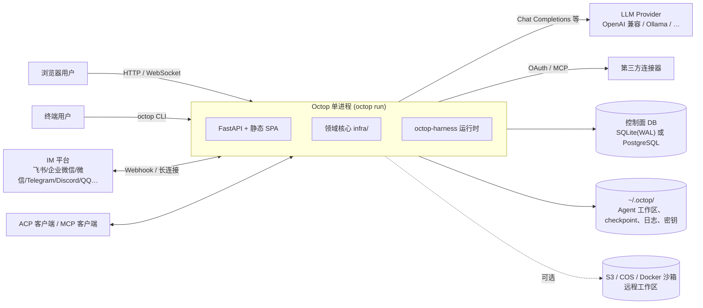
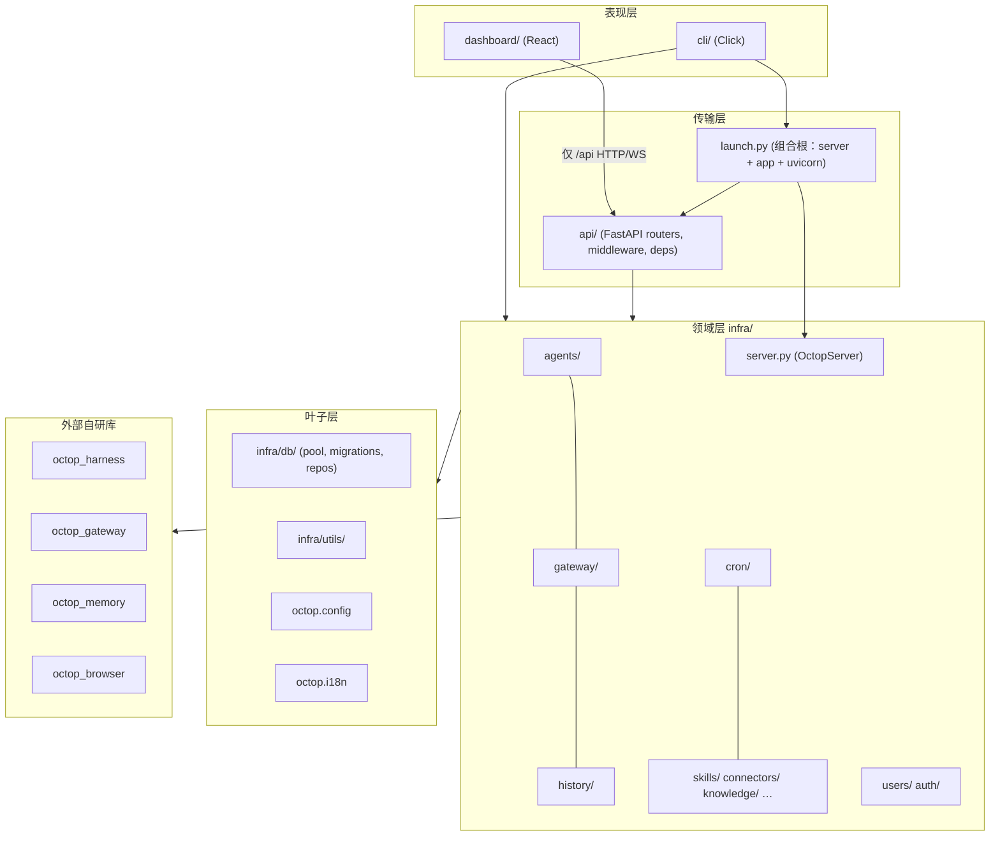
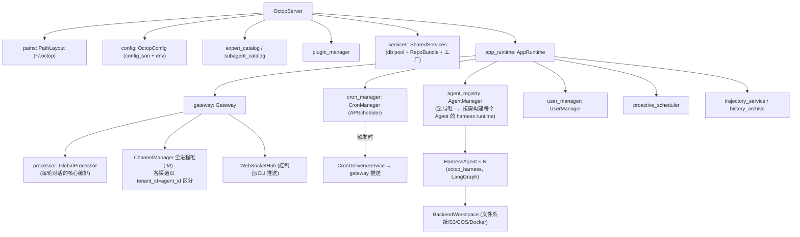
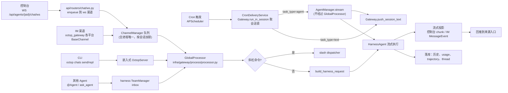

# 01 · 整体架构总览

> 一句话：Octop 是一个**单进程**的自托管 AI 助手平台。它把三个自研库拼装成一个 Python wheel：`octop-harness`（基于 LangGraph 的 Agent 运行时）、`octop-gateway`（IM 渠道管线）和 `octop-memory`（长期记忆），外加 React 控制台和 Click CLI。Octop 本仓库的主要工作是**多用户、多 Agent 的管控面**（用户、权限、配置、会话、渠道、定时任务、知识库……），以及把各种入口统一接到 Agent 运行时上。

本篇你将学到：

- 系统和外部世界的关系（系统上下文）
- 代码分层、依赖方向，以及哪些 import 是禁止的
- 进程启动后内存里有哪些"活对象"，彼此如何引用
- Octop 和四个外部 `octop_*` 库的分工边界
- 源码目录地图，以及 4 种对话入口如何汇合到同一条处理链路
- 核心名词表

规模参考（2026-09 统计）：`src/octop` 约 13.4 万行 Python；`dashboard/src` 约 17.3 万行 TS/TSX；测试文件 456 个；外部库 `octop_harness` 约 3.9 万行、`octop_gateway` 约 1.5 万行、`octop_memory` 约 3.2 万行、`octop_browser` 约 0.9 万行。

---

## 1. 系统上下文



要点：

- **没有外部队列，也没有 worker 进程**。定时任务靠进程内的 APScheduler，多 Agent 协作靠进程内的 inbox（见 `docs/adr/001-single-process-model.md`）。
- 唯一必需的外部依赖是 LLM Provider，其他（PG、对象存储、IM）都是可选的。
- 控制台 SPA 打包在 wheel 里（`src/octop/dashboard/`），由 FastAPI 以静态文件方式提供。

## 2. 分层与依赖方向



**规则：依赖只能往里走。** 传输层调用领域层，领域层从不反过来调用 HTTP 或 CLI。硬禁令如下（完整版见 `AGENTS.md` §5）：

| 禁止 | 正确做法 |
|---|---|
| `infra/` import `api/`、`cli/`、`launch.py` | 领域逻辑只放在 infra，由 api/cli 调用 |
| `api/` import `cli/`、`launch.py` | — |
| `cli/` import `api/` | 需要起服务时经过 `launch.py` |
| `infra/db/repos/` import 非 DB 的 infra 包 | repo 只写 SQL |
| `infra/utils/` import 其他 infra 包 | utils 必须是纯函数 |
| router 里写业务规则或直接 import repo | 走 `server.services.*` 或 infra 的 manager |
| 前端直接 `fetch` | 走 `dashboard/src/api/modules/*` |

唯一被允许同时 import `infra/server` 和 `api/app` 的模块是 `launch.py`。

## 3. 运行时对象图（进程里有什么）

`OctopServer.start()`（`src/octop/infra/server.py:281`）按依赖顺序装配出下面这棵树，`_boot_runtime` 负责构造 AppRuntime 中的各个单例。详细步骤见 [02-boot-and-runtime.md](02-boot-and-runtime.md)。



`AppRuntime` 的定义在 `src/octop/infra/server.py:209`。router 通过 `Depends(get_server)` 拿到 `OctopServer`，再经 `server.app_runtime.<xxx>` 或 `server.services.<xxx>_repo` 访问这些对象（见 [07-api-layer.md](07-api-layer.md)）。

> 设置向导在"数据库为空"时允许热切换控制面 DB：`AppRuntime.replace_services`（`server.py:220`）会把各个单例重新指向新的 `SharedServices`。所以不要在别处长期缓存 repo 引用。

## 4. Octop 与外部库的分工

| 库 | 规模 | 负责什么 | Octop 主要用到的接口 |
|---|---|---|---|
| `octop_harness` | ~3.9 万行 | 单个 Agent 的**运行时**：LangGraph 图、LLM provider 调用、工具、middleware、compaction、skills、subagents、MCP 加载、安全策略、工作区后端、插件、团队 inbox、ACP、斜杠命令基类 | `HarnessAgent`、`BackendWorkspace`、`resolve_backend`、`PluginContext`、`SlashCommand`、`SecurityPolicy`、`ModelConfig`/`ProviderConfig`、`aload_mcp_tools`、`teams.inbox/processor` |
| `octop_gateway` | ~1.5 万行 | IM **渠道适配**：各平台 `BaseChannel` 实现、`ChannelManager`、消息模型、媒体、渠道约束 | `InboundMessage`/`MessageEvent`（models）、`BaseChannel`、`ChannelManager`、`ChannelConstraints`、`MessageProcessor`、扫码登录 |
| `octop_memory` | ~3.2 万行 | Agent **长期记忆**（抽取、存储、检索），自己管理记忆表 DDL | `application`、便携导入导出 `operations.migration.portable` |
| `octop_browser` | ~0.9 万行 | 浏览器自动化（Playwright/CDP），作为 Agent 工具 | `settings`、`tool_interface`、`record.store`、`profile` |

源码位置：`.venv/lib/python3.12/site-packages/octop_*/`。**遇到 Octop 里找不到实现的行为（比如工具怎么执行、LLM 怎么流式返回、IM 平台协议细节），就去这些库里找。**

分工口诀：**harness 管"一个 Agent 怎么想和做"，gateway 管"消息从哪来、回到哪去"，Octop 管"谁的 Agent、用什么配置、记录在哪、怎么对外暴露"。**

## 5. 多种入口如何汇合到主链路



- 控制台的 WS 路由**不直接调用** processor，而是把消息放进 ChannelManager 队列（`src/octop/api/routers/chat/ws.py:168`），和 IM 消息一样排队、按会话串行；浏览器断线不会取消正在进行的轮次。
- 控制台和 CLI 走 `GlobalProcessor.iter_turn_chunks`（`processor.py:885`），产出 dict chunk；IM 走 `GlobalProcessor.__call__`（`processor.py:601`），产出 `MessageEvent`。**这两条路径大量平行但并不完全相同**（模型、推理参数、MCP 失败处理、trajectory、HITL 上都有差别），修 bug 时两边都要看。
- Cron **不经过 GlobalProcessor**：它先用 `Gateway.run_in_session` 拿会话锁（和同一会话的用户消息串行），再直接调用 `AgentManager.stream`，最后推回任务创建时所在的渠道（`src/octop/infra/cron/delivery.py:67-173`）。
- 会话键（session key）编码了"哪个 Agent、哪个入口、哪个用户或会话、私聊还是群聊"，形如 `<aid>:dashboard:<user_id>:dm`；`thread_id` 本身不编码来源。
- 细节见 [03-chat-flow.md](03-chat-flow.md)（主链路）和 [05-gateway.md](05-gateway.md)（IM、斜杠命令）。

## 6. 数据放在哪里

| 数据 | 位置 | 谁管 |
|---|---|---|
| 用户、Agent、Provider、渠道、cron、会话、线程、审计、设置、密钥 | 控制面 DB（SQLite 默认在 `~/.octop/`，或 PG） | `infra/db/`，迁移在 `infra/db/migrations/` |
| 版本化消息历史 | `~/.octop/history_v2.sqlite`（`server.py` 中 `history_archive`） | `infra/history/` |
| LangGraph checkpoint / 会话状态（**对话正文的权威来源**；DB 里的 `thread_messages` 只是读模型） | 默认 Agent 工作区下的 `checkpoints.sqlite`；启用记忆时 octop_memory 兼任 checkpointer，存在 `memory.sqlite`（或 PG），见 04 §9、06 §2 | octop_harness |
| Agent 工作区内容（SOUL.md、skills、上传附件 `inbound/`…） | 默认 `~/.octop/agents/<agent_id>/`，可以换成 S3/COS/Docker | **必须走 `BackendWorkspace`** |
| 长期记忆 | octop_memory 自管的表 | octop_memory |
| 配置 | `~/.octop/config.json` + 环境变量 | `src/octop/config.py` |

详见 [06-data-layer.md](06-data-layer.md)、[04-agents.md](04-agents.md)。

## 7. 源码目录地图

```
src/octop/
├── __main__.py / config.py / launch.py      入口、配置、组合根
├── i18n/                                    en/zh 文案 bundle + tr() + domains/*
├── api/                                     HTTP 传输层
│   ├── app.py deps.py errors.py openapi_meta.py
│   ├── middleware/                          JWT 闸门、setup lockdown
│   ├── common/                              workspace 路径规范化、附件等 HTTP 胶水
│   └── routers/  (80 个文件)                 每个资源一个模块；chat/ browser/ desktop/ mobile/ 子目录
├── cli/                                     main.py registry.py commands/(23) support/ repl/
└── infra/                                   领域核心
    ├── server.py                            OctopServer / AppRuntime
    ├── errors.py metrics.py
    ├── agents/   (164)                      AgentManager、providers、settings、workspace、teams、experts、plugins、memory…
    ├── gateway/  (53)                       Gateway、process/(GlobalProcessor)、channels/、slash/、threads、ws/、hitl/、media/
    ├── history/  (17)                       版本化历史、trajectory、turn 投影
    ├── db/       (34)                       pool、migrations、repos、services.py
    ├── connectors/ (42)                     连接器目录、OAuth、MCP gateway、凭证加密
    ├── auth/ (20) users/ (11)               认证（JWT/OAuth/OIDC/captcha）、用户与角色
    ├── knowledge/ (17)                      知识库
    ├── skills/ (11)                         skill 包、SkillHub
    ├── setup/ (15)                          首次运行向导、服务安装、TLS、自更新
    ├── cron/ backend/ backup/ mobile/ desktop/ voice/ proactive/ browser/
    └── utils/ (25)                          纯函数工具
dashboard/src/                               前端源码（api/ pages/ components/ hooks/ context/ locales/…）
src/octop/dashboard/                         前端构建产物 —— 不要手改
tests/unit, tests/integration, tests/support 测试与共享夹具
docs/                                        官方文档（architecture、api、cli、configuration、adr/…）
```

## 8. 核心名词表

| 名词 | 含义 | 代码入口 |
|---|---|---|
| User | 登录用户（整数 `user_id`，登录名 `username`），分 admin 和普通用户 | `infra/users/` |
| Agent | 一个 AI 助手实例，属于某个用户；有自己的模型配置、人格、工作区、skills、渠道 | `infra/agents/manager.py` |
| HarnessAgent / runtime | Agent 在内存中的运行实例（LangGraph），按需启动 | `octop_harness.agent` |
| Workspace | Agent 的文件空间，通过 `BackendWorkspace` 读写 | `infra/backend/`、harness `backends/` |
| Provider | LLM 服务配置（按名字作为键） | `infra/agents/providers/` |
| Session key / Thread | 会话键决定"哪段对话"；thread 是会话下具体的对话线程（可复用、可归档） | `gateway/process/message_keys.py`、`gateway/threads.py` |
| Turn | 一轮"用户输入 → Agent 流式回答" | `GlobalProcessor` |
| Channel | Agent 绑定的 IM 渠道 | `gateway/channels/`、`octop_gateway` |
| Slash command | `/help`、`/compact` 等斜杠命令 | `gateway/slash/` |
| HITL | 工具调用前的人工确认（中断后恢复） | `gateway/hitl/`、`chat/hitl/resume` |
| Skill | 能力包（SKILL.md + 脚本），可以启用或禁用 | `infra/skills/` |
| Expert | 预置的"专家"模板（人格 + skills + 子 Agent），可发布 | `infra/agents/experts/` |
| Subagent / Team | 子 Agent 委派、多 Agent 协作（@Agent、ask_agent） | `infra/agents/teams/` |
| Connector | 第三方服务连接（OAuth + MCP 工具） | `infra/connectors/` |
| Cron job | 定时任务：直接推文本，或者让 Agent 跑一轮再推送 | `infra/cron/` |
| Trajectory | 每轮的执行轨迹记录（调试和观测用） | `infra/history/trajectory/` |
| Plugin | 可安装的扩展（`~/.octop/plugins/`），基于 harness `PluginContext` | `infra/agents/plugins/` |

## 9. 延伸阅读

- 官方概览：`docs/architecture.md`、`AGENTS.md`
- ADR：`docs/adr/001-single-process-model.md`、`docs/adr/002-database-backends.md`
- 下一篇：[02-boot-and-runtime.md](02-boot-and-runtime.md)
