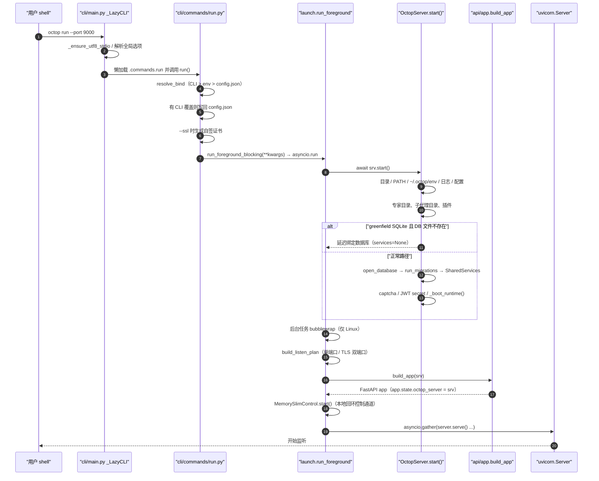
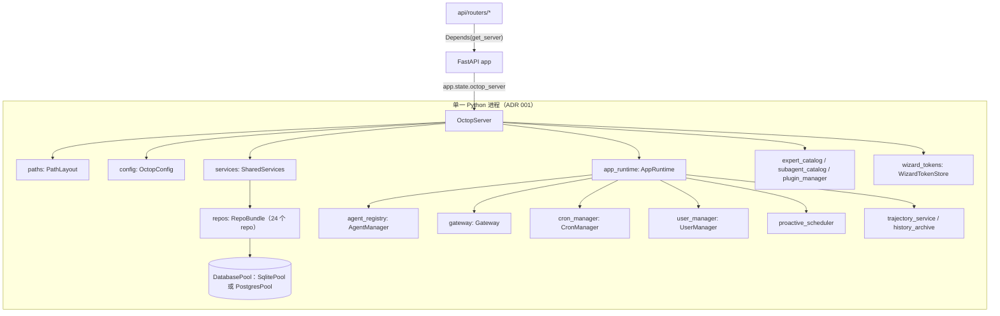
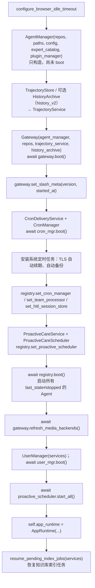
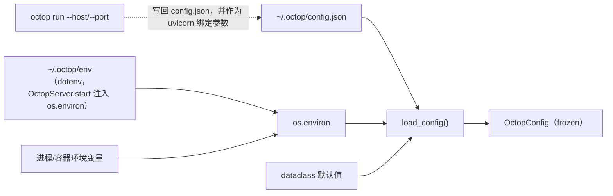
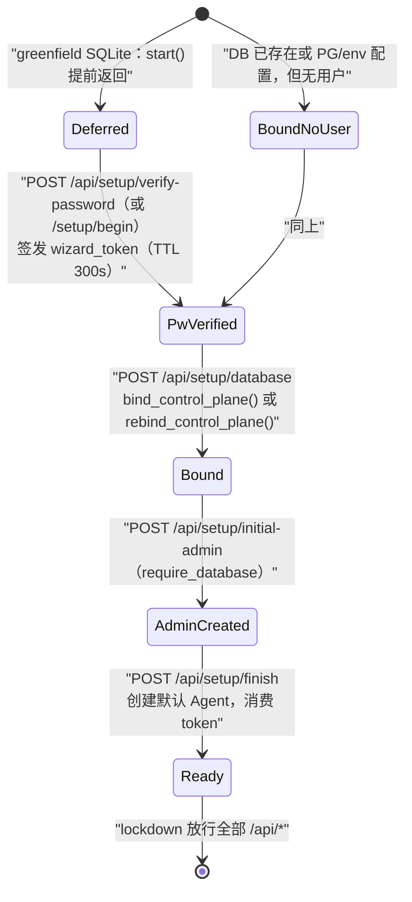

# 02 · 启动流程与运行时装配

> **一句话概述**：`octop run` 在同一个 Python 进程里先完整启动领域层 `OctopServer`（环境变量 → 日志 → 配置 → 目录类单例 → 数据库 → 运行时单例），然后用同一个 server 实例构建 FastAPI 应用并交给 uvicorn 提供服务；退出时按相反方向依次拆掉。

**本篇你将学到**

- `octop run` 从 Click 入口到端口开始监听的完整调用链，以及每一步为什么排在那个位置。
- `OctopServer.start()` / `_boot_runtime()` 装配了哪些单例、单例之间的依赖顺序，以及「延迟绑定数据库」（greenfield deferral）这条分支。
- `OctopConfig` 的来源与覆盖优先级：`~/.octop/env`、`config.json`、环境变量、CLI 参数分别在哪一层起作用。
- `~/.octop/` 目录结构（以 `PathLayout` 代码为准）。
- `SharedServices` / `RepoBundle` / `AppRuntime` 三者的分工，以及 router 如何通过 `get_server` 拿到它们。
- 首次运行的两条路径：`octop init`（离线初始化）与 HTTP 设置向导（`/api/setup/*` + setup lockdown 中间件）。
- 优雅关闭的顺序，以及修改启动流程时容易踩的坑。

---

## 1. 关键文件

| 路径 | 职责 | 行数 |
|------|------|------|
| `src/octop/__main__.py` | `python -m octop` 入口，直接调用 CLI | 8 |
| `src/octop/cli/main.py` | Click 根命令 `cli`、懒加载子命令的 `_LazyCLI`、全局 `--user/--agent/--json` | 130 |
| `src/octop/cli/registry.py` | 子命令名 → (模块, 属性, 帮助文本) 注册表 | 37 |
| `src/octop/cli/commands/run.py` | `octop run`：解析 host/port、持久化 CLI 覆盖、自签证书、调用 `launch` | 194 |
| `src/octop/cli/commands/init.py` | `octop init`：离线建目录、跑迁移、创建首个 admin | 120 |
| `src/octop/launch.py` | 组合根：`OctopServer` + `build_app` + uvicorn，唯一同时 import `infra/server` 与 `api/app` 的模块 | 161 |
| `src/octop/infra/server.py` | `OctopServer`（进程级编排器）、`AppRuntime`（运行时单例容器）、日志轮转 | 590 |
| `src/octop/api/app.py` | `build_app()`：FastAPI 工厂、中间件、路由挂载、SPA 静态托管 | 316 |
| `src/octop/config.py` | `OctopConfig` 及子配置 dataclass、`load_config()`、环境变量覆盖 | 633 |
| `src/octop/infra/utils/paths.py` | `PathLayout`：`~/.octop/` 下所有路径的唯一来源 | 160 |
| `src/octop/infra/utils/env_file.py` | `~/.octop/env`（dotenv）解析与注入 `os.environ` | 176 |
| `src/octop/infra/db/services.py` | `RepoBundle`（一表一 repo）与 `SharedServices`（paths + config + repos） | 210 |
| `src/octop/infra/db/factory.py` | `open_database()`、`should_defer_control_plane_db()` | 44 |
| `src/octop/infra/db/rebind.py` | 向导中途切换数据库时的 `rebind_control_plane()` | 150 |
| `src/octop/api/deps.py` | `get_server`、`require_database`、JWT 解析、`current_user` 等 Depends | 230 |
| `src/octop/api/middleware/setup_lockdown.py` | 无用户时锁定除 setup/health 外的所有 `/api/*` | 41 |
| `src/octop/api/middleware/jwt_auth.py` | `/api/*` 全局 JWT 校验与滑动续期 | 72 |
| `src/octop/infra/setup/password_file.py` | 向导一次性密码文件 `~/octop-login.txt` | 81 |
| `src/octop/infra/setup/wizard_tokens.py` | 向导会话 token（内存、TTL、限流） | 67 |
| `src/octop/cli/repl/embedded_session.py` | CLI「嵌入式」模式：在 CLI 进程里临时起一个 `OctopServer` | 42 |
| `docs/adr/001-single-process-model.md` | 单进程、无外部队列的架构决策 | — |

---

## 2. 全局视图

### 2.1 启动时序



### 2.2 运行时对象关系



---

## 3. 从命令行到 `launch`

### 3.1 `__main__.py` 与 console script

- `python -m octop` 执行 `src/octop/__main__.py:5-8`，直接 `cli()`。
- 安装后的 `octop` 命令来自 `pyproject.toml` 的 `[project.scripts] octop = "octop.cli.main:cli"`，两条入口等价。

### 3.2 `cli/main.py`：懒加载的 Click 根命令

- `_LazyCLI(click.Group)`（`src/octop/cli/main.py:57`）从 `COMMANDS` 注册表（`src/octop/cli/registry.py:6`）读取「命令名 → (模块路径, 属性名, 帮助文本)」。`get_command()`（`:65`）只在真正调用某个子命令时才 `importlib.import_module`；`format_commands()`（`:75`）直接用注册表里的帮助文本，因此 `octop --help` 不会 import 任何重量级模块（例如 `infra/server.py` 会间接 import LangGraph harness）。
- 根命令 `cli()`（`:115`）做两件事：
  1. `_ensure_utf8_stdio()`（`:14`）把 stdout/stderr 重设为 UTF-8。原因写在 docstring 里：Windows 的 GBK 代码页遇到 `✅` 等字符会抛 `UnicodeEncodeError`，导致工作已经完成、进程却以失败退出。
  2. 把 `--user`（env `OCTOP_USER`）、`--agent`（env `OCTOP_AGENT`）、`--json` 存进 `ctx.obj`，供子命令读取（细节见 [09-frontend-cli.md](09-frontend-cli.md)）。

> **新增子命令**只需在 `registry.py` 加一行并在 `cli/commands/` 下实现，不要在 `main.py` 里直接 import。

### 3.3 `cli/commands/run.py`：绑定地址解析

`run()`（`src/octop/cli/commands/run.py:160`）在调用 launch 之前只做「启动前」的事情：

| 步骤 | 代码 | 说明 |
|------|------|------|
| 解析 host/port | `resolve_bind()` `:98` | 优先级 **CLI 参数 > `OCTOP_BIND_HOST`/`OCTOP_PORT` > `config.json`**，用 `is not None` 比较，因此 `--port 0`（交给 OS 选端口）不会被当成「未设置」 |
| 读取 config.json | `_load_configfile_overrides()` `:72` | 兼容旧键 `host`。文件**损坏**时抛 `corrupt_config_error`，而不是静默回退默认值 |
| 持久化 CLI 覆盖 | `_save_configfile_overrides()` `:109` | 只要传了 `--host`/`--port`，就 read-merge-write 写回 `config.json`（原子写）。docstring 提到 issue #730：曾经因为损坏的 JSON 被当成 `{}` 合并，导致 `database` 段丢失、PG 实例被悄悄切回 SQLite |
| 自签证书 | `_maybe_generate_self_signed()` `:25` | 只在 `--ssl` 且没给 cert/key 时生成 `~/.octop/ssl/self_signed.{crt,key}`（RSA 2048，SAN=127.0.0.1，有效期 365 天） |
| 进入 launch | `_run_uvicorn()` `:18` | 一个便于测试替换的间接层，内部 `from octop.launch import run_foreground_blocking` |

注意：`--port` 的取值范围是 `IntRange(0, 65535)`（`:142`）。注释解释了原因：如果不限制范围，非法端口会先被写进 `config.json`，然后 uvicorn 在 `socket.bind` 时失败，之后每次启动都会继承这个坏端口。

---

## 4. `launch.py`：组合根

`launch.py` 是**唯一**允许同时 import `infra/server` 与 `api/app` 的模块（AGENTS.md §5）。`cli/` 不能 import `api/`，所以 `octop run` 必须经由它。

### 4.1 `run_foreground(...)`（`src/octop/launch.py:56`）

签名：`async def run_foreground(*, host, port, reload, workers, log_level, ssl_certfile, ssl_keyfile) -> None`，同步包装为 `run_foreground_blocking(**kwargs)`（`:159`，内部 `asyncio.run`）。

按顺序执行：

1. **`srv = OctopServer(); await srv.start()`**（`:74-75`）。领域层必须先启动，因为下一步 `build_app` 要读取配置（dashboard/API docs/mobile 开关）。
2. **后台 bubblewrap 预置**（`:76`，`_schedule_linux_bubblewrap_ensure` `:33`）：仅在 Linux 上执行，通过 `asyncio.to_thread` 在后台运行，失败只记日志（`:16-30`），不会阻塞启动。
3. **确定配置来源**（`:78`）：`srv.services.config if srv.services is not None else srv.config`。在延迟绑定数据库的情况下 `services` 为 `None`，此时退回 `srv.config`。
4. **TLS 路径**（`:82-83`）：CLI 没给证书时，调用 `resolve_tls_paths(srv.paths.root, cfg.tls)` 读取 Let's Encrypt 等已签发的证书。
5. **监听计划**（`build_listen_plan`，`src/octop/infra/setup/tls/listeners.py:33`）：当 `cert+key` 都存在、`tls.enabled`、`tls.http_port > 0` 且不等于主端口时，进入**双端口模式**：主端口提供 HTTPS，`tls.http_port`（默认 80）运行一个只负责 ACME 挑战和重定向的 companion app（`build_http_companion_app`）。
6. **workers / reload**（`:93-98`）：双端口模式强制 `workers=1`、关闭 reload。
7. **`app = build_app(srv)`**（`:100`）。
8. 构造一个或两个 `uvicorn.Server(uvicorn.Config(app, ...))`（`:103-145`）。
9. **`MemorySlimControl(srv).start()`**（`:149-151`）：在 `127.0.0.1:随机端口` 上开一个本地控制通道，把 `{port, token, pid}` 写入 `~/.octop/memory-slim-control.json`（`src/octop/infra/agents/memory/slim_control.py:35-41`），供 `octop memory` CLI 对**正在运行的**进程执行记忆瘦身，信任边界是文件系统权限。
10. **`await asyncio.gather(*(s.serve() for s in servers))`**（`:152`）阻塞，直到收到退出信号。
11. `finally`（`:153-156`）：关闭 MemorySlimControl → 取消 bubblewrap 任务 → `await srv.stop()`。

> **关于 `--workers` / `--reload`（结论来自 uvicorn 源码）**：launch 把 **app 对象**（而不是 import 字符串）传给 `uvicorn.Config`，然后调用 `Server.serve()`。在 uvicorn 中，reload 和多 worker 只由 `uvicorn.run()` 里的 supervisor 处理（`.venv/.../uvicorn/main.py:604-616`）；`Server.serve()` 始终是单进程单事件循环（`uvicorn/server.py:76-78`）。因此在当前实现下，`--workers N` 与 `--reload` 实际不会产生多进程或热重载效果。这也符合 ADR 001 的单进程模型：`SharedServices`、`AgentManager` 等内存单例本来就不能跨进程共享。

### 4.2 为什么不用 FastAPI lifespan

`build_app` 没有注册 `lifespan`，领域层的启停完全由 `run_foreground` 在 uvicorn 外部用 `await srv.start()` / `try…finally srv.stop()` 管理。好处有两个：

- 同一个 `OctopServer` 可以同时被多个 uvicorn Server（HTTPS + HTTP companion）共享；
- 测试和 CLI 嵌入式模式（`src/octop/cli/repl/embedded_session.py:17`）可以不经过 HTTP，直接复用 `OctopServer.start()/stop()`。

代价是：`srv.start()` 和 `build_app()` 都在 `try` **之外**（`:75`、`:100`）。如果 `start()` 执行到一半失败，或者 `build_app` 抛出异常，`srv.stop()` 不会被调用，只能依赖进程退出来回收资源。

---

## 5. `OctopServer.start()`：逐步拆解

类定义在 `src/octop/infra/server.py:242`。构造函数（`:243-255`）只设置字段，不做 I/O：`paths = PathLayout(home or from_env().root)`，其余字段（`config`/`services`/`app_runtime`/目录类单例）都为 `None`，`wizard_tokens = WizardTokenStore(ttl_seconds=300)` 在构造时创建（与数据库无关）。

`start()`（`:281-332`）是幂等的（`_started` 为真时直接返回）。各步骤如下：

| # | 代码 | 做什么 | 为什么在这个位置 |
|---|------|--------|------------------|
| 1 | `paths.ensure_root()` `:284` | `mkdir -p ~/.octop` | 后续所有文件操作的前提 |
| 2 | `ensure_cli_path()` `:287-289` | 把 `~/.npm-global/bin` 加入进程 `PATH` | 让连接器 CLI（wecom-cli / lark-cli）在检测和调用时可见，必须在任何连接器初始化之前 |
| 3 | `apply_env_file(~/.octop/env)` `:290-292` | 把 dotenv 合并进 `os.environ`（只增不删，`src/octop/infra/utils/env_file.py:117`） | **必须在日志和配置之前**：`OCTOP_LOG_*`、`OCTOP_DATABASE_*` 等变量都可能写在这个文件里 |
| 4 | `_setup_logging()` `:293`、`:550-586` | 挂载 `~/.octop/logs/octop.log` 的按天+按大小轮转 handler，迁移旧的 `~/.octop/octop.log`，清理过期文件，按 delaycompress 压缩；同时挂到 `uvicorn*` logger | 在此之后的启动日志才能落盘。root 日志级别读的是 **环境变量** `OCTOP_LOG_LEVEL`（`:580`），而不是 `config.log_level`（后者只决定 uvicorn 的级别，`launch.py:92`）。非 DEBUG 时把 `httpx`/`httpcore` 降到 WARNING，防止 URL 中的 token 泄漏到日志 |
| 5 | `ensure_mobile_capabilities_probed(paths.config)` `:294` | 内部调用 `load_config()`；如果 `capabilities.mobile.probed_at` 为空，就探测一次主机的 Android 能力，写回 `config.json` 后重新加载（`src/octop/infra/mobile/config_probe.py:50-56`） | 这是 `start()` 中**唯一**加载配置的地方；首次运行时 `load_config` 还会生成默认的 `config.json` |
| 6 | `ExpertCatalog(...).refresh()` `:297-301` | 加载内置专家库和 `~/.octop/expert_market/` | 与数据库无关，因此放在延迟绑定分支之前，向导阶段也能使用 |
| 7 | `SubagentCatalog(...).refresh()` `:302-303` | 加载内置子代理包 | 同上 |
| 8 | `PluginManager.seed_bundled()` + `load_installed(install_deps=True)` `:305-310` | 把内置插件复制到 `~/.octop/plugins/`，加载已安装插件（可能安装依赖） | `AgentManager` 构造时需要 `plugin_manager`，所以必须在 `_boot_runtime` 之前 |
| 9 | `_started_at = int(time.time())` `:314` | 记录启动时间，用于 `/status` 等斜杠命令显示 uptime | — |
| 10 | **分支** `should_defer_control_plane_db()` `:316-320` | 满足条件时：标记 `_started=True`，打印向导密码，**直接返回**（`services`、`app_runtime` 仍为 `None`） | 见 §5.2 |
| 11 | `open_database()` `:322` | 按 `config.database` 打开 `SqlitePool` 或 `PostgresPool`（`src/octop/infra/db/factory.py:34`） | — |
| 12 | `run_migrations(db)` `:323` | 执行编号迁移（细节见 [06-data-layer.md](06-data-layer.md)） | 任何 repo 读写之前，schema 必须已经是最新的 |
| 13 | `build_shared_services()` `:324` | 构造 `RepoBundle` + `SharedServices` | — |
| 14 | `captcha.boot_from_services()` `:325-327` | 根据 settings/secrets 初始化登录验证码 provider 的快照 | 依赖 repos |
| 15 | `_ensure_jwt_secret()` `:328`、`:588-590` | `secret_repo.get_or_create("jwt", os.urandom(32))`，**存放在数据库 `secrets` 表**中 | 登录签发 token 之前必须存在 |
| 16 | `await _boot_runtime(config)` `:329` | 构造并启动全部运行时单例，见 §5.1 | — |
| 17 | `_started=True`；`_emit_wizard_password(user_count)` `:330-332` | 如果还没有任何用户且 `require_setup_password`，确保 `~/octop-login.txt` 存在并在终端打印一个黄色 banner | 需要 `user_manager.count()`，所以放在最后 |

### 5.1 `_boot_runtime(config)`：运行时单例的依赖顺序

`src/octop/infra/server.py:362-495`。下面这张图展示每一步依赖哪些已经就绪的对象：



几个关键的「为什么」：

- **AgentManager 先构造、最后才 boot**（`:373` 构造，`:477` boot）。Gateway、Cron、Proactive 都要持有 `agent_manager` 引用，所以它必须最早存在；但 Agent 真正启动（`AgentManager.boot`，`src/octop/infra/agents/manager.py:464`）时需要 `team_processor`（来自 `gateway.processor.teams`）、`cron_manager`、`hitl_session_store`、`proactive_scheduler`，这些只能通过 `set_*` 事后注入（`:455-459`、`:475`）。这就是「先构造、后注入、最后启动」的两阶段装配。
- **Gateway 在 Agent 之前 boot**（`:420`）。`Gateway.boot()`（`src/octop/infra/gateway/gateway.py:220`）创建 `GlobalProcessor`、`ChannelManager`，注册内置的 WebSocket（dashboard）和 CLI channel，再并发注册数据库里所有启用的 IM channel。之后 AgentManager 需要从 `gateway.processor` 取 team/HITL 组件，因此 Gateway 必须先完成 boot。副作用是 channel 注册时 Agent 还没启动，拿不到 media backend，所以 Agent boot 完成后需要再调用一次 `refresh_media_backends()`（`:478`，docstring 明确写了是为了弥补「gateway boots before agents」的顺序缺口，`gateway.py:268-273`）。
- **Cron 在 Agent 之前 boot**（`:445`）：`CronManager.boot()`（`src/octop/infra/cron/manager.py:75`）只是启动 APScheduler 并登记任务，任务触发时才去找 Agent。如果某个任务在 Agent 就绪前触发，行为「待确认」（需查看 `CronDeliveryService` 的容错逻辑）。
- **UserManager 最后 boot**（`:480-481`）：它只是把启用用户加载到内存缓存里（`src/octop/infra/users/manager.py:103`），不依赖其他单例。
- **history_v2**（`:385-408`）：当 `config.history_v2_enabled` 为真，或 `~/.octop/history_v2.sqlite` / `.required` 标记文件存在时，启用分段历史归档。它**只支持 SQLite 控制面**，PG 下直接抛 `ValueError`（`:400-401`）。细节见 [03-chat-flow.md](03-chat-flow.md)。
- `AppRuntime` 在所有 boot **成功之后**才赋值（`:484`）。所以在 boot 过程中 `server.user_manager` 仍为 `None`，而 setup lockdown 会把这种状态视为「需要 setup」（见 §9.3）。

### 5.2 延迟绑定控制面数据库（greenfield deferral）

`should_defer_control_plane_db()`（`src/octop/infra/db/factory.py:20-31`）只在以下条件**全部满足**时返回 True：驱动是 SQLite、没有设置任何 `OCTOP_DATABASE_*` 环境变量、目标 SQLite 文件还不存在。

这样设计的原因是：全新安装的用户可能想在向导里选择 PostgreSQL。如果启动时直接创建 `octop.db`，下次启动就不会再进入「全新」状态，而且会留下一个没用的 SQLite 库。

延迟状态下的特征：

- `server._started == True`，`server.services is None`，`server.app_runtime is None`，`server.database_bound == False`（`:277-279`）。
- `get_server` 可以正常返回；需要数据库的路由应调用 `require_database(server)`（`src/octop/api/deps.py:107`），它会返回 503 `SETUP_REQUIRED`。
- 用户在向导中提交 `POST /api/setup/database`（`src/octop/api/routers/setup.py:274`）→ 写入 `config.json` 的 `database` 段 → `await server.bind_control_plane()`（`src/octop/infra/server.py:334-360`）：重新 `load_config` → 打开连接池 → 迁移（失败时关闭连接池）→ `SharedServices` → captcha → JWT → `_boot_runtime`。这与 `start()` 后半段完全对称。
- 如果**已经绑定但还没有用户**，又想换一个库，则走 `rebind_control_plane()`（`src/octop/infra/db/rebind.py:102`）：打开新库、迁移、确认新库 `users` 表为空后，关闭旧连接池，替换 `server.services`，再调用 `AppRuntime.replace_services()`（`src/octop/infra/server.py:220-239`）把 UserManager、AgentManager、Gateway、Cron、Proactive、Trajectory 的 repos **原地换掉**，不重建单例。启用 history_v2 时拒绝换库（`:225-226`），要求重启。

---

## 6. `build_app(server)`：HTTP 层装配

`src/octop/api/app.py:101-316`，签名 `def build_app(server: OctopServer) -> FastAPI`。

1. **读取开关**（`:102-107`）：同样使用 `server.services.config` 或回退到 `server.config`。`enable_dashboard`、`enable_api_docs`、`capabilities.mobile.enabled` **只在构建时读取一次**，修改后需要重启。
2. **FastAPI 实例**（`:109-115`）：只有 `enable_api_docs` 时才暴露 `/api/openapi.json`。
3. **`app.state.octop_server = server`**（`:117`）：整个 HTTP 层获取领域对象的唯一入口。
4. **异常处理器**（`:77-98`）：`OctopError` 按请求 locale 本地化后返回 envelope；5xx 用英文原文记录日志。未捕获异常统一转换为 `INTERNAL_ERROR`。
5. **中间件**（`:120-133`）：依次 `add_middleware(CORSMiddleware)`（仅当配置了 `cors_origins`）→ `install_jwt_auth` → `install_setup_lockdown`。Starlette 的 `add_middleware` 会 `insert(0, …)`（`.venv/.../starlette/applications.py:101`），**后添加的在外层**，所以请求实际经过的顺序是：**setup_lockdown → jwt_auth → CORS → 路由**。因此 lockdown 返回的 503 和 JWT 返回的 401 都在 CORS 外层直接返回，这些响应**不会带 CORS 头**（只影响跨域部署，同源 dashboard 不受影响）。
6. **ACME HTTP-01**（`:135-142`）：`/.well-known/acme-challenge/{token}` 直接从内存 `challenge_store` 读取。
7. **路由挂载**（`:144-272`）：50 余个 router 通过 `_RouterMount(router, prefix, tags)` 声明式挂载；`mobile` 仅在启用时挂载（`:274-280`）；`/api/docs` 仅在启用时挂载（`:282-289`）。路由的具体内容见 [07-api-layer.md](07-api-layer.md)。
8. **SPA 回退**（`:291-314`）：托管 `src/octop/dashboard/`（构建产物）。`api/`、`ws/` 前缀返回 404；拒绝绝对路径和 `..`；`assets/` 下缺失的文件返回 404 而不回退到 `index.html`（防止升级后旧 hash 的 JS 被当作 HTML 加载）；`index.html`/`sw.js`/`manifest.json` 设置 `no-cache`，`assets/` 设置一年 `immutable`（`:36-44`）。**SPA 通配路由最后注册**，所以任何 API 路由都必须在它之前挂载。

---

## 7. 配置：`OctopConfig` 与覆盖规则

### 7.1 四层来源



- **优先级（从高到低）**：环境变量（包括由 `~/.octop/env` 注入的） > `config.json` > dataclass 默认值（`src/octop/config.py:449-517`）。对于 bind 地址，CLI 参数再高一级（`run.py:98-106`；`launch.py:80-81` 中 `host or cfg.bind_host`）。
- `~/.octop/env` 用 `os.environ[key] = value` **直接覆盖**（`env_file.py:120-121`），所以当它和 systemd/容器注入的同名变量冲突时，**env 文件优先**。
- `load_config()`（`src/octop/config.py:419`）的行为：
  - 文件不存在时，**写入一份默认 `config.json`**（`:443-447`），其中不含 `database.password`/`url`（`_defaults_for_file`，`:152-159`）。
  - 文件损坏或顶层不是 object 时抛 `ValueError` 并指出行列号，**不回显内容**（可能包含数据库密码）。
  - 旧键 `cron_timezone` 在没有 `default_timezone` 时生效（`:451-453`）。
  - `database_in_file` 记录文件里是否有 `database` 段（`:442`）。这个标志决定没有 env 覆盖时 SQLite 路径使用 `config.database.sqlite_path` 还是 `PathLayout.db`（`factory.py:12-17`）。
  - 非法整数/布尔环境变量只会打警告（不回显值）并回退，不会导致启动失败；而 `database`/`tls`/`backup`/`capabilities` 段结构错误会抛 `ValueError`。
- `OctopConfig` 是 `frozen=True`，进程内是**只读快照**。运行时修改 `config.json` 的路由（如 TLS、备份设置）会自己写文件，但已经注入到各单例中的值要等重启或显式 reload 才生效。
- `octop.config` 按 AGENTS.md §5 **不能 import `infra/`**，所以 `load_config` 里复制了一份 JSON 损坏检测逻辑（docstring `:423-426`）。

### 7.2 重要配置项

| 键（config.json） | 环境变量 | 默认值 | 作用 / 读取位置 |
|-------------------|----------|--------|-----------------|
| `bind_host` | `OCTOP_BIND_HOST` | `127.0.0.1` | 监听地址；`launch.py:80` |
| `port` | `OCTOP_PORT` | `8088` | 监听端口，0–65535（`config.py:395-416`） |
| `log_level` | `OCTOP_LOG_LEVEL` | `info` | uvicorn 级别；root logger 另外直接读取 env（`server.py:580`） |
| `access_token_ttl_seconds` | `OCTOP_ACCESS_TOKEN_TTL` | `86400` | JWT 有效期；剩余不足 1/3 时滑动续期（`deps.py:62`、`:151`） |
| `login_max_attempts` / `login_lockout_seconds` | `OCTOP_LOGIN_MAX_ATTEMPTS` / `OCTOP_LOGIN_LOCKOUT_SECONDS` | `5` / `900` | 登录失败锁定 |
| `cors_origins` | `OCTOP_CORS_ORIGINS`（逗号分隔） | `[]` | 非空时才安装 CORS（`app.py:120`） |
| `default_timezone` | `OCTOP_DEFAULT_TIMEZONE`（兼容 `OCTOP_CRON_TIMEZONE`） | `Asia/Shanghai` | Cron、Proactive、前端显示的服务端时区（`server.py:443`、`:465`） |
| `enable_dashboard` | `OCTOP_ENABLE_DASHBOARD` | `true` | 是否托管 SPA |
| `enable_api_docs` | `OCTOP_ENABLE_API_DOCS` | `false` | `/api/docs` + openapi.json |
| `history_v2_enabled` | `OCTOP_HISTORY_V2_ENABLED` | `false` | 分段历史归档（仅 SQLite） |
| `require_setup_password` | `OCTOP_REQUIRE_SETUP_PASSWORD` | `true` | 向导是否需要 `~/octop-login.txt` 密码 |
| `database.*` | `OCTOP_DATABASE_URL` / `_DRIVER` / `_SQLITE_PATH` / `_HOST` / `_PORT` / `_NAME` / `_USER` / `_PASSWORD` | `sqlite` + `octop.db` | 控制面数据库；**只要设置了任一 `OCTOP_DATABASE_*` 就不会延迟绑定** |
| `tls.*` | —（仅文件） | `enabled=false`，`http_port=80` | 双端口监听与自动续期 |
| `backup.*` | `OCTOP_BACKUP_*` | `auto_enabled=false`，`cron:0 4 * * *`，保留 7 份 | 自动备份（系统 cron 任务，`server.py:451-453`） |
| `capabilities.mobile` | `OCTOP_ENABLE_MOBILE`（只覆盖 `enabled`） | 首次启动时探测后写入 | 是否挂载 mobile 路由 |
| `max_upload_mb` | `OCTOP_MAX_UPLOAD_MB` | `100`（1–1024，超出上限会被截断） | 上传大小限制 |
| `browser_idle_timeout_minutes` | `OCTOP_BROWSER_IDLE_TIMEOUT_MINUTES` | `30` | 浏览器会话空闲回收（`server.py:371`） |

另有一些**不进入 `OctopConfig`**、在其他地方直接读取的环境变量：`OCTOP_HOME`（`paths.py:17`）、`OCTOP_LOG_RETENTION_DAYS` / `OCTOP_LOG_MAX_BYTES` / `OCTOP_LOG_COMPRESS`（`server.py:106-157`）、`OCTOP_CAPTCHA_*`（captcha 模块）、`OCTOP_USER` / `OCTOP_AGENT`（CLI）。完整列表见 `docs/configuration.md`。

> 语言**不是** `config.json` 的键（AGENTS.md §7），不要新增。

---

## 8. `~/.octop/` 目录结构（以 `PathLayout` 为准）

根目录 = `$OCTOP_HOME`（`expanduser`）或 `~/.octop`（`src/octop/infra/utils/paths.py:15-20`）。

```
~/.octop/
├── config.json               PathLayout.config；首次 load_config 生成默认值
├── env                       env_file_path(root)；dotenv，start() 时注入 os.environ
├── octop.db                  PathLayout.db；默认 SQLite 控制面（可被 database.sqlite_path 覆盖）
├── history_v2.sqlite         可选：分段历史归档（server.py:387）
├── memory-slim-control.json  运行时本地控制通道端点（launch 启动时写入）
├── cli_state.json            CLI 固定的 default_user / default_agent（cli/support/state.py:15）
├── logs/                     PathLayout.logs_dir
│   ├── octop.log             当前日志
│   └── octop.log.YYYY-MM-DD[.gz|-NNN]  轮转文件
├── agents/<agent_id>/        PathLayout.agent_workspace；Agent 工作区（新 Agent 另有 .octop/ 系统目录）
├── users/<username>/         PathLayout.user_dir
├── plugins/                  PathLayout.plugins_dir；内置插件在 start/init 时复制到这里
├── expert_market/            SkillHub 专家模板缓存
├── published_experts/        用户发布的专家快照
├── skill-packages/           全局技能包内容
├── knowledge/                知识库文件
├── security/tool_guard/dangerous_shell_commands.yaml  命令守卫规则（AgentManager.boot 时 ensure_seeded）
├── backups/                  系统备份归档
├── avatars/{users,roles}/    头像
├── ssl/                      自签证书、ACME 账户与证书
└── connector-cli/<kind>/<key>/  各连接器 CLI 实例的隔离配置目录
```

另外有两个**不在 `~/.octop` 下**的文件：

- **`~/octop-login.txt`**：向导一次性密码，位于 `Path.home()` 而不是 `OCTOP_HOME`（`server.py:501`、`password_file.py:9`）。权限 0600，**永远不会被删除**（`password_file.py:75-76`）。
- 旧日志 `~/.octop/octop.log` 会在启动时迁移到 `logs/octop.log`（`server.py:556-559`）。

> **与 `docs/configuration.md` 不一致的地方（以代码为准）**：该文档说 JWT secret 存放在 `~/.octop/secrets/jwt_secret`，但当前代码存放在数据库 `secrets` 表的 `k='jwt'` 行（`server.py:588-590`、`src/octop/infra/db/repos/secrets.py:20-34`）；该文档的目录树仍把 `octop.log` 画在根目录，而代码已经改为 `logs/octop.log`。

---

## 9. 运行时单例与依赖注入

### 9.1 三层容器

| 容器 | 定义 | 内容 | 生命周期 |
|------|------|------|----------|
| `RepoBundle` | `src/octop/infra/db/services.py:36-93` | `db: DatabasePool` + 24 个 repo（user、agent、provider、channel、cron、session、thread、thread_message、trajectory_event、secret、audit、usage、settings、storage_backend、connector、skill_package、published_expert、knowledge、voice_provider、care_push、proactive_care_config、sso、user_policy、invite） | `from_pool(db)` 一次性构造，frozen |
| `SharedServices` | `services.py:96-200` | `paths`、`config`、`repos`，以及每个 repo 的直通 property（`services.user_repo` ≡ `services.repos.user_repo`）和 `db` | `build_shared_services()`（`:203`）；rebind 时整体替换 |
| `AppRuntime` | `src/octop/infra/server.py:208-239` | `agent_registry`、`gateway`、`cron_manager`、`user_manager`、`proactive_scheduler`、`trajectory_service`、`history_archive` | `_boot_runtime` 末尾创建；`stop()` 时置为 `None` |

`OctopServer` 本身还直接持有：`paths`、`config`、`expert_catalog`、`subagent_catalog`、`plugin_manager`、`wizard_tokens`，以及懒创建的 `sso_service`（`:262-275`，当 `services`/`user_manager` 身份变化时重建，以便向导换库后不继续持有旧引用）。为了向后兼容还提供 `server.user_manager` 属性（`:258-260`）。

**分层含义**：`SharedServices` 是「纯持久化」层，只有数据库，没有 asyncio 任务，可以在 CLI 离线模式下单独构造（`cli/support/db.py` 的 `open_cli_services`）；`AppRuntime` 是「活的」层，包含后台任务、IM 长连接和 harness 进程，只能在 `OctopServer` 里运行。领域代码需要持久化时接收 `RepoBundle`/`SharedServices`，需要编排时接收 manager。

### 9.2 router 如何获取它们

```python
# src/octop/api/deps.py:100-104
def get_server(request: Request) -> OctopServer:
    server: OctopServer = request.app.state.octop_server
    if not getattr(server, "_started", False):
        raise OctopError(ErrorCode.INTERNAL_ERROR, "server not started")
    return server
```

典型用法：`server: OctopServer = Depends(get_server)`，然后

- 持久化：`server.services.agent_repo`（AGENTS.md §7：不要在 router 里 import `infra/db/repos/*`）；
- 编排：`server.app_runtime.agent_registry` / `.gateway` / `.cron_manager`（例如 `src/octop/api/common/agent.py:47-48`）；
- 当前用户：`Depends(current_user)`（`deps.py:186`），优先复用 JWT 中间件缓存在 `request.state.octop_user` 上的结果。

注意：`get_server` 只检查 `_started`。在延迟绑定状态下 `_started` 为 True，但 `services`/`app_runtime` 都是 `None`。正常情况下 setup lockdown 会先拦截请求（`user_manager is None` → 503）。setup 路由自己放行了 lockdown，所以需要自行调用 `require_database(server)`（例如 `setup.py:352`、`:384`、`:422`）。

### 9.3 两个与启动状态相关的中间件

- **setup_lockdown**（`src/octop/api/middleware/setup_lockdown.py:21-41`）：只处理 `/api/*`。放行 `/api/setup/*`、`/api/health[/*]`，以及启用时的 `/api/docs`、`/api/openapi.json`。只要 `server.user_manager is None`（延迟绑定或正在 boot）或者 `count() == 0`，就返回 **503 `{"setup_required": true}`**，SPA 据此跳转到 `/setup`。`count()` 每次都查询数据库（`src/octop/infra/users/manager.py:236-237`），即**每个 API 请求都会多一次 `SELECT COUNT`**。
- **jwt_auth**（`src/octop/api/middleware/jwt_auth.py:32-72`）：除白名单（`deps.py:66-89`）外，所有 `/api/*` 请求都要求 Bearer 或 `?access_token=`；校验通过后缓存用户，并在响应头 `X-Octop-Access-Token` 中下发续期 token。JWT secret 从 `services.secret_repo` 读取，所以**只有在数据库已绑定后才能工作**。由于 lockdown 在外层，未绑定时请求根本到不了这一层。

细节见 [07-api-layer.md](07-api-layer.md)。

---

## 10. 首次运行 / 初始化

### 10.1 路径 A：`octop init`（离线、无 HTTP）

`src/octop/cli/commands/init.py:42-120`：

1. 如果 `~/.octop` 非空：没有 `--force` 就报错退出；有 `--force` 且非 `--yes` 时二次确认，然后执行 **`shutil.rmtree(home)`**（`:62-76`），删除全部状态。
2. `ensure_root` → `PluginManager.seed_bundled()` → `apply_env_file` → `load_config`（生成默认 config.json）→ `open_database` → `run_migrations`（`:78-84`）。
3. 交互式或通过 `OCTOP_ADMIN_USERNAME` / `OCTOP_ADMIN_PASSWORD` / `OCTOP_ADMIN_DISPLAY_NAME` 获取管理员信息，执行 `validate_password_policy`，然后直接用 `UserRepo(db).create(role="admin")`（`:109-114`）。

效果：数据库文件已经存在且有一个用户，所以下一次 `octop run` **不会**延迟绑定，也**不会**打印向导密码，lockdown 直接放行。适合无人值守或容器部署。注意 init **不会**创建默认 Agent，而向导的 `finish` 会（`setup.py:155` `_bootstrap_default_agent`）。

### 10.2 路径 B：HTTP 设置向导



- 向导密码：`_emit_wizard_password`（`server.py:497-525`）→ `boot_self_heal`（`password_file.py:68-81`）。没有用户时，如果文件不存在就生成，存在就读取，并在终端打印。支持 `Password: xxx` 带标签格式（供镜像构建脚本改写）。`require_setup_password=false` 时不生成，改用 `POST /api/setup/begin`（`setup.py:311-318`）。
- `WizardTokenStore`（`wizard_tokens.py:26`）是**纯内存**的，进程重启后失效；`verify-password` 按客户端 IP 做 5 次/60 秒的限流（`:12-13`、`:59-67`）。
- 各端点的具体校验规则见 [07-api-layer.md](07-api-layer.md) 和 `docs/configuration.md` 的「First-boot wizard」。

### 10.3 其他 infra/setup 模块（点到为止）

`infra/setup/service.py`（`octop service` 的 systemd/launchd 安装）、`infra/setup/self_update.py`（`octop update`）、`infra/setup/tls/`（ACME、证书存储、续期任务 `install_auto_renewal_job`、HTTP companion）。其中续期任务和自动备份任务都在 `_boot_runtime` 中作为**系统 cron 任务**注册（`server.py:447-453`）。

---

## 11. 优雅关闭

触发方式：uvicorn 在 `Server.serve()` 中接管 SIGINT/SIGTERM（`capture_signals`，`uvicorn/server.py:319-339`），设置 `should_exit`，处理完在途请求后 `serve()` 返回，`gather` 结束，进入 `launch.py:153` 的 `finally`。


`OctopServer.stop()`（`src/octop/infra/server.py:527-546`）的顺序是**「先停产生新工作的来源，再停执行者，最后关存储」**：

1. **Proactive 与 Cron 先停**：它们是定时产生新任务的来源，先停可以避免在拆除 Gateway/Agent 的过程中又触发新任务。Cron 使用 `shutdown(wait=False)`（`cron/manager.py:100-103`），不等待正在运行的任务。
2. **Gateway 再停**：断开 IM 长连接，外部不再有新消息进来。
3. **AgentManager 随后停**：`harness_manager.aclose()` 会先排空 harness 内部的 SQLite 工作线程，**必须在事件循环关闭之前**（`agents/manager.py:490-499` 的注释）。
4. **UserManager、history archive**，最后在 `finally` 中**必定**关闭数据库连接池（`:540-546`），即使前面某一步抛异常也会执行；随后 `services`/`app_runtime` 置为 `None`，`_started=False`，因此同一个实例可以再次 `start()`（测试和嵌入式 CLI 会用到）。

注意：`try` 块内任何一步抛异常，都会**跳过后续**的 manager 关闭（只有数据库关闭在 `finally` 中）。如果新增的单例 shutdown 可能失败，应当自行捕获异常，避免拖累后续步骤。

补充一点「待确认」的行为：uvicorn 退出 `capture_signals` 时会恢复原来的信号处理器并**重新发出**捕获到的信号（`uvicorn/server.py:333-335`）。在双端口模式下，两个 `Server` 依次覆盖信号处理器，这个链式重发机制理论上会让两个 server 都退出。但重发的 SIGINT 与 `asyncio.run` 的 KeyboardInterrupt 处理如何交互、`srv.stop()` 是否一定能完整执行完，没有经过实测。

---

## 12. 单进程模型（ADR 001）对代码的约束

`docs/adr/001-single-process-model.md` 的决策：web、CLI 嵌入、Agent 运行时、IM 连接、cron 全部运行在**一个 uvicorn 进程**中，不使用 Redis/Celery/独立 worker。对改代码的人意味着：

- **所有状态都在进程内存中**：`AgentManager` 的 harness 实例、Gateway 的 channel 连接、`WizardTokenStore`、ACME `challenge_store`、SSO 缓存都不能跨进程共享。所以 `--workers > 1` 本来就不被支持（而且如 §4.1 所述，当前实际也不会生效）。
- **事件循环是共享资源**：阻塞 I/O 必须放到 `run_in_executor` / `asyncio.to_thread`（AGENTS.md §8）。启动路径上的 `plugin_manager.load_installed(install_deps=True)` 和 mobile 探测是同步调用，但发生在 uvicorn 开始监听**之前**，只会拖慢启动，不会阻塞请求。
- **CLI 嵌入式模式会再起一个 `OctopServer`**（`embedded_session.py:17-35`）：`octop chats send`、`octop agent start` 等命令在 CLI 进程里完整执行一次 `start()`，包括 `gateway.boot()` 注册 IM channel、`registry.boot()` 启动 Agent。如果此时 `octop run` 也在运行，两个进程会同时连接同一个数据库，并可能同时连接同一个 IM 机器人。这类命令的边界和已知限制见 [09-frontend-cli.md](09-frontend-cli.md)。
- 重启语义简单：`start()` 完全从数据库和文件重建运行时，不存在需要对账的外部状态。

---

## 13. 修改指南

### 13.1 常见需求该改哪里

| 需求 | 改哪里 | 注意 |
|------|--------|------|
| 新增一个 `config.json` 配置项 | `OctopConfig` 字段（`config.py:124`）+ `load_config` 返回值（`:599`）；需要环境变量覆盖时在 `:461-517` 附近添加 | 只能用 stdlib/pydantic，**不能 import `infra/`**；非法值打 warning 并回退，**不要记录原始值**；同步更新 `docs/configuration.md`；复杂子段仿照 `_parse_backup_section` 单独写解析函数 |
| 新增一个运行时单例（manager/service） | 在 `_boot_runtime`（`server.py:362`）中构造并 boot，加入 `AppRuntime` 字段；在 `stop()` 中按「来源 → 执行者 → 存储」顺序插入 shutdown；如果持有 repos，还要在 `AppRuntime.replace_services` 中处理 | 想清楚它依赖谁、谁依赖它；需要持有 AgentManager 的对象构造在 `registry.boot()` 之前，通过 `set_*` 注入 |
| 新增一张表 / repo | repo 放在 `infra/db/repos/`，在 `RepoBundle`（字段 + `from_pool`）和 `SharedServices`（直通 property）中注册 | 迁移规则见 [06-data-layer.md](06-data-layer.md)；router 只能通过 `server.services.xxx_repo` 使用 |
| 新增一个系统定时任务 | 仿照 `install_auto_renewal_job` / `install_auto_backup_job`，在 `_boot_runtime` 中 `cron_mgr.boot()` 之后注册 | 系统任务不会被 `reload_from_db` 清除 |
| 新增 `~/.octop` 下的目录 | 在 `PathLayout` 中加 property（和按需使用的 `ensure_*`） | 不要在各处手写 `Path.home() / ".octop"`；测试中用 `monkeypatch.setenv("OCTOP_HOME", tmp_path)` |
| 新增一个 router | `api/routers/xxx.py` + `build_app` 的 `_mount_routers` 列表 | 必须挂在 SPA 通配路由之前；不需要登录的路径要同时加入 `deps.py` 的 JWT 白名单；启动前（向导期间）就要能访问的，还要加入 lockdown 的 `_OPEN_PREFIXES` |
| 新增 CLI 子命令 | `cli/registry.py` 加一行 + `cli/commands/xxx.py` | 不能 import `api/`；需要运行时就用 `embedded_runtime()` |
| 修改绑定地址或端口逻辑 | `run.py:resolve_bind` + `config.env_bind_overrides` + `launch.py:80-81` | 这三处共同决定最终端口，要保持一致 |
| 需要在 uvicorn 启动前或关闭后执行某个动作 | `launch.run_foreground` | 只放「进程/HTTP 服务」层面的东西；领域初始化放进 `OctopServer.start` |

### 13.2 坑与注意事项

1. **不要在 `infra/` 中 import `launch.py` 或 `api/`**（AGENTS.md §5）。`OctopServer` 不能知道 FastAPI 的存在；`build_app` 通过参数接收 server，而不是反过来。
2. **不要假设 `server.services` / `app_runtime` 一定非空**。延迟绑定时两者都是 `None`；`build_app`、`launch`、lockdown 都有 `services is not None` 的回退写法。新写的代码如果在向导期间也可能执行，需要 `require_database()` 或做判空。
3. **配置是启动时快照**：`OctopConfig` 是 frozen，`build_app` 的开关只读取一次。「修改配置后立即生效」需要单独实现 reload 路径，否则就在文档中注明需要重启。
4. **`~/.octop/env` 在 `start()` 时注入，而不是在 import 时**。模块顶层读取 `os.environ` 的代码拿不到 env 文件里的值。应在函数调用时读取，或者从 `config` 获取。
5. **日志在第 4 步才挂载**：`start()` 之前（包括 CLI 解析阶段）的 `logger.*` 输出不会写入 `octop.log`。
6. **不要在 `_boot_runtime` 中做长时间阻塞的网络 I/O**：它是串行 await 的，任何一步变慢都会推迟端口开始监听的时间（`registry.boot()` 会逐个启动 Agent，Agent 很多时本身就较慢）。可以把工作拆成 `asyncio.create_task` 在后台执行，参考 launch 中 bubblewrap 的写法，并在关闭时取消。
7. **rebind 时的引用陈旧问题**：新单例如果缓存了 `repos` 或 `services`，必须在 `AppRuntime.replace_services` 中更新，否则向导换库后会继续写旧库（而旧连接池已经关闭）。
8. **`stop()` 中的异常会让后续 manager 跳过关闭**，只有数据库关闭在 `finally` 中；新增的 shutdown 应该自己保证不抛异常。
9. **测试**：启动相关测试不要写死 `~/.octop` 字符串，用 `OCTOP_HOME` + `tmp_path`；Windows CI 下注意 `~/octop-login.txt` 的 0600 chmod 语义（AGENTS.md §7「Cross-platform tests」）。修改完用 `make all` 验证。
10. **无关的现存问题（只记录，不要顺手修改）**：`config.py:518-540` 中 `capabilities` 的解析和 `OCTOP_ENABLE_MOBILE` 覆盖块被原样写了两遍，结果等价；`server.py:312` 与 `:426` 在函数内重复 `import time`。

---

## 14. 延伸阅读

- 聊天消息如何从 Gateway 流到 harness：[03-chat-flow.md](03-chat-flow.md)
- `AgentManager` 的启动、重载、harness 细节：[04-agents.md](04-agents.md)
- `Gateway` / `GlobalProcessor` / IM channel：[05-gateway.md](05-gateway.md)
- 连接池、迁移、repo 约定、`rebind` 的数据侧细节：[06-data-layer.md](06-data-layer.md)
- 路由、鉴权、setup 端点、错误映射：[07-api-layer.md](07-api-layer.md)
- cron、proactive、connectors、TLS、备份等领域模块：[08-domains.md](08-domains.md)
- dashboard 与 CLI（离线/嵌入式/外部三种传输层）：[09-frontend-cli.md](09-frontend-cli.md)
- 源码与文档：`src/octop/launch.py`、`src/octop/infra/server.py`、`src/octop/api/app.py`、`src/octop/config.py`、`src/octop/infra/utils/paths.py`、`docs/configuration.md`、`docs/adr/001-single-process-model.md`、`docs/adr/002-database-backends.md`、`AGENTS.md` §5/§7
