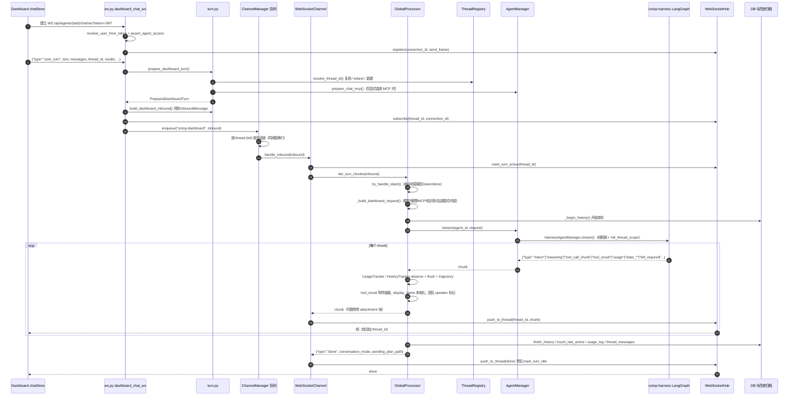
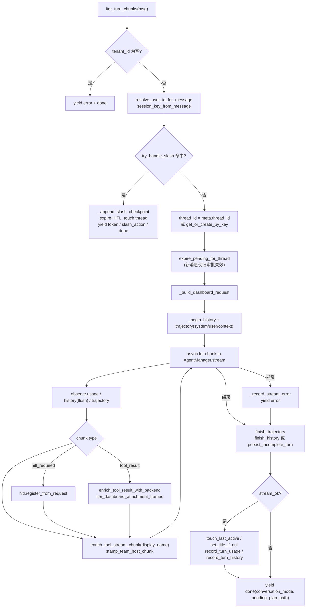
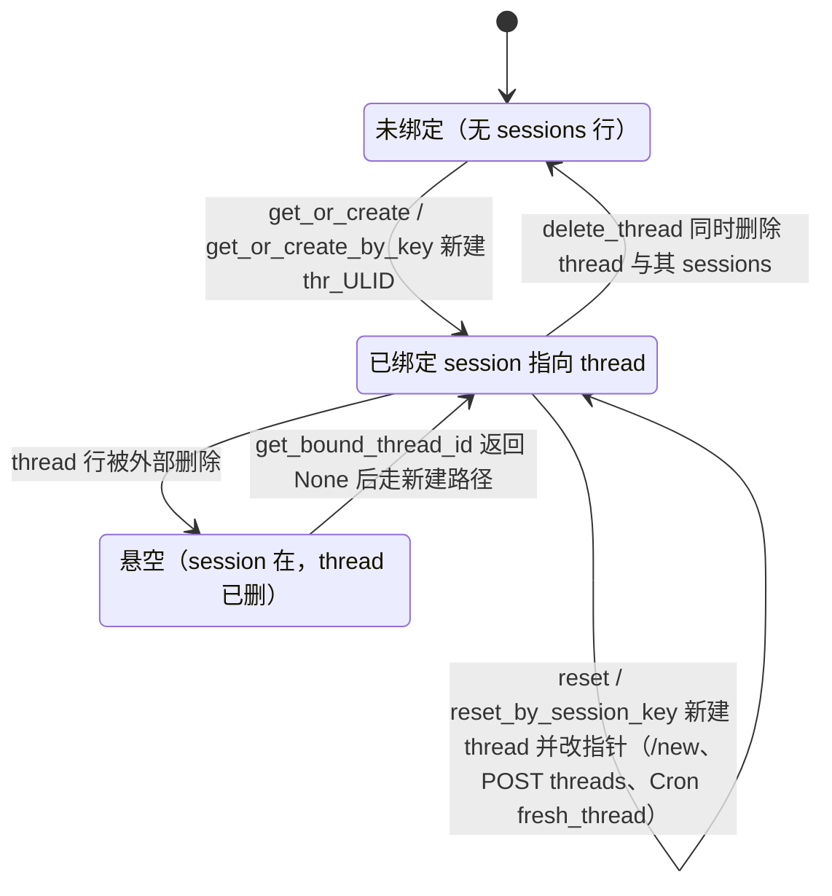
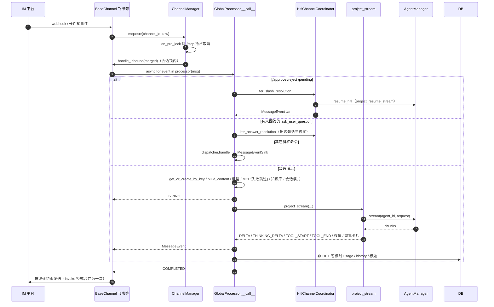
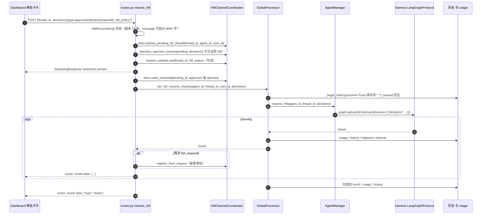
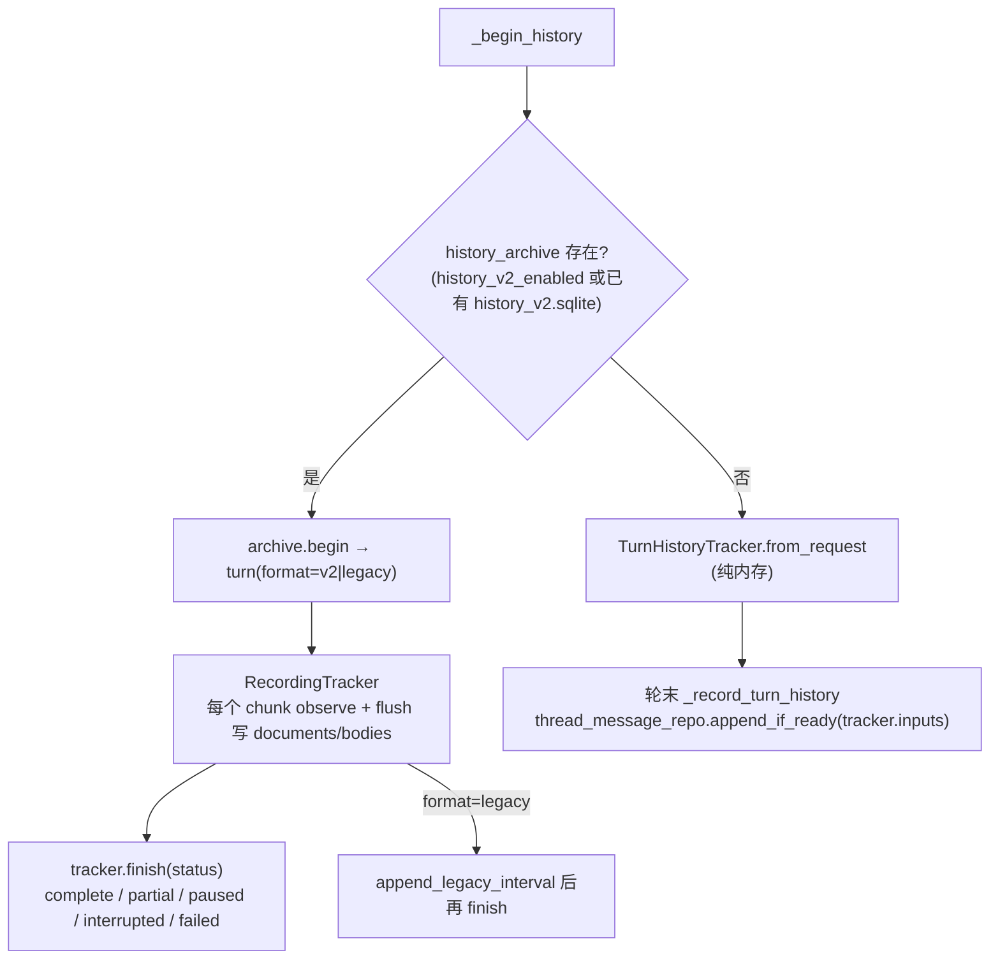
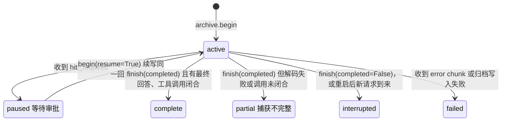

# 03 · 核心链路：一条消息的完整旅程

> 一句话：无论消息来自 Dashboard、IM 渠道还是 CLI，最终都会变成一条 `InboundMessage`，放进 octop-gateway 的 `ChannelManager` 队列，按会话加锁后交给 **`GlobalProcessor`**。`GlobalProcessor` 先解析会话（session key → thread_id），再分流斜杠命令，然后把模型、MCP、知识库、会话模式、多模态内容组装成一个 harness 请求字典，调用 `AgentManager.stream()` 驱动 octop-harness（LangGraph）。harness 产出的流式 chunk 有两条出路：直接透传成 WebSocket 帧（Dashboard/CLI），或者投影成 `MessageEvent`（IM）。轮次结束后，再把历史、用量、轨迹写入数据库。

本篇你将学到：

- Dashboard 一次 `user_turn` 从浏览器到 LLM 再回到浏览器的每一跳，以及每一跳"为什么要这样设计"
- `session_key` 与 `thread_id` 怎么生成、复用、重绑定
- 每轮请求在发给 harness 之前注入了什么（模型、推理参数、MCP、知识库、会话模式、附件）
- harness 与 Octop 的边界：请求字典的形状、chunk 字典的形状、取消与 HITL 恢复
- 轮次收尾：历史投影 / 版本化历史归档、usage、trajectory、未完成轮次、错误处理
- IM、CLI、Cron、多 Agent 协作四种入口在哪里汇入主链路
- 常见修改场景分别该改哪里，有哪些坑

> 行号取自 2026-09 `main` 分支（`c8217c1a`）。octop-harness 版本为 `1.0.0`，源码位于 `.venv/lib/python3.12/site-packages/octop_harness/`；octop-gateway 版本同为 `1.0.0`。

---

## 1. 关键文件

| 路径 | 职责 | 行数 |
|------|------|-----:|
| `src/octop/api/routers/chat/ws.py` | Dashboard 聊天 WebSocket 端点 `dashboard_chat_ws`：鉴权、`ping` / `subscribe` / `cancel` / `user_turn` 帧分发、入队 | 183 |
| `src/octop/api/routers/chat/turn.py` | 轮次预处理：校验 MCP / skills、解析 thread、写 composer 偏好、把前端 `messages` 转成 `ContentPart`、构造 `InboundMessage` | 358 |
| `src/octop/api/routers/chat/models.py` | `ChatTurnBody`、`UserTurnWsFrame`、`HitlResumeBody` 等 Pydantic 模型 | 222 |
| `src/octop/api/routers/chat/routes.py` | 欢迎卡片、**HITL 恢复（SSE）**、提示词润色 | 277 |
| `src/octop/api/routers/chat/history.py` | 线程列表、历史分页、fork、rebind、删除等 REST 接口 | 626 |
| `src/octop/api/routers/chat/serialize.py` | 把 LangChain 消息序列化成前端历史格式 | 1045 |
| `src/octop/api/routers/chat/sse.py` | `format_sse` / `json_chunk_default` | 32 |
| `src/octop/infra/gateway/ws/ws_channel.py` | 虚拟 IM 渠道 `WebSocketChannel`：把队列里的 Dashboard 消息交给 `iter_turn_chunks`，再推给 hub | 236 |
| `src/octop/infra/gateway/ws/ws_hub.py` | `WebSocketHub`：连接表、thread 订阅、`turn_active` 标记、按 thread / 用户扇出 | 167 |
| `src/octop/infra/gateway/process/processor.py` | **`GlobalProcessor`**：IM 入口 `__call__`、Dashboard/CLI 入口 `iter_turn_chunks`、HITL 恢复、请求组装、轮次收尾 | 1602 |
| `src/octop/infra/gateway/process/harness_request.py` | `build_content_from_message`（多模态）、`build_harness_request`（请求字典） | 332 |
| `src/octop/infra/gateway/process/message_keys.py` | session key / user id 推导、IM 元数据清洗、composer 快照 | 185 |
| `src/octop/infra/gateway/process/stream_project.py` | harness chunk → `MessageEvent` 投影（IM 用）、工具名本地化 | 255 |
| `src/octop/infra/gateway/process/usage_record.py` | `UsageTracker`（去重累加）、`record_turn_usage`（落库） | 276 |
| `src/octop/infra/gateway/threads.py` | `ThreadRegistry`：session_key ↔ thread_id 绑定 | 505 |
| `src/octop/infra/history/projection.py` | `TurnHistoryTracker`：从流中截取"本轮"消息，生成 `thread_messages` 投影 | 240 |
| `src/octop/infra/history/recorder.py` | `RecordingTracker`：版本化历史（v2）的边流边写 | 451 |
| `src/octop/infra/history/service.py` | `HistoryArchive`：回合边界、分段、状态 | 272 |
| `src/octop/infra/gateway/hitl/{coordinator,store}.py` | HITL 待审批记录（进程内、TTL）、IM `/approve` 解析 | 486 / 211 |
| `src/octop/infra/agents/manager.py`（节选） | `AgentManager.stream` / `resume_hitl` / `cancel_stream`：线程锁 + 调 harness | — |

边界外：Gateway 的启动装配见 [02-boot-and-runtime.md](./02-boot-and-runtime.md)；`AgentManager` 生命周期见 [04-agents.md](./04-agents.md)；IM 渠道适配、斜杠命令细节见 [05-gateway.md](./05-gateway.md)；`threads` / `sessions` / `thread_messages` / `usage_log` 表结构见 [06-data-layer.md](./06-data-layer.md)；鉴权与错误映射见 [07-api-layer.md](./07-api-layer.md)；Cron / 知识库 / 连接器见 [08-domains.md](./08-domains.md)；前端 `chatStore` 与 CLI REPL 见 [09-frontend-cli.md](./09-frontend-cli.md)。

---

## 2. 端到端时序（Dashboard）



这张图里有几个设计要点，改代码前需要先理解：

1. **WS 路由不直接调用处理器，而是入队。** `ws.py:168` 调用的是 `channel_manager.enqueue(WS_CHANNEL_ID, inbound)`。Dashboard 被包装成一个"虚拟 IM 渠道"（`WebSocketChannel`，`ws_channel.py:32`），因此和 IM 共享同一套队列、会话锁、`/stop` 抢占逻辑（`gateway.py:508`）。
2. **锁的粒度是 thread，不是 session。** `WebSocketChannel.get_debounce_key` 返回 `thread:{thread_id}`（`ws_channel.py:65-84`）。Dashboard 的 session_key 是"每个用户 × 每个 Agent"一个，如果按它加锁，同一用户开两个对话标签页时就会互相阻塞。`should_batch_inbound` 恒为 `False`（`ws_channel.py:86-88`），因此两次 `user_turn` 永远不会被拼成一条消息。
3. **断线不取消轮次。** `ws.py:177-180` 在 `finally` 中只做 `hub.unregister`。harness 会继续运行，客户端重连后发送 `subscribe`，就能继续收帧；`GET …/history` 也会返回 `turn_active`（`history.py:388`）。推送失败被吞掉，不会中断生成（`ws_channel.py:149-158`），否则会在节点中途留下不完整的 checkpoint。
4. **帧协议就是 harness chunk 本身。** 注释写的是 "Wire protocol mirrors harness stream chunks"（`ws.py:38`）。Octop 只在透传前做"增强"（附件、`display_name`、团队 speaker、`thread_id`），不做重新编码。

---

## 3. 第一跳：WebSocket 端点 `dashboard_chat_ws`

签名：`async def dashboard_chat_ws(websocket, agent_id: str, token: str | None = Query(None))`（`ws.py:32-37`）。

| 阶段 | 代码 | 说明 |
|------|------|------|
| 鉴权 | `ws.py:40-48` | JWT 通过 query 参数 `token` 传入（浏览器 WS 无法设置 Header）；失败时以 4001 关闭 |
| 权限 | `ws.py:58-65` | `assert_agent_access`；无权限关闭码 4003，Agent 不存在 4404 |
| 注册 | `ws.py:67-77` | 每个连接分配 `connection_id = uuid4().hex`，把 `send_frame` 注册到 hub |
| 解析 | `ws.py:81-90` | 非 JSON 文本被当作 `{"type":"user_turn","text": raw}`，便于调试 |
| `ping` | `ws.py:91-93` | 回 `pong` |
| `subscribe` | `ws.py:95-114` | 校验 thread 归属后订阅，并立即回 `turn_status{active}`，用于重连续流 |
| `cancel` | `ws.py:116-128` | `agent_registry.cancel_stream(agent_id, thread_id)`，**不入队**，直接设置 harness 的取消事件 |
| `user_turn` | `ws.py:134-168` | Pydantic 校验 → 判空 → `prepare_dashboard_turn` → `build_dashboard_inbound` → 订阅 → 入队 |

每次校验失败都会补发一个 `{"type":"done"}`（`ws.py:138`、`144`、`156`），这样前端的"发送中"状态能被复位。改这里时要保留这个约定。

### 3.1 `prepare_dashboard_turn`（`turn.py:226-303`）

它在 API 层做"会让本轮直接失败"的校验，并准备好所有需要写入 metadata 的数据：

1. `require_agent_row`，读取 Agent 的 `default_model`（`turn.py:234-235`）。
2. `validate_chat_mcp_servers` / `validate_chat_skills`：检查用户是否有权使用这些连接器 / 技能（`turn.py:237-243`）。
3. 如果显式选择了 MCP，**提前**调用 `prepare_chat_mcp` 加载工具；加载失败时抛出本地化的 `CONNECTOR_MCP_LOAD_FAILED`（`turn.py:244-256`）。
4. `resolve_thread_id`（`turn.py:60-86`）：
   - 前端带了 `thread_id` → 校验归属后 `rebind(session_key → thread_id)`，即"切换对话"；
   - 否则 `get_bound_thread_id(session_key)` 复用当前绑定；
   - 都没有时 `get_or_create_by_key` 新建。
5. `default_model` 必须是可用的模型引用（`turn.py:266-274`）。模型、推理模式、推理强度会通过 `update_composer` **持久化到 threads 行**（`turn.py:275-283`），成为该对话的"粘性"选择。
6. `build_composer_context`：生成历史气泡上显示的"连接器 / 技能 / 模型"标签快照（`message_keys.py:28-55`）。
7. `content_parts_from_dashboard_turn`（`turn.py:155-223`）：把前端的 OpenAI 风格 `messages` 转成 `TextContent` / `ImageContent` / `FileContent`。**附件必须已经上传到工作区的 `inbound/`**，这里只认 `workspace_path`，预览 URL 会被忽略（`turn.py:193-196`）。是否走视觉通道由 `is_vision_attachment` 决定。

### 3.2 `build_dashboard_inbound`（`turn.py:306-353`）

它把本轮所有"选项"塞进 `InboundMessage.metadata`。下游 `GlobalProcessor` 只看 metadata，不认识 `ChatTurnBody`：

| metadata 键 | 含义 | 注意 |
|-------------|------|------|
| `ws_connection_id` | 发起连接 | `WebSocketChannel` 必需，缺失直接丢弃（`ws_channel.py:98-101`） |
| `session_key` / `thread_id` | 会话标识 | `thread_id` 存在时 processor 不再查 registry（`processor.py:968-977`） |
| `user_is_admin` | 知识库可见范围 | admin 可见全部知识库（`processor.py:1405-1409`） |
| `mcp_servers` | 本轮 MCP | **`[]` 也会写入**，表示"本轮关闭默认打开的连接器"（`turn.py:321-323`） |
| `knowledge_base_ids` | 本轮知识库 | 同理，`[]` 表示关闭默认知识库（`turn.py:324-326`） |
| `skills` | 本轮技能 | `[]` 表示禁用全部技能 |
| `model` / `reasoning_mode` / `reasoning_effort` | 模型与推理 | 见 §5.2 |
| `conversation_mode` | `ask` / `plan` / `craft` | 见 §5.4 |
| `hitl_policy` | 线程级工具审批放行 | 写入 `session_policies`（`processor.py:1298-1302`） |
| `octop_composer_context` | 历史标签快照 | 最终写到 `HumanMessage.additional_kwargs` |
| `octop_inbound_attachments` | 附件元信息 | 同上，供历史回放渲染 |
| `target_agent_ids` | @ 提及的其它 Agent | 同一用户的 Agent |

`InboundMessage` 本身：`channel_id="octop-dashboard"`、`channel_type="dashboard"`、`tenant_id=agent_id`、`channel_subject.subject_id=str(user_id)`（`turn.py:345-353`）。**`tenant_id` 就是 agent_id**，这是 gateway 把消息路由到 Agent 的唯一依据。

---

## 4. 第二跳：队列 → `WebSocketChannel.handle_inbound`

`ChannelManager._worker_loop`（octop_gateway `manager.py:708-760`）的流程：取出消息 → `get_debounce_key` → 视情况合并同会话消息 → 调用 `on_pre_lock`（Octop 在这里对 `/stop` 做抢占取消）→ 获取 `channel_id:session_key` 锁 → `channel.handle_inbound(merged)`。

`WebSocketChannel.handle_inbound`（`ws_channel.py:90-174`）做了三件事：

1. 为每一轮复制一个新的 `ChannelSubject`，把 `thread_id` 写进它的 metadata，**而不是改共享的 subject**（`ws_channel.py:111-130`）。否则同一用户的两个并发线程会串流。
2. `hub.subscribe` + `hub.mark_turn_active`，然后 `async for chunk in processor.iter_turn_chunks(message)` 逐帧调用 `push_to_thread`。
3. 异常时推送本地化的 `error` + `done`；`finally` 中执行 `mark_turn_idle`。

`WebSocketHub`（`ws_hub.py:26`）要点：

- 一个连接同一时间只订阅一个 thread；订阅新 thread 会自动退订旧的（`ws_hub.py:73-89`）。
- `push_to_thread` 用 `stamp_thread_id` 给每帧补上 `thread_id`（`ws_hub.py:16-23`、`129-140`），前端据此丢弃串线的帧。
- `_active_turns` 只存在于内存中。**进程重启后 `turn_active` 一律为 false**。

---

## 5. 第三跳：`GlobalProcessor.iter_turn_chunks`

签名：`async def iter_turn_chunks(self, msg: InboundMessage) -> AsyncIterator[dict[str, Any]]`（`processor.py:885`）。Dashboard 和 CLI 都走这个方法；IM 走 `__call__`（§8.1）。



### 5.1 身份与会话：`message_keys.py` + `ThreadRegistry`

- **user_id**：`resolve_user_id_for_message`（`message_keys.py:79-105`）。只有 `dashboard` / `cli` 渠道把 `subject_id` 当作 Octop 的 `users.id`；**IM 渠道的会话一律归属于 Agent 所有者**，因为 IM 平台的用户 ID 属于另一个身份域，即使它恰好是数字也不能当成 Octop 用户 ID。
- **session_key**：`session_key_from_message`（`message_keys.py:124-134`）。metadata 里有显式 `session_key` 就用它，否则按 `ThreadRegistry.make_key` 拼成 `{agent_id}:{channel_type}:{subject_id}:{chat_type}`（`threads.py:30-39`）。Dashboard 的默认值是 `dashboard_key` = `{aid}:dashboard:{uid}:dm`（`threads.py:81-88`），CLI 是 `{aid}:cli:{uid}:dm`（`threads.py:90-97`）。
- **thread_id**：格式为 `thr_{ULID}`（`threads.py:493-494`）。`sessions` 表是"会话 → 当前线程"的指针，`threads` 表保存线程元数据（标题、置顶、composer 粘性设置、会话模式、产物）。一个 session 在不同时间可以指向不同的 thread（`/new`、切换对话、fork），但同一时刻只指向一个。
- **IM 元数据**：`sanitize_im_metadata`（`message_keys.py:166-185`）只保留主动推送所需的持久路由字段（openid、chat_id 等），并去掉 `msg_id`、`response_url` 等一次性字段，结果存入 `sessions.channel_metadata`。

会话绑定的状态机如下（`ThreadRegistry` 本身没有显式的状态字段，下图是对其方法语义的归纳）：



线程行本身还有一个隐含的"是否有内容"状态：新建时 `last_active=0`、`title=NULL`；每轮成功后 `_touch_thread_after_turn` 调用 `touch_last_active` + `set_title_if_null(用户首句)`（`processor.py:1484-1487`）。`thread_row_has_messages`（`threads.py:497-505`）只依据这两个字段判断，不读 checkpoint。

并发安全：`get_or_create` 采用"无锁快查 + `asyncio.Lock` 双检"（`threads.py:157-169`）；`get_or_create_by_key` 发现 session 属于别的 Agent 时直接抛 `ValueError`（`threads.py:211-213`）。

### 5.2 模型解析 `_resolve_harness_model`（`processor.py:507-556`）

优先级从高到低：

1. 本轮 metadata 的 `model`（composer 显式选择）；
2. threads 行的 `model_ref`（上次在该对话中的选择，即粘性值）；
3. harness 内存中的 thread model（旧版 `/model` 命令设置的覆盖值，`AgentManager.get_thread_model`）；
   —— 以上三项在 `_model_ref_from_meta` 中合并（`processor.py:493-505`）；若引用已不可用（被删除或禁用），直接丢弃（`processor.py:532-533`）；
4. Agent 的显式默认模型 `resolve_explicit_default_model`；
5. 用户偏好 `preferred_model`；
6. 全局兜底 `resolve_fallback_model_ref()`；
7. 仍然为空时返回 `None`，请求中不带 `model`，由 harness 自行路由（专家 AUTO 模式）。

最后，如果本轮内容含图片（`content_blocks_need_vision`），会通过 `resolve_model_for_multimodal_turn` 升级到支持视觉的模型（`processor.py:553-556`）。

**推理参数** `_resolve_reasoning_overrides`（`processor.py:558-597`）：先查模型的推理能力（`get_model_reasoning_capability`），不支持则返回 `{}`；`mode` / `effort` 的优先级是本轮 metadata → thread 粘性值 → 用户对该模型的偏好。`reasoning_request_parameters`（`providers/reasoning.py:160`）按 provider 适配器（OpenAI `reasoning_effort`、Anthropic `thinking` 等）生成 `{"model_fields": …, "extra_body": …}`，放进 `configurable["octop_reasoning_overrides"]`。真正生效的地方是 Octop 注入 harness 的中间件 `ReasoningRequestMiddleware`（`src/octop/infra/agents/middleware/reasoning.py:11-31`），它在每次模型调用前执行 `model.model_copy(update=…)`。

### 5.3 MCP、技能与知识库

- **MCP** `_resolve_turn_mcp_servers`（`processor.py:1421-1468`）：
  - 团队主持 Agent（team host）只负责分派，永远不挂 MCP（`processor.py:1439-1441`）；
  - `merge_turn_mcp_servers` 合并"本轮显式选择"和"默认打开的连接器"。Dashboard 总会发送 `mcp_servers`（哪怕是 `[]`），此时 `apply_defaults=False`；metadata 中没有这个键时（IM）才使用默认值（`processor.py:1224-1237`）；
  - `prepare_chat_mcp` 确保工具已加载。**Dashboard / HTTP 加载失败直接报错；IM 只打 warning 并跳过 MCP**（`raise_on_failure=False`，`processor.py:761-767`），避免一个不稳定的连接器拖垮整条 IM 消息；
  - 实际注入的服务器列表会回写到 composer 快照的 `connectors` 字段，保证历史标签与实际一致（`processor.py:1238-1259`）。
- **技能**：metadata 里有 `skills` 就原样放进 `request["skills"]`（`processor.py:1286-1287`）。harness 的语义是：`None` 表示全部技能，`[]` 表示禁用全部技能（`octop_harness/request.py:45-47`）。
- **知识库** `_attach_turn_knowledge_config`（`processor.py:1392-1419`）→ `stamp_turn_knowledge_config`（`infra/knowledge/default_open.py:38`）：写入 `configurable.knowledge_base_ids` / `knowledge_base_catalog` / `user_is_admin` / `locale`（`default_open.py:57-62`），供 `search_knowledge` 工具读取。它**不会**往 prompt 里注入检索结果，检索由模型自己调用工具完成。

### 5.4 会话模式 conversation mode

`_stamp_turn_conversation_mode`（`processor.py:1337-1360`）+ `_sync_and_resolve_conversation_mode`（`processor.py:1304-1335`）：

- 模式优先级为本轮显式值 → thread 粘性值 → `craft`（`conversation_mode.py:46-58`）。显式值会被写回 threads 行。
- `ask`（只读）和 `plan`（只能写 `plans/*.md`）会强制 `skills=[]`、移除 MCP，并额外放行 `search_knowledge` 等只读工具（`conversation_mode.py:97-112`）。harness 侧的 `_restrict_ask_plan_config` 会再兜底一次（`octop_harness/request.py:161-170`）。
- **Plan → 执行的自动切换**：如果 thread 处于 `plan` 模式并且有 `pending_plan_path`（由 `infra/agents/middleware/thread_artifacts.py:163` 在写完计划后记录），而用户这句话像"执行吧"（`is_plan_execute_utterance`，`conversation_mode.py:82`），就把模式切到 `craft`，清空 `pending_plan_path`，并用 `execute_user_message(path)` **改写本轮用户消息**（`processor.py:1322-1328`、`1352-1353`）。
- 轮次结束时，`done` 帧会带上当前的 `conversation_mode` 和 `pending_plan_path`（`processor.py:1367-1376`），前端据此显示"执行计划"按钮；IM 端则追加一句本地化提示 `conversation_mode.plan_ready`（`processor.py:1378-1390`）。

### 5.5 内容与附件：`build_content_from_message`（`harness_request.py:96-164`）

- 取消息里的 `ImageContent`：前 `VISION_MAX_COUNT` 张经 `materialize_image_part` 转成 `image_url` 块（base64）；超出数量、体积过大或读不出的图片降级为**路径提示文本**；
- 非图片附件（`FileContent` 等）一律转成路径提示（`hints_from_content_parts`），让 Agent 自己用文件工具读取；
- 群聊还会拼接一段"群聊背景｜仅供参考"和"当前群消息｜请回复这条消息"（`_group_turn_text`，`harness_request.py:29-93`），这段上下文只存在于本轮，不会写成持久的虚假轮次；
- 返回值：没有图片时是字符串，有图片时是 `[{"type":"text"}, {"type":"image_url"}…]`。

### 5.6 组装请求：`build_harness_request`（`harness_request.py:255-322`）

输出的是一个**普通 dict**，形状严格对齐 harness 的 `ChatRequest` 字段：

```python
{
  "messages": [HumanMessage(content=..., additional_kwargs={octop_composer_context, octop_inbound_attachments})]
              # 或没有 kwargs 时 [{"role": "user", "content": "..."}]
  "thread_id": "thr_01J...",
  "user": "42",                       # str(user_id)
  "source": "dashboard/octop-dashboard",   # f"{channel_type}/{channel_id}"
  "agent_id": "agt_...",
  "model": "openai/gpt-4o",           # 可省略 → harness 路由
  "mcp_servers": [...],               # 可选
  "skills": [...],                    # 可选
  "conversation_mode": "craft",       # stamp_conversation_mode 写入
  "configurable": {
      "session_key": "...",
      "octop_reasoning_overrides": {...},
      "knowledge_base_ids": [...], "knowledge_base_catalog": [...],
      "user_is_admin": false, "locale": "zh",
      "conversation_mode": "...",      # 以及 ask/plan 的只读工具覆盖
      "peer_invoke_mode": "async",     # 仅团队主持 Agent（stamp_host_runtime）
  },
}
```

之后 `AgentManager._prepare_stream_request`（`manager.py:2961-2976`）会再补上插件工具配置 `plugin_tool_configs`，以及 `apply_agent_runtime_to_stream_request` 的 `recursion_limit`、模型设置、`max_input_tokens`。

> **坑：顶层键不能随便加。** harness 通过 `ChatRequest.coerce` 执行 `cls(**request)`（`octop_harness/request.py:85-96`），出现未知顶层键会直接 `TypeError`。每轮的新参数应放进 `configurable`，由中间件通过 `get_config()["configurable"]` 读取；参考 `octop_reasoning_overrides` 的做法。

---

## 6. 第四跳：Octop ↔ octop-harness 边界

### 6.1 调用链

```
GlobalProcessor
  └─ AgentManager.stream(agent_id, request)                 manager.py:1224-1239
       ├─ _thread_execution_lock(agent_id, thread_id)       同一 thread 串行（manager.py:902）
       ├─ _track_invocation(agent_id)                       与历史回填互斥
       ├─ _prepare_stream_request                           插件 / 运行时限制
       └─ with hitl_thread_scope(thread_id):                HITL 会话级放行策略的上下文
            HarnessAgentManager.stream(agent_id, req)       octop_harness/manager.py:377-386
              └─ HarnessAgent.stream(ChatRequest)           octop_harness/agent.py:475-527
                   ├─ iter_with_runtime_slash               harness 自己的运行时斜杠命令
                   ├─ _iter_until_cancelled(..., cancel_event)
                   └─ LangGraphProtocol.stream              protocols/langgraph.py:115-132
                        graph.astream(stream_mode=["values","updates","messages","custom"], version="v2")
```

`ChatRequest.to_runnable_config`（`octop_harness/request.py:110-147`）把 `thread_id` / `user` / `source` / `model` / `mcp_servers` / `skills` / `conversation_mode` / `agent_id` 注入 `configurable`，然后合并 Octop 传入的 `configurable`。**`thread_id` 同时也是 LangGraph checkpoint 的键**，因此 Octop 的 `thr_…` 就是 checkpoint 线程 ID。

### 6.2 chunk 格式（`LangGraphProtocol._project_chunk`）

harness 把 LangGraph v2 的四种 stream_mode 投影成扁平 dict（`protocols/langgraph.py:30-41`、`169-236`）：

| `type` | 来源 | 字段 | 说明 |
|--------|------|------|------|
| `token` | `messages` | `content`, `node` | 可见文本增量；`<think>` 由 `ThinkSplitter` 拆出 |
| `reasoning` | `messages` | `content`, `node` | 思考内容（`reasoning_content` 或 `<think>` 内文本） |
| `tool_call_chunk` | `messages` | `id`, `name`, `args`（字符串片段）, `index`, `node` | 工具调用参数流式拼接 |
| `usage` | `messages` | `usage`（已规范化）, `call_id`, `model`, `node` | 每次模型调用的用量 |
| `tool_result` | `updates` | `node`, `messages`（ToolMessage 列表） | 某个节点的更新里含 tool 消息 |
| `state_update` | `updates` | `node`, `data` | 其它节点更新 |
| `state_snapshot` | `values` | `data`（完整 state，含 `messages`） | 每步后的全量状态 |
| `hitl_required` | `updates.__interrupt__` | `request`（`action_requests` / `review_configs`） | 人工确认中断 |
| `custom` | `custom` | `data` | 工具 / 中间件通过 stream writer 发出的自定义事件 |

压缩（summarization）内部的模型调用 token 会被过滤掉（`_is_internal_model_stream`，`protocols/langgraph.py:19-27`）。

### 6.3 取消

`ws cancel` 帧或 IM 的 `/stop` → `AgentManager.cancel_stream` → `HarnessAgentManager.cancel` → `HarnessAgent.cancel(thread_id)` 设置 `cancel_event`（`octop_harness/agent.py:382-385`）。`_iter_until_cancelled`（`agent.py:396-450`）会抢占正在阻塞的 `__anext__`，然后**正常 return，不抛异常**。

> 注意：因此在 `iter_turn_chunks` 看来，被取消的轮次和正常结束一样是 `stream_ok=True`（`processor.py:1081`）。usage 与历史会按"完成"记录。v2 归档的 `RecordingTracker.finish` 在找不到最终回答或工具调用不闭合时会降级为 `partial`（`recorder.py:413-432`）。legacy 投影没有单独的"已取消"标记（待确认产品上是否需要区分）。

---

## 7. 第五跳：流式投影与帧回传

### 7.1 Dashboard / CLI：透传 + 增强（`processor.py:1022-1080`）

每个 chunk 依次经过：

1. `usage_tracker.observe` / `history_tracker.observe` / **`await flush_tracker`**（v2 下先把变更写入归档，再把帧交给调用方，`recorder.py:361`）/ `_observe_trajectory`；
2. `hitl_required` → `self._hitl.register_from_request`：登记进程内的待审批记录，刷新页面后可重新注入审批卡片（`processor.py:1035-1049`）；
3. `tool_call_chunk` → 记下 `saw_tool_call=True`；
4. `tool_result` → `enrich_tool_result_with_backend` 把工具产出的媒体改写成工作区下载 URL；`iter_dashboard_attachment_frames` 额外产出 `attachment` 帧。只有本轮确实发生过工具调用才推送，并按 id / 路径去重，避免 `PatchToolCallsMiddleware` 用 `Overwrite` 重放历史时重复发送（`processor.py:1016-1020`、`1052-1072`）；
5. `enrich_tool_stream_chunk`：给带 `name` 的 `tool_call_chunk` / `tool_result` 加上本地化的 `display_name`（`stream_project.py:50-74`）。harness 的 `tool_result` 顶层一般不带 `name`，所以通常只有 `tool_call_chunk` 会获得 `display_name`；
6. `stamp_team_host_chunk`：团队主持 Agent 的帧会加上 `agent` / `agent_id`，便于前端区分说话人（`team_manager.py:1118-1128`）。

### 7.2 WS 帧类型表（服务端 → 前端）

| `type` | 产生位置 | 主要字段 | 前端处理（`dashboard/src/pages/Chat/hooks/chatStore.ts`） |
|--------|----------|----------|------|
| `token` | harness / 斜杠回复 | `content`, `node` | 拼接到当前助手气泡 |
| `reasoning` | harness | `content` | 思考折叠区 |
| `tool_call_chunk` | harness | `id`, `name`, `args`, `index`, `display_name` | 工具卡片 |
| `tool_result` | harness | `messages`, `node`（已改写媒体 URL） | 工具结果 |
| `attachment` | `iter_dashboard_attachment_frames` | `kind`, `url` / `preview_url` 或 `data`（base64）, `mime_type`, `filename`, `path` | 附件气泡 |
| `usage` | harness | `usage`, `call_id`, `model` | 用量显示 |
| `state_update` / `state_snapshot` | harness | `node`, `data` | 基本忽略 |
| `custom` | harness | `data` | 自定义事件 |
| `hitl_required` | harness | `request` | 弹出审批卡片 |
| `slash_action` | 斜杠命令 | 命令自定义字段 | 前端动作（例如切换线程） |
| `error` | processor / channel / ws | `message`, `error_code?` | 错误气泡 |
| `done` | processor | `conversation_mode?`, `pending_plan_path?` | 结束本轮 |
| `turn_status` | `subscribe` 应答 | `thread_id`, `active` | 判断是否需要继续等流 |
| `pong` | `ping` 应答 | — | 心跳 |
| `dashboard_push` | `notify_dashboard_push`（通知 WS） | `agent_id`, `thread_id`, `text`, `agent_name` | 全局 toast，走 `/api/notifications/ws` |

所有经过 `push_to_thread` 的帧都会带 `thread_id`。团队主持 Agent 的帧额外带 `agent` / `agent_id`。

### 7.3 IM：`project_stream` → `MessageEvent`（`stream_project.py:77-228`）

IM 渠道不能逐 token 推送原始 dict，需要 octop-gateway 的 `MessageEvent` 协议（`octop_gateway/models.py:127-139`）。投影规则：

| harness chunk | MessageEvent | 说明 |
|---------------|--------------|------|
| `token` | `DELTA`；节点切换时先发 `FLUSH` | gateway 负责累积与限速发送 |
| `reasoning` | `THINKING_DELTA` | 渠道的 `show_thinking` 决定是否显示 |
| `tool_call_chunk`（名称和参数都出现后） | `TOOL_START` | **`tool_name` 已本地化，并附带 `tool_hint_text`**，另带原始 `tool_key` |
| `tool_result` | 补发 `TOOL_START`（如未发）+ `TOOL_END`，再加工具产出的媒体事件 | 媒体只在本轮真的调用过工具时发送，并按 id 去重 |
| `hitl_required` | `MESSAGE(审批卡片文本)`，然后 **return** | 设置 `projection_state.hitl_paused=True` |
| `state_update` | 节点切换时 `FLUSH` | — |

外部 IM 渠道默认使用 `invoke` 响应模式（`response_mode.py:21`）：`collapse_to_invoke_response` 会丢掉工具调用前的"过程叙述"，只在结束时一次性发送最终文本和媒体；团队主持 Agent 强制使用 `stream`（`gateway.py:695-703`）。

---

## 8. 其它入口如何汇入

```mermaid
flowchart LR
    subgraph Entry["入口"]
        D["Dashboard WS<br/>ws.py"]
        C["CLI chats send/repl<br/>cli/repl/runtime.py"]
        I["IM 渠道<br/>飞书/企微/Telegram…"]
        R["Cron<br/>cron/delivery.py"]
        P["主动关怀<br/>proactive/service.py"]
        T["团队 inbox 回调<br/>harness teams"]
    end
    CM["ChannelManager<br/>队列 + 会话锁"]
    D -->|"enqueue octop-dashboard"| CM
    C -->|"enqueue octop-cli"| CM
    I -->|"enqueue channel_id"| CM
    CM -->|"WebSocketChannel / CliChannel"| ITC["GlobalProcessor.iter_turn_chunks"]
    CM -->|"BaseChannel.handle_inbound"| CALL["GlobalProcessor.__call__"]
    R -->|"Gateway.run_in_session"| AMS["AgentManager.stream"]
    P -->|"Gateway.push_text_from_session"| PUSH["Gateway.push_session_text"]
    T -->|"on_reply / prepare_peer_session"| TM["TeamManager"]
    ITC --> AMS
    CALL -->|"project_stream"| AMS
    TM --> AMS
    R --> PUSH
```



### 8.1 IM：`GlobalProcessor.__call__`（`processor.py:601-880`）

octop-gateway 的 `BaseChannel.handle_inbound` 通过 `async for event in self._processor(message)` 调用它（`octop_gateway/channel.py:831`）。它和 `iter_turn_chunks` 的主体逻辑平行，但有以下差异：



与 Dashboard 路径的区别（改代码时经常需要**两处同步**）：

| 方面 | `__call__`（IM） | `iter_turn_chunks`（Dashboard / CLI） |
|------|------------------|----------------------------------------|
| 输出 | `MessageEvent` | 原始 chunk dict |
| 模型 | 不看 metadata（`meta=None`，`processor.py:754-760`） | metadata → thread 粘性 → …… |
| 推理参数 | 不注入 | 注入 `octop_reasoning_overrides` |
| MCP | 默认连接器，失败时跳过 | 显式列表，失败时报错 |
| 知识库 | `is_admin=False`，只用默认知识库 | 前端可选，admin 可见全部 |
| 斜杠命令 | `parse_slash` + `dispatcher.handle`，不写 checkpoint | `try_handle_slash` + `_append_slash_checkpoint` 写入历史 |
| HITL | 回复 `/approve` `/reject`；`ask_user_question` 用下一句话作答 | HTTP `POST …/hitl/resume`（SSE） |
| HITL 后的记账 | 暂停时**不记** usage / history（`processor.py:858`） | 流结束即记账，归档状态为 `paused` |
| trajectory | 不记录 | 记录 system / user / context + 全部 chunk |
| 结尾提示 | 追加 plan_ready 文本消息 | `done` 帧携带字段 |

IM 渠道的注册、`response_mode`、群聊上下文等细节见 [05-gateway.md](./05-gateway.md)。

### 8.2 CLI：`octop chats send / repl`

CLI 在进程内启动一个 embedded `OctopServer`（`embedded_runtime()`），`CliChatSession`（`src/octop/cli/repl/runtime.py:38-105`）把自己注册到 `gateway.cli_hub`，然后：

`prepare_cli_turn`（`infra/gateway/cli/turn.py:16`，默认 key 为 `cli_key`）→ `build_cli_inbound` → `channel_manager.enqueue(CLI_CHANNEL_ID="octop-cli", inbound)`（`runtime.py:102`）→ `CliChannel.handle_inbound`（`cli_channel.py:78-126`）→ **同样调用 `iter_turn_chunks`** → `cli_hub.push(conn_id, chunk)` → 收到 `done` / `error` 后结束等待（`runtime.py:52-56`）。

因此 CLI 与 Dashboard 共用同一条处理链路，只是出口不同：CLI 按 `session_key` 加锁，没有 thread 订阅。命令行界面见 [09-frontend-cli.md](./09-frontend-cli.md)。

### 8.3 Cron 与主动推送

Cron **不经过 `GlobalProcessor`**。`CronDelivery.deliver`（`infra/cron/delivery.py:67-87`）通过 `Gateway.run_in_session` 获取与入站消息相同的会话锁，避免和用户正在进行的对话交错：

- `task_type == "text"`：Dashboard 会话时向 checkpoint 追加一对 Human/AI 消息，然后 `push_session_text`（`delivery.py:89-130`）；
- agent 任务：自己调用 `build_harness_request` + `AgentManager.stream`，用 `TurnHistoryTracker` / `UsageTracker` 记账（`source="cron"`）；遇到 `hitl_required` 直接报错（"cron agent run requires user interaction"），最后 `push_session_text` 发出最终文本（`delivery.py:132-173`）。

`Gateway.push_text_from_session`（`gateway.py:418-432`）是"不运行 Agent、只推送一段完整文本"的接口，目前由主动关怀使用（`infra/proactive/service.py:252`）。它对 Dashboard 会话额外调用 `notify_dashboard_push` 发 toast（`gateway.py:480-501`）；对虚拟渠道会刷新 `last_active`、标题和未读数（`gateway.py:400-404`）。Cron 的调度细节见 [08-domains.md](./08-domains.md)。

### 8.4 多 Agent 协作（简述）

`GlobalProcessor` 同时实现了 harness 的 `TeamProcessor` 协议，所有方法都委托给 `TeamManager`（`processor.py:443-464`）：

- `prepare_peer_session(PeerCall)`：被调用方（callee）在同一个用户与渠道下获得一个独立的 peer 会话（`ThreadRegistry.peer_room_session_key`，`threads.py:57-79`），避免覆盖 callee 自己的 1:1 对话；
- `record_peer_turn`：把一次 peer 调用写入历史；
- `on_reply(ReplyEvent)`（`team_manager.py:279-315`）：异步 `ask_agent` 完成后，把结果推回发起方的 room thread、IM 或 Dashboard 会话；
- `stamp_host_runtime`（`team_manager.py:495-508`）：团队主持 Agent 的每一轮强制使用 `peer_invoke_mode="async"`，并移除 MCP。

设计文档见 [docs/agent-interop-mailbox.md](../agent-interop-mailbox.md)，团队功能细节见 [04-agents.md](./04-agents.md)。

---

## 9. 斜杠命令的分流

只说明 processor 如何分流，命令本身见 [05-gateway.md](./05-gateway.md)。

- **Dashboard / CLI**：`try_handle_slash(msg.text, dispatcher, ctx)`（`slash/runner.py:12-34`）返回 `(handled, lines, actions)`。未知的 `/foo` 返回 `handled=False`，会被当成普通消息交给模型。命中时（`processor.py:928-960`）：
  1. `_append_slash_checkpoint`（`processor.py:1549-1592`）把"命令 + 回复"写成 `slash:{ulid}:human/assistant` 两条消息。命令规格 `persist_checkpoint=True`（`slash/catalog.py:32` 的默认值）时追加到 harness checkpoint，否则只写入 `thread_messages` 投影；
  2. 让该线程的 HITL 待审批记录过期；
  3. 回复逐行作为 `token` 帧、`slash_action` 帧发出，最后是 `done`。
- **IM**：`parse_slash` 先截走 `/approve` `/reject` `/pending`（HITL），再交给 `dispatcher.handle`，输出通过 `_MessageEventSink` 转成 `MESSAGE` 事件（`processor.py:114-124`、`720-737`）。
- **`/stop` / `/cancel`**：在会话锁**之前**由 `Gateway._preempt_cancel_on_stop` 取消当前轮次（`gateway.py:508-537`），否则它会排在正在运行的轮次后面，永远起不到打断作用。
- harness 还有自己的运行时斜杠层 `iter_with_runtime_slash`（`octop_harness/agent.py:489-513`），处理 harness 内置命令；Octop 的 dispatcher 先于它执行。

---

## 10. HITL：中断与恢复

### 10.1 中断

模型调用了需要审批的工具时，LangGraph 抛出 interrupt，harness 产出 `{"type":"hitl_required","request":{...}}`，随后本次 `astream` 结束。Octop 的处理：

- `HitlPendingStore.register`（`hitl/store.py:38-68`）创建 `HitlPendingRecord`，其中 `pending_id` 是 4 位 hex，TTL 30 分钟（`store.py:12`）。同一 session 已有的 pending 会被标为 `expired`。**这份存储只在进程内存中**，重启后丢失。
- 历史：`RecordingTracker.observe` 看到 `hitl_required` 就设置 `paused=True`，归档回合状态变成 `paused`（`recorder.py:149-150`、`402-406`），`finished_at` 保持为空（`service.py:132-138`）。
- 用户发新消息时，`iter_turn_chunks` 先调用 `expire_pending_for_thread`（`processor.py:979`），旧审批随之失效。
- 刷新页面时，`GET …/history` 返回 `hitl_pending`（`history.py:371-376`、`389`），前端据此重新显示审批卡片。
- 会话级放行策略：`hitl_policy`（`ask` / `allow_all` / `allow_tools`）写入 `session_policies`，并通过 `hitl_thread_scope(thread_id)` 在 harness 调用期间生效（`manager.py:1236`，`infra/agents/security/hitl_session.py:137`）。

### 10.2 恢复：`POST /api/agents/{aid}/chat/hitl/resume`（SSE）



要点：

- 恢复**走 SSE 而不是 WS**，它是一次独立的 HTTP 请求，不经过 ChannelManager 队列。并发保护依靠 `AgentManager.resume_hitl` 里的 `_thread_execution_lock`（`manager.py:1264-1267`）。
- 在长时间的恢复流开始之前**先调用 `mark_resolved`**（`routes.py:136-140`），避免期间刷新页面时重复显示同一张卡片。恢复失败时改标为 `expired`，并推送本地化的 `error`（`routes.py:158-166`）。
- 客户端断开后，SSE 停止输出，但仍会把 chunk **消费完**（`routes.py:148-155`），保证 harness 跑完、历史写全。
- `decisions` 的格式直接对应 langchain `HumanInTheLoopMiddleware` 的决策类型（`models.py:10`、`195-222`）。`respond` / `reject` 的 `message` 会原样进入模型上下文，因此在 API 层做校验。
- `iter_hitl_resume_chunks`（`processor.py:1110-1172`）结束时**不产出 `done`**，`done` 由 SSE 包装层补发（`routes.py:157`）。

IM 的对应路径是 `/approve [id]`、`/reject [id] [理由]`，由 `HitlChannelCoordinator.iter_slash_resolution` → `project_resume_stream`（`stream_project.py:231-255`）实现；`ask_user_question` 类的中断则用"下一句话"作为答案（`processor.py:673-718`）。

---

## 11. 轮次收尾

### 11.1 收尾矩阵（`iter_turn_chunks`，`processor.py:1081-1108`）

| 情况 | `finally` | 成功之后 |
|------|-----------|----------|
| 正常结束（含被取消、含 HITL 中断） | `_finish_trajectory`；`_finish_history(completed=True)` | `touch_last_active` + `set_title_if_null(用户原文)`；`_record_turn_usage`；`_record_turn_history`；`done` |
| harness 抛异常 | `_persist_incomplete_turn`：同样刷新线程时间与标题，历史按 `completed=False` 写入（`processor.py:1507-1516`） | 只发 `done`，不记 usage |

异常处理：`_record_stream_error`（`processor.py:1470-1482`）增加 `stream_errors_total` 指标，并写审计日志 `agent.stream.error`。`_stream_error`（`processor.py:94-97`）对 `OctopError` 使用 `localized_message(locale)` 加错误码，其它异常用 `format_stream_error` 做本地化包装。错误会以 `{"type":"error","message","error_code?"}` 发给前端，**同时 `observe` 进历史跟踪器**，于是历史中会留下一条带 `octop_stream_error=True` 的 AI 消息（`projection.py:207-213`、`message_keys.py:17-18`），刷新后错误仍然可见。

### 11.2 历史的两套存储



- **legacy 投影**（默认）：`TurnHistoryTracker`（`projection.py:154-240`）从 `state_snapshot` / `state_update` 中截取"最后一条用户消息及其之后"的消息作为本轮内容；如果状态里没有覆盖流式文本（例如中途被打断），就补一条由 `token` / `reasoning` 拼出的 AI 消息；出错时再补一条错误消息。轮末调用 `thread_message_repo.append_if_ready`。**写投影失败只记 warning，不影响本轮结果**（`processor.py:1536-1547`），因为投影只是读取优化，真正的数据源是 harness checkpoint。
- **版本化归档 v2**（`config.history_v2_enabled`，`server.py:385-409`，目前要求 SQLite 控制面）：`RecordingTracker`（`recorder.py:56`）**边流边写**。`token` / `tool_call_chunk` / `tool_result` / `error` 会增量更新 wire 消息，`flush` 在把帧交给调用方之前落盘（`recorder.py:361-397`）；即使进程崩溃，已推送给用户的内容也已经持久化。回合状态见下图。设计与回退方法见 [docs/versioned-history.md](../versioned-history.md)。



### 11.3 usage（`usage_record.py`）

- `UsageTracker.observe`（`usage_record.py:219-244`）：一旦出现 harness 的显式 `usage` chunk，就只采信这类 chunk，并按 `call_id` 去重（流重放不会重复计数）；没有显式 usage 时，退回从 `state_snapshot` 中"最后一条用户消息之后的 AI 消息"的 `usage_metadata` 汇总。
- `normalize_usage`（`usage_record.py:46-81`）把各家 provider 的字段统一成互不重叠的缓存分桶：`uncached_input`、`cache_read`、`cache_write`、`output`、`reasoning`。
- `record_turn_usage`（`usage_record.py:251-276`）**每轮写一行** `usage_log`，`model_calls` 为本轮模型调用次数。写入异常会被 `contextlib.suppress` 吞掉，不影响聊天。`source` 取值为 `chat` 或 `cron`。

### 11.4 trajectory（轨迹）

仅当 Agent 配置启用轨迹（`agent_trajectory_enabled`，`processor.py:252-258`）并且走 `iter_turn_chunks` / HITL 恢复路径时才记录。轮次开始时写入 `system`（每个线程一次，内容是实时的 system prompt）、`user`、`context`（工作区记忆文件、本轮生效的技能、MCP），然后逐个 chunk 调用 `observe_chunk`，轮末 `finish_turn(usage)`（`processor.py:260-369`）。轨迹写入失败只记日志。查询接口在 `api/routers/chat/trajectory.py`。

---

## 12. 历史读取（简述）

`GET /api/agents/{aid}/threads/{tid}/history`（`history.py:281-398`）：

- 启用 v2 归档时：`history.reader.read_page` 按分段组合"旧前缀 + v2 回合"，支持游标分页；
- 否则读 `thread_messages` 投影。投影还没准备好（旧线程）时，把回填任务交给 `history_backfill` 队列，并返回 `history_loading=true` + `history_retry_after_ms=1500`，让前端稍后重试。Agent 忙碌时不入队；
- 响应还包含 `turn_active`、`hitl_pending`、`artifacts`、`conversation_mode`、`pending_plan_path`、`hitl_policy`，这是前端刷新后恢复页面状态的**唯一依据**；
- 消息序列化由 `serialize._serialize_history_message`（`serialize.py:921`）负责：拆分 thinking / tool_use 块、去掉附件路径提示等发给 LLM 的噪声、改写工具媒体 URL。

其它线程接口（列表、新建 `reset`、fork、rebind、改名 / 置顶 / composer、删除）也在 `history.py` 中，属于 API 层内容，见 [07-api-layer.md](./07-api-layer.md)。

---

## 13. 数据结构速查

### 13.1 `InboundMessage`（octop_gateway `models.py:168-185`）

| 字段 | 类型 | 本链路中的含义 |
|------|------|----------------|
| `channel_id` | `str` | `octop-dashboard` / `octop-cli` / IM 渠道行的 `channel_id` |
| `channel_type` | `str` | `dashboard` / `cli` / `feishu` / `wecom` … |
| `tenant_id` | `str \| None` | **agent_id** |
| `channel_subject` | `ChannelSubject` | `subject_id`：Dashboard/CLI 为 user_id，IM 为平台用户 ID；`metadata` 中放每轮的路由信息（`thread_id`、`ws_connection_id`） |
| `channel_session_id` | `str \| None` | Dashboard 中为 session_key |
| `content` | `list[ContentPart]` | `TextContent` / `ImageContent` / `FileContent` / `AudioContent` / `VideoContent`，媒体用 `local_path` / `url` / `data`（base64）定位 |
| `group_context` | `GroupContext \| None` | 群聊近期消息（仅供参考的上下文） |
| `metadata` | `dict` | 见 §3.2 表；IM 还有 `chat_type`、`sender_id` 等 |
| `text`（属性） | `str` | 所有 `TextContent` 拼接后的文本，斜杠解析和标题都用它 |

### 13.2 `MessageEvent`（octop_gateway `models.py:202-208`）

| 字段 | 说明 |
|------|------|
| `type` | `message` / `delta` / `thinking` / `thinking_delta` / `flush` / `typing` / `tool_start` / `tool_end` / `error` / `completed` |
| `content` | `list[ContentPart]`，文本或媒体 |
| `metadata` | `tool_start` / `tool_end` 携带 `tool_name`（已本地化）、`tool_hint_text`、`tool_key` 等 |
| `error` | 错误文本（`error_event`） |

### 13.3 harness 请求 dict / chunk dict

见 §5.6 和 §6.2。补充几个 `additional_kwargs` 约定键（`message_keys.py:11-18`）：`octop_composer_context`、`octop_inbound_attachments`（写在 HumanMessage 上）；`checkpoint_ts`（epoch 毫秒，必须与 harness 的 `CHECKPOINT_TS_KEY` 一致）；`octop_stream_error` + `error_code`（写在错误 AI 消息上）。

### 13.4 WS 上行帧（前端 → 服务端）

| `type` | 字段 |
|--------|------|
| `user_turn`（默认） | `text`、`messages`、`thread_id`、`session_key`、`model` / `default_model`、`reasoning_mode`、`reasoning_effort`、`conversation_mode`、`hitl_policy`、`mcp_servers`、`knowledge_base_ids`、`skills`、`target_agent_ids`（`models.py:120-140`） |
| `subscribe` | `thread_id` |
| `cancel` | `thread_id` |
| `ping` | — |

下行帧见 §7.2。

---

## 14. 修改指南

### 14.1 加一种新的流式事件

1. **产生**：多数情况下在 harness 侧的工具或中间件里用 LangGraph stream writer 发出，它会以 `{"type":"custom","data":…}` 到达 Octop；只有确实需要新的顶层 `type` 时才改 harness 的 `LangGraphProtocol._project_chunk`（这是另一个仓库）。
2. **Dashboard 路径**：`iter_turn_chunks` 默认会透传任何 chunk，不需要改动。如果需要增强（补字段、附件），参考 `processor.py:1050-1079` 的 `tool_result` 分支，并确认 `stamp_team_host_chunk` 的 `_STREAM_SPEAKER_TYPES`（`team_manager.py:73`）是否需要包含新类型。
3. **HITL 恢复路径**：`iter_hitl_resume_chunks` 不做附件增强，按需同步修改。
4. **IM 路径**：`stream_project._project_chunks` 不认识的类型会被**静默丢弃**。需要在 IM 端显示时，在这里映射成 `MessageEvent`，**用户可见的文字必须走 i18n**（`octop.i18n.tr` / `domains/channel.py`），工具名和提示行必须在投影时本地化，不能依赖 `ChannelConstraints.tool_hint_template`（AGENTS.md §7 的 IM 规则）。
5. **历史**：`TurnHistoryTracker.observe` / `RecordingTracker.observe` 只处理已知类型。如果新事件需要刷新后仍然可见，就得在这两处写入 wire 消息，并在 `serialize._serialize_history_message` 中渲染。
6. **前端**：`dashboard/src/pages/Chat/hooks/chatStore.ts` 和 `dashboard/src/utils/parseHarnessChunk.ts` 的 `switch` 需要加分支，修改后运行 `cd dashboard && npx tsc -b`。
7. **cron**：`delivery._deliver_agent` 只收集 `token` / `delta` 文本；如果新事件会影响最终文本，这里也要处理。

### 14.2 在每轮之前注入上下文 / 参数

| 需求 | 推荐位置 | 说明 |
|------|----------|------|
| 每轮的运行时参数（给中间件或工具读） | `_build_dashboard_request` **和** `__call__` 中调用 `build_harness_request` 之后，写入 `request["configurable"]` | 参照 `_attach_turn_knowledge_config`；**不要加顶层键**（§5.6 的坑） |
| 每次模型调用前修改模型参数 | 仿照 `infra/agents/middleware/reasoning.py` 写中间件，从 `get_config()["configurable"]` 读取 | 中间件在 `04-agents.md` 所述的 harness 配置装配中注册 |
| 改写用户消息文本 | `build_content_from_message` 或 `_overwrite_last_user_text`（`processor.py:100-111`） | 注意 `content` 可能是 str 也可能是块列表 |
| 前端新增一个每轮选项 | `models.py`（`UserTurnWsFrame` + `ChatTurnBody.from_ws_payload`）→ `turn.build_dashboard_inbound` 写入 metadata → processor 读取 | 需要"本轮关闭默认值"语义时，参照 `mcp_servers` / `knowledge_base_ids` 用 `[]` 与缺省区分 |
| 希望在历史气泡上显示 | 放进 `build_composer_context` | 只写在新消息上，不会回填旧消息 |

两条入口都要改：`iter_turn_chunks` → `_build_dashboard_request`，以及 `__call__`（`processor.py:748-812`）。CLI 自动跟随 Dashboard 路径；Cron 自己组装请求（`cron/delivery.py:175` `_build_agent_request`），需要单独判断是否同步修改。

### 14.3 修改历史落库

- 只影响"本轮捕获了哪些消息"：改 `TurnHistoryTracker`（legacy）和 `RecordingTracker`（v2），两者都要改，并补充 `tests/unit` 中的对应用例。
- 改表结构：`thread_messages` 属于控制面 DB，按 AGENTS.md 的规则走编号 migration 对（`00N_*.sql` + `00N_*.pg.sql`），未发布的改动折叠进当前的 `00N`；v2 归档是独立的 SQLite（`history/store.py` 的 `_SCHEMA`），不走控制面 migration。
- 历史写入失败**不能**让本轮失败（legacy 用 try/except 包住）；v2 的 `flush` 失败会抛异常，从而中止本轮，这是"推送给用户的内容必须已持久化"这一取舍的代价。
- 不要在 async 路径中做同步 I/O：归档写入全部通过 `asyncio.to_thread`（`recorder.py:380`，`processor.py:189`、`206`）。

### 14.4 其它常见坑

- **两条路径的分叉**：`__call__` 与 `iter_turn_chunks` 大量逻辑平行（见 §8.1 的表），修 bug 时两边都要检查。
- **i18n**：错误消息用 `OctopError.localized` / `format_stream_error`；斜杠回复用 `octop.i18n.domains.slash.tr`；locale 由 `resolve_user_locale`（用户偏好 → metadata → 渠道类型默认值）决定，`ChatTurnBody.locale` 已废弃（`models.py:68-71`）。新增用户可见文本必须同时加到 `en.json` 和 `zh.json`。
- **内存态**：`WebSocketHub._active_turns`、`HitlPendingStore`、`session_policies` 的缓存都只存在于内存中，多进程部署或重启后都会丢失。Octop 是单进程模型（见 [01-architecture.md](./01-architecture.md)）。
- **锁**：同一个 thread 有两层串行：ChannelManager 会话锁（Dashboard 按 thread）和 `AgentManager._thread_execution_lock`。HITL 恢复只经过后者。新增旁路调用 `AgentManager.stream` 时，要考虑是否需要 `Gateway.run_in_session`（Cron 就用了它）。
- **附件**：Dashboard 附件必须先通过上传接口放进 `{workspace}/inbound/`，WS 帧里只传 `workspace_path`（AGENTS.md "Chat attachments"）。不要在 processor 中直接读写 `~/.octop/agents/<id>/`，应通过 `harness_workspace_for_agent` 获取 `BackendWorkspace`。
- **API 文档**：新增 REST 路由（例如另一个 SSE 接口）时要写 `summary`，并使用 `response_model` 或 Pydantic 模型，保证 `/api/docs` 可读。

---

## 15. 延伸阅读

- [01-architecture.md](./01-architecture.md)：整体分层与四种入口的鸟瞰
- [02-boot-and-runtime.md](./02-boot-and-runtime.md)：`OctopServer.start` 如何创建 `Gateway`、`GlobalProcessor`、`HistoryArchive`
- [04-agents.md](./04-agents.md)：`AgentManager`、harness 配置、中间件、团队
- [05-gateway.md](./05-gateway.md)：IM 渠道适配、斜杠命令目录、HITL 卡片格式
- [06-data-layer.md](./06-data-layer.md)：`sessions` / `threads` / `thread_messages` / `usage_log` 表
- [07-api-layer.md](./07-api-layer.md)：鉴权、错误映射、线程 REST 接口
- [08-domains.md](./08-domains.md)：Cron、知识库、连接器（MCP）
- [09-frontend-cli.md](./09-frontend-cli.md)：`chatStore`、`wsChat.ts`、CLI REPL
- 设计文档：[agent-interop-mailbox.md](../agent-interop-mailbox.md)（团队 inbox）、[versioned-history.md](../versioned-history.md)（v2 历史归档）、[agent-backend-file-io.md](../agent-backend-file-io.md)（工作区 I/O）
