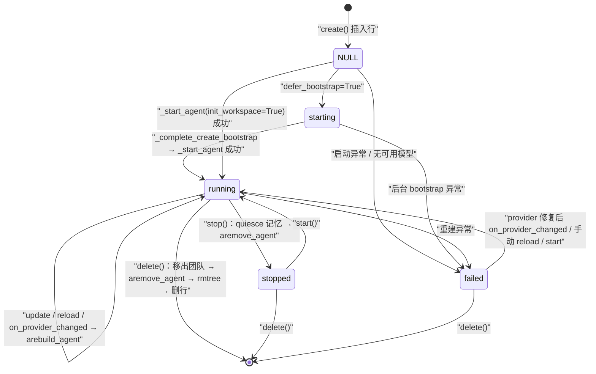
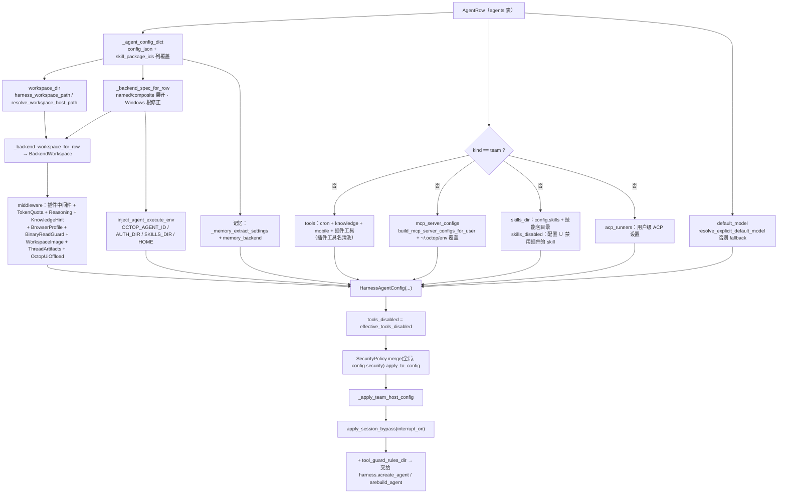
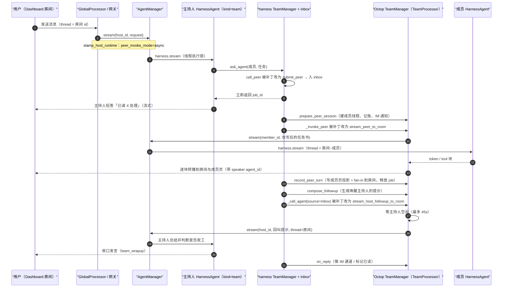

# 04 · Agent 子系统

> **一句话概述**：`src/octop/infra/agents/` 把数据库里的一行 `agents` 记录翻译成一个运行中的 `octop_harness.HarnessAgent`（LangGraph 深度 Agent），并负责它从创建、启动、热重载到删除的整个生命周期；`src/octop/infra/backend/` 负责把"这个 Agent 的文件存在哪"翻译成 harness 能用的 backend spec。

**本篇你将学到**

1. `AgentManager`（`manager.py`，3344 行）的方法分组、锁模型、生命周期状态机。
2. `_build_harness_config` 如何把一行 `AgentRow` 组装成 `HarnessAgentConfig`：模型、工具、MCP、技能、中间件、记忆、backend、安全策略分别从哪来。
3. Octop 与 `octop_harness` 的职责边界：哪些逻辑在 Octop，哪些在 harness（以及 harness 内部的中间件链、checkpointer 默认值）。
4. workspace 路径规则（`workspace_dir` / `root_dir` / `.octop/` 系统目录）与"workspace I/O 必须走 `BackendWorkspace`"的硬规则。
5. 专家团队（team host）与 `ask_agent` / inbox 的协作时序。
6. 常见改动（加配置项、加内置工具、接 provider、改种子文件）分别改哪里、有什么坑。

> 边界外的内容只点到为止：进程启动装配见 [02-boot-and-runtime.md](02-boot-and-runtime.md)；单条消息从入口到 `AgentManager.stream` 的链路见 [03-chat-flow.md](03-chat-flow.md)；IM 网关与 `GlobalProcessor` 见 [05-gateway.md](05-gateway.md)；`agents` 等表结构见 [06-data-layer.md](06-data-layer.md)；HTTP 路由见 [07-api-layer.md](07-api-layer.md)；cron / skills / connectors / knowledge 见 [08-domains.md](08-domains.md)；前端与 CLI 见 [09-frontend-cli.md](09-frontend-cli.md)。

---

## 1. 目录地图

### 1.1 `src/octop/infra/agents/`

| 路径 | 职责 | 文件数 / 主要文件 |
|------|------|------------------|
| `manager.py` | `AgentManager`：进程级单例，拥有 harness `HarnessAgentManager` 与全部 `HarnessAgent` 实例；CRUD、启停、热重载、MCP 预加载、配置组装 | 1 个文件，3344 行 |
| `providers/` | LLM provider：DB 行 → harness `ProviderConfig`、模型可用性判定、预设模板、连通性探测、Codex OAuth、ONNX 本地 embedding | 14 / `store.py`、`harness_factory.py`、`presets.py`、`probe.py`、`reasoning.py`、`model_flags.py` |
| `settings/` | Agent 相关配置结构：profile 列与 `config_json` 的拆分、运行时旋钮、内置工具目录、Langfuse / ACP / 媒体生成全局设置存储 | 7 / `profile.py`、`runtime_limits.py`、`tool_catalog.py`、`acp.py`、`langfuse.py`、`media_generation.py` |
| `workspace/` | `workspace_dir` 解析（宿主路径 vs agent 可见路径）、`.octop/` 系统目录、execute 环境变量注入 | 3 / `dir.py`、`execute_env.py` |
| `security/` | 全局 `SecurityPolicy` 持久化、tool-guard 规则文件、会话级 HITL 放行 | 4 / `policy_store.py`、`tool_guard_rules.py`、`hitl_session.py` |
| `memory/` | 记忆存储 backend 解析（SQLite / PostgreSQL）、在线整理 `memory.sqlite`（memory slim） | 4 / `backend.py`、`slim.py`、`slim_control.py` |
| `teams/` | 专家团队：主持人（`kind=team`）编制、房间转播、inbox 派工适配 | 5 / `team_manager.py`（1750 行）、`service.py`、`jobs.py`、`welcome.py`、`template/` |
| `plugins/` | `PluginManager`：`~/.octop/plugins/` 安装/启用/卸载、插件 skill 同步、工具名清洗 | 5 个顶层 + 26 个 `bundled/` 插件 / `manager.py`、`plugin_tool_defaults.py`、`plugin_tool_names.py`、`seed.py` |
| `experts/` | 专家模板目录（`library/` 18 个内置专家）、种子复制、发布/安装快照、SkillHub 市场 | 9 个顶层 + library 中脚本 / `catalog.py`、`publish.py`、`published_creation.py`、`market_creation.py`、`skillhub_market.py`、`default_agent.py` |
| `subagents/` | 内置 subagent 库（`library/<locale>/<division>/*.md`，约 490 个 md）的目录服务 | 1 / `catalog.py` |
| `persona/` | MBTI 人格档案与 persona system prompt 渲染 | 3 / `loader.py`、`mbti_profiles.py` |
| `middleware/` | Octop 自有的 LangChain Agent 中间件（配额、推理参数、二进制读取拦截、图片物化、线程产物、UI 负载卸载、浏览器 profile） | 7 |
| `threads/` | 线程级辅助：产物路径抽取、fork 会话、上下文窗口占用拆分 | 4 / `artifact.py`、`fork.py`、`context_breakdown.py` |
| `builtin_skills/` | Octop 自带、每次启动都会同步进工作区的内置 skill（目前是 `skill-manager`） | `__init__.py` + `skill-manager/` |
| `conversation_mode.py` | Ask / Plan / Craft 模式的 Octop 侧辅助（策略本体在 harness） | 1 |

### 1.2 `src/octop/infra/backend/`

| 文件 | 职责 |
|------|------|
| `adapter.py` | `storage_backends` 表的一行 → harness `resolve_backend` 能吃的 spec（纯转换，无 I/O）`src/octop/infra/backend/adapter.py:44` |
| `resolver.py` | 展开 agent `config.backend` 中的 `named` 引用与 `composite` 路由；默认 backend；Windows 根目录修正 `src/octop/infra/backend/resolver.py:12-125` |
| `docker_spec.py` | Docker sandbox spec 补默认值（`sandbox_prefix=octop_sandbox`、`sandbox_scope`、`agent_id`/`username`）`src/octop/infra/backend/docker_spec.py:55` |
| `probe.py` | Admin 存储页的连通性探测（docker / opensandbox 自己探，其余委托 harness `probe_backend`）`src/octop/infra/backend/probe.py:73` |
| `browse.py` | Admin 存储页浏览远端目录树 |
| `opensandbox_deps.py` | 按需安装 `opensandbox` SDK |

---

## 2. 与 `octop_harness` 的边界

在读 `AgentManager` 之前，先弄清"谁干什么"。Octop 安装的 harness 在 `.venv/lib/python3.12/site-packages/octop_harness/`（`octop-harness 1.0.0`，同时还有 `octop_memory`、`octop_gateway`、`octop_browser`）。

| 关注点 | Octop（本篇范围） | octop_harness |
|--------|-------------------|---------------|
| Agent 注册表 | 无自有缓存；DB 为真源，`get_agent()` 直接查 harness 注册表 `src/octop/infra/agents/manager.py:1115` | `HarnessAgentManager` + `AgentRegistry` `octop_harness/manager.py:45` |
| 模型 | 把 `providers` 表转成 `ProviderConfig` 列表，决定 default_model `src/octop/infra/agents/providers/store.py:131` | `ChatModelFactory`（共享工厂）、`ModelRouterMiddleware` 按轮路由 `octop_harness/manager.py:69`、`octop_harness/agent.py:1427` |
| 工作区种子 | Octop 内置 skill、插件 skill、专家模板、团队模板 | `init_workspace()`：`AGENTS.md`/`BOOTSTRAP.md`/`MEMORY.md`/`USER.md`/`PROACTIVE.md` 模板、`_builtin_skills`、内置 subagent `octop_harness/init.py:87` |
| 文件 I/O | 只通过 `BackendWorkspace` | `BackendWorkspace`、`resolve_backend`、各类 backend 实现 `octop_harness/backends/` |
| 工具 | cron / knowledge / mobile / 插件工具，作为 `HarnessAgentConfig.tools` 传入 | 文件系统、`execute`、`task`、web、浏览器、记忆、`ask_user_question`、`agent_list`/`ask_agent` 等 |
| 中间件 | 8 个 Octop 中间件 + 插件中间件，作为 `HarnessAgentConfig.middleware` 传入 | 自带链：ModelRouter → ModelSettings → SessionHeader → SkillFilter → ToolGuard → FilesystemGuard → MCP → Retry → PII → MediaOffload → CheckpointTs → Memory → **cfg.middleware** → PeerAgent → ConversationMode → ToolsFilter … `octop_harness/agent.py:1427-1519` |
| 安全 | 全局策略存 settings 表；与 agent 覆盖合并；HITL 会话放行包装 | `SecurityPolicy.apply_to_config`、ToolGuard、PII、HITL interrupt |
| 记忆 / checkpoint | 决定 namespace、memory backend（SQLite 路径或 PG DSN）、抽取参数 | `octop_memory.Memory`；**启用记忆时 Memory 实例同时充当 checkpointer**，否则回落 `{系统目录}/checkpoints.sqlite` `octop_harness/agent.py:1765-1799` |
| 多 Agent | 团队主持人装配、房间转播、`TeamProcessor` 回调实现 | `TeamManager`、inbox、`PeerAgentMiddleware`、`agent_list`/`ask_agent` 工具 |
| MCP | 按用户组装 connector MCP 配置、自定义 MCP 工具缓存与按需追加 | `MCPToolMiddleware`、`aload_mcp_tools` |

一句话：**Octop 负责"配置从哪来、给谁用、何时重建"，harness 负责"怎么跑一个 Agent"**。`HarnessAgentConfig` 是两者之间唯一的主契约（定义在 `octop_harness/config/__init__.py:548`）。

> 兼容性注意：`manager.py` 多处用 `"xxx" in _HARNESS_AGENT_CONFIG_FIELDS` 探测字段是否存在（`src/octop/infra/agents/manager.py:104`、`:3270`、`:3320-3343`），也有针对旧版 harness（0.9.5 无 interval 记忆抽取）的降级逻辑 `src/octop/infra/agents/manager.py:203-217`。新增字段时请沿用这种"探测后再传"的写法，否则 harness 版本不匹配会直接 `TypeError`。

---

## 3. `AgentManager` 总览

### 3.1 构造与依赖注入

`AgentManager` 在 `OctopServer._boot_runtime` 中构造（`src/octop/infra/server.py:373`），此时只拿到 `repos`、`paths`、`config`、`expert_catalog`、`plugin_manager`。其余协作者由 setter 后绑定，**必须在 `boot()` 之前完成**：

| Setter | 绑定对象 | 调用处 |
|--------|---------|--------|
| `set_cron_manager` `src/octop/infra/agents/manager.py:442` | `CronManager`（用于构建 cronjob 工具） | `src/octop/infra/server.py:455` |
| `set_team_processor` `src/octop/infra/agents/manager.py:450` | gateway 里的 Octop `TeamManager`（实现 harness `TeamProcessor`） | `src/octop/infra/server.py:456` |
| `set_hitl_session_store` `src/octop/infra/agents/manager.py:456` | 线程级 HITL 放行存储 | `src/octop/infra/server.py:459` |
| `set_proactive_scheduler` `src/octop/infra/agents/manager.py:446` | 主动关怀调度器（create/delete 时增删任务） | server 后续 |

然后 `await registry.boot()`（`src/octop/infra/server.py:477`）。这种"先构造、后注入、再 boot"的顺序是因为 gateway 构造需要 `AgentManager`，而 `AgentManager.boot()` 又需要 gateway 里的 `TeamManager`，形成环；用 setter 打破。

构造函数内部还创建了一批**设置存储**（都从 settings/secret 表读写）：`LangfuseSettingsStore`、`MediaGenerationSettingsStore`、`SecuritySettingsStore`、`ACPSettingsStore`、`ToolGuardRulesStore`、`ProviderStore`、`ConnectorService`（`src/octop/infra/agents/manager.py:387-409`）。`replace_persistence()`（`:417`）在控制面切库（例如备份恢复）后重建它们。

### 3.2 方法分组表

按类内的分节注释整理（行号为方法定义处）：

| 分组 | 方法 | 说明 |
|------|------|------|
| **装配 / 启停** | `__init__` :340、`replace_persistence` :417、`set_*` :442-458、`boot` :464、`shutdown` :490 | boot 创建 `HarnessAgentManager`、绑定团队钩子、下发安全策略，然后逐个启动 `last_state != "stopped"` 的 agent |
| **只读属性** | `providers` / `security` / `acp_settings` / `tool_guard_rules` / `langfuse` / `media_generation` / `paths` / `harness_manager` / `octop_config` :505-539 | 供 API 层读写全局设置 |
| **CRUD** | `create` :545、`_abort_incomplete_create` :721、`_preserve_internal_layout` :739、`update` :768、`set_shared` :827、`set_icon_url` :842、`delete` :853 | 写 DB + 同步运行时 |
| **启停单个** | `start` :887、`stop` :922、`_quiesce_octop_memory` :933、`_wait_memory_maintenance_idle` :959 | stop 先让记忆 GC 线程停下再关 SQLite |
| **读取（不需 harness）** | `get_row` :980、`workspace_for_agent` :984、`list_agents` :1001、`list_rows` :1004、`resolve_user_agent` :1008、`get_config` :1024、`persist_harness_config` :1031、`resolve_workspace_dir` :1050、`is_bootstrapped` :1074、`find_agents_using_provider` :1093、`find_agents_using_storage_backend` :1101 | 全部直接读 DB，无行缓存 |
| **运行时句柄** | `get_agent` :1115、`_unavailable_error` :1130、`delete_thread_checkpoint` :1140 | 映射 `AGENT_NOT_FOUND` / `AGENT_FAILED` / `AGENT_NOT_RUNNING` |
| **调用** | `is_agent_active` :1175、`try_begin_history_backfill` :1179、`end_history_backfill` :1190、`_begin_invocation` / `_end_invocation` / `_track_invocation` :1196-1222、`stream` :1224、`call` :1241、`resume_hitl` :1255、`cancel_stream` :1276、`get/set/clear_thread_model` :1281-1292、`resolve_fallback_model_ref` :1294 | 所有对 harness 的调用入口 |
| **热重载** | `reload` :1307、`reload_all` :1311、`reload_octop_harnesss` :1318、`_provider_reload_impact_ids` :1330、`_reload_agents` :1362、`on_provider_changed` :1377 | provider 变化时只重建受影响的 agent |
| **Connector / MCP** | `reload_connectors` :1410、`reload_connectors_for_user` :1440、`invalidate_mcp_tool_cache` :1452、`mcp_server_labels_for_user` :1463、`resolve_tool_display_name_for_chat` :1471、`_get_or_load_mcp_tools` :1502、`merge_turn_mcp_servers` :1563、`default_mcp_servers` :1579、`default_knowledge_base_ids` :1588、`prepare_chat_mcp` :1595、`_attach_gateway_tools` :1772 | 聊天前按需装载 MCP 工具 |
| **全局设置持久化** | `save_langfuse` :1813、`save_media_generation` :1832、`save_security` :1850 | 写存储并推送到运行中的 harness |
| **Agent 配置变更** | `apply_persona_mbti` :1864、`update_config_json` :1895、`persist_skills_disabled` :1912、`persist_tools_disabled` :1923、`persist_plugin_tools_config` :1933、`persist_skill_package_ids` :2031、`sync_skill_package_dirs` :2059、`persist_knowledge_base_ids` :2102、`persist_mcp_servers` :2117、`validate_*` :2091/:2137/:2151、`refresh_agents_for_package` :2187、`strip_skill_package_id` :2194 | 区分"需要重建图"与"热同步即可" |
| **技能 / subagent / 工具查询与热同步** | `resolve_context_max_tokens` :2209、`list_skill_summaries` :2213、`list_subagent_summaries` :2368、`sync_skills_disabled` :2375、`sync_tools_disabled` :2379、`strip_team_host_runtime_tools` :2393、`sync_effective_tools_disabled` :2413 | 热同步到运行中 agent，不重建 |
| **内部：校验** | `_assert_agent_name_available` :2438 | 同一用户下重名检查 |
| **内部：启动与种子** | `_complete_create_bootstrap` :2458、`_start_agent` :2472、`_post_start_agent` :2525、`_mark_bootstrap_graph_refresh_pending` :2593、`_apply_pending_bootstrap_graph_refresh` :2607、`_agent_config_dict` :2625、`_backend_spec_for_row` :2629、`resolved_backend_spec` :2651、`_owner_username` :2658、`_spec_is_opensandbox` :2667、`_prepare_docker_backend` :2670、`_backend_workspace_for_row` :2683、`_seed_expert_template` :2721 | |
| **内部：后台重载** | `_reload_agent` :2791、`_schedule_reload` :2828、`_reload_worker` :2836 | 合并连续的更新 |
| **内部：配置组装** | `_agent_runtime_bundle` :2855、`_refresh_peer_entry` :2891、`_apply_peer_profile_metadata` :2899、`_peer_manifest_metadata` :2918、`_connector_uid_for` :2948、`_prepare_stream_request` :2961、`_build_harness_config` :2978、`_install_team_host_dispatch` :3292、`_apply_team_host_config` :3316 | 核心：Row → HarnessAgentConfig |

模块级辅助函数：`_memory_namespace` :107（`agent_<id>`，octop-memory 以它作 SQL 表前缀，因此 agent id 必须是合法标识符片段）、`skills_disabled_set` :111、`tools_disabled_set` :119、`skill_package_ids_list` :126、`_memory_extract_settings` :164、`validate_custom_agent_id` :265（3-64 位字母数字下划线连字符，保留字 `api/admin/agents/experts` :281），以及入参数据类 `AgentCreateSpec` :285。

### 3.3 锁与并发模型

`AgentManager` 全部运行在单个 asyncio 事件循环上，但有多层锁，读代码前务必记住：

| 锁 / 状态 | 定义 | 保护什么 |
|-----------|------|---------|
| `_lock`（全局） | `src/octop/infra/agents/manager.py:370` | `create` / `delete` / `start` / `stop` 的整体串行，避免同名/同 id 并发创建 |
| `_agent_lifecycle_locks[agent_id]` | `:373`、`_lifecycle_lock_for` :895 | 同一 agent 的 start / reload / stop 串行，防止并发 provider 重载时同一 id 重复注册（harness 报 "already exists in the registry"） |
| `_thread_execution_locks[(agent_id, thread_id)]` | `:378`、`_thread_execution_lock` :902 | 同一线程的 `stream` / `resume_hitl` 串行；注释说明 dashboard 有 debounce，但 HITL resume 和 cron 没有，两次并发执行会交错写 LangGraph checkpoint |
| `_active_invocations` / `_invocation_waiters` / `_history_backfills` | `:379-381`、`:1175-1222` | "空闲预约"：历史回填与 memory slim 只能在 agent 空闲时独占；新调用会在 `_begin_invocation` 等待预约释放 |
| `_reload_dirty` / `_reload_worker_running` | `:382-383` | 后台重载合并（见 §4.4） |
| `_mcp_tool_cache_guard` + 每 `(user, server)` 锁 | `:411-413` | 自定义 MCP 工具按用户/服务器/指纹只加载一次 |

注意 `call()`（`:1241`）只套了 `_track_invocation`，**没有**线程执行锁，这与 `stream()` / `resume_hitl()` 不同。

另外，`_start_agent` 与 `_reload_agent` 对 "already registered" 竞态做了恢复：捕获异常后若注册表里已有实例，就把状态记为 running 而不是 failed（`:2508-2516`、`:2812-2820`）。

---

## 4. 生命周期

### 4.1 状态机

`agents.last_state` 列（TEXT，无约束，见 `001_initial.sql:41`）实际写入的值只有 `starting` / `running` / `failed` / `stopped`；新插入的行为 `NULL`。`_AGENT_STATES_NEEDING_MODEL_RELOAD = {"failed", "created"}`（`:102`）中的 `created` 在当前代码中没有写入点（待确认是否为历史遗留）。



几条关键规则：

- **boot 只跳过 `stopped`**：`failed` 的 agent 在进程重启时会再尝试启动（`src/octop/infra/agents/manager.py:484-488`）。
- **没有任何可用 provider 时**，`_start_agent` 直接把状态写成 `failed` 并附上 `NO_MODELS_CONFIGURED` 文案，不调用 harness（`:2476-2478`）。随后用户配好 provider，`on_provider_changed` 会把 `failed` 的 agent 纳入重建集合（`:1349`）。
- **`_reload_agent` 遇到 stopped / disabled / 已删除的行**，会把 harness 中的实例移除而不是重建（`:2796-2799`）。所以"改配置"不会意外拉起一个被停止的 agent。

### 4.2 create：从请求到可聊天

`create(spec, defer_bootstrap=False, workspace_initializer=None)`（`:545`）在全局 `_lock` 下完成：

1. **id 与名字**：校验同用户重名（`:554`）；自定义 id 走 `validate_custom_agent_id`，否则用 `new_short_id()` 最多重试 16 次（`:555-569`）。
2. **配置合并**：`merge_agent_runtime_values(spec.config, spec.runtime_config)` 把运行时旋钮并入 `config`；MBTI 写入 `config["persona"]`（`:570-575`）。
3. **资源策略**：普通专家检查用户 agent 配额；无论专家还是团队都检查 `backend` 是否越出用户允许的根目录（`:585-597`，实现在 `infra/users/resource_policy.py`）。
4. **工作区目录**：`seed_workspace_dir_on_create` 写入 `config["workspace_dir"]` 并创建宿主目录；强制 `system_files_path = ".octop"`，**用户不可配置**（`:601-605`）。
5. **profile 拆分**：`extract_profile_from_config` 把展示类字段（`icon_name`、`color`、`skill_package_ids`、`knowledge_base_ids`、`mcp_servers` 等，见 `PROFILE_CONFIG_KEYS` `src/octop/infra/agents/settings/profile.py:12`）抬到独立列，`config_json` 只保留与 harness 交互的键（`:611-629`）。
6. **插入行**（`:630-654`），必要时 `set_shared`。
7. **写种子**：`kind=team` 调 `seed_team_template`，否则若有 `template_name` 调 `_seed_expert_template`；然后可选的 `workspace_initializer(row, workspace)`（API 的 composer 补丁、发布快照安装等都用它）。团队种子或 initializer 失败会调用 `_abort_incomplete_create` 回滚（`:661-683`）。
8. **启动**：
   - `defer_bootstrap=True`：状态置 `starting`，`asyncio.create_task(_complete_create_bootstrap)` 后立即返回（`:684-691`）。专家页面创建、默认 agent、市场安装、发布安装全部走这条路（`api/routers/experts.py:894`、`experts/default_agent.py:83`、`experts/market_creation.py:364`、`experts/published_creation.py:404`）。
   - 否则同步 `_start_agent(row, init_workspace=True)`；对 OpenSandbox backend 的模板要在 agent 起来之后再种（因为停机时拿不到远端沙箱，见 §7.3）；有模板的专家启动后再 `reload_subagents()` 让新写入的 `agents/*.md` 生效（`:692-713`）。
9. 写审计日志、登记主动关怀任务（`:714-718`）。

为什么种子在 harness 启动**之前**写？因为 harness 编译图时会读取工作区里的模板、skill、subagent；先种子再 `acreate_agent` 可以少一次图重编译。harness 自己的 `init_workspace()` 也只有在"真的写了东西"时才重编译（`octop_harness/manager.py:155-167`）。

### 4.3 `_start_agent` 与 `_post_start_agent`

```text
_start_agent(row, init_workspace)                       manager.py:2472
  ├─ shared_factory 为空 → failed(NO_MODELS_CONFIGURED)   :2476
  └─ async with lifecycle_lock(agent_id)                  :2479
       ├─ 已在注册表 → 标 running，直接返回（幂等）        :2480-2489
       ├─ _agent_runtime_bundle(row) → cfg/metadata/tags   :2493
       ├─ harness.acreate_agent(cfg, init_workspace=...)   :2497   （团队主持人强制 False）
       ├─ _post_start_agent(...)                           :2504
       └─ set_state(running) / 异常时 set_state(failed, 本地化错误)
```

`_post_start_agent`（`:2525`）在 harness 实例创建后做"只能在运行时做"的事：

- 为非团队 agent 注入 connector 网关工具（`inject_missing_gateway_tools`），团队主持人则剥掉残留 MCP 工具（`:2536-2547`）。
- `sync_octop_builtin_skills(ws)`：把 `builtin_skills/` 下的 Octop 内置 skill **覆盖写入** `_builtin_skills/`，并删除已退役的内置 skill（`src/octop/infra/agents/builtin_skills/__init__.py:28-74`）。
- `PluginManager.sync_skills_to_workspace`：把启用插件自带的 skill 拷到 `skills/<name>/`，**已存在则跳过**（`src/octop/infra/agents/plugins/manager.py:729-764`）。
- 若还没完成 bootstrap（首次对话引导），挂上 `on_bootstrap_complete` 回调（`:2585-2591`）。

**Bootstrap 的图刷新为什么要延迟**：首次对话时 harness 用 `BOOTSTRAP.md` 引导用户，此时 `_build_harness_config` 故意传 `system_prompt=None`、`memory=()`（`:3164-3168`）。引导完成后需要带上 DB 里的 `system_prompt` 重编译图，但注释写明"在流式输出中途同步 `_init_graph` 会段错误"，所以回调只把 agent 放进 `_bootstrap_graph_refresh_pending`（`:2593-2605`），真正的 `_init_graph()` 在下一次 `stream/call/resume_hitl` 的开头或结尾执行（`:1234`、`:1239`、`:2607-2623`）。

### 4.4 update 与后台重载合并

用户改配置的主路径 `update(agent_id, **kwargs)`（`:768`）：

1. 运行时键（`max_iters`、`max_input_length`、`temperature`、`top_p`、`max_tokens`，见 `AGENT_RUNTIME_CONFIG_KEYS` `src/octop/infra/agents/settings/runtime_limits.py:22`）从 kwargs 中取出合并进 `config_json`。
2. `_preserve_internal_layout(..., pin_workspace_dir=True)`：**`system_files_path` 与 `workspace_dir` 以 DB 为准，客户端传的值被丢弃**（`:739-766`）。注释解释了原因：改写目录会悄悄把 agent 搬家，scoped / 容器 agent 会丢失 skill、sessions、生成文件。
3. 重新检查 backend 根目录策略，拆分 profile 列，重名检查，写库。
4. `_schedule_reload(agent_id)`（`:2828`）：把 id 放入 `_reload_dirty`；若该 agent 没有 worker 在跑，就起一个 `_reload_worker`（`:2836`）。worker 循环"取出脏标记 → `_reload_agent`"，直到没有新的脏标记。**连续多次 PATCH 只会导致最多两次重建**。

`_reload_agent`（`:2791`）调用 harness `arebuild_agent`，它在 `hold_shared_memory` 下 `aremove_agent` + `acreate_agent(init_workspace=False)`（`octop_harness/manager.py:296-325`）。所以**重载不会重新种 harness 模板**，但 `_post_start_agent` 会再次同步 Octop 内置 skill 与插件 skill。

并非所有改动都需要重建图。以下方法只写库 + 热同步到运行中的 agent：

| 方法 | 热同步手段 |
|------|-----------|
| `persist_skills_disabled` :1912 | `agent.set_skills_disabled()` |
| `persist_tools_disabled` / `persist_plugin_tools_config` :1923/:1933 | `sync_effective_tools_disabled` → `agent.set_tools_disabled()` |
| `persist_skill_package_ids` :2031 | `sync_skill_package_dirs` 更新 `skills_dir` |
| `set_icon_url` :842 | 不重载 |

需要重建的有 `update`、`update_config_json`（`:1895`）、`apply_persona_mbti`（`:1864`）以及 API 显式调用的 `reload` / `reload_all`（插件安装、connector 变化等，见 `api/routers/plugins.py:120`、`api/routers/connectors.py:453`）。

### 4.5 provider 变化的影响面

`on_provider_changed(provider_name=None, active_model_changed=False)`（`:1377`）由 providers / setup / backup 路由调用（如 `api/routers/providers.py:185`、`:230`）：

1. `sync_providers_to_harness` 把新的 `ProviderConfig` 列表同步进 harness 共享工厂（删除消失的、add 新的）`src/octop/infra/agents/providers/harness_factory.py:16`。
2. `_provider_reload_impact_ids`（`:1330`）计算要重建的 agent：`failed` 状态的；active model 变化时所有"AUTO 默认模型"的 agent；以及 `default_model` 或 `config.providers` 引用了该 provider 的 agent。两个参数都为空（备份恢复、OAuth 等）则全部重建。
3. `_reload_agents` 以 `asyncio.Semaphore(6)` 并发重建（`:1362`、`:96`）。

### 4.6 stop / delete

- `stop`（`:922`）：`_quiesce_octop_memory` 先调用记忆中间件的 `shutdown()`，并等待名为 `hm-maintenance` 的 GC 线程退出（最多 5 秒）再 `aremove_agent`。注释说明：在 `list_candidates` 进行中关闭 SQLite 会**段错误**（`:933-974`）。之后状态写成 `stopped`。
- `delete`（`:853`）：先由 `TeamService.assert_can_delete_agent` 拒绝有在途派工的专家/团队（`src/octop/infra/agents/teams/service.py:232`）；非团队专家会从所有团队编制中移除（`drop_member`）；quiesce 记忆 → `aremove_agent` → `rmtree(workspace_dir)`（失败只记日志）→ 删行 → 取消主动关怀 → 重载受影响的团队（`:853-885`）。

注意 `delete` 用 `resolve_workspace_dir`（宿主路径）+ `shutil.rmtree` 删除工作区，这是"整目录删除"的宿主操作，不属于内容文件 I/O；远端 backend（COS/S3/docker）上的内容**不会**被这一步清理（待确认是否有别处清理）。

---

## 5. Runtime 组装：`_build_harness_config`

这是理解 Agent 行为最重要的一个方法（`src/octop/infra/agents/manager.py:2978-3290`）。它把 `AgentRow` + `config_json` + 全局设置转换为 `HarnessAgentConfig`。



逐项说明（括号内为行号）：

| 字段 | 来源 | 备注 |
|------|------|------|
| `name` | `agent_<agent_id>`（:3241） | 同时是 octop-memory 的 namespace |
| `workspace_dir` | 持久化的 `config.workspace_dir` **原样**传给 harness（:2989-2994） | 宿主映射仅用于 Octop 自己的宿主操作，见 §7 |
| `system_files_path` | `system_files_path_from_config`（:3243），新 agent 为 `.octop` | 旧 agent 为空 = 系统文件在工作区根 |
| `default_model` | `providers.resolve_explicit_default_model(row, cfg)`，否则 `resolve_fallback_model_ref()`（:3249-3252） | 注释：这里给的是记忆辅助 LLM 需要的具体 ref；**每轮 AUTO 路由由网关单独决定**（见 03-chat-flow） |
| `system_prompt` / `memory` | `row.system_prompt`；未完成 bootstrap 时为 `None` / `()`（:3164-3168） | bootstrap 结束后延迟刷新（§4.3） |
| `backend` | spec 经 docker 补全 + execute env 注入；OpenSandbox 则传**已创建的实例** `ws.backend`（:3229-3238） | OpenSandbox 创建非幂等，避免起两个远端沙箱 |
| `mcp_server_configs` | `build_mcp_server_configs_for_user`（connectors 领域），再用 `~/.octop/env` 覆盖 stdio 环境变量（:3170-3199） | 共享 agent（`user_id IS NULL`）需要 `_connector_user_override` 提供聊天用户，否则为空 |
| `tools` | cron（需 `CronManager`）+ knowledge + mobile（需 `capabilities.mobile.enabled`）+ 插件工具（:3014-3145） | 插件工具名若含非 ASCII 会被重写为合法名，原名保存在 `_plugin_tool_labels` 供展示（:3079-3095） |
| `middleware` | 见下表（:3121-3138） | 插件中间件在最外层 |
| `skills_dir` | `config.skills` + 技能包目录（仅本地 backend 且 root 为 `/` 或工作区根时）（:3201-3213） | 判定见 `_backend_supports_host_skill_packages` :1972 |
| `skills_disabled` | `config.skills_disabled` ∪ 被禁用插件的 skill 名（:3214-3223、:3262） | |
| `acp_runners` / `acp_delegate_enabled` | 用户级 ACP 设置 + `config.acp.tool_enabled`（:3148-3162、:3260-3261） | |
| `media_generation` | 全局媒体生成设置（:3266） | |
| 记忆字段 | `_memory_extract_settings`（`config.memory.*` → `memory_enabled`、`memory_extract_*`、`memory_aux_*_model`）+ `memory_backend_from_agent_config`（:3267-3268） | 见 §9 |
| `tools_disabled` | `effective_tools_disabled`：内置禁用 ∪ 显式禁用的插件工具，减去 `CRITICAL_TOOLS`（:3270-3281） | `src/octop/infra/agents/settings/tool_catalog.py:168` |
| 安全 | `SecurityPolicy.merge(global, config.security).apply_to_config`（:3099-3101、:3282） | 见 §10 |
| `interrupt_on` | 用 `apply_session_bypass` 包装每个 HITL 工具的 `when`（:3284-3286） | 会话级"全部允许 / 允许某工具" |
| `tool_guard_rules_dir` | `~/.octop/security/tool_guard/`（:3289） | |

**Octop 中间件链**（列表顺序即外 → 内）：

| 中间件 | 文件 | 作用 |
|--------|------|------|
| 插件中间件 | `PluginRegistry().build_middleware_chain` | 插件声明的中间件 |
| `TokenQuotaMiddleware` | `middleware/token_quota.py` | 用户 token 配额耗尽时拒绝本轮 |
| `ReasoningRequestMiddleware` | `middleware/reasoning.py` | 按 provider 注入推理参数 |
| `KnowledgeSearchHintMiddleware` | `infra/knowledge/hint.py` | 知识库检索提示 |
| `BrowserProfileMiddleware` | `middleware/browser_profile.py` | 浏览器工具强制使用当前用户隔离 profile |
| `BinaryReadGuardMiddleware` | `middleware/binary_read_guard.py` | 阻止 `read_file` 读二进制附件（PDF/Office） |
| `WorkspaceImageMaterializeMiddleware` | `middleware/workspace_image.py` | 仅在模型请求时把 `workspace://` 图片引用展开为 data URI，base64 不进 checkpoint |
| `ThreadArtifactsMiddleware` | `middleware/thread_artifacts.py` | 工具成功后把文件路径记到 `threads.artifacts` |
| `OctopUiOffloadMiddleware` | `middleware/octop_ui_offload.py` | 最内层：把超大 `octop_ui` 插件负载挪到 `ToolMessage.artifact`，不进模型上下文 |

这些中间件在 harness 链中位于记忆中间件之后、`PeerAgentMiddleware` 之前（`octop_harness/agent.py:1493-1519`）。FilesystemGuard、ModelSettings 等由 harness 自动挂载，Octop 不再重复（`:3114-3120` 注释）。

### 5.1 每轮请求的补充：`_prepare_stream_request`

有些 agent 配置不进图，而是每轮随请求下发（`:2961-2976`）：

- 插件工具配置 → `configurable.plugin_tool_configs`；
- `apply_agent_runtime_to_stream_request`：`max_iters` → 顶层 `recursion_limit`；`temperature/top_p/max_tokens` → `CONFIGURABLE_MODEL_SETTINGS`（被 harness `ModelSettingsMiddleware` 消费）；`max_input_length` → `CONFIGURABLE_MAX_INPUT_TOKENS`（`src/octop/infra/agents/settings/runtime_limits.py:135-167`）。

这就是为什么改 `temperature` 这类键理论上不需要重建图——但 `update()` 仍会 `_schedule_reload`，因为它不区分键。

### 5.2 `_agent_runtime_bundle` 与 peer 元数据

`_agent_runtime_bundle`（`:2855`）在组装 config 之外还构造注册表 `metadata`（`user_id`、`description`、`display_name`、`icon`、`template_name`，以及从工作区 `.octop/manifest.json` 读出的 `quick_prompts`）和 `tags`（`team`、模板名）。这些元数据被 harness `TeamManager.list_peers` 用于 `agent_list` 输出；`boot()` 里 `bind_peer_enrich(self._refresh_peer_entry)` 让每次列 peer 时重新读取 DB 描述（`:474`、`:2891`）。

注意 `_peer_manifest_metadata`（`:2918-2946`）直接对宿主路径 `read_text` 读 `manifest.json`，这是 §7 规则的一个现存例外（仅读元数据）。

---

## 6. Provider 与模型解析

数据流：`providers` 表 →`ProviderStore` → harness `ProviderConfig` → 共享 `ChatModelFactory`。

- **可用性**：`iter_usable_rows` 只接受 `enabled`、有 `base_url` 与 `api_key`、且至少一个"可聊天"模型的行（`src/octop/infra/agents/providers/store.py:111-125`）。embedding 模型、ONNX 本地模型被 `is_chat_eligible_model` 排除（`providers/model_flags.py:156`）。
- **协议映射**：`KIND_TO_PROTOCOL`（`store.py:19`）：`openai/ollama/azure/gemini` → `openai`，`anthropic` → `anthropic`；未知 kind 默认 `openai`（`:133`）。harness 只认两种协议。
- **model ref** 统一为 `"<provider_name>/<model_id>"`。`is_model_ref_usable`（`:232`）是判定的唯一入口；`resolve_explicit_default_model`（`:264`）按 `row.default_model` → `config.default_model` 顺序取第一个可用的非 `auto` ref，否则返回 `None` 表示 AUTO。
- **fallback**：`AgentManager.resolve_fallback_model_ref`（`manager.py:1294`）先用 settings 表的 active model，再退到第一个可用模型。
- **多模态**：`resolve_model_for_multimodal_turn`（`store.py:204`）在本轮需要看图而所选模型不支持时升级到第一个视觉模型。
- **预设**：`load_provider_presets` 直接序列化 harness 自带的 `provider_template.json`，并补一个 `openai-codex` 预设（`providers/presets.py:214`）。
- **其他**：`probe.py`（连通性测试）、`reasoning.py`（推理能力元数据与请求参数）、`codex_oauth.py` / `codex_apply.py`（ChatGPT Codex 设备码登录）、`opencode_session.py`（OpenCode 会话头）、`onnx_*.py`（本地 embedding 模型下载，**不是**聊天 provider，见 `onnx_service.py:1-5`）。

---

## 7. Workspace 与 Backend

### 7.1 三个"路径维度"

`src/octop/infra/agents/workspace/dir.py:1-22` 的模块文档是这一块的权威说明：

| 概念 | 含义 | 存哪 |
|------|------|------|
| `backend.root_dir` | 本地 backend 的根文件系统（agent 看到的 `/`） | `config.backend` |
| `workspace_dir` | agent 的工作目录。**创建后 DB 值为准，harness 原样接收**，不与 `root_dir` 拼接 | `config.workspace_dir` |
| `system_files_path` | 工作区内系统文件前缀，新 agent 固定 `.octop` | `config.system_files_path`（内部键） |

创建时默认值（`seed_workspace_dir_on_create` `dir.py:124`）：

- 宿主根 backend（`root_dir` 为 `/`、空、或 Windows 盘符根）→ `{OCTOP_HOME}/agents/<id>/`，存绝对宿主路径。
- scoped `root_dir`（目录狱）→ 物理目录 `{root_dir}/.octop/workspaces/<id>/`，但**持久化 agent 可见路径** `/.octop/workspaces/<id>`。
- 用户显式给的 `workspace_dir` 总是优先。

`resolve_workspace_host_path`（`dir.py:168`）只给 Octop 宿主操作（删除目录、记忆 SQLite 路径、执行环境 mkdir）用，把 `/.octop/workspaces/…` 映回 `{root_dir}/…`；`harness_workspace_path`（`dir.py:209`）决定传给 harness 的值（Windows 上无法表达无盘符绝对路径时才退回宿主映射）。

### 7.2 `.octop/` 系统目录

harness 的 `apply_system_files_prefix` 只给"系统逻辑条目"加前缀：`skills`、`_builtin_skills`、`agents`、`sessions`、`.bootstrapped`、`.env`、`checkpoints.sqlite`、`memory.sqlite*`（`octop_harness/backends/workspace.py:80-97`、`:134-158`）。人格 markdown（`AGENTS.md`、`MEMORY.md`、`USER.md`、`SOUL.md`，即 `DEFAULT_MEMORY_FILES` `workspace.py:79`）留在工作区根。

于是一个新专家的工作区大致是：

```text
<workspace_dir>/
  AGENTS.md  SOUL.md  USER.md  MEMORY.md  BOOTSTRAP.md  PROACTIVE.md   ← 人格 / 记忆 markdown（harness 模板 + 专家模板覆盖）
  inbound/                                                            ← 聊天附件（见 AGENTS.md "Chat attachments"）
  skills/                                                             ← 旧布局可读根；插件 skill 目前写这里
  .octop/
    manifest.json          ← 专家 / 团队清单（欢迎语、quick_prompts、团队 members）
    skills/  _builtin_skills/  agents/  sessions/
    memory.sqlite  checkpoints.sqlite  .bootstrapped  .env
    auth/                  ← 工具/skill 的鉴权凭据（旧 agent：<workspace>/.octop-auth）
    conversation_history/  ← 本地 backend 的压缩 offload
```

注意：`sync_skills_to_workspace` 写的是字面路径 `skills/<name>/...`（`plugins/manager.py:755`），经过 `BackendWorkspace` 前缀规则后是否落在 `.octop/skills/`，取决于 harness 对 `skills` 条目的前缀处理（按上面规则应落到 `.octop/skills/`，待运行验证）。`skills_discovery_roots` 同时扫描 `.octop/skills` 与 `skills`（`dir.py:359`）以兼容两种布局。

`agent_auth_dir`（`dir.py:342`）在旧 `.octop-auth` 有文件而新目录为空时继续使用旧路径，保证升级不丢凭据。

### 7.3 backend spec 的解析链

```text
config.backend ──None──► default_agent_backend_spec(workspace_dir)          resolver.py:12
      │                   （POSIX：harness DEFAULT_BACKEND_SPEC = local_shell, root_dir=/, virtual_mode）
      │                   （Windows：local_shell, root_dir=<workspace>）
      ▼
resolve_agent_backend_spec(spec, repo=storage_backend_repo)                 resolver.py:79
      │  named → storage_backends 行 → row_to_backend_spec → 递归            adapter.py:44
      │  composite → 递归展开 default 与 routes
      ▼
windows_neutralize_host_root                                                resolver.py:34
      ▼
_prepare_docker_backend：enrich_docker_backend_spec + environment_file      manager.py:2670
      ▼
inject_agent_execute_env（仅 local_shell / docker，composite 递归 default） execute_env.py:93
      ▼
HarnessAgentConfig.backend ──► harness resolve_backend(...)                 octop_harness/backends/__init__.py:85
```

`row_to_backend_spec` 支持的 kind：`cos`、`oss`、`obs`、`s3`/`custom`（S3 兼容）、`filesystem`、`shell`（→ `local_shell`）、`postgres`、`docker`、`opensandbox`（`adapter.py:44-168`）。

不同 backend 的差异要点：

| 类型 | 文件在哪 | `execute` | 注意 |
|------|---------|-----------|------|
| `local_shell`（默认） | 宿主机；`virtual_mode` 下以 `root_dir` 为虚拟根 | 宿主机执行；Linux + 非宿主 root + 有 `bwrap` 时进目录狱 | 见 `docs/agent-backend-file-io.md` §12 |
| `filesystem` | 同上 | 不支持 | |
| `cos` / `s3` / `oss` / `obs` | 远端对象存储 | 不支持 | 技能包（`skills_dir` 宿主路径）不可用：`persist_skill_package_ids` 会报 `SKILL_PACKAGE_BACKEND_UNSUPPORTED`（`manager.py:2043-2051`） |
| `docker` | 容器内与宿主 `workspace_dir` 同名的绝对路径（不 bind-mount） | 容器内 | `sandbox_scope`：`agent`（默认）/ `user` / `fixed`；前缀 `octop_sandbox` |
| `opensandbox` | 远端沙箱 | 远端 | 创建非幂等：停机时的 `_backend_workspace_for_row` 退回本地 `filesystem`（`manager.py:2706-2712`），模板要等 agent 运行后再种 |

`inject_agent_execute_env` 给可执行 backend 注入 `OCTOP_AGENT_ID`、`OCTOP_AUTH_DIR`、`OCTOP_HOME`、`OCTOP_SKILLS_DIR`；目录狱下使用 agent 可见路径，确保 skill 脚本在狱内外指向同一位置（`execute_env.py:1-10`、`:68-90`）。

### 7.4 workspace I/O 硬规则

`AGENTS.md` §7 "Agent workspace I/O" 规定：所有 agent 工作区**内容文件**的读写必须走 `HarnessAgent.workspace`（`BackendWorkspace`），不要用 `agent.backend`、`resolve_harness_backend`、或 `Path.read_text/write_text`，也不要在 Octop 里按 backend 类型或 `virtual_mode` 分支——路径规则由 `BackendWorkspace` 统一处理。

在 agents 子系统中拿 `BackendWorkspace` 的方式：

| 场景 | 入口 |
|------|------|
| agent 运行中 | `agent_manager.get_agent(id).workspace` |
| 运行与否都要（有则复用，无则现造） | `AgentManager.workspace_for_agent(id)` `manager.py:984` |
| 启动前种子 / create 流程 | `_backend_workspace_for_row(row)` `manager.py:2683`（内部 `BackendWorkspace(resolve_backend(spec), workspace_dir, system_files_path=...)`） |
| HTTP（要求运行中） | `require_running_workspace()` `src/octop/api/common/workspace.py:37` |
| 网关 / IM / 媒体 | `harness_workspace_for_agent()` `src/octop/infra/gateway/process/agent_resolve.py:18` |

本子系统里遵守该规则的典型代码：`seed_expert_directory`（`experts/catalog.py:214`，`aupload_many`）、`seed_team_template`（`teams/service.py:311`）、`sync_octop_builtin_skills`、`PluginManager.sync_skills_to_workspace`。路径传**工作区相对路径**（`SOUL.md`、`skills/foo/SKILL.md`），`"."` 与 `"/"` 在 `BackendWorkspace` 中含义不同，不要混用。

> `docs/agent-backend-file-io.md` §2 中的示例仍写着 `resolve_harness_backend` / `aupload_files`，那是改造方案的早期写法；当前以 `AGENTS.md` 为准。

---

## 8. Settings：配置项放在哪

一个 agent 的配置分布在三处：

1. **`agents` 表列**：`name`、`description`、`persona_mbti`、`default_model`、`system_prompt`、`icon*`、`color`、`template_name`、`kind`、`skill_package_ids`、`knowledge_base_ids`、`mcp_servers`、`welcome_message`、`published_expert_id` 等（列定义见 06-data-layer）。
2. **`config_json`**：与 harness 交互的键——`workspace_dir`、`system_files_path`、`backend`、`plugins`、`memory`、`skills`、`skills_disabled`、`tools_disabled`、`security`、`acp`、`persona`、运行时旋钮（`max_iters` 等）。`settings/profile.py` 的 `strip_profile_config` / `extract_profile_from_config` 保证 profile 键不会留在 `config_json` 里（`profile.py:35`、`:90`）；读取时 `overlay_skill_package_ids` 把列值覆盖回 dict（`:132`、`manager.py:2625`）。
3. **全局设置（settings / secrets 表 + 文件）**：安全策略、Langfuse、媒体生成、用户级 ACP runner（`acp_runners:user:<id>`，`settings/acp.py:16`）、tool-guard YAML（`~/.octop/security/tool_guard/`）、插件全局启用表。

`settings/tool_catalog.py` 是"工具设置"对话框的数据源：`BUILTIN_TOOL_CATALOG`（`:52`）列出可见的内置工具及分类，`CRITICAL_TOOLS`（`ls/read_file/glob/grep/write_todos/task`，`:10`）永远不能被禁用。

---

## 9. Memory

- **与 octop_memory 的关系**：Octop 不实现记忆本身，只决定 `HarnessAgentConfig` 的记忆参数；harness `memory/runtime.py` 构造 `octop_memory.Memory` / `MemoryService`。启用记忆时，这个 `Memory` 实例**同时就是 LangGraph checkpointer**（`octop_harness/agent.py:1791-1793`），所以 `memory.sqlite` 里既有长期记忆也有对话 checkpoint——这正是 "memory slim" 实际整理的是 checkpoint 表的原因。
- **backend 解析** `memory_backend_from_agent_config`（`src/octop/infra/agents/memory/backend.py:13`）：
  - 未配置：SQLite 控制面下返回空（harness 默认在系统目录建 `memory.sqlite`）；PostgreSQL 控制面下默认用同一 DSN（按 namespace 分 schema）。
  - `{"type":"sqlite","db_path":...}`：缺省路径为 `{系统目录}/memory.sqlite`。
  - `{"type":"postgres","dsn":...}` 或 `use_control_plane_dsn: true`。
- **抽取参数** `_memory_extract_settings`（`manager.py:164`）：对应 dashboard `PUT .../memory/extract-config` 写入的 `config.memory` 段；`aux_model` 同时驱动轻/重两级抽取，失效的 ref 会被丢弃并回落默认模型（`:134-161`）。
- **Memory slim**（`memory/slim.py`）：`MemorySlimCoordinator` 挂在 `AgentManager.memory_slim`（`manager.py:369`），`_run`（`slim.py:195`）用 `try_begin_history_backfill` 抢占空闲窗口（最多等 120 秒），备份后在线调用 `octop_memory.application.checkpoint_maintenance.slim_live_checkpoints`；期间新的 stream/call/resume 在 `_begin_invocation` 排队。CLI 通过本机 loopback 通道（`memory/slim_control.py`，`docs/memory-slim.md` 中写作 `memory_slim_control.py`，实际路径以代码为准）触发。`shutdown()` 先 `memory_slim.close()` 再关 harness（`manager.py:490-499`）。

---

## 10. Security

三层叠加：

1. **全局 `SecurityPolicy`**（`security/policy_store.py`）：存 settings 表 `security_policy` 键；无记录时 Octop 默认值为 **HITL 关闭、tool_guard 开启且 `mode=warn`**（`policy_store.py:18-23`），比 harness 默认更宽松。`save_security` 保存后立即 `harness_manager.set_security_policy`（`manager.py:1850-1858`）。
2. **Agent 覆盖**：`config.security` 与全局 `SecurityPolicy.merge` 后 `apply_to_config`（`manager.py:3099-3101`、`:3282`）。
3. **会话级 HITL 放行**（`security/hitl_session.py`）：用户在聊天里选择"本会话全部允许 / 允许某些工具"，存 `threads.hitl_policy`。`apply_session_bypass`（`:204`）把每个 `interrupt_on` 条目的 `when` 包一层：若当前线程允许该工具则不中断。"当前线程"通过 `ContextVar` 传递——`stream/call/resume_hitl` 外面都包着 `hitl_thread_scope(thread_id)`（`manager.py:1236`、`:1248`、`:1269`）。`ask_user_question` 永不跳过。

tool-guard 规则文件由 `ToolGuardRulesStore.ensure_seeded` 在 `boot()` 时从 harness 内置 YAML 初始化（`security/tool_guard_rules.py`、`manager.py:465`）；规则编辑后调用 `reload_octop_harnesss()`（`:1318`）让 harness 就地重建所有 agent（**不**重读 DB 配置）。

---

## 11. Persona / MBTI、Experts、Plugins、Subagents

### 11.1 Persona

`PersonaLoader.render(mbti, agent_name, user_display, custom)` 用 `mbti_profiles.py` 的档案渲染 persona 文本（`persona/loader.py`）。`apply_persona_mbti`（`manager.py:1864`）把渲染结果**写进 `agents.system_prompt` 列**并设置 `config.persona`、`persona_mbti` 列，然后后台重载。注意它是覆盖 `system_prompt`，而不是写 `SOUL.md`；工作区里的 `SOUL.md` 等人格 markdown 由 harness 作为 memory 文件加载，两者是并列的输入。详见 `docs/personas.md`。

### 11.2 Experts（专家模板，简述）

- **内置目录**：`experts/library/<id>/`（18 个），`manifest.json` + `SOUL.md` / `IDENTITY.md` / `USER.md` / `skills/` 等；`ExpertCatalog` 在 server 启动时扫描（`src/octop/infra/server.py:297-301`）。
- **种子**：`_seed_expert_template` → `seed_expert_directory`，把模板文件与 `manifest.json`（写到 `.octop/manifest.json`）一起 `aupload_many` 进工作区（`experts/catalog.py:214-240`）。
- **发布 / 安装**：`publish.py` 把 agent 工作区导出为快照；`published_creation.py` 负责发布、刷新、安装（安装时作为 `workspace_initializer` 回放快照）。
- **市场**：`skillhub_market.py` 把 SkillHub skillset 规整成与内置专家同形的目录（`manifest.json` + `SOUL.md` + `skills/<slug>/SKILL.md`）；`market_creation.py` 从市场模板创建 agent；`manifest_generator.py` 用内部 skill 生成欢迎语元数据。
- **默认 agent**：`default_agent.py` 在 setup 向导（固定 `agent_id=main`）与邀请注册时创建 `general-assistant`。

### 11.3 Plugins

`PluginManager`（`plugins/manager.py:270`）管理 `~/.octop/plugins/`：从本地目录、zip、URL（GitHub blob 链接会被规整）或内置市场安装；`seed_bundled` 把 `bundled/` 下的插件按版本号种入（`plugins/seed.py:59`）；全局启用状态存 JSON 配置文件。插件本体由 harness `PluginRegistry` 加载，一个插件目录 = `plugin.yaml`（id、kind、entry、requires、ui）+ `main.py` 中的 `setup(ctx: PluginContext)` 注册工具（例：`plugins/bundled/weather/main.py:207`）+ 可选 `skills/` 与 `ui/`。

插件对 agent 的影响有三条通路，都在 §5 的组装里：
1. **工具**：`build_plugin_tools(agent_plugins, global_plugins)`；`plugin_tool_defaults.py` 决定"默认开启"的展开；工具名清洗在 `plugin_tool_names.py`。
2. **中间件**：`PluginRegistry().build_middleware_chain`。
3. **Skill**：启动时拷入工作区；禁用的插件其 skill 进入 `skills_disabled`。

插件安装/启停后 API 调 `reload_all()`（`api/routers/plugins.py:120` 等）。

### 11.4 Subagents

- **运行时**：harness 从工作区 `agents/**/*.md`（带 frontmatter）加载 subagent（`subagents_auto_load=True`，`subagents_path` 可配）；harness `init_workspace` 会种内置 subagent。修改后 `reload_subagents()` 或 `POST .../reload` 重编译。
- **Octop 目录**：`SubagentCatalog`（`subagents/catalog.py:160`）扫描 `library/<locale>/<division>/*.md`（agency-agents 库），slug 取文件名；**没有对应 locale 翻译的条目不会回落到其他语言**（`:1-9`）。`api/routers/subagents.py` 提供目录浏览与"安装到某个 agent"（写到该 agent 的 `agents/<slug>.md`）。
- `list_subagent_summaries`（`manager.py:2368`）在 harness 未返回颜色时从 frontmatter 补 `color`（`:230-252`）。
- 团队主持人 `subagents_auto_load=False`（`:3338-3339`）。

### 11.5 Threads 辅助

`threads/artifact.py`（从工具调用中抽取文件路径、判断是否允许作为产物）、`threads/fork.py`（从某条助手回复处复制 checkpoint 到新线程）、`threads/context_breakdown.py`（不读 checkpoint 计算上下文占用）。它们被 chat API 与 `TeamManager` 使用（`api/routers/chat/history.py:24-25`），链路细节见 03-chat-flow。

---

## 12. 多 Agent 协作：Teams

### 12.1 概念

- **普通专家互调**：每个 harness agent 默认 `team_enabled=True`，harness 挂 `PeerAgentMiddleware`，提供 `agent_list` / `ask_agent` 两个工具（`octop_harness/middleware/peer.py:160`、`octop_harness/agent.py:1507`）。**它们不在 `config.tools` 里**（`manager.py:3146` 注释）。用户消息里出现 `@agent` 时，该中间件只把 peer 名单追加到本轮 system prompt，是否调用由模型决定（`peer.py:203-216`）。
- **专家 `peer_invoke_mode="sync"`**：普通专家只能同步 `ask_agent`，结果作为工具返回（`manager.py:3319-3322`）。
- **团队主持人**：`agents.kind="team"` 的特殊 agent（`team_id` = 主持人 `agent_id`）。`_apply_team_host_config`（`manager.py:3316`）把它改造成"只调度"的角色：`tools_disabled` = 内置工具目录减去 `agent_list/ask_agent/memory_search/memory_get/current_time`（`teams/service.py:25-37`）、`team_peers` = 成员、`peer_invoke_mode="async"`、无 MCP / skill / 插件工具 / subagent / bootstrap，`system_prompt` 追加本地化的主持人简报（`teams/team_manager.py:87`）。
- **编制**：只存在主持人工作区 `.octop/manifest.json` 的 `members`，没有成员表（`teams/service.py:22`、`:152`）。创建时由 `seed_team_template` 写入 `teams/template/` 下的 `AGENTS.md`、`SOUL.md`、`MEMORY.md` 与 manifest。
- **在途派工锁**：`TeamJobTracker`（`teams/jobs.py:8`）进程内记账；有在途任务时不能删除团队/成员，也不能从编制移出该成员。**重启即丢失**。

### 12.2 Octop 如何接入 harness 的 inbox

harness `TeamManager` 拥有 inbox（纯内存队列，按被叫方串行、不同成员并行；回叫按源线程串行，见 `octop_harness/teams/inbox.py:256-316`）。Octop 通过三种方式挂钩：

1. **TeamProcessor 回调**：`boot()` 时把 gateway 的 Octop `TeamManager`（`teams/team_manager.py:100`）作为 `team_processor` 传给 `HarnessAgentManager`，并 `bind_peer_session(prepare=prepare_peer_session, after=record_peer_turn)`（`manager.py:467-480`）。回调包括 `compose_followup`（生成唤醒主持人的提示，`:246`）与 `on_reply`（投递结果，`:279`）。
2. **猴子补丁**：`_install_team_host_dispatch` → `TeamManager.install_host_dispatch` → `wire_host_dispatch`（`manager.py:3292`、`teams/team_manager.py:539`、`:1577`）替换 harness team 的 `call_peer`（主持人的调用一律改成 `submit_peer` 入 inbox）、`_call_agent`（inbox 回叫主持人时改走房间流 `stream_host_followup_to_room`）、`_invoke_peer`（异步房间派工改走 `stream_peer_to_room`，逐 token 转播）、`_enrich_request`（用主持人改写后的任务书替换成员收到的消息）。
3. **请求级覆盖**：成员被派工时 `_member_runtime` 下发 `peer_invoke_mode="sync"` 与收窄后的 `team_peers`（去掉自己），禁止成员再异步拉人（`teams/team_manager.py:588-599`）；主持人自己的对话由 `stamp_host_runtime` 强制 `async` 并剥离 MCP（`:495`）。

线程约定：房间 id = 主持人 `thread_id`；成员 checkpoint = `derive_peer_thread_id(房间, 成员)`（即 `主thread~成员id`）；成员侧 session key 为 `peer:{房间}` 形式，不复用 1:1 DM（`teams/team_manager.py:125-191`、`docs/expert-teams.md`）。

### 12.3 时序



同步 `ask_agent`（普通专家之间）走 harness 原始 `call_peer`：被叫方一次性 `call`，结果作为工具返回；Octop 侧只在 `prepare_peer_session` / `record_peer_turn` 中建立 `peer:{房间}` 会话与历史投影。

> 文档差异提醒：`docs/agent-call-agent.md` / `docs/agent-delegation.md` 中提到的 `AgentManager.apply_mention_agent_calls`、在 `_build_harness_config` 中通过 `team.team_tools()` 注入工具，在当前代码中已不存在（`grep` 无结果），以 `PeerAgentMiddleware` 为准。`docs/agent-interop-mailbox.md` 与 `docs/expert-teams.md` 的设计与现状基本一致。

---

## 13. MCP 与 Connectors 的 agent 侧

connector 目录、OAuth、MCP 网关本身属于 08-domains；这里只说 `AgentManager` 怎么用它们：

- 启动时：`_build_harness_config` 写入 `mcp_server_configs`；`_post_start_agent` 注入网关型 connector 的进程内工具。
- 聊天前：`prepare_chat_mcp(agent_id, names)`（`manager.py:1595`）检查本轮请求的 MCP server 是否已有工具（按工具名前缀 `<server>_` 判断）。缺失时分三类处理：**自定义 MCP** 从用户级缓存加载并 `append_mcp_tools`（不重建）；**网关 connector** 刷新凭据后就地注入（`_attach_gateway_tools` :1772，注释说明重建会丢掉在途 turn 正在写的 checkpointer 连接池）；**其他内置 connector** 才走 `reload_connectors` 整体重建，之后再把自定义工具重新注入。返回仍缺失的 server 名。
- 共享 agent（`user_id IS NULL`）没有 owner，connector 需要以"当前聊天用户"解析：`reload_connectors` 在重建期间设置 `_connector_user_override`（`:1429-1438`），`_connector_uid_for` 优先读它（`:2948`）。

---

## 14. 修改指南

### 14.1 给 Agent 加一个新配置项

先决定它属于哪一类：

| 类型 | 放哪 | 生效方式 |
|------|------|---------|
| 展示/目录元数据（dashboard 显示、列表过滤） | `agents` 表新列 + `PROFILE_CONFIG_KEYS`（`settings/profile.py:12`）+ `extract_profile_from_config` | 不需要重载 |
| 影响图结构（工具、中间件、模型、backend、记忆） | `config_json` 键，在 `_build_harness_config` 中读取并映射到 `HarnessAgentConfig` 字段 | `update` / `update_config_json` 自动 `_schedule_reload` |
| 每轮可变的模型参数 | `AGENT_RUNTIME_CONFIG_KEYS` + `apply_agent_runtime_to_stream_request`（`settings/runtime_limits.py:22`、`:135`） | 每轮下发 |
| 可热切换的过滤类（禁用 skill / 工具） | 仿照 `persist_tools_disabled` + `sync_*`，调用 harness 的 setter | 不重建 |

步骤与坑：

1. 新列必须按 `AGENTS.md` 的迁移规则加 `00N_*.sql` 与 `.pg.sql` 成对文件（未发布的版本合入当前 `00N`），并更新 `AgentRow`（06-data-layer）。
2. 如果要传给 harness 的字段在旧 harness 中不存在，先 `if "field" in _HARNESS_AGENT_CONFIG_FIELDS` 再传。
3. **不要**让它成为 `workspace_dir` / `system_files_path` 的别名——`_preserve_internal_layout` 会覆盖客户端传入的这两个键。
4. 团队主持人是否需要这个配置？若不需要，在 `_apply_team_host_config` 里显式清掉。
5. API 层只做校验与调用 `AgentManager` 方法（07-api-layer），不要在路由里拼 `config_json`。

### 14.2 加一个 Octop 内置工具

以 cron 工具为范本（`infra/cron/tools.py:97` `build_cronjob_tools`，返回 `StructuredTool` 列表）：

1. 在所属领域包（不是 `agents/`）写 `build_xxx_tools(...)`；工具内通过 LangGraph config 取 `agent_id` / `user_id`，并**自行做归属校验**（参考 cron 工具的 `_user_owns_agent`）。
2. 在 `_build_harness_config` 中构建并加入 `merged_tools`（`manager.py:3140-3145`）；团队主持人通常不挂（放在 `if not team_host` 里）。
3. 把工具名加入 `BUILTIN_TOOL_CATALOG`（`settings/tool_catalog.py:52`），否则工具设置 UI 看不到、也无法单独禁用；若为条件加载，参考 `_MOBILE_TOOLS` 并在 `builtin_tool_available` 中给出可用性。
4. 名字要与插件工具名不冲突：`sanitize_plugin_tool_names(..., reserved=...)` 目前只保留了 cron/knowledge/mobile 名字（`:3084-3090`），新增工具时一并加入 `reserved`。
5. i18n：`src/octop/i18n/en.json` / `zh.json` 的 `tools.<name>` 显示名（如 `en.json:541` 的 `cronjob_list`），并同步 dashboard 副本，跑 `uv run pytest tests/unit/i18n -q`。
6. 若是通用能力（与 Octop 业务无关），更合适的位置可能是 harness 的 `builtin/tools/`，而不是 Octop。

### 14.3 接入一个新的 LLM provider

1. 若是 OpenAI 兼容或 Anthropic 协议：通常无需改代码，dashboard 选择 kind 并填 `base_url` / `api_key` / 模型即可；新 kind 需加入 `KIND_TO_PROTOCOL`（`providers/store.py:19`），否则默认按 `openai` 处理。
2. 想出现在"预设"列表：预设来自 harness `provider_template.json`（`providers/presets.py:214`），应在 harness 侧添加；Octop 仅在确有必要时像 `openai-codex` 一样在此补一条。
3. 特殊请求头：放 `extra_json.headers`（`store.py:144-148`）；会话头类需求参考 `opencode_session.py`。
4. 推理（thinking）参数差异：`providers/reasoning.py` 的 `reasoning_capability` / `reasoning_request_parameters`，由 `ReasoningRequestMiddleware` 按轮应用。
5. 连通性测试：`providers/probe.py`（embedding 模型走单独路径）。
6. 全新协议（非 openai/anthropic）需要在 harness `llm/` 中实现，Octop 侧只加映射。
7. 保存后务必走 `on_provider_changed(provider_name=...)`，否则共享工厂不更新、引用它的 agent 不重建。

### 14.4 修改 workspace 种子文件

先确认文件由谁种：

| 文件 | 来源 | 改哪里 | 何时写入 |
|------|------|-------|---------|
| `AGENTS.md`、`BOOTSTRAP.md`、`MEMORY.md`、`USER.md`、`PROACTIVE.md` 通用模板 | harness `builtin/md_files/{zh,en}/` | harness 仓库 | 仅首次启动 `init_workspace=True`，**已存在不覆盖** |
| `_builtin_skills/<harness 内置>` | harness | harness 仓库 | 首次启动，带版本号 |
| `_builtin_skills/skill-manager` 等 Octop 内置 skill | `src/octop/infra/agents/builtin_skills/` | 此目录（新增 skill 需含 `SKILL.md`） | **每次启动/重载覆盖**；可用 `{{OCTOP_WORKSPACE}}`、`{{OCTOP_SKILLS}}`、`{{OCTOP_BUILTIN_SKILLS}}` 占位符 |
| 专家 `SOUL.md`、`skills/`、`.octop/manifest.json` | `experts/library/<id>/` | 此目录与 `manifest.json` | 仅创建时 |
| 团队主持人 `SOUL.md`、`AGENTS.md`、`MEMORY.md`、manifest | `teams/template/` | 此目录 | 仅创建时 |
| 插件 skill | 插件包 `skills/` | 插件 | 每次启动，**已存在则跳过** |

坑点：

- **只能通过 `BackendWorkspace` 写**（`aupload_many` / `write_text`），不要 `Path.write_text` 到 `~/.octop/agents/<id>/`——对 docker、COS、OpenSandbox、scoped `root_dir` 都会写错地方。
- 改模板**不会影响已存在的 agent**（除 Octop 内置 skill 外）。需要迁移老 agent 时要单独写迁移逻辑，并考虑用户可能已编辑过该文件。
- 退役一个 Octop 内置 skill：加到 `RETIRED_BUILTIN_SKILLS`（`builtin_skills/__init__.py:10`），启动时会删除。
- OpenSandbox：停机时拿不到真实沙箱，种子逻辑必须放在 agent 运行后（参考 `create` 中 `_spec_is_opensandbox` 分支）。
- 团队主持人启动时 `init_workspace=False`（`manager.py:2496`），不要指望 harness 为它种模板。

### 14.5 其他常见坑

- **不要在 `infra/agents/` 里 import `api/`**；要给 API 层用的东西以 `AgentManager` 方法暴露。
- 阻塞 I/O（`rmtree`、SQLite 维护、`reload_subagents`）一律 `asyncio.to_thread`，参考现有写法；harness 的 `acreate_agent` 已经把图编译放到线程里。
- 在流式输出过程中不要同步重编译图（`_init_graph`），会段错误；需要时参考 bootstrap 的"延迟到下一轮"做法。
- 关闭或重建 agent 前要 quiesce 记忆 GC 线程（`_quiesce_octop_memory`），自己写新的移除路径时别漏掉。
- 测试需跨平台：涉及路径请用 `tmp_path` 与 `Path` 比较，Windows 下默认 backend 与 POSIX 不同（`resolver.py:12-31`）。

---

## 15. 延伸阅读

- 仓库内设计文档：`docs/agent-backend-file-io.md`（backend 与文件 I/O，§12 目录狱、§13 Docker）、`docs/expert-teams.md`（团队模式决策与运行时）、`docs/agent-interop-mailbox.md`（inbox + callback 设计）、`docs/agent-call-agent.md` 与 `docs/agent-delegation.md`（互调与后台协作，部分内容已过时，见 §12.3 提醒）、`docs/memory-slim.md`（在线整理记忆库）、`docs/personas.md`、`docs/octop-ui-payload-offload.md`。
- harness 源码关键入口：`octop_harness/config/__init__.py:548`（`HarnessAgentConfig`）、`octop_harness/manager.py:135`（`_register_agent`）、`octop_harness/agent.py:1427-1519`（中间件链）、`:1765`（checkpointer 解析）、`octop_harness/backends/workspace.py`（`BackendWorkspace` 与系统文件前缀）、`octop_harness/teams/`（inbox 与 TeamManager）、`octop_harness/middleware/peer.py`。
- 学习文档其他篇：[02-boot-and-runtime.md](02-boot-and-runtime.md)（`AgentManager` 在启动序列中的位置）、[03-chat-flow.md](03-chat-flow.md)（`stream()` 的上游）、[05-gateway.md](05-gateway.md)（`GlobalProcessor` 与团队房间 WS）、[06-data-layer.md](06-data-layer.md)（`agents` / `threads` / `storage_backends` 表）、[07-api-layer.md](07-api-layer.md)（agents / experts / teams / providers 路由）、[08-domains.md](08-domains.md)（connectors、cron、knowledge、skills）、[09-frontend-cli.md](09-frontend-cli.md)。
