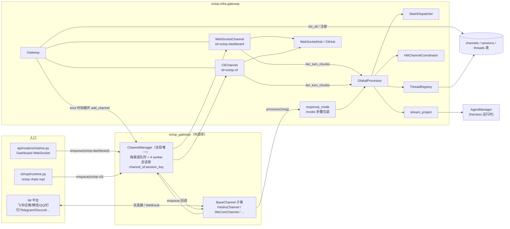
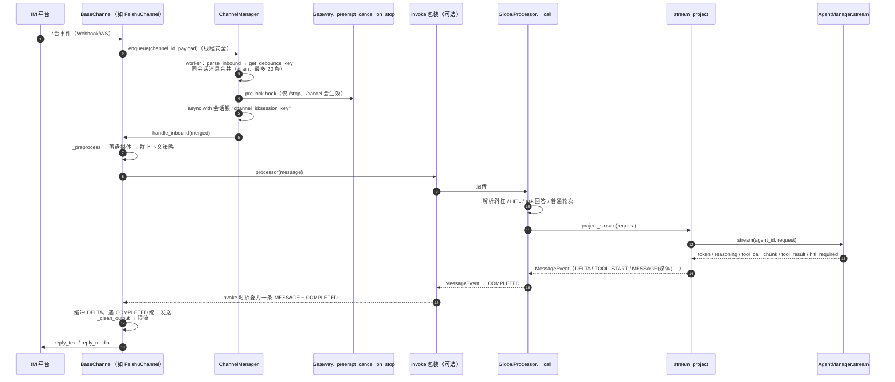
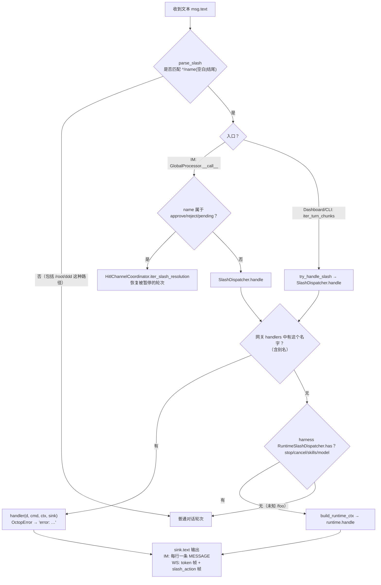

# 05 · 网关、IM 渠道与斜杠命令

> 一句话概述：`src/octop/infra/gateway/` 是 Octop 所有对话入口的汇合层。它持有**一个**全局的 `octop_gateway.ChannelManager`，把控制台（WebSocket）、CLI 和各个 IM 机器人（飞书、企业微信、微信、QQ、钉钉、Telegram、Discord……）都注册成"渠道"。所有渠道的消息都交给同一个 `GlobalProcessor`，由它按 `tenant_id`（即 agent ID）路由到对应的 Agent。网关还负责斜杠命令、IM 渠道的人工确认（HITL）、媒体进出，以及主动推送。

**本篇你将学到**

- `Gateway` 在进程里扮演什么角色，启动时注册了哪些渠道，渠道配置怎样从数据库变成在线连接；
- Octop 与外部库 `octop_gateway` 的分工：`InboundMessage` / `MessageEvent` / `ChannelConstraints` 各自是什么，processor 是怎样被"挂"进去的；
- IM 消息从进来到回复出去的完整路径，包括 session key、会话锁、invoke 与 stream 两种回复模式、工具提示的本地化；
- 斜杠命令 dispatcher → handlers → catalog 的三层结构、现有命令一览，以及 i18n 的用法；
- HITL（`/approve`、`/reject`、`ask_user_question`）在 IM 侧怎样协调；媒体（图片、文件、语音）怎样进出工作区；
- 新增斜杠命令、接入新 IM、修改 IM 回复格式时分别要改哪些文件，有哪些坑。

> 边界说明：一轮对话在 `GlobalProcessor` 内部怎样组装请求、怎样调用 harness、怎样写历史，属于 [03-chat-flow.md](03-chat-flow.md)。本篇只讲它在网关中的位置和进出口。

---

## 1. 关键文件

| 路径 | 职责 | 行数 |
|---|---|---|
| `src/octop/infra/gateway/gateway.py` | `Gateway`：持有 ChannelManager 并启动它；渠道增删改查、探活、运行时状态；主动推送（`push_text*`、`run_in_session`）；`/stop` 抢占 | 742 |
| `src/octop/infra/gateway/process/processor.py` | `GlobalProcessor`：唯一的 `MessageProcessor`。`__call__` 服务 IM，`iter_turn_chunks` 服务 Dashboard 和 CLI（细节见 03 篇） | 1602 |
| `src/octop/infra/gateway/process/message_keys.py` | session key 与 user_id 的推导，IM 元数据清洗 | 185 |
| `src/octop/infra/gateway/process/agent_resolve.py` | 取出 agent 的 `BackendWorkspace` 和 `MediaBackend` 适配器 | 40 |
| `src/octop/infra/gateway/process/response_mode.py` | IM 回复模式 `invoke` / `stream`，以及 invoke 折叠包装 | 140 |
| `src/octop/infra/gateway/process/channel_thinking.py` | 给 `BaseChannel._clean_output` 打补丁，用于处理思考标签 | 32 |
| `src/octop/infra/gateway/process/stream_project.py` | 把 harness 流式 chunk 投影成 `MessageEvent`，包括工具提示本地化、工具媒体和 HITL 卡片 | 255 |
| `src/octop/infra/gateway/process/harness_request.py` | 把 `InboundMessage` 转成 harness 的 content 和 request | 332 |
| `src/octop/infra/gateway/process/usage_record.py` | 按轮统计 token 用量（`UsageTracker`） | 276 |
| `src/octop/infra/gateway/slash/` | 斜杠命令：`parser` / `dispatcher` / `catalog` / `ctx` / `runner` / `runtime_bridge` / `help` / `formatting` / `handlers/*` | 约 1650 |
| `src/octop/infra/gateway/threads.py` | `ThreadRegistry`：维护 session_key 到 thread_id 的绑定 | 505 |
| `src/octop/infra/gateway/hitl/` | IM 渠道 HITL：内存待确认表（`store.py`）、卡片格式（`format.py`）、恢复编排（`coordinator.py`） | 996 |
| `src/octop/infra/gateway/media/` | 入站落盘（`ingress.py`、`inbound_store.py`）、附件提示（`attachment_hints.py`）、工具结果媒体（`tool_media.py`）、后端文件读写（`backend_files.py`） | 约 2660 |
| `src/octop/infra/gateway/ws/` | Dashboard 虚拟渠道 `WebSocketChannel` 和连接中心 `WebSocketHub` | 417 |
| `src/octop/infra/gateway/cli/` | CLI 虚拟渠道 `CliChannel`，以及轮次准备函数 `prepare_cli_turn` | 262 |
| `src/octop/infra/gateway/channels/` | 扫码绑定辅助（`qr_bind.py`，覆盖企微、微信、QQ）；钉钉 Device Flow（`dingtalk_registration.py`） | 194 |
| `src/octop/infra/gateway/bot_creators/` | 飞书、元宝"扫码建 bot"的独立子进程脚本，以及飞书子进程 runner | 974 |
| `src/octop/infra/gateway/history_backfill.py` | 旧 checkpoint 历史投影的单 worker 回填队列 | 66 |
| `.venv/.../octop_gateway/` | 外部库：`BaseChannel`、`ChannelManager`、消息模型、各平台适配器 | 约 7200（顶层与 channels 的 .py 文件） |

---

## 2. 总览图

### 2.1 网关组件图

要点：

- 全进程只有**一个** `ChannelManager`（`src/octop/infra/gateway/gateway.py:244`），不是每个 agent 一个。多 agent 靠的是每条 `channels` 行注册时带上的 `tenant_id=row.agent_id`（`gateway.py:705-711`），`GlobalProcessor.__call__` 再根据 `msg.tenant_id` 找到 agent（`processor.py:606`）。
- Dashboard 和 CLI 也是 `BaseChannel` 子类，同样走 ChannelManager 的队列和会话锁，但它们重写了 `handle_inbound`，调用的是 `iter_turn_chunks`，输出原始 chunk 帧，而不是 `MessageEvent`（`ws/ws_channel.py:90-175`）。

### 2.2 IM 消息进出时序图

### 2.3 斜杠命令分发流程图

---

## 3. Gateway：职责与生命周期

### 3.1 构造与启动

`Gateway` 由 `OctopServer` 创建并调用 `boot()`（`src/octop/infra/server.py:414-420`），随后设置 `/status` 用到的版本号和启动时间（`server.py:429`）。agent 全部启动之后，server 会再调用一次 `refresh_media_backends()`（`server.py:478`），原因见 3.3。进程启动顺序参见 [02-boot-and-runtime.md](02-boot-and-runtime.md)。

`Gateway.__init__`（`gateway.py:101-126`）持有以下对象：

- `ThreadRegistry`，基于 `session_repo` 和 `thread_repo`；
- `SlashDispatcher`，由 `build_default_dispatcher()` 构建；
- `WebSocketHub` 和 `CliHub`，后者其实是 `WebSocketHub` 的别名（`cli/__init__.py:4`）；
- 各渠道的运行时状态表 `_runtime_status`；
- `HistoryBackfillQueue`。

`boot()`（`gateway.py:220-266`）按以下顺序执行：

1. `install_channel_thinking_clean()`：用 Octop 自己的 `prepare_channel_text` 替换 `BaseChannel._clean_output`，除 `<think>` 外也处理 `<thinking>` 和孤立的闭合标签（`process/channel_thinking.py:10-31`）。
2. 创建 `GlobalProcessor`，注入大量 repo 和 `gateway=self`（`gateway.py:226-242`）。
3. `ChannelManager(channels={})`，并安装 pre-lock hook `_preempt_cancel_on_stop`（`gateway.py:244-246`）。
4. 注册两个内置虚拟渠道：`WebSocketChannel(id="octop-dashboard")` 和 `CliChannel(id="octop-cli")`（`gateway.py:248-260`；常量分别在 `ws/ws_channel.py:29` 和 `cli/cli_channel.py:29`）。
5. 用 `channel_repo.list_all(include_disabled=False)` 读出所有启用的 IM 渠道，通过 `asyncio.gather` 并发执行 `_safe_register_channel`（`gateway.py:262-264`）。单个渠道注册失败只记为 `error` 状态，不影响启动（`gateway.py:674-681`）。

### 3.2 渠道注册：从 DB 行到在线连接

`_register_channel(row)`（`gateway.py:683-717`）是"DB 配置 → 外部库实例"的唯一转换点：

1. `_config_from_row` 把 `config_json` 解析成 dict，不合法时抛出 `CHANNEL_INVALID_CREDENTIALS`（`gateway.py:719-733`）。别名和字段过滤交给外部库的 `ChannelConfig.from_dict`：它会 strip 字符串、忽略未知键、映射 `field_aliases`（`octop_gateway/channel.py:97-136`）。
2. **决定回复模式**：
   - team host agent 强制使用 `stream`，以免 invoke 折叠丢掉派发旁白（`gateway.py:689-698`）；
   - QQ 看 `c2c_streaming`，默认 stream（`gateway.py:699-700`，`response_mode.py:39-43`）；
   - 其余渠道看 `config.response_mode`，默认 **invoke**（`response_mode.py:21-28`）。
3. `processor_for_response_mode` 在 invoke 模式下给 `GlobalProcessor` 包一层折叠器（`gateway.py:703`）。
4. `manager.add_channel(row.kind, config, tenant_id=row.agent_id, channel_id=row.channel_id, processor=processor)`（`gateway.py:705-711`）。外部库按 `kind` 懒加载适配器类（`octop_gateway/channels/__init__.py:12-23`），在 `_register_channel` 中调用 `channel.start()` 登录平台，再为该渠道起 `workers_per_channel=4` 个 worker（`octop_gateway/manager.py:631-678`）。启动失败时会回滚注册（`manager.py:652-664`）。
5. 给渠道设置 `MediaBackend`（`AgentBackedMediaBackend`），让入站附件写进该 agent 工作区的 `inbound/` 目录（`gateway.py:712-716`）。

增删改都是"先写 DB，再重新注册"：

- `create_channel`：同一 agent 下同名同 kind 的渠道视为更新，同名不同 kind 抛出 `CHANNEL_NAME_TAKEN`（`gateway.py:327-360`）；
- `update_channel`：先 `_unregister` 再按 enabled 决定是否重新注册（`gateway.py:362-384`）；
- `delete_channel`：见 `gateway.py:386-389`；
- `reload_channels_from_db`：备份恢复后使用，内置的两个渠道保留，IM 渠道全部重建（`gateway.py:285-309`，调用方在 `api/routers/backup.py:202`）。

`channels` 表的 repo 层以 JSON 字符串存取 `config_json`，本层未见加解密（`src/octop/infra/db/repos/channels.py:12-38`），凭证是否在别处加密待确认。数据层细节见 [06-data-layer.md](06-data-layer.md)。

### 3.3 为什么需要 `refresh_media_backends`

Gateway 比 agent 先启动。`_register_channel` 调用 `media_backend_for_agent` 时，agent 可能还没有 workspace，函数返回 `None`（`process/agent_resolve.py:18-40`）。所以 server 在 `registry.boot()` 之后要再补一次 `refresh_media_backends()`（`gateway.py:268-283`）。如果改了启动顺序，一定要保留这一步，否则 IM 入站图片不会落盘。

### 3.4 探活与运行时状态

- `probe_channel` / `probe_config`（`gateway.py:574-636`）在 `manager.probe_channel` 里起一个临时实例，processor 用空生成器 `_probe_processor`（`gateway.py:88-91`）。缺字段时捕获 `ChannelCredentialsError`，并把缺失字段本地化（`i18n/domains/channel.py:31-35`）。平台错误通过 `_format_probe_error` 映射到 `channel.probe.*` 文案（`gateway.py:638-657`）。
- `get_runtime_status` 会读取适配器可选的 `is_connected` / `runtime_error` 属性，实时修正缓存（`gateway.py:184-200`）；`reason` 码在序列化时用 `channel_runtime_reason` 本地化（`gateway.py:202-218`）。

### 3.5 主动推送能力（被 cron、主动关怀、团队使用）

| 方法 | 用途 | 调用方 |
|---|---|---|
| `run_in_session(agent_id, session_key, op)`（`gateway.py:406-416`） | 在该会话的 ChannelManager 会话锁内执行一段操作，避免和入站轮次交错 | `infra/cron/delivery.py:83` |
| `push_text_from_session(agent_id, session_key, text)`（`gateway.py:418-432`） | 加锁推送一段完整文本，不经过 agent；如果是 dashboard 会话，还会推送 toast | `infra/proactive/service.py:252` |
| `push_session_text(session, text)`（`gateway.py:434-450`） | 对已解析好的 `SessionRow` 推送；dashboard 和 CLI 这类虚拟会话会累加未读数、刷新 last_active、补全标题 | `infra/cron/delivery.py:125,168` |
| `push_text(channel_type, channel_id, subject, text)`（`gateway.py:539-572`） | 最底层推送：按目标渠道的 `show_thinking` 清洗思考标签后调用 `manager.push_text` | `infra/agents/teams/team_manager.py:924` |
| `notify_dashboard_push(session, agent_id, text)`（`gateway.py:480-501`） | 通过 `WebSocketHub.push_to_user` 给属主的所有控制台连接发送 `dashboard_push` toast | cron、proactive |

推送目标怎样确定：

- `_channel_id_for_session` 把 dashboard 和 cli 会话映射到内置渠道 id；IM 会话必须带有 `session.channel_id`（`gateway.py:453-462`）。
- `_resolve_push_subject` 用 `SessionRow.to_channel_subject()` 还原路由目标（`src/octop/infra/db/repos/sessions.py:98`）；虚拟渠道还会补上 `thread_id`（`gateway.py:464-478`）。
- IM 回复所需的持久化路由字段（openid、chat_id 等）来自入站时的 `sanitize_im_metadata`，见 5.1。

### 3.6 `/stop` 抢占：pre-lock hook

同一会话的 IM 轮次被 ChannelManager 串行化了（`octop_gateway/manager.py:751`）。如果不做特殊处理，`/stop` 会排在正在进行的轮次后面，永远打断不了它。

Octop 利用 worker 在"取会话锁之前"调用的 hook（`manager.py:740-746`）：`_preempt_cancel_on_stop` 识别到 `/stop` 或 `/cancel` 后，先调用 `agent_manager.cancel_stream(agent_id, thread_id)`（`gateway.py:508-537`）。当前轮次因此提前结束、释放锁，`/stop` 消息随后作为普通斜杠命令进入 harness 运行时的 `handle_stop` 执行。对应测试在 `tests/unit/gateway/test_preempt_stop_cancel.py`。

---

## 4. 与外部库 `octop_gateway` 的边界

安装版本为 `octop_gateway-1.0.0`（`pyproject.toml` 要求 `>=1.0.0`）。**平台协议全部在外部库**，Octop 仓库里没有任何 `FeishuChannel` 之类的实现。

### 4.1 核心模型（`octop_gateway/models.py`）

| 类型 | 位置 | 要点 |
|---|---|---|
| `InboundMessage` | `models.py:168` | `channel_id`（注册 id）、`channel_type`（kind）、`tenant_id`（**= agent_id**）、`channel_subject`（回复目标：私聊为用户，群聊为会话）、`content: list[ContentPart]`、`metadata`、`group_context`；`.text` 拼接所有 TextContent |
| `MessageEvent` | `models.py:202` | processor 产出的事件，工厂方法有 `text / delta / thinking / thinking_delta / flush / typing / tool_start / tool_end / completed / error_event` |
| `MessageEventType` | `models.py:127` | `MESSAGE, DELTA, THINKING, THINKING_DELTA, FLUSH, TYPING, TOOL_START, TOOL_END, ERROR, COMPLETED` |
| `ChannelSubject` | `models.py:312` | 可路由主体，`metadata` 携带平台路由附加信息 |
| `ChannelConstraints` | `constraints.py:28` | 平台约束：`reply_timeout` + `timeout_strategy`（占位语）、`send_rate_limit`、`typing_keepalive_interval`、`show_tool_hints` / `tool_hint_template` / `tool_end_template`、`show_thinking` / `thinking_template` |
| `MessageProcessor` | `channel.py:53` | `Callable[[InboundMessage], AsyncIterator[MessageEvent]]`，也就是 Octop 注入的"大脑" |

### 4.2 适配器模型

- `BaseChannel.handle_inbound` 是模板方法（`octop_gateway/channel.py:723-737`），流程为：`parse_inbound` → `_preprocess_inbound`（适配器钩子）→ `_track_subject` → 落盘媒体 → `GroupContextManager.prepare`（群聊里没有 @ 机器人的消息只进入短期上下文，返回 `None` 表示不触发 agent）→ `_process_inbound` → `_finalize_inbound`（`channel.py:748-784`）。
- 默认的 `_process_inbound` 是"缓冲式"投递（`channel.py:786-917`）：
  - `DELTA` 和 `THINKING_DELTA` 分别累积；
  - 遇到 `FLUSH`、`MESSAGE` 或 `COMPLETED` 时把累积内容作为一条消息发出；
  - `TOOL_START` / `TOOL_END` / `ERROR` 立即交给 `_deliver_event`；
  - processor 抛异常时发送英文兜底句 "An error occurred while processing your message."（`channel.py:894-910`）。
  需要真流式的适配器（如企微）会重写这个方法（`constraints.py:56-58` 的注释）。
- 队列与并发（`octop_gateway/manager.py`）：
  - 每个渠道一个 `asyncio.Queue`，默认 4 个 worker（`manager.py:92`）；
  - `enqueue` 可以在其他线程里调用（飞书、企微 SDK 线程），实现上用 `call_soon_threadsafe`（`manager.py:249-269`）；
  - worker 用 `get_debounce_key` 作为会话键，把同会话积压的消息合并（`manager.py:726-736`），然后在 `f"{channel_id}:{session_key}"` 锁内处理（`manager.py:762-765`）；
  - 不同会话之间可以并行。

### 4.3 Octop 怎样注册 processor

- IM：每个渠道在 `add_channel(..., processor=...)` 时拿到 `GlobalProcessor` 实例本身，或它的 invoke 包装（`gateway.py:703-711`）。`GlobalProcessor` 实现了 `async def __call__(msg) -> AsyncIterator[MessageEvent]`（`processor.py:601`），所以能直接充当 `MessageProcessor`。
- Dashboard 和 CLI：构造时把 `GlobalProcessor` 传给 `WebSocketChannel` / `CliChannel`（`gateway.py:248-260`）。它们的 `handle_inbound` 检查 `hasattr(processor, "iter_turn_chunks")` 后调用这个"原始 chunk"接口（`ws/ws_channel.py:136-160`）。入队方是 `api/routers/chat/ws.py:168` 和 `cli/repl/runtime.py:102`，二者都调用 `channel_manager.enqueue(...)`。

### 4.4 Octop 对外部库做的"覆盖"

| 覆盖点 | 位置 | 原因 |
|---|---|---|
| `BaseChannel._clean_output` 被 monkey-patch | `process/channel_thinking.py:10-31` | 上游只剥离 `<think>`，Octop 还要处理 `<thinking>` 和孤立的闭合标签 |
| 工具提示预本地化 `tool_hint_text` | `process/stream_project.py:96-113` | 上游 `tool_hint_message` 在有 `tool_hint_text` 时优先使用它（`octop_gateway/constraints.py:98-110`），否则回落到英文模板 |
| pre-lock hook | `gateway.py:245, 508-537` | 让 `/stop` 能插队 |
| `WebSocketChannel.get_debounce_key` 按 thread 加锁、`should_batch_inbound=False` | `ws/ws_channel.py:65-88` | dashboard 的 session_key 是"每用户每 agent"一个，按它加锁会把不相关的线程串行化，甚至把两个 turn 合并成一个 |

---

## 5. `process/` 下的网关侧辅助

### 5.1 `message_keys.py`：session key 与身份

- **session key 格式**是 `"{agent_id}:{channel_type}:{subject_id}:{chat_type}"`（`threads.py:31-39`）。`session_key_from_message` 的规则是：`metadata.session_key` 显式给出时优先使用（dashboard 和 CLI 会传），否则按上述格式拼出（`process/message_keys.py:124-134`）。`chat_type` 只取 `dm` 或 `group`，由 `metadata.chat_type` / `is_group` 推导（`message_keys.py:114-121`）。
- **user_id 归属**：只有 dashboard 和 cli 会把数值型 `subject_id` 当作 Octop 用户 id；**所有外部 IM 会话都归 agent 属主所有**（`message_keys.py:79-105`）。换句话说，同一个 agent 的所有 IM 成员共用属主身份做持久化，这个身份**不能**当作授权凭证。`/memory` 在 IM 中直接拒绝执行，就是出于这个原因（`slash/handlers/memory.py:51-55`）。
- `sanitize_im_metadata`（`message_keys.py:166-185`）只保留 `_PERSISTED_META_KEYS` 白名单里的持久化路由字段（`message_keys.py:143-163`），去掉 `msg_id`、`response_url`、`_frame` 这类一次性的被动回复上下文。清洗后的结果写进 `sessions.channel_metadata`，供之后主动推送使用。

### 5.2 `agent_resolve.py`

`harness_workspace_for_agent` 返回 `agent.workspace`，agent 没运行时返回 `None`；`media_backend_for_agent` 把它包装成 `AgentBackedMediaBackend`，并带上 `max_upload_bytes`（`process/agent_resolve.py:18-40`）。这是 AGENTS.md 规定的"网关、IM、媒体"访问工作区的唯一入口。

### 5.3 `response_mode.py`：invoke 与 stream

- `stream`：`GlobalProcessor` 的事件原样交给渠道（由渠道自己决定是缓冲还是真流式）。
- `invoke`（外部 IM 的默认模式）：`collapse_to_invoke_response`（`process/response_mode.py:46-115`）会
  - 累积 DELTA；
  - 遇到 `TOOL_START` 时清空之前的文本（视为"我先查一下"之类的进度旁白），但 `tool_key == "ask_agent"` 例外，保留 team 派发语；
  - 丢弃 thinking、typing、flush、tool_end；
  - 在 `COMPLETED` 时一次性产出"最终文本 + 所有媒体"合成的一条 MESSAGE；
  - 遇到 ERROR 时清空缓冲并透传。
- 这样设计的原因：agent 始终走 streaming 路径，取消、用量、HITL、工具媒体提取等逻辑只需要维护一份；折叠只影响用户看到的形态。

### 5.4 `channel_thinking.py`

见 4.4。注意有两条清洗路径：

- 入站回复由被 patch 的 `_clean_output` 清洗；
- 主动推送不经过 `_clean_output`，由 `Gateway.push_text` 自己调用 `prepare_channel_text`（`gateway.py:552-572`）。

两处都读取目标渠道的 `show_thinking` 和 `thinking_template`。

### 5.5 `stream_project.py`：harness chunk 到 MessageEvent（IM 格式的核心）

`_project_chunks`（`process/stream_project.py:77-200`）是 IM 回复格式的主要控制点：

| harness chunk | 产出 |
|---|---|
| `token` | `MessageEvent.delta`；当图节点（node）切换时先产出一个 `flush()`，把不同节点的发言拆成多条消息（`:123-129`） |
| `reasoning` | `thinking_delta`（是否展示由渠道的 `show_thinking` 决定） |
| `tool_call_chunk` | 拼接工具名；第一次出现参数片段时产出 `tool_start`（`:136-155`） |
| `tool_result` | 如果还没发出过 start，先补一个，再发 `tool_end`；之后调用 `media_events_from_tool_result` 产出媒体 MESSAGE（`:157-178`） |
| `hitl_required` | 在 `HitlChannelCoordinator` 登记待确认记录，产出本地化卡片文本，然后 **return**，本轮到此结束（`:180-195`） |
| `state_update` | 节点切换时 flush |

**工具提示本地化规则**（AGENTS.md 中 "IM channels" 一条的落地实现）：`_tool_start` 和 `_tool_end` 按以下方式构造事件：

- `tool_name` 取 `tool_display_name(raw, loc)` 的本地化显示名；
- `tool_hint_text` 由 `channel_tool_hint_start` / `channel_tool_hint_end` 生成完整句子，文案来自 `channel.tool_hint_start` / `channel.tool_hint_end`；
- `tool_key` 额外携带原始工具 id，供 invoke 折叠判断（`stream_project.py:96-113`；i18n 函数在 `src/octop/i18n/domains/channel.py:17-22`）。

`locale` 由 `resolve_user_locale` 决定（`processor.py:622-627`）：先看用户偏好，再看 `metadata.locale` / `language` / `lang`，最后看渠道提示。渠道提示规则是：飞书、企微、微信、钉钉、QQ、小艺、元宝用 zh，telegram 用 en，其余（如 discord、mqtt）回落到默认值 en（`src/octop/infra/utils/locale.py:22-43`）。

另外，`enrich_tool_stream_chunk` 给 Dashboard 的 chunk 加上 `display_name`（`stream_project.py:50-74`），与 IM 共用同一套显示名规则。

### 5.6 `GlobalProcessor.__call__` 在网关中的位置（概要）

`processor.py:601-882` 大致分四个分支（轮次内部细节见 [03-chat-flow.md](03-chat-flow.md)）：

1. `/approve`、`/reject`、`/pending` → HITL 协调器（`:628-671`）；
2. 该会话有待回答的 `ask_user_question`，且本条消息不是斜杠命令 → 把本条消息当作答案来恢复轮次（`:673-718`）；
3. 其它斜杠命令 → `SlashDispatcher.handle`，**handled 为 False 时继续当作普通对话**（`:720-737`）；
4. 普通轮次：`get_or_create_by_key` 得到 thread → `build_content_from_message` → 组装 request → `yield typing()` → `project_stream` → 记录用量和历史 → `completed()`（`:739-882`）。

---

## 6. 渠道清单与配置来源

### 6.1 支持的 kind

以外部库 `_CHANNEL_MAP` 为准（`octop_gateway/channels/__init__.py:12-23`），Octop 通过 `ChannelKind` 再导出（`gateway.py:14`），并在 API 请求体中用作枚举（`api/routers/channels.py:36-39`）：

| kind | 平台 | Octop 侧的扫码 / 自动创建辅助 |
|---|---|---|
| `feishu` | 飞书 / Lark | `bot_creators/feishu_bot_creator.py`（子进程，lark-oapi Device Flow） |
| `wecom` | 企业微信智能机器人 | `channels/qr_bind.py:25-56`（扫码拿 bot_id / secret） |
| `weixin` | 微信（iLink） | `qr_bind.py:106-136` |
| `qq` | QQ 机器人 | `qr_bind.py:59-103`（`QQBotQRLogin`，进程内按 session 保存登录任务） |
| `dingtalk` | 钉钉 | `channels/dingtalk_registration.py`（Device Flow 一键注册） |
| `yuanbao` | 元宝 | `bot_creators/yuanbao_bot_creator.py`（子进程） |
| `telegram` | Telegram | 无，手填 token |
| `discord` | Discord | 无，手填 Bot Token（见 `docs/discord-channel.md`） |
| `xiaoyi` | 小艺 | 无 |
| `mqtt` | MQTT | 无 |

另有两个内置虚拟渠道：`dashboard`（id `octop-dashboard`）和 `cli`（id `octop-cli`），`ThreadRegistry.is_virtual_channel` 把它们识别为非 IM 出站目标（`threads.py:21-24`）。

### 6.2 配置从哪里来

1. 控制台或 CLI 创建渠道 → `POST /api/agents/{agent_id}/channels`（`api/routers/channels.py:133-157`）→ `Gateway.create_channel` 写入 `channels` 表（`agent_id`、`user_id`、`kind`、`name`、`config_json`、`enabled`）。
2. 进程启动或配置变更时，按 3.2 的流程注册。
3. `config_json` 的字段由各平台的 `XxxConfig` dataclass 定义，公共字段包括 `show_thinking`、`show_tool_hints`、`group_context`（`octop_gateway/channel.py:62-95`）；Octop 额外读取 `response_mode` 和 QQ 的 `c2c_streaming`。

### 6.3 扫码绑定与建 bot

- 企微、微信、QQ 的扫码都是"generate → 前端轮询 poll → 拿到凭证 → 前端再调用 create channel"。辅助函数在 `channels/qr_bind.py`，由 API 调用（`api/routers/channels.py:599-780`），CLI 也可以复用。
- 飞书建 bot 以**独立子进程**运行 `feishu_bot_creator.py create --platform feishu|lark`。脚本通过 stdout 逐行输出 JSON 事件（二维码、状态、finish 携带凭证），父进程轮询解析。这样可以把 lark-oapi 的阻塞式 Device Flow 隔离出主事件循环。
  - CLI 使用 `bot_creators/feishu_runner.py` 的 `start_feishu_creator` / `poll_feishu_creator`（调用方是 `cli/support/feishu_creator.py:39`）；
  - API 路由在 `api/routers/channels.py:781-834` **自己组装命令并执行 `subprocess.Popen`**，只复用了 `extract_feishu_credentials`。改启动参数时两处都要同步。
- 元宝同样是子进程，API 路由在 `api/routers/channels.py:929-1068`。

---

## 7. 斜杠命令

### 7.1 三层结构

| 层 | 文件 | 职责 |
|---|---|---|
| 解析 | `slash/parser.py:16-20` | 正则 `^\s*/[a-zA-Z][\w-]*(?:\s[\s\S]*)?$`：命令名后必须紧跟空白或文本结尾，所以 `/root/ddd` 这类路径不会被当成命令；匹配后交给 harness 的 `parse_slash` |
| 元数据 | `slash/catalog.py:19-67`（`SlashCommandSpec`）、`:69-269`（`CATALOG`） | 名称、别名、usage、图标、配色、分类、可见入口 `origins`、前端动作 `client_action`、`hidden`、`persist_checkpoint`；label 和描述**不写在代码里**，由 `tr("slash.catalog.{name}.label/description")` 提供 |
| 分发 | `slash/dispatcher.py:24-46` | `register(spec, handler)` 同时登记主名和所有别名；`handle` 先查网关 handler，查不到再查 harness 的 `RuntimeSlashDispatcher`（`stop/cancel/model/models/skills`，见 `octop_harness/slash/handlers.py:106-112`）；handler 抛出的 `OctopError` 转成 `error: …` 文本 |
| 实现 | `slash/handlers/*.py`，由 `handlers/__init__.py:14-28` 汇总 | `register_all` 只登记 **CATALOG 中存在**并且在 `GATEWAY_HANDLERS` 中有实现的命令 |
| 上下文 | `slash/ctx.py:24-43`（`SlashCtx`）、`:86-169`（`build_slash_ctx`） | agent、user、channel_type、session_key、各 repo、agent_manager、locale、时区等；`subject_id(ctx)` / `chat_type(ctx)` 通过拆分 session_key 得到 |
| harness 桥 | `slash/runtime_bridge.py:15-72` | 把 `SlashCtx` 转成 `RuntimeSlashCtx`；`/stop` 只读取已绑定的 thread，不会新建 |
| 执行包装 | `slash/runner.py:12-46` | `try_handle_slash` 供 Dashboard 和 CLI 使用，返回 `(handled, lines, actions)` |

同一套 dispatcher 服务三个入口：IM（`processor.py:720-737`）、Dashboard 和 CLI（`processor.py:917-960`），以及 API 目录接口 `GET /api/slash/commands`（`api/routers/slash.py:39-70`，前端封装在 `dashboard/src/api/modules/slash.ts`）。

### 7.2 现有命令表

| 命令（别名） | handler 文件 | 作用 | 备注 |
|---|---|---|---|
| `/help` | `handlers/platform.py:21` | 按分类列出当前入口可见的命令 | 用 `format_help`（`slash/help.py:15`） |
| `/status` | `handlers/composite.py:176` | 当前 agent、线程、模型、版本、运行时长等状态 | |
| `/model`（`models`） | `handlers/composite.py:299` | 查看、设置或 `reset` 线程级模型覆盖 | 网关 handler 优先于 harness 的同名实现 |
| `/mode`（`ask`、`plan`、`craft`） | `handlers/composite.py:333` | 查看或切换会话模式 | 别名本身就是目标模式 |
| `/new`（`clear`） | `handlers/session.py:26` | 新建线程并重新绑定会话，可带标题 | `client_action=new_chat` |
| `/compact` | `handlers/composite.py:63` | 强制摘要并卸载当前线程历史，不新建线程 | |
| `/memory slim [--all] [--confirm] \| status` | `handlers/memory.py:49` | 瘦身 checkpoint 数据库 | 只允许虚拟渠道；`persist_checkpoint=False` |
| `/stop`（`cancel`） | harness `handle_stop` | 取消当前流 | IM 侧另有 pre-lock 抢占（3.6） |
| `/history` | `handlers/composite.py:142` | 当前线程的消息数、标题、置顶、最近活跃时间、模型覆盖 | 时间按 `default_timezone` 格式化 |
| `/token` | `handlers/platform.py:26` | 当前线程 token 用量和缓存命中率 | |
| `/list`（`topics`、`sessions`） | `handlers/session.py:42` | 最近 10 个线程 | |
| `/switch <short_id>` | `handlers/session.py:62` | 用线程 id 后缀切换并重新绑定 | |
| `/resume [short_id]` | `handlers/session.py:80` | 回到上一个或指定的线程 | |
| `/approve`、`/reject`、`/pending` | IM：`hitl/coordinator.py:332`；其它入口：`handlers/hitl.py:17` | IM 中恢复被暂停的轮次；Dashboard 中只提示去界面上操作 | 见 8 节 |
| `/title <text>` | `handlers/session.py:112` | 设置线程标题 | |
| `/delete <short_id>` | `handlers/session.py:123` | 删除非当前线程 | |
| `/pin`、`/unpin` | `handlers/session.py:141,148` | 置顶或取消置顶当前线程 | `unpin` 设了 hidden |
| `/cron [list]` | `handlers/platform.py:59` | 列出该 agent 的定时任务 | IM 的 ctx 没有 `cron_manager`，会回复"不可用" |
| `/agent list \| switch <name>` | `handlers/platform.py:76` | 列出或切换 agent（通过 `switch_agent` 动作） | |
| `/skills [list]` | harness `handle_skills` | 列出技能 | |
| `/connectors [list]` | `handlers/platform.py:120` | 列出已启用的连接器实例 | |
| `/exit`（`quit`） | `handlers/platform.py:146` | 由 CLI 自己处理；如果走到网关会抛出 `SLASH_BAD_ARGS` | hidden，仅 cli |

要特别注意的行为：

- **`origins` 只影响列表展示，不做拦截**：`visible_in` 只被 `/help` 和 `GET /api/slash/commands` 使用，`SlashDispatcher.handle` 不检查 origin（`dispatcher.py:33-46`）。另外，`channel_origin` 把 IM 映射成具体的 kind，例如 `"feishu"`，而不是 `"im"`（`catalog.py:310-312`）。所以 origins 为 `{"im","cli"}` 的命令（如 `/approve`）在飞书的 `/help` 里**不会列出**，但仍然可以执行。
- **输出形态**：IM 的 `_MessageEventSink` 把每次 `sink.text` 转成一条 MESSAGE（`processor.py:114-124`）。在 stream 模式下，渠道会把它们逐条发出；在 invoke 模式下，它们被折叠成一条。这个 sink 没有 `action` 方法，所以 handler 里 `hasattr(sink, "action")` 分支对 IM 不生效。Dashboard 使用 `BufferSink`，lines 转成 `token` 帧，actions 转成 `slash_action` 帧（`processor.py:947-958`）。
- **是否写入 checkpoint**：Dashboard 和 CLI 路径会调用 `_append_slash_checkpoint`，遵守 `persist_checkpoint`（`processor.py:939-944, 1549-1590`）。IM 路径不写（`processor.py:720-737`）。
- **未知命令**：`handle` 返回 False，文本当作普通消息交给 LLM（`dispatcher.py:34-40`；测试见 `tests/unit/gateway/test_slash_dispatcher.py:59-78`）。

### 7.3 i18n 用法

- handler 中统一写 `from octop.i18n.domains.slash import tr`，使用短键，例如 `tr("new.started", lang, short=...)`。它会自动加上 `slash.` 前缀（`src/octop/i18n/domains/slash.py:11-12`）。`lang` 通过 `lang_of(ctx)` 获得（`slash/ctx.py:46-47`）。
- 键值表格使用 `localized_rows` 和 `field_label`，对应 `slash.fields.*`（`i18n/domains/slash.py:15-23`）；格式化函数 `markdown_kv_block`、`markdown_bullets` 在 `slash/formatting.py`。
- 命令的 label 和描述在 `slash.catalog.<name>.label/description`，分类名在 `slash.catalog.categories.<cat>`（`catalog.py:40-66, 296-297`）。
- 需要跨命名空间的文案（例如 `memory_slim.*`）时，改用 `octop.i18n.tr` 并写全路径，参考 `handlers/memory.py`。

---

## 8. HITL：IM 渠道侧的人工确认

控制台的 HITL 通过前端卡片完成。IM 没有交互卡片，所以由 `hitl/` 把"暂停 → 用户回复 → 恢复"翻译成文本协议：

1. **暂停**：`stream_project` 收到 `hitl_required` 后，调用 `HitlChannelCoordinator.register_from_request` 写入 `HitlPendingStore`（`hitl/coordinator.py:126-140`），产出 `format_hitl_card` 生成的卡片（`hitl/format.py:86-126`），然后结束本轮。卡片分两种：一种是工具审批卡，列出每个动作的本地化名称和参数；另一种是 `ask_user_question` 问答卡（`format_ask_card`）。
2. **存储**：`HitlPendingStore` 是**进程内内存**（`hitl/store.py:32-35`），TTL 为 30 分钟（`store.py:13`），`pending_id` 是 4 位十六进制。同一 session 登记新记录时，会把该 session 旧的 pending 记录标为 expired（`store.py:51-52`）。进程重启后，IM 侧的待确认记录会丢失。
3. **审批恢复**：`/approve [id]` 和 `/reject [reason]` 进入 `iter_slash_resolution`（`coordinator.py:332-441`）。它构造 decisions，调用 `project_resume_stream` → `agent_manager.resume_hitl`（`stream_project.py:231-255`），先发送一条确认回执，再发送恢复后的输出。如果又遇到新的暂停，会追加 `hitl.followup_pending` 提示。`/pending` 列出当前 session 的待确认项（`coordinator.py:472`）。
4. **问答恢复**：`ask_user_question` 类型的暂停不需要斜杠命令，用户的下一条普通消息就被当作答案（`processor.py:673-718`，`coordinator.py:169-189`）。只有 **pending 记录中的 user_id 与发送者一致**时才会接管这条消息，这是为了群聊中不被其他人代答。但是 IM 用户在持久化时都映射到 agent 属主（5.1），所以这项校验在群聊里的实际效果待确认。
5. 会话级审批策略 `HitlSessionPolicyStore` 来自 `infra/agents/security/hitl_session.py`（`hitl/__init__.py:3-7`），启动时由 server 换成 DB 实现（`server.py:455-457`）。安全策略本身见 [04-agents.md](04-agents.md)。

---

## 9. 媒体进出

### 9.1 入站（用户发送图片、文件、语音）

1. 适配器解析出 `ImageContent` / `FileContent` / `AudioContent` / `VideoContent`。`BaseChannel._persist_media` 调用 `MediaBackend.save` 保存（`octop_gateway/channel.py:555`）。
2. Octop 的 `AgentBackedMediaBackend.save` 先校验大小，再通过 `workspace.aupload_bytes` 写到 `inbound/<key>`（`media/ingress.py:14-23`）。路径规则见 `media/inbound_store.py:253`（`inbound_rel_path`）。
3. `build_content_from_message`（`process/harness_request.py:96-`）：
   - 数量在 `VISION_MAX_COUNT` 以内的图片变成视觉块。有落盘路径时只存工作区引用，不把 base64 写进 checkpoint；真正发给 LLM 时再重新物化（`media/attachment_hints.py:399-420`）。
   - 超出数量的图片、文件、**语音**、视频一律变成"路径提示"文本，让 agent 用工具去读（`attachment_hints.py:181-240`）。
   - 网关层不做语音转写；STT 在 `infra/voice/`，见 [08-domains.md](08-domains.md)。个别平台适配器是否先行转写待确认。

### 9.2 出站（agent 发文件或图片给用户）

- 只有白名单工具的结果会作为媒体推送：`send_file`、`send_file_to_user`、`desktop_screenshot`、`mobile_screenshot`、`generate_image`、`generate_video`（`media/tool_media.py:47-56`）。`write_file`、`read_file`、浏览器截图等被刻意排除，否则会把旧的 outbound 文件反复推给用户。
- `media_events_from_tool_result`（`tool_media.py:900-925`）把媒体块解析成 `ContentPart`，产出 MESSAGE 事件，渠道用 `reply_media` 发送。`stream_project` 用 `saw_tool_call` 和 `emitted_media_ids` 两个状态防止历史重放导致重复推送（`stream_project.py:40-47, 170-177`）。
- Dashboard 路径改用 `attachment_frames_from_tool_result` 或 `iter_dashboard_attachment_frames`，生成 `attachment` 帧和预览 URL（`tool_media.py:667-777`，以及 `media/backend_files.py`）。

---

## 10. 其它子模块

- **`threads.py`**（`ThreadRegistry`，状态机细节见 03 篇）：`sessions` 表是"会话 → 当前线程"的指针，`threads` 表保存线程元数据。
  - `get_or_create`：在 `asyncio.Lock` 内做双检后建线程，已有会话时刷新路由元数据（`threads.py:109-196`）。
  - `get_or_create_by_key`：会拒绝跨 agent 使用同一个 session_key；绑定的线程被删除后会自动新建（`threads.py:198-231`）。
  - `/new` 对应 `reset`，只新建线程并移动指针，旧线程保留在 `/list` 中，可以用 `/resume` 找回（`threads.py:301-345`）。
  - `/switch` 对应 `rebind`（`threads.py:258-299`）。
  - `peer_session_key` 和 `peer_room_session_key` 为 agent 互调、团队场景派生会话（`threads.py:41-79`）。
- **`ws/`**：`WebSocketHub` 维护连接到线程的订阅（每个连接同一时间只绑定一个线程）、用户到连接的映射（用于 toast），以及 `_active_turns`（用于断线重连后续流）（`ws/ws_hub.py:26-160`）。投递失败不会中断 harness 轮次（`ws_channel.py:143-152`）。
- **`cli/`**：`CliChannel` 结构与 WS 渠道相同，只是 `show_thinking=True`（`cli/cli_channel.py:33-53`）。`prepare_cli_turn` 负责 CLI 的线程绑定（`cli/turn.py:16-`）。CLI 命令本身见 [09-frontend-cli.md](09-frontend-cli.md)。
- **`history_backfill.py`**：一个有界（100）、按 key 去重的单 worker 队列。它保证同一时刻只解码一个巨大的旧 checkpoint，避免内存峰值（`history_backfill.py:14-66`）。调用方在 `api/routers/chat/history.py:202, 348`；版本化历史本身见 03 和 06 篇。

---

## 11. 修改指南

### 11.1 新增一个斜杠命令（以 `/ping` 为例）

1. **元数据**：在 `slash/catalog.py` 的 `CATALOG` 中加一条 `SlashCommandSpec(name="ping", usage="/ping", icon=..., category="system", origins=...)`。
   - 只想在部分入口显示时再设置 `origins`，并记住它**不拦截执行**。确实需要禁止执行的，在 handler 里判断 `ctx.channel_type`，参考 `/memory`。
   - 如果不希望命令进入 agent 上下文，设置 `persist_checkpoint=False`。
2. **handler**：在合适的 `slash/handlers/*.py` 中实现 `async def cmd_ping(d, cmd, ctx, sink)`，签名见 `slash/types.py:14-17`，并加到该文件的 `*_HANDLERS` 字典。新建文件时，要在 `handlers/__init__.py:14-20` 合并进 `GATEWAY_HANDLERS`。**不要**直接改 `register_all`：它只遍历 CATALOG，只写 handler 不写 CATALOG 的命令不会被注册。
3. **输出**：只调用 `sink.text(...)`。需要前端动作时，用 `if hasattr(sink, "action"): await sink.action(...)` 保护起来，IM 的 sink 没有这个方法。业务错误抛 `OctopError`，dispatcher 会转成文本（`dispatcher.py:41-44`）。
4. **i18n**：在 `src/octop/i18n/en.json` 和 `zh.json` **同时**添加：
   - `slash.catalog.ping.label` 和 `slash.catalog.ping.description`（`/help`、API 目录、`test_catalog_labels_match_json` 都依赖它们）；
   - handler 用到的回复键，例如 `slash.ping.pong`。在 handler 中写成 `from octop.i18n.domains.slash import tr; tr("ping.pong", lang_of(ctx))`。
   - 前端如果有本地斜杠文案（`dashboard/src/locales/*.json` 的 `slash` 节），也要同步检查。
5. **别名**：写在 spec 的 `aliases` 里，dispatcher 会自动登记。注意不要和 harness 运行时命令（`stop/cancel/model/models/skills`）重名；重名时网关 handler 会**遮蔽** harness 实现。
6. **测试**：
   - `tests/unit/gateway/test_slash_dispatcher.py` 已有 fixture，可以直接加 `BufferSink` 断言；
   - `tests/unit/gateway/test_slash_catalog.py` 要求 `origin="all"` 可见的命令都已被 dispatcher 注册；
   - 运行 `uv run pytest tests/unit/gateway -k slash -q` 和 `uv run pytest tests/unit/i18n -q`，最后运行 `make all`。
7. **可能遗漏的地方**：IM 中 `/approve`、`/reject`、`/pending` 在 dispatcher 之前就被截走（`processor.py:628`）；如果新命令也需要"在锁外抢占"，要改 `Gateway._preempt_cancel_on_stop`。

### 11.2 接入一个新 IM 渠道

平台协议属于外部库，所以这是一个**跨仓库**改动：

1. **在 `octop_gateway` 仓库中**：实现 `XxxChannel(BaseChannel)` 和 `XxxConfig(ChannelConfig)`，声明 `required_credentials` 和 `field_aliases`，按平台限制设置 `_default_constraints`。只在确有需要时重写 `_preprocess_inbound`、`_process_inbound`、`get_debounce_key`。然后登记进 `_CHANNEL_MAP`、`_CLASS_NAMES`、`ChannelKind`（`octop_gateway/channels/__init__.py`）。发版后升级 Octop `pyproject.toml` 中的下限。
2. **Octop 后端**，通常不需要改 `gateway.py`。`ChannelKind` 会自动出现在 API 枚举中。需要检查以下几项：
   - `InboundMessage.metadata` 里用于**主动推送**的路由字段，是否已在 `_PERSISTED_META_KEYS` 白名单中（`process/message_keys.py:143-163`）。缺失时 cron 和主动关怀的推送会找不到目标。
   - 平台是否需要默认中文：加入 `infra/utils/locale.py:38` 的 `im_zh` 集合。
   - 凭证字段的本地化名称：在 `channel.probe.field.<field>` 下为 en 和 zh 同时添加。
   - 平台特有的探活错误：在 `Gateway._format_probe_error`（`gateway.py:638-657`）中加映射，再补 `channel.probe.*` 文案。
   - 回复模式：默认 invoke；想默认 stream，就参照 QQ 在 `_register_channel` 中加分支。
   - 有扫码或建 bot 流程时，辅助函数放在 `infra/gateway/channels/` 或 `bot_creators/`，HTTP 薄层放在 `api/routers/channels.py`，CLI 放在 `cli/support/`。按 AGENTS.md 的要求，路由里不要写领域逻辑。
3. **前端**：在 `dashboard/src/pages/Agent/Channels/components/constants.ts` 登记表单字段，并更新对应测试。改完运行 `cd dashboard && npx tsc -b`。
4. **测试**：参考 `tests/unit/gateway/test_discord_channel.py`、`test_gateway_probe.py`、`test_message_keys.py`。凡是涉及 `OCTOP_HOME` 的测试，都要用 `monkeypatch.setenv("OCTOP_HOME", str(tmp_path))`，并遵守跨平台约定（AGENTS.md §7）。
5. **文档**：参照 `docs/discord-channel.md` 写一份验收说明。

### 11.3 修改 IM 回复格式

按"想改什么"找到对应位置：

| 想改 | 位置 |
|---|---|
| 工具调用提示语（"🔧 正在调用…"） | 修改 i18n 的 `channel.tool_hint_start` / `channel.tool_hint_end`（en 和 zh 都要改）。**不要**只改 `ChannelConstraints.tool_hint_template`，Octop 总是传入 `tool_hint_text`，模板只是兜底 |
| 工具显示名 | `tools.*` 命名空间，通过 `tool_display_name` 获取；agent 级自定义名称走 `resolve_tool_display_name_for_chat`（仅 Dashboard） |
| 是否显示工具提示或思考过程 | 渠道配置 `show_tool_hints` / `show_thinking`（`octop_gateway/channel.py:92-94`）。思考的格式由 `thinking_template` 和 `prepare_channel_text` 决定 |
| 多条消息怎样切分 | `stream_project._project_chunks` 中的 `flush()` 时机（按节点切分，`stream_project.py:123-126, 197-200`）；invoke 模式下的折叠规则见 `response_mode.collapse_to_invoke_response` |
| 只要最终答案 / 想看到过程 | `config.response_mode`：`invoke` 或 `stream` |
| HITL 卡片 | `hitl/format.py` 以及 `slash.hitl.*` 文案 |
| 斜杠命令输出 | 各 handler 与 `slash/formatting.py` |
| 错误文案 | 轮次错误走 `_stream_error` 和 `stream_errors.*`（`processor.py:94`）；适配器兜底的英文句子在外部库（`octop_gateway/channel.py:906-910`），Octop 无法本地化，除非 processor 自己捕获异常并产出 `error_event` |
| 长消息分段、Markdown 转换 | 在外部库各平台适配器内（例如 telegram 的 `format_html.py`），不在 Octop |

### 11.4 常见坑（结合 AGENTS.md）

- **用户可见文本不要硬编码英文**：IM 状态、斜杠回复、卡片都要走 `src/octop/i18n/*.json`，en 和 zh 的键树必须一致（有 `tests/unit/i18n` 守护）。
- **工作区 I/O 只通过 `agent.workspace`**：网关里新增媒体读写时，使用 `harness_workspace_for_agent` 或 `media_backend_for_agent`。禁止用 `Path.write_text` 直接写 `~/.octop/agents/<id>/`，也不要按 backend 类型分支。
- **不要阻塞事件循环**：适配器 SDK 回调可能运行在其他线程，所以入队只能走 `enqueue`；子进程读取和文件 I/O 要放进 `run_in_executor` 或 `asyncio.to_thread`。
- **IM 身份不等于授权**：所有 IM 成员都映射到 agent 属主 user_id（5.1）。任何有破坏性的斜杠命令都要像 `/memory` 那样判断 `is_virtual_channel`。
- **session key 拼接**：session key 用 `:` 分隔，并用 `split(":", 3)` 解析（`slash/ctx.py:50-58`、`threads.py:221`）。平台 `subject_id` 中如果含有冒号，解析会错位；新适配器要避免这种情况（是否已有平台出现过，待确认）。
- **HITL 待确认记录只在内存里**：重启或多进程部署都会丢失，改动时不要假设它持久化。
- **启动顺序**：gateway 先于 agent 启动，别删掉 `refresh_media_backends`。
- **分层**：`infra/gateway` 不得 import `api/` 或 `cli/`；飞书子进程 runner 能被 API 和 CLI 共享，正是因为它放在 infra 下。
- **测试的跨平台约定**：涉及路径的断言使用 `tmp_path` 和 `Path` 比较（AGENTS.md §7）。

---

## 12. 延伸阅读

- [01-architecture.md](01-architecture.md)：整体分层与四种入口汇合图
- [02-boot-and-runtime.md](02-boot-and-runtime.md)：`OctopServer.start()` 中 Gateway、Cron、Agent 的启动顺序
- [03-chat-flow.md](03-chat-flow.md)：`GlobalProcessor` 轮次内部、`iter_turn_chunks` 帧协议、线程状态机、版本化历史
- [04-agents.md](04-agents.md)：`AgentManager.stream` / `resume_hitl` / `cancel_stream`、HITL 安全策略、团队（team host）
- [06-data-layer.md](06-data-layer.md)：`channels`、`sessions`、`threads` 表与 repo
- [07-api-layer.md](07-api-layer.md)：`api/routers/channels.py`、`chat/ws.py`、`slash.py`
- [08-domains.md](08-domains.md)：cron 投递、主动关怀、语音、连接器
- [09-frontend-cli.md](09-frontend-cli.md)：渠道配置页、斜杠菜单、CLI REPL
- 仓库文档：`docs/discord-channel.md`（Discord 配置与验收）、`docs/agent-backend-file-io.md`（工作区 I/O 规则）、`docs/versioned-history.md`
- 外部库源码：`.venv/lib/python3.12/site-packages/octop_gateway/`（`channel.py`、`manager.py`、`models.py`、`constraints.py`、`channels/*`）
