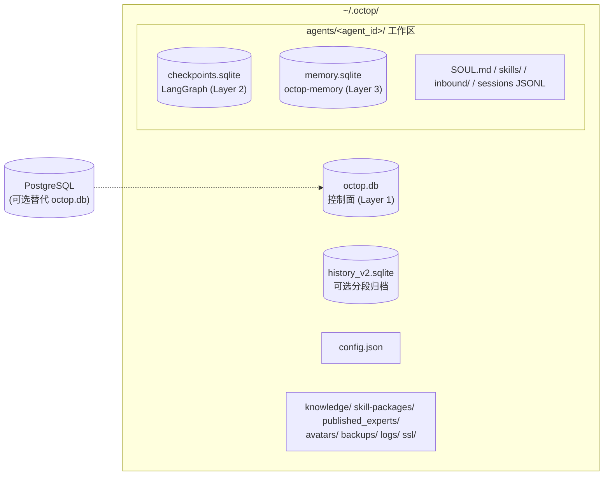
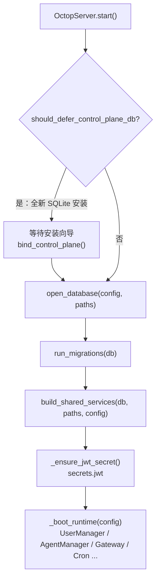
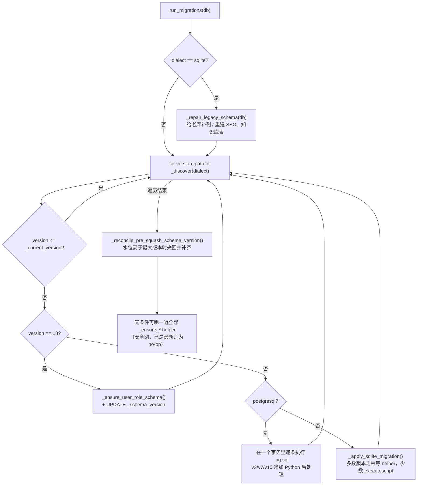
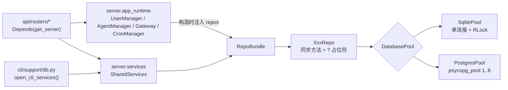
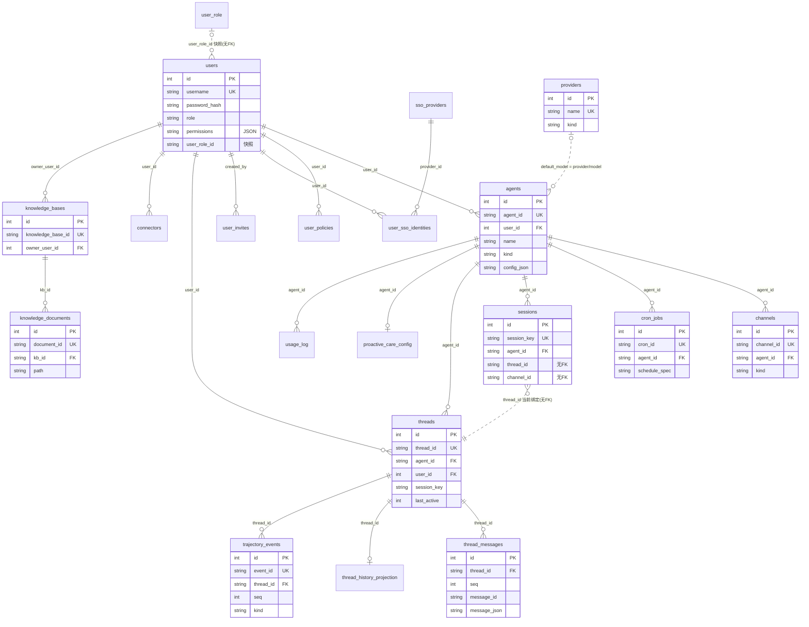
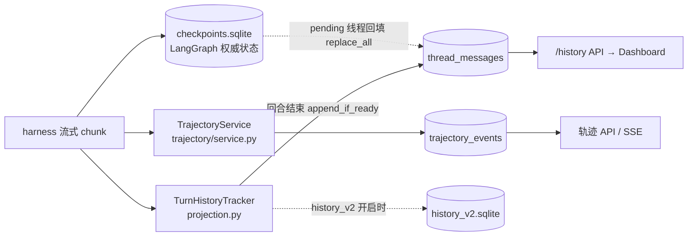

# 06 · 数据层：数据库、仓储与历史

> 一句话：Octop 的"管控面"状态（用户、Agent、渠道、会话线程、定时任务、知识库、连接器、配置与密钥……）全部落在**一个**关系库里（默认 SQLite 文件，可选 PostgreSQL），由 `infra/db/` 提供同步连接池、成对的编号迁移和"每表一个 repo"的仓储层，再通过 `SharedServices` 注入到各领域组件；对话正文的权威来源是 harness 的 LangGraph checkpoint，控制面库只保存面向 Dashboard 的**读模型**（投影与轨迹），可选的 `history_v2.sqlite` 则是一份独立的分段归档。

本篇你将学到：

- 控制面数据库怎么打开：`SqlitePool`（单连接 + RLock + WAL + `BEGIN IMMEDIATE`）与 `PostgresPool`（psycopg 连接池 + `?`→`%s` 改写）的差异
- 迁移机制：`NNN_*.sql` / `NNN_*.pg.sql` 成对文件、`_schema_version` 水位、`migrate.py` 里那一大堆幂等 helper 究竟在补什么
- `RepoBundle` / `SharedServices` 的构造与热替换，以及"每表一个 repo"的完整清单
- 全部 30 张业务表（外加 `_schema_version`）按领域分组的字段与用途，以及核心 ER 关系
- 资源表的"整数 `id` + 公共字符串 `{entity}_id`"约定和例外
- `infra/history/`：`thread_messages` 投影、轨迹账本、可选的分段归档与 checkpoint 的关系
- `infra/users/`：`User`/`Role`、argon2 密码、`UserManager` 的缓存与锁定逻辑
- 新增表 / 加列 / 新增 repo / 在 async 代码里访问 DB 的操作步骤和坑

---

## 1. 关键文件

| 文件 | 行数 | 作用 |
|------|------|------|
| `src/octop/infra/db/pool.py` | 176 | `DatabasePool` 协议、`SqlitePool`、`PostgresPool`、`_PgConnectionProxy` |
| `src/octop/infra/db/factory.py` | 44 | `open_database()`、`resolve_sqlite_db_path()`、`should_defer_control_plane_db()` |
| `src/octop/infra/db/probe.py` | 49 | 安装向导"测试连接"：短命池 + `SELECT 1` |
| `src/octop/infra/db/rebind.py` | 150 | 首启向导期间热切换控制面库（仅 `user_count == 0`） |
| `src/octop/infra/db/migrate.py` | 1886 | `run_migrations()` 与全部幂等修复 helper |
| `src/octop/infra/db/migrations/` | 18 对 | `001_initial.sql` … `018_user_role.sql` 及其 `.pg.sql` 对应文件 |
| `src/octop/infra/db/services.py` | 210 | `RepoBundle`、`SharedServices`、`build_shared_services()` |
| `src/octop/infra/db/repos/_base.py` | 81 | repo 公共 helper：`now_ts`、`partial_updates`、`insert_returning_id`… |
| `src/octop/infra/db/repos/*.py` | 25 个 | 每表（或每组紧耦合表）一个 repo |
| `src/octop/infra/history/` | ~2.9k | 投影（`projection.py`）、分段归档（`store.py`/`service.py`/`recorder.py`/`reader.py`）、轨迹（`trajectory/`） |
| `src/octop/infra/users/` | ~2k | `identity.py`、`password.py`、`manager.py`、`permissions.py`、`invites.py`、`resource_policy.py`、`preferences.py` |
| `docs/adr/002-database-backends.md` | — | 双后端决策记录（三层存储、不做跨引擎迁移） |
| `docs/versioned-history.md` | — | 分段历史归档的启用 / 回退 / 备份说明 |
| `tests/unit/db/` | 26 个测试文件 | 迁移、repo、池行为的单测；`test_db_pool.py` 断言当前 schema 版本 |

---

## 2. 三层存储：先分清"哪些数据在哪"

ADR 002 把持久化分成三层，**不要混为一谈**（`docs/adr/002-database-backends.md` "Three storage layers"）：

| 层 | 内容 | 位置 | 谁管 schema |
|----|------|------|-------------|
| Layer 1 控制面 | users / agents / channels / cron / threads 元数据 / settings / secrets / 投影 / 轨迹 | `~/.octop/octop.db`（SQLite）或 PostgreSQL | Octop `migrations/` + `migrate.py`（本篇） |
| Layer 2 Harness checkpoint | LangGraph 状态（对话消息的权威来源） | 默认 `{workspace}/checkpoints.sqlite`；memory 走 postgres 时复用 PostgresSaver | `octop-harness` |
| Layer 3 Agent 记忆 | octop-memory 的长期记忆 | 默认 `{workspace}/memory.sqlite`（新 agent 在 `.octop/` 下）；PG 控制面默认同 DSN、schema `agent_<id>` | `octop-memory` 运行时自建 |

另有一个**可选**的第四个 SQLite 文件 `~/.octop/history_v2.sqlite`（分段历史归档，见 §8.4），它不走控制面迁移。

---

## 3. 连接池：`SqlitePool` 与 `PostgresPool`

### 3.1 `DatabasePool` 协议

所有 repo 只依赖一个极小的协议（`src/octop/infra/db/pool.py:20-30`）：`dialect` 字段 + `connect()` / `transaction()` 两个上下文管理器 + `close()`。repo 里写的 SQL 统一用 SQLite 风格的 `?` 占位符，方言差异在池边界处理。

### 3.2 `SqlitePool`：单连接 + 可重入锁

`src/octop/infra/db/pool.py:33-78`：

- **只有一个** `sqlite3.Connection`，`check_same_thread=False`，所以可以从 `asyncio.to_thread` 的工作线程里用（`pool.py:42-46`）。
- `isolation_level=None` → Python 不再隐式开事务，**每条语句自动提交**。只有显式进入 `transaction()` 才是事务。
- `row_factory = sqlite3.Row`，repo 里一律用 `row["col"]` 取值（`pool.py:47`）。
- 连接级 PRAGMA 在构造时设置：`foreign_keys = ON`、`journal_mode = WAL`（`pool.py:48-49`）。ADR 明确要求连接/会话设置放在池里而**不是**迁移里。
- `threading.RLock` 串行化所有访问（`pool.py:50`）：`connect()` 只是"拿锁 → 把同一个连接借给你"（`pool.py:54-57`）。
- 新建的库文件在 POSIX 上 `chmod 0600`（`pool.py:51-52`，测试 `tests/unit/db/test_db_pool.py:30-35` 用 `skipif(os.name != "posix")` 守护）。
- `transaction()` 用 `BEGIN IMMEDIATE`（`pool.py:59-75`）。注释解释了原因：延迟 `BEGIN` 在"先读后写"时会在第一次写时才抢写锁，若另一个连接（`octop run --workers N` 的另一个进程、或服务运行时跑的 CLI）在中间提交，SQLite 会立即返回 `SQLITE_BUSY_SNAPSHOT`，5 秒 busy timeout（`sqlite3.connect` 的默认 `timeout=5.0`）也救不了；一开始就拿写锁可以让竞争者等待而不是让自己失败。

### 3.3 `PostgresPool`：psycopg 池 + 兼容代理

`src/octop/infra/db/pool.py:151-176`：

- `psycopg_pool.ConnectionPool(min_size=1, max_size=8)`，行工厂 `_compat_row_factory` 产出 `_CompatRow`，同时支持 `row["col"]` 与 `row[0]`，模仿 `sqlite3.Row`（`pool.py:81-112`）。
- 每次借出的连接包在 `_PgConnectionProxy` 里，`execute()` 先 `qmark_to_pyformat()` 把 `?` 换成 `%s`（`pool.py:15-17, 115-130`）。**这个替换不识别字符串字面量**：SQL 文本里不要出现字面 `?`；LIKE 模式等含 `%` 的值要走参数绑定（`tests/unit/db/test_postgres_pool_unit.py:12` 断言 `%` 不被改动）。
- `transaction()` = `pool.connection()` + `conn.transaction()`。`connect()` 退出时由 psycopg_pool 在无异常时提交——也就是说**PG 下一个 `connect()` 块本身就像一个事务，而 SQLite 下是逐语句自动提交**。依赖原子性的多语句写入必须用 `transaction()`，两边语义才一致。
- 方言差异偶尔需要在 repo 里分支：例如 `ThreadMessageRepo.append_if_ready` 在 PG 下先 `SELECT … FOR UPDATE` 锁住父线程行来串行化 `MAX(seq)+1`（`src/octop/infra/db/repos/thread_messages.py:247-251`），SQLite 靠 `BEGIN IMMEDIATE` 已经串行；`UsageRepo` 用 `sql_unix_day_bucket(..., dialect=...)` 生成按天分桶表达式（`src/octop/infra/db/repos/_base.py:67-71`）。

### 3.4 打开数据库：`open_database`

`src/octop/infra/db/factory.py:33-43`：`config.database.is_postgresql` 时返回 `PostgresPool(conninfo)`，否则 `SqlitePool(resolve_sqlite_db_path(...))`。SQLite 路径规则（`factory.py:11-16`）：`config.json` 有 `database` 段或设置了 `OCTOP_DATABASE_*` 环境变量时用配置里的 `sqlite_path`，否则回落到遗留布局 `paths.db` = `~/.octop/octop.db`（`src/octop/infra/utils/paths.py:23`）。

`should_defer_control_plane_db()`（`factory.py:19-30`）：全新 SQLite 安装（无库文件、无 env、非 PG）时，服务启动**推迟**打开库，等安装向导选好后端再 `bind_control_plane()`。调用方：

| 场景 | 位置 |
|------|------|
| 服务启动 | `src/octop/infra/server.py:316-324`：`open_database` → `run_migrations` → `build_shared_services` |
| 向导首次绑定 | `src/octop/infra/server.py:334-351` `bind_control_plane()` |
| 向导热换库 | `src/octop/infra/db/rebind.py:103-150` `rebind_control_plane()` |
| CLI 离线操作 | `src/octop/cli/support/db.py:20-32` `open_cli_services()` |
| 备份 / 恢复 / init / admin | `src/octop/cli/commands/backup.py:55`、`init.py:82`、`admin.py:119`、`src/octop/infra/backup/system_archive.py:534` |

注意：**每个打开库的入口都会先跑 `run_migrations`**，所以迁移必须对"已是最新"的库零副作用。

启动与迁移的整体流程：

---

## 4. 迁移机制

### 4.1 文件约定与发现

- 文件名 `NNN_description.sql`（SQLite）与 `NNN_description.pg.sql`（PostgreSQL），**必须成对**。`_discover(dialect)` 按方言挑文件：SQLite 跳过 `.pg.sql`，PG 只取 `.pg.sql`（`src/octop/infra/db/migrate.py:39-62`，测试 `tests/unit/db/test_migrate_discovery.py`）。
- 同一版本号出现两个文件会直接 `RuntimeError("Duplicate migration version … Fold unreleased schema into a single NNN pair")`（`migrate.py:53-61`）——这就是 AGENTS.md "未发布的 schema 改动折叠进当前 `00N`"规则的硬约束。
- `_schema_version` 是只有一行一列的表，由 `001_initial.sql` 创建并插入 1（`src/octop/infra/db/migrations/001_initial.sql:269-270`）。它是**已应用迁移的水位线**，不是变更日志。
- `*.pg.sql` 禁止 `CREATE EXTENSION`（ADR 002 "Hard rule"）；PG 迁移按 `;\n` 切分逐条执行（`migrate.py:23-36, 1680-1682`），所以写 PG 迁移时每条语句结尾的 `;` 后要换行。

当前共 18 对迁移（`001` 初始 schema，`002` cron MCP + skill_packages，`005` 共享专家/SSO/知识库，`007` 资源标识重建，`010` 线程消息投影，`012` 轨迹事件，`013` 多实例连接器，`014` 用户策略，`015` SSO kind，`016` agent teams，`017` 会话模式，`018` 角色模板……）。

### 4.2 `run_migrations` 的执行顺序

`src/octop/infra/db/migrate.py:1836-1886`：

几个容易误解的点：

1. **SQLite 大多数版本并不执行 `.sql` 文件本身**。`_apply_sqlite_migration`（`migrate.py:1685-1833`）对 v2–v9、v11、v12、v14–v17 直接调用对应的 `_ensure_*` helper 然后更新水位；只有 v1、v10（存在 `threads` 时）、v13（存在 `connectors` 时）落到末尾的 `conn.executescript(sql)`（`migrate.py:1831-1833`）；v18 两个方言都走 helper（`migrate.py:1842-1851`）。原因是老版本本地库形态五花八门，`ALTER TABLE ADD COLUMN` 在 SQLite 里不幂等，必须先查 `PRAGMA table_info` 再加。
2. 因此 **`.sql` 文件是"规范 DDL"，helper 是它的等价幂等实现**，两者要保持一致（AGENTS.md §7 Database）。PG 路径则真的执行 `.pg.sql`，v7 等版本之后再跑 helper 做 Python 回填（`migrate.py:1852-1868`）。
3. `executescript` 会先隐式 `COMMIT`，且不受 `transaction()` 包裹；SQLite 的 `.sql` 文件自己在末尾写 `UPDATE _schema_version SET version = N`（如 `migrations/010_thread_message_projection.sql:36`、`018_user_role.sql:23`）。
4. 末尾"无条件再跑一遍全部 `_ensure_*`"（`migrate.py:1871-1886`）是安全网：覆盖"水位已前进但 DDL 没真正应用"的库（例如 develop 分支上曾经并行出现过两个 `010_*.sql`，见 `migrate.py:1035-1040` 的 docstring）。

### 4.3 `migrate.py` 里的 helper 分类

1886 行里绝大多数是这些幂等 helper，按作用分：

| 类别 | 代表函数 | 做什么 |
|------|----------|--------|
| 元数据探测 | `_current_version`（:65）、`_table_columns`（:77）、`_table_exists`（:96）、`_relation_exists`（:453） | 两种方言分别查 `PRAGMA` / `information_schema` |
| 补列 / 删列 | `_ensure_column`（:112）、`_drop_column`（:132） | 列不存在才 `ALTER TABLE ADD COLUMN` |
| 按版本的 schema 保证 | `_ensure_cron_jobs_schema`（:150）、`_ensure_usage_cache_schema`（:843）、`_ensure_user_invites_schema`（:869）、`_ensure_thread_message_projection_schema`（:1035）、`_ensure_trajectory_events_schema`（:1126）、`_ensure_connectors_v13_schema`（:1243）、`_ensure_user_policy_schema`（:1419）、`_ensure_agent_teams_schema`（:1413）、`_ensure_thread_conversation_mode_schema`（:1537）、`_ensure_sso_provider_kind_schema`（:780）、`_ensure_user_role_schema`（:915） | 每个对应一个版本号，缺什么补什么 |
| 表重建（SQLite 无法 `ALTER` 表达的） | `_rebuild_skill_packages_identity_schema`（:302）、`_rebuild_published_experts_identity_schema`（:394）、`_rebuild_knowledge_identity_schema`（:551）、`_ensure_sso_oidc_schema`（:677） | 把 TEXT 主键老表改成"整数 `id` + 字符串 `{entity}_id`"，`RENAME → CREATE → INSERT SELECT → DROP` |
| 数据回填 | `_backfill_agent_profile_from_config`（:206）、`_collapse_legacy_agent_welcome_columns`（:168）、`_copy_legacy_user_policy_columns`（:1460）、`_seed_user_roles`（:980） | 从 `config_json` / 旧列搬数据；播种 `admin`/`user` 角色模板 |
| 老库兼容 | `_repair_legacy_schema`（:1545） | SQLite 专用，启动时先跑：给 `users`/`threads`/`agents` 补历史上加过的列 |
| 水位修正 | `_reconcile_pre_squash_schema_version`（:1588） | 早期 005–009 被合并（squash）过；若库里水位 > 当前最大版本，逐版本调用 helper 补齐再把水位夹回最大值，否则后续新迁移会被永久跳过 |

> 补充：`_seed_user_roles` 会 import `octop.infra.users.permissions.BASELINE_PERMISSIONS`（`migrate.py:987`），是 `infra/db` 里少见的对领域模块的依赖。

### 4.4 与测试的耦合

`tests/unit/db/test_db_pool.py` 的 fixture 就是"新建 `SqlitePool` + `run_migrations`"（`test_db_pool.py:17-21`），多个用例断言最终版本：`assert v == 18`（`test_db_pool.py:102, 184, 324, 349, 384, 467`），另有"水位被人为改成 2/4/6/8/10/13 后能自愈"的回归用例（如 `test_db_pool.py:308-324, 357-384`）。表清单断言在 `test_db_pool.py:38-71`。

> 注意：AGENTS.md §7 仍写着"currently `v == 7`"，**已过时**，以测试文件里的 `18` 为准。

PG 的真库测试用 `@pytest.mark.postgresql` 标记，需要 `OCTOP_TEST_DATABASE_URL` 指向**专用**数据库（会 `DROP SCHEMA public`，`tests/integration/test_postgresql_control_plane.py:1-26`，标记定义在 `pyproject.toml:208`）。

---

## 5. 仓储层：`repos/` 与 `SharedServices`

### 5.1 repo 的写法

每个 repo 是一个持有 `DatabasePool` 的普通类，方法全是**同步**的；读用 `with self._db.connect() as conn`，多语句写用 `with self._db.transaction() as conn`；返回值是 `@dataclass(frozen=True)` 的 `XxxRow`，由 `from_row(r)` 构造。`SecretRepo`（`src/octop/infra/db/repos/secrets.py:11-41`）是最短的完整样板，其中 `get_or_create` 展示了"事务内二次检查"防并发。

`_base.py` 提供的公共 helper（`src/octop/infra/db/repos/_base.py`）：

| helper | 用途 |
|--------|------|
| `now_ts()` | 统一 unix 秒时间戳（绝大多数表的 `created_at`/`updated_at` 是 INTEGER 秒） |
| `bool_int()` | bool → 0/1（布尔列都是 INTEGER） |
| `map_rows(rows, cls)` | 批量 `from_row` |
| `partial_updates()` / `optional_updates()` + `UNSET` | 拼 PATCH 的 `SET` 子句；前者 `None` 表示跳过，后者用哨兵区分"没传"与"显式置空" |
| `sql_in_placeholders(n)` | `IN (?, ?, ?)` |
| `sql_unix_day_bucket(col, dialect=)` | 两种方言的按天分桶 |
| `insert_returning_id()` | `INSERT … RETURNING id`（SQLite 3.35+ 与 PG 都支持），取回整数主键 |

`ON CONFLICT … DO UPDATE SET x = excluded.x` 两边语义相同，repo 里广泛使用（如 `settings.py:23`、`sessions.py:151`、`trajectory_events.py:77`）。

### 5.2 全部 repo 与表

| repo（`RepoBundle` 字段） | 文件 | 表 |
|------|------|----|
| `user_repo` → `UserRepo` | `repos/users.py` | `users`、`user_sso_identities` |
| `user_policy_repo` → `UserPolicyRepo` | `repos/user_policies.py` | `user_policies` |
| `invite_repo` → `InviteRepo` | `repos/invites.py` | `user_invites`（兑换时也写 `users`、`user_policies`） |
| `agent_repo` → `AgentRepo` | `repos/agents.py` | `agents` |
| `provider_repo` → `ProviderRepo` | `repos/providers.py` | `providers` |
| `voice_provider_repo` → `VoiceProviderRepo` | `repos/voice_providers.py` | `voice_providers` |
| `channel_repo` → `ChannelRepo` | `repos/channels.py` | `channels` |
| `cron_repo` → `CronJobRepo` | `repos/cron.py` | `cron_jobs` |
| `session_repo` → `SessionRepo` | `repos/sessions.py` | `sessions` |
| `thread_repo` → `ThreadRepo` | `repos/threads.py` | `threads`（新建线程时顺带写 `thread_history_projection`） |
| `thread_message_repo` → `ThreadMessageRepo` | `repos/thread_messages.py` | `thread_messages`、`thread_history_projection` |
| `trajectory_event_repo` → `TrajectoryEventRepo` | `repos/trajectory_events.py` | `trajectory_events` |
| `secret_repo` → `SecretRepo` | `repos/secrets.py` | `secrets` |
| `audit_repo` → `AuditRepo` | `repos/audit.py` | `audit_log` |
| `usage_repo` → `UsageRepo` | `repos/usage.py` | `usage_log` |
| `settings_repo` → `SettingsRepo` | `repos/settings.py` | `settings` |
| `storage_backend_repo` → `BackendRepo` | `repos/backends.py` | `storage_backends` |
| `connector_repo` → `ConnectorRepo` | `repos/connectors.py` | `connectors`、`connector_oauth_states` |
| `skill_package_repo` → `SkillPackageRepo` | `repos/skill_packages.py` | `skill_packages` |
| `published_expert_repo` → `PublishedExpertRepo` | `repos/published_experts.py` | `published_experts` |
| `knowledge_repo` → `KnowledgeRepo` | `repos/knowledge.py` | `knowledge_bases`、`knowledge_documents` |
| `care_push_repo` → `CarePushRepo` | `repos/care_push.py` | `care_push_records` |
| `proactive_care_config_repo` → `ProactiveCareConfigRepo` | `repos/proactive_care_config.py` | `proactive_care_config` |
| `sso_repo` → `SsoRepo` | `repos/sso.py` | `sso_providers`、`sso_login_states` |
| （不在 bundle 中）`UserRoleRepo` | `repos/user_roles.py` | `user_role` |

`UserRoleRepo` 是唯一**没有**挂到 `RepoBundle` 的 repo，调用方临时 `UserRoleRepo(server.services.db)` 构造（`src/octop/api/routers/user_roles.py:62-63`、`src/octop/infra/users/invites.py:252-255`）；其中 router 直接 import repo 与 AGENTS.md §8 的约定不一致，属于既有代码现状。

### 5.3 `RepoBundle` / `SharedServices`

`src/octop/infra/db/services.py`：

- `RepoBundle`（`services.py:36-93`）：frozen dataclass，持有 `db` 和上表 24 个 repo，`from_pool(db)` 一次性全部构造。所有 repo 共享同一个池。
- `SharedServices`（`services.py:96-200`）：`paths` + `config` + `repos`，并为每个 repo 提供同名只读 property（`services.user_repo` 等价于 `services.repos.user_repo`），所以调用处写 `server.services.agent_repo`。
- `build_shared_services()`（`services.py:203-210`）是唯一的构造入口。

**热替换**：首启向导换库时，`rebind_control_plane()` 构造新的 `SharedServices`，然后调用 `AppRuntime.replace_services()`（`src/octop/infra/server.py:220-239`），它逐个调用各组件的公开 `replace_*` API：`user_manager.replace_services`、`agent_registry.replace_persistence`、`gateway.replace_repos`、`cron_manager.replace_repos`、`proactive_scheduler.replace_persistence`、`trajectory_service.replace_store`。这意味着**长期持有 repo 引用的组件必须实现 replace 方法并在这里登记**，否则换库后会继续写旧库。启用了分段历史归档时换库被拒绝（`server.py:224-225`、`rebind.py:117-122`）。

---

## 6. 表清单（schema v18）

以下以 `run_migrations` 在空 SQLite 上跑完后的实际 schema 为准（PG 对应列类型：`INTEGER PRIMARY KEY AUTOINCREMENT` → `GENERATED BY DEFAULT AS IDENTITY`，`BLOB` → `BYTEA`，见 `001_initial.sql:1-10` 的注释）。时间戳默认是 unix 秒 INTEGER；`skill_packages` 的时间戳是 TEXT，`trajectory_events.ts` 是 REAL。

### 6.1 用户、认证与权限

| 表 | 主要字段 | 用途 |
|----|----------|------|
| `users` | `id` PK、`username`（唯一索引 `005_…sql:98`）、`password_hash`（SSO 用户可为空）、`role`（`admin`/`user`）、`display_name`、`disabled`、`locale`、`permissions`（JSON 数组）、`preferences_json`、`email`（唯一）、`login_failed_count`/`login_locked_until`、`sso_provider_id`/`sso_subject`（旧单身份）、`role_name`/`user_role_id`（角色模板快照，非 FK）、`avatar_icon` | 账号本体 |
| `user_role` | `id`、`user_role_id` UK、`user_role_name` UK、`permissions`、`policies`（JSON）、`description`、`avatar_icon` | 角色模板（v18）；用户与邀请只存快照，改模板不回写已有用户（`018_user_role.sql:1-3`） |
| `user_policies` | `id`、`policy_id` UK、`user_id` FK、`name`、`enabled`、`value`，`UNIQUE(user_id,name)` | 每用户具名资源策略：`workspace_root_dir`、`token_quota`、`max_agents`（`src/octop/infra/users/resource_policy.py:18-20`） |
| `user_invites` | `id`、`code` UK、`created_by` FK、`expires_at`、`used_at`、`used_by_user_id`、`revoked_at`、`role_name`/`user_role_id` | 一次性邀请码 |
| `sso_providers` | `id`、`kind`（唯一，`oidc` 等）、`issuer`、`client_id`、`client_secret_enc`（加密 BLOB）、`scopes`、`extra`（JSON）、`enabled` | SSO 提供方配置（name-less，按 `kind` 唯一） |
| `user_sso_identities` | `id`、`user_id` FK、`provider_id` FK、`subject`，`UNIQUE(provider_id,subject)` | 一个用户可绑多个 SSO 身份（v15） |
| `sso_login_states` | `state` PK、`provider_id`、`nonce`、`code_verifier`、`login_code`、`expires_at`、`consumed_at` | OIDC 登录流程的短期状态（临时行） |

### 6.2 Agent 与模型配置

| 表 | 主要字段 | 用途 |
|----|----------|------|
| `agents` | `id`、`agent_id` UK、`user_id` FK（可空）、`name`（`UNIQUE(user_id,name)` 部分索引 `001_initial.sql:48`）、`kind`（`expert`/`team`）、`default_model`、`system_prompt`、`persona_mbti`、`config_json`（大量运行时配置，如 `enable_trajectory`、memory 后端）、`enabled`、`last_state`/`last_error`、`is_shared`、展示字段（`icon*`、`color`、`welcome_message`）、关联 JSON（`skill_package_ids`、`knowledge_base_ids`、`mcp_servers`、`published_expert_id`） | Agent 注册表；运行时对象见 [04-agents.md](04-agents.md) |
| `providers` | `id`、`name` UK、`kind`、`base_url`、`api_key`、`models_json`、`extra_json`、`enabled` | LLM 提供方；模型以 `provider/model` 字符串被引用（`src/octop/infra/agents/providers/store.py:55-70`），无外键 |
| `voice_providers` | `id`、`name` UK、`kind`、`capability`、`base_url`、`api_key` | 语音（ASR/TTS）提供方 |
| `storage_backends` | `id`、`name` UK、`kind`、`endpoint`、`access_key`/`secret_key`、`bucket`、`region`、`config_json` | 远程工作区存储（COS/S3…），见 [04-agents.md](04-agents.md) |
| `proactive_care_config` | `agent_id` PK+FK、`enabled`、`active_hours_start/end`、`min/max_interval_hours` | 每 Agent 主动关怀配置（1:1 扩展表） |
| `care_push_records` | `id`（UUID 文本 PK）、`agent_id`、`session_key`、`episode_id`、`pushed_at` | 主动关怀推送流水（无 FK，追加日志） |

### 6.3 会话、线程与消息

| 表 | 主要字段 | 用途 |
|----|----------|------|
| `sessions` | `id`、`session_key` UK、`agent_id` FK、`user_id` FK、`channel_type`、`chat_type`、`thread_id`（**当前绑定**的线程，无 FK）、`channel_id`、`channel_subject_id`、`channel_metadata`、`unread_count` | "会话键 → 当前线程"映射（`repos/sessions.py:1`）。`session_key` 由入口决定，如 Dashboard 用 `ThreadRegistry.dashboard_key(agent_id, user_id)` |
| `threads` | `id`、`thread_id` UK、`agent_id` FK、`user_id` FK、`channel_type`、`session_key`、`title`、`pinned`、`last_active`、composer 偏好（`model_ref`、`reasoning_mode`、`reasoning_effort`）、`artifacts`（JSON）、`conversation_mode`/`pending_plan_path`/`hitl_policy` | 一条对话的元数据；`thread_id` 同时是 LangGraph checkpoint 的 `configurable.thread_id` |
| `thread_messages` | `id`、`thread_id` FK、`seq`、`message_id`、`role`、`message_json`（LangChain `message_to_dict` 结果），`UNIQUE(thread_id,seq)`、`UNIQUE(thread_id,message_id)` | Dashboard 历史**读模型**（v10） |
| `thread_history_projection` | `thread_id` PK+FK、`status`（`pending`/`queued`/`running`/`failed`/`ready`）、`error` | 每线程投影是否可用 |
| `trajectory_events` | `id`、`event_id` UK、`agent_id`、`thread_id` FK、`seq`、`ts`、`kind`、`turn_id`、`request_seq`、`is_error`、`summary`、`payload_json`，`UNIQUE(thread_id,seq)` | 追加式轨迹账本（v12），驱动"运行轨迹"视图 |

"会话 / 线程"模型在 `src/octop/infra/gateway/threads.py:1-14` 的 `ThreadRegistry`：一个 `session_key` 同一时刻只绑一个活动线程，`/new` 或 Dashboard "新对话"会新建线程并改写 `sessions.thread_id`；旧线程仍在 `threads` 中可被浏览。详见 [05-gateway.md](05-gateway.md)、[03-chat-flow.md](03-chat-flow.md)。仓库里**没有** `chat_sessions` 表。

### 6.4 渠道与定时任务

| 表 | 主要字段 | 用途 |
|----|----------|------|
| `channels` | `id`、`channel_id` UK、`agent_id` FK、`user_id` FK、`kind`、`name`（`UNIQUE(agent_id,name)`）、`config_json`（含 IM 凭据）、`enabled` | IM 渠道实例，见 [05-gateway.md](05-gateway.md) |
| `cron_jobs` | `id`、`cron_id` UK、`agent_id` FK、`user_id` FK、`name`、`schedule_spec`、`prompt`、`session_key`、`model`、`fresh_thread`、`task_type`（`text`/`agent` CHECK）、`mcp_servers`（JSON）、`enabled`、`last_run_at`/`last_status`/`last_error` | 定时任务，见 [08-domains.md](08-domains.md) |

### 6.5 知识库、技能包与专家

| 表 | 主要字段 | 用途 |
|----|----------|------|
| `knowledge_bases` | `id`、`knowledge_base_id` UK、`owner_user_id` FK、`name`（`UNIQUE(owner_user_id,name)`）、`shared`、`default_open`、`embedding_model`/`embedding_dim`、`doc_count`、`max_documents` | 知识库元数据；文件在 `~/.octop/knowledge/`（`paths.py:78`） |
| `knowledge_documents` | `id`、`document_id` UK、`kb_id` FK→`knowledge_bases.knowledge_base_id`、`path`（`UNIQUE(kb_id,path)`）、`is_dir`、`content_type`、`byte_size`、`content_hash`、`status`、`chunk_count` | 文档 / 文件夹条目与索引状态 |
| `skill_packages` | `id`、`skill_package_id` UK、`name`（唯一索引）、`created_by`、`skill_count`、`icon_*` | 技能包元数据；内容在 `~/.octop/skill-packages/` |
| `published_experts` | `id`、`published_expert_id` UK、`slug`（唯一）、`name`、`created_by`、`source_agent_id` | 用户发布的专家模板；快照在 `~/.octop/published_experts/` |

### 6.6 连接器

| 表 | 主要字段 | 用途 |
|----|----------|------|
| `connectors` | `id`、`instance_id` UK、`user_id` FK、`kind`、`display_name`、`status`、`shared`、`mcp_server_name` UK、`credential_blob`（加密）、`credential_expires_at`/`credential_rotated_at`、`config_json` | 连接器实例（v13 起支持同一 `kind` 多实例与共享） |
| `connector_oauth_states` | `id`、`state_id` UK、`state` UK、`user_id` FK、`kind`、`code_verifier`、`redirect_after` | OAuth PKCE 流程临时状态 |

凭据用 `secrets` 表里的密钥加密后存入 `credential_blob`（`src/octop/infra/connectors/service.py:110, 136`）。

### 6.7 配置 KV、密钥

| 表 | 主要字段 | 用途 |
|----|----------|------|
| `settings` | `key` PK、`value` | 全局 KV（如 `knowledge_embedding_model`，`src/octop/infra/knowledge/service.py:114`） |
| `secrets` | `k` PK、`v` BLOB、`created_at`、`rotated_at` | 服务端密钥：`jwt`（启动时 `get_or_create`，`src/octop/infra/server.py:590`）、SSO Fernet 密钥（`src/octop/infra/auth/sso/crypto.py:13`）、连接器凭据加密密钥等 |

### 6.8 日志与计量

| 表 | 主要字段 | 用途 |
|----|----------|------|
| `usage_log` | `id`、`ts`、`agent_id` FK、`user_id` FK、`thread_id`、`model`、`input/output/total_tokens`、`uncached_input_tokens`、`cache_read/write_tokens`、`reasoning_tokens`、`model_calls`、`source` | token 用量流水；`token_quota` 策略据此判断（`resource_policy.py:182`） |
| `audit_log` | `id`、`ts`、`actor`、`action`、`target`、`payload` | 审计流水（登录、用户变更等，`AuditRepo.write`） |
| `_schema_version` | `version` | 迁移水位 |

### 6.9 核心 ER 图

实线 = 真实外键；虚线 = 仅逻辑引用（无 FK）。

绝大多数 FK 带 `ON DELETE CASCADE`：删除 Agent 会级联删掉其渠道、定时任务、会话、线程、投影、轨迹和用量；删除用户会级联删除其 Agent 及所有下游行。`user_invites.used_by_user_id` 是 `ON DELETE SET NULL`。注意级联只作用于控制面库，工作区文件和 checkpoint 需要领域代码另行清理（见 [04-agents.md](04-agents.md)）。

---

## 7. 资源表 id 约定

AGENTS.md §7 "Database" 约定：**API 可见的资源表**使用

| 列 | 作用 |
|----|------|
| `id` | 整数代理主键（SQLite `AUTOINCREMENT` / PG `GENERATED BY DEFAULT AS IDENTITY`） |
| `{entity}_id` | 公共字符串 id，`UNIQUE`（ULID 或短 id）；API、路径、其他表都用它 |

子表存**字符串** id 并 `REFERENCES parent({entity}_id)`，**永远不要 FK 到整数 `id`**。从上面的 schema 可以验证：`channels.agent_id`、`threads.agent_id`、`thread_messages.thread_id`、`knowledge_documents.kb_id` 都引用字符串列。

repo 的映射有两种写法（均存在于现有代码）：

- `AgentRow`、`ThreadRow`、`CronJobRow` 同时暴露 `id: int` 和 `agent_id`/`thread_id`/`cron_id: str`（`src/octop/infra/db/repos/agents.py:21-23, 65-66`、`threads.py:32-34`）。
- `knowledge`、`skill_packages`、`published_experts`、`user_policies` 的 Row 把公共字符串映射成 `id`，整数放到 `pk`（`src/octop/infra/db/repos/knowledge.py:24, 45-46`）。AGENTS.md 推荐的是这种"`row.id` = 公共字符串、`row.pk` = 整数"。

`007_resource_identity_and_profile.sql` 就是把 v2/v5 时代 TEXT 主键的资源表重建成这一形态的迁移（`migrations/007_resource_identity_and_profile.sql:2-6`）。

**不适用**此约定的表：

| 类型 | 表 | 主键形态 |
|------|----|----------|
| 用户 | `users` | 整数 `user_id` 被各表 FK；登录身份是 `username` |
| 按名称的配置 | `providers`、`voice_providers`、`storage_backends` | 整数 `id` + `name UNIQUE` |
| 追加日志 | `usage_log`、`audit_log`、`care_push_records` | 自增整数或 UUID 文本 |
| KV | `settings`、`secrets` | 文本 key |
| 1:1 扩展 | `proactive_care_config` | `agent_id` 即主键 |
| 临时行 | `sso_login_states` | `state` 文本 PK |

另外 SSO 相关（`sso_providers`、`user_sso_identities`）和 `user_invites` 也用整数 FK，没有公共字符串 id。

---

## 8. 历史：`infra/history/`

### 8.1 谁是"对话正文"的权威来源

对话消息的**权威存储是 LangGraph checkpoint**（harness 按 `configurable.thread_id` 管理，默认在工作区的 `checkpoints.sqlite`）。控制面库里的 `thread_messages` 只是给 Dashboard 分页读用的**投影**：失败不影响对话本身——`_record_turn_history` 在投影写失败时只打 warning（`src/octop/infra/gateway/process/processor.py:1539-1547` 的注释 "History projection is a read optimization and must never turn a successful model response into a failed chat turn"）。

### 8.2 回合投影：`projection.py`

`src/octop/infra/history/projection.py`：

- `TurnHistoryTracker`（`projection.py:155`）在一次请求中观察 harness 流式 chunk（`observe`，`:170`），只保留**当前用户回合**的消息（state chunk 会重放全部历史，需要去重），最后 `inputs`（`:224`）产出 `ThreadMessageInput` 列表。
- `message_input()`（`:64`）把 LangChain 消息 `message_to_dict` 后存 JSON，丢弃 `system` 角色；`live_message_input()`（`:83`）会给本回合消息补 `checkpoint_ts`（毫秒），让投影里的时间与 checkpoint 一致。
- 由网关处理器创建与消费：`processor.py:180-224` `_begin_history`、`processor.py:1520-1547` `_record_turn_history`。Agent teams 与 fork 也会直接 `append_if_ready`（`src/octop/infra/agents/teams/team_manager.py:225`、`src/octop/infra/agents/threads/fork.py:234`）。

`ThreadMessageRepo` 的读写门控（`src/octop/infra/db/repos/thread_messages.py`）：

- 新线程在创建时直接插入 `thread_history_projection(status='ready')`（`repos/threads.py:184`）。
- `append_if_ready()`（`:231-280`）：在事务里检查状态，**不是 `ready` 就什么也不写**；按 `MAX(seq)+1` 递增，并按 `message_id` 去重。
- v10 之前就有消息的老线程被迁移标成 `pending`（`migrations/010_thread_message_projection.sql:29-34`），需要"历史迁移"回填：`POST /agents/{agent_id}/history-migration/start` 把候选线程排队（`src/octop/api/routers/chat/history.py:159-209`），后台逐个解码 checkpoint 后 `replace_all()`（`thread_messages.py:282-317`）——先删、再按 200 条一批写入，最后标 `ready`；由于读者只看 `ready`，中间批次不可见，也不会长时间占着 SQLite 写锁。

### 8.3 轨迹：`trajectory/`

- `TrajectoryService`（`src/octop/infra/history/trajectory/service.py`）：把 harness chunk 投影成 `TrajectoryEvent`（`projector.py`），写 store，并通过 `TrajectoryLiveBus` 实时推送；"Observe never fails the caller"（`service.py:1`）。
- `TrajectoryStore`（`trajectory/store.py:12-54`）是 `TrajectoryEventRepo` 的薄包装，写入前 `clip_persisted_event` 截断大字段。
- 持久化上限（`trajectory/settings.py:19-23`）：payload 64k 字符、summary 240 字符、只保留最近 50 个用户回合（`prune_older_than_user_turns`，`repos/trajectory_events.py:150`）。
- 每个 Agent 可在 `config_json.enable_trajectory = false` 关闭，默认开启（`trajectory/settings.py:1-4, 27-31`）。

### 8.4 分段历史归档（`history_v2`，可选）

由 `config.json` 的 `history_v2_enabled`（或 `OCTOP_HISTORY_V2_ENABLED`，`src/octop/config.py:136, 610-613`）控制，默认关闭。完整的运维说明见 `docs/versioned-history.md`，这里只讲数据结构：

- **独立文件** `~/.octop/history_v2.sqlite` + 标记文件 `history_v2.required`（`src/octop/infra/server.py:387-406`）。只要开关打开、或文件/标记已存在，就会装配 `HistoryArchive`；仅支持 SQLite 控制面，PG 下直接报错（`server.py:400-401`）。
- `HistoryStore`（`src/octop/infra/history/store.py:57-80`）复用 `SqlitePool`，另设 `synchronous = FULL`、`busy_timeout = 5000`；首次创建时写入 `archive_meta(version, identity)`，`identity` 是控制面库文件的绝对路径，之后不匹配就拒绝打开（防止主库与归档错配）；标记文件存在而库文件缺失时抛 `FileNotFoundError`。
- 表结构（`store.py:25-50`）：`segments`（每线程的格式分段：`legacy` 或 `v2`，记录 `thread_messages`/`trajectory_events` 的起止 seq 边界或 checkpoint 锚点）、`turns`（回合状态 `active/paused/complete/partial/failed/interrupted`）、`documents`（消息或轨迹文档）、`bodies`（按内容哈希去重的正文，超过 1024 字符按块切分）、`body_refs`（引用计数）。
- `HistoryArchive.begin()`（`src/octop/infra/history/service.py:42-126`）以**完整回合为边界**切换格式：新开 segment，记录旧表当前的 `head`，老前缀不复制；v2 回合不再写 `thread_messages` / `trajectory_events`。
- `RecordingTracker.flush()`（`src/octop/infra/history/recorder.py:361-397`）在把事件转发给前端**之前**等待事务提交；`finish()`（`:399-446`）根据是否缺工具结果、是否解码失败等判定回合状态。
- 读取：`reader.read_page()`（`src/octop/infra/history/reader.py:14`）把 v2 段、旧投影段和 checkpoint 锚点段拼成一个带 `next_cursor` 的分页结果。
- 启用归档后，`rebind_control_plane` 与 `AppRuntime.replace_services` 都会拒绝运行时换库。

---

## 9. 用户域：`infra/users/`

只讲数据与领域逻辑；JWT、登录路由、SSO 回调等 HTTP 部分见 [07-api-layer.md](07-api-layer.md)。

### 9.1 身份原语

`src/octop/infra/users/identity.py`：`Role(StrEnum)` 只有 `ADMIN="admin"`、`USER="user"` 两个系统角色（`:9-11`）；`User` dataclass 含 `id`、`username`、`role`、`display_name`、`locale`、`permissions`（`:14-29`），`is_admin` 就是 `role is Role.ADMIN`。

"角色模板"（`user_role` 表）与系统角色不是一回事：模板是创建用户/邀请时拷贝权限与策略的**预设**，用户行只保存 `role_name`/`user_role_id` 快照（`src/octop/infra/db/repos/user_roles.py:1`）。

### 9.2 权限与策略

- `permissions.py` 定义模块级权限目录 `PERMISSIONS`（`channels`、`connectors`、`terminal`、`browser`……，`src/octop/infra/users/permissions.py:50` 起），分 `settings`/`control`/`admin` 三类；`BASELINE_PERMISSIONS` 是 settings 类，新用户默认勾选但**仍显式写入**（`:222`）。
- `user_has_permission()`：未知 key 一律拒绝，admin 全放行，否则看 `users.permissions` JSON（`:225-234`）。
- `resource_policy.py`：从 `user_policies` 行解析 `workspace_root_dir`、`token_quota`、`max_agents`，并提供 `assert_token_quota_available`（对照 `usage_log`）、`assert_agent_quota_available`（对照 `agents` 数量）等检查（`resource_policy.py:182-207`）。

### 9.3 密码：argon2id

`src/octop/infra/users/password.py`：模块级 `PasswordHasher()`（argon2-cffi 默认参数，即 argon2id），`hash_password` / `verify_password`（后者吞掉 `VerifyMismatchError`/`InvalidHashError` 返回 `False`，`:35-45`）。`validate_password_policy`：至少 8 位、同时含字母和数字、不在常见密码黑名单、改密时不能与旧密码相同（`:48-70`）。

### 9.4 `UserManager`

`src/octop/infra/users/manager.py:82`：

- **内存缓存**：`_users: dict[username, User]`，`boot()` 时加载全部未禁用用户（`:103-114`）；`get`/`get_by_id`/`list` 读缓存，`get_row`/`list_all`/`count` 直读 DB（`:216-237`）。改动用户的方法都在 `asyncio.Lock` 下同时更新 DB 与缓存。
- `create()`（`:122-187`）：校验密码策略与权限 key → 查重 username/email → `hash_password` → `user_repo.create` → 写缓存 → `audit_repo.write("user.create")`。邀请兑换走 `create_from_invite` → `InviteService.redeem`，再通过 `register_cached_user` 入缓存（`:189-214`）。
- `authenticate()`（`:454-510`）：支持用户名或邮箱登录；禁用用户、无密码（纯 SSO）用户直接失败；`login_locked_until` 未到期抛 `LOGIN_LOCKED`；密码错误时 `record_failed_login` 累加失败次数，到阈值后锁定（阈值与时长来自 `config.login_max_attempts` / `login_lockout_seconds`，锁定时长下限 60 秒，`:92-93`），并写 `auth.failed` 审计；成功则清零并写 `auth.login`。
- SSO：`resolve_or_create_sso_user` / `bind_sso_identity` / `unbind_sso_identity`（`:241-414`）读写 `user_sso_identities`。
- `replace_services()`（`:95-99`）供换库时重定向。

---

## 10. `~/.octop/` 中数据库以外的数据

路径集中定义在 `src/octop/infra/utils/paths.py` 的 `PathLayout`（根目录由 `OCTOP_HOME` 覆盖）。简表：

| 路径 | 内容 | 详见 |
|------|------|------|
| `config.json` | 进程配置（含 `database` 段、`default_timezone`、`history_v2_enabled`） | [02-boot-and-runtime.md](02-boot-and-runtime.md) |
| `agents/<agent_id>/` | Agent 工作区：SOUL、skills、`inbound/` 附件、会话 JSONL、`checkpoints.sqlite`、`memory.sqlite`；新 agent 的系统文件在 `.octop/` 下 | [04-agents.md](04-agents.md) |
| `knowledge/`、`skill-packages/`、`published_experts/`、`expert_market/` | 知识库文件、技能包内容、专家快照、市场缓存 | [08-domains.md](08-domains.md) |
| `avatars/`、`backups/`、`logs/`、`ssl/`、`plugins/`、`connector-cli/` | 头像、备份、日志、TLS 证书、插件、连接器 CLI 状态 | — |
| `history_v2.sqlite` + `.required` | 可选分段归档 | §8.4 |

工作区内容文件一律通过 `HarnessAgent.workspace`（`BackendWorkspace`）读写，不要直接 `Path.write_text`（AGENTS.md §7）。密钥类数据（JWT、加密密钥）在 DB 的 `secrets` 表，不在文件里。备份按"聊天相关表 + 工作区 checkpoint/memory/sessions 文件"分组（`src/octop/infra/backup/chats.py:15-33`）。

---

## 11. 修改指南

### 11.1 新增一张表 / 给已有表加一列

1. **决定版本号**。看 `migrations/` 里最大的 `NNN`，再确认它是否已随正式版发布（`git tag` / CHANGELOG）：
   - 未发布（仍只在 `develop`）→ **折叠进当前 `NNN`**，直接改那对 `.sql` / `.pg.sql`，**不要**新开 `NNN+1`（重复版本号会让 `_discover` 抛错；新版本号会让已经跑过旧 `NNN` 的开发库跳过改动）。
   - 已发布 → 新建 `NNN+1_description.sql` 与 `NNN+1_description.pg.sql`。
   - 注意：折叠进已被某些本地库应用过的 `NNN` 时，那些库的水位已经是 `NNN`，不会重跑文件——所以**必须**同时有一个幂等 `_ensure_*` helper 兜底（见第 3 步）。
2. **写两份 DDL**。
   - 资源表遵守 §7：`id` 整数 PK + `{entity}_id TEXT NOT NULL UNIQUE`；子表 FK 到字符串列；需要级联就写 `ON DELETE CASCADE`。
   - SQLite 用 `INTEGER PRIMARY KEY AUTOINCREMENT`、`BLOB`；PG 用 `GENERATED BY DEFAULT AS IDENTITY`、`BYTEA`、大计数用 `BIGINT`。
   - 文件末尾 `UPDATE _schema_version SET version = N;`（两份都写）。
   - PG 文件：语句以 `;` + 换行结尾；**不要** `CREATE EXTENSION`；不要在 SQL 里写字面 `?`。
3. **在 `migrate.py` 写幂等 helper**，如 `_ensure_foo_schema(db)`：`_table_exists` 判断后建表（`CREATE TABLE IF NOT EXISTS`，PG 分支用 PG 类型），加列用 `_ensure_column(db, table, col, definition)`。SQLite 无法用 `ALTER` 表达的变更（改主键、改约束、删 UNIQUE）参照 `_rebuild_*_identity_schema` 写"改名 → 建新表 → 拷贝 → 删旧表"，并保证重复运行无害。
4. **接线**：
   - `_apply_sqlite_migration` 加一个 `if version == N:` 分支调用 helper 并更新水位（否则会落到 `executescript(sql)`）；
   - 如 PG 需要 Python 后处理，加到 `run_migrations` 的 PG 分支；
   - `_reconcile_pre_squash_schema_version` 的两个方言分支各加 `if max_version >= N: _ensure_foo_schema(db)`；
   - `run_migrations` 末尾的安全网列表追加 `_ensure_foo_schema(db)`。
5. **更新测试**：把 `tests/unit/db/test_db_pool.py` 里所有 `assert v == 18` / `version == 18` 改成新版本（只在新开版本号时需要）；新表加进 `test_run_migrations_creates_tables` 的 `expected` 集合；为 helper 写一个"水位已前进但列缺失也能修复"的用例（参考 `test_db_pool.py:148-166`）。有 PG 环境时跑一遍 `@pytest.mark.postgresql` 用例。
6. **同步文档**：本篇 §6 的表清单；如版本断言变化，AGENTS.md §7 里的版本号也已过时，可一并提醒维护者。
7. 验证：`uv run pytest tests/unit/db -q`，最终 `make all`。

坑点：

- SQLite 的 `ADD COLUMN ... NOT NULL` 必须带 `DEFAULT`。
- 新列若 repo 的 `from_row` 直接 `r["new_col"]`，在老库补列之前会 `KeyError`/`IndexError`；`AgentRow.from_row` 对 `is_shared`、`kind` 做了 `try/except` 兜底（`repos/agents.py:50-60`），可参照。
- 备份/恢复按表名枚举聊天表（`src/octop/infra/backup/chats.py:15-20`），新增聊天相关表要考虑是否加入；`system_archive.py` 还会比较 `_current_version` 与 `_max_discovered_version`（`system_archive.py:42`）拒绝不兼容恢复。
- 若新表的行对 API 可见，还要在 `api/` 写 Pydantic 模型与 OpenAPI 描述（见 [07-api-layer.md](07-api-layer.md)）。

### 11.2 新增一个 repo 并挂到 `SharedServices`

1. 在 `src/octop/infra/db/repos/foo.py` 写 `FooRow`（frozen dataclass + `from_row`）和 `FooRepo(db: DatabasePool)`。只 import `infra/db/pool`、`repos/_base`、`infra/utils/`——**repo 不得 import 任何非 DB 的 infra 包**（AGENTS.md §5 Hard bans）。
2. SQL 用 `?` 占位；需要主键时用 `insert_returning_id()`；多语句写入包在 `transaction()` 里；PATCH 用 `optional_updates()`。
3. 在 `src/octop/infra/db/services.py`：import → `RepoBundle` 加字段 → `from_pool` 里构造 → `SharedServices` 加同名 property。
4. 如果某个运行时单例（Manager、Gateway…）在构造时拿走了这个 repo 的引用，给它加 `replace_*` 方法，并在 `AppRuntime.replace_services()`（`src/octop/infra/server.py:220-239`）里调用，否则首启向导换库后它仍指向旧池。
5. 上层只通过 `server.services.foo_repo`（HTTP）或 `SharedServices`（infra、CLI）访问，不要在 router 里 `import octop.infra.db.repos.foo`（AGENTS.md §8）。
6. 测试：`tests/unit/db/test_repo_foo.py`，fixture 为 `SqlitePool(tmp_path / "octop.db")` + `run_migrations(pool)`。

### 11.3 在 async 代码中安全访问 DB

现状是**同步池从 async 调用**（ADR 002 "Sync pool from async (same pattern as today)"，`asyncio.to_thread` 助手被列为后续工作）。实践中两种写法并存：大量 router/manager 直接在协程里调用 repo（单行查询很快，可接受）；耗时或批量路径用 `asyncio.to_thread`，例如 `processor.py:188` 的 `archive.store.segments`、`recorder.py:377-379` 的 `save_message_updates`。

规则建议：

1. **短小单行读写**（按主键查、更新一行）可以直接调用。
2. **可能扫大量行 / 批量写 / 解码 checkpoint / 任何文件 I/O** → `await asyncio.to_thread(repo.method, ...)`（AGENTS.md §8：async 里不要做阻塞 I/O）。
3. **不要在持有 `transaction()` 期间 `await`**：SQLite 池是单连接 + `threading.RLock`，事务期间其他线程（包括事件循环线程上的其他 repo 调用）会被阻塞；在事件循环线程里开事务再 `await` 会让同一线程的其他协程重入同一事务（RLock 可重入），写入混在一起。事务块内只做同步 SQL。
4. **原子性要用 `transaction()`**。SQLite 下 `connect()` 是逐语句自动提交，PG 下 `connect()` 块整体提交——只用 `connect()` 写多条语句会导致两种后端行为不一致。
5. **"先读后写"要放在同一个 `transaction()` 里**（SQLite 的 `BEGIN IMMEDIATE` 保证不会被别的写者插队）；PG 下若需要对父行串行化，用 `SELECT … FOR UPDATE`（参考 `thread_messages.py:247-251`）。
6. `asyncio.to_thread` 的调用可能被取消，但线程里的写不会被取消；如果后续逻辑依赖写入已完成，参照 `RecordingTracker.flush` 的 `asyncio.shield` 等待写完（`recorder.py:377-389`）。
7. 离线 CLI 用 `open_cli_services()`；它会在服务运行时并发写同一个 SQLite 文件，依赖的正是 WAL + `BEGIN IMMEDIATE` + 5 秒 busy timeout。多进程只保证"不报锁错误"，ADR 002 不承诺多实例写入语义。

---

## 12. 延伸阅读

- `docs/adr/002-database-backends.md` —— 双后端决策、三层存储、备份与热换库边界
- `docs/versioned-history.md` —— 分段历史归档的启用、回退、备份恢复
- `AGENTS.md` §7 "Database"、§5 模块边界、§8 禁止事项
- [01-architecture.md](01-architecture.md) —— 全局架构与 `AppRuntime`
- [02-boot-and-runtime.md](02-boot-and-runtime.md) —— 启动顺序、安装向导如何推迟/绑定控制面库
- [03-chat-flow.md](03-chat-flow.md) —— 一次对话中投影与轨迹何时写入
- [04-agents.md](04-agents.md) —— Agent 工作区、checkpoint、memory 后端
- [05-gateway.md](05-gateway.md) —— `ThreadRegistry`、`sessions` 与渠道
- [07-api-layer.md](07-api-layer.md) —— 认证、`get_server`、history API
- [08-domains.md](08-domains.md) —— cron、知识库、连接器、技能包等领域
- [09-frontend-cli.md](09-frontend-cli.md) —— CLI 的 Offline / Embedded 两种数据访问方式
