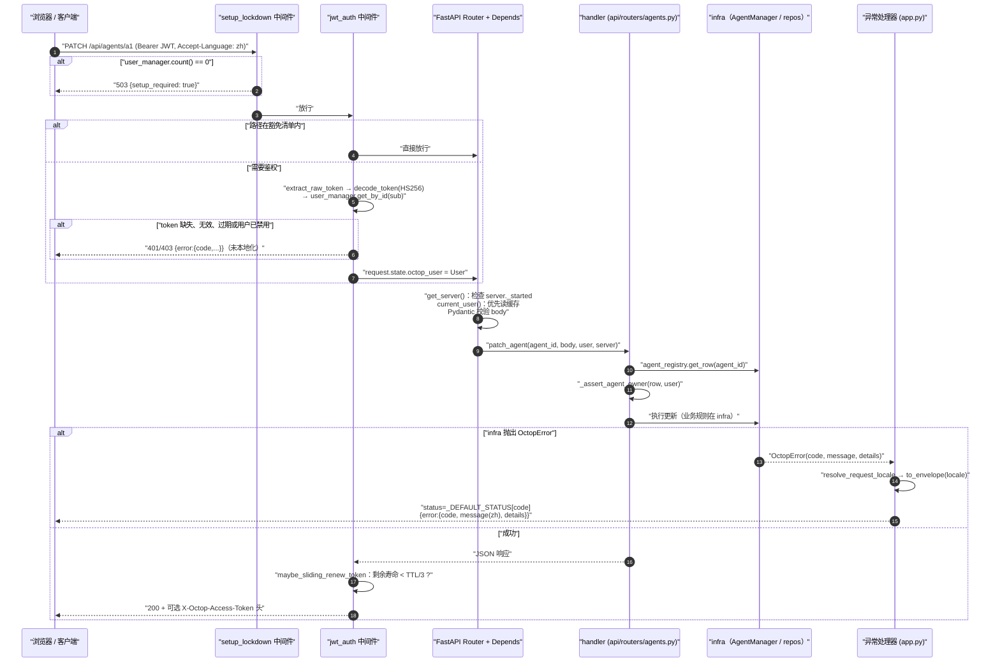
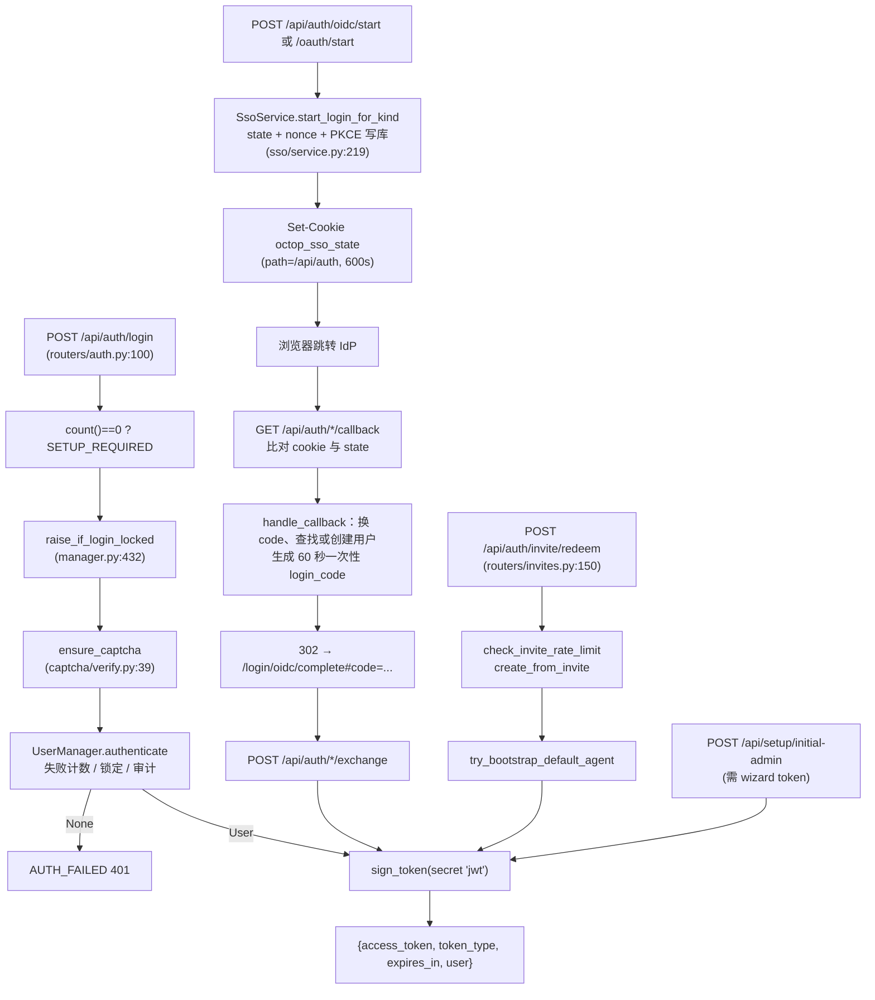
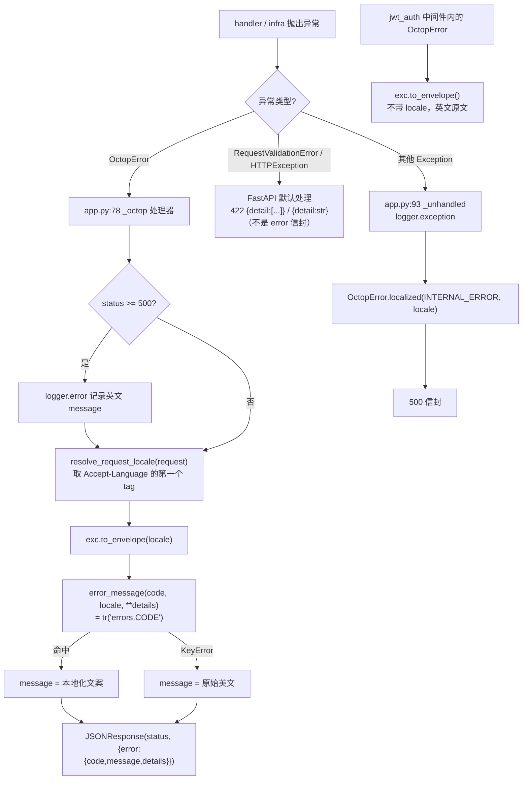

# 07 · API 层：路由、认证、错误与国际化

> 一句话：`src/octop/api/` 是 Octop 的 HTTP 适配层。它用 FastAPI 把 50 多个路由模块挂到 `/api/*` 下，用两个 HTTP 中间件（首次安装锁定、JWT 门禁）挡住未授权请求，用 `Depends` 把 `OctopServer` 和当前用户注入 handler，再把 `infra/` 抛出的 `OctopError` 按 `Accept-Language` 本地化成统一的 `{"error": {code, message, details}}` 信封。业务规则留在 `infra/`，这一层只负责校验、鉴权、调用和错误映射。

本篇你将学到：

- 一次 HTTP 请求经过哪些环节（中间件 → 依赖注入 → router → infra → 错误映射 → 响应），以及各环节的顺序为什么重要
- JWT 的签发、校验、滑动续期和密钥存放位置；密码登录、验证码、OIDC/OAuth SSO、邀请注册这几条入口如何最终都落到同一个 `sign_token`
- 权限模型：admin 角色、模块权限 key（`require_permission`）、Agent 归属校验（`assert_agent_owner` / `require_agent_row`）
- 全部路由模块的总表：URL 前缀、主要端点、对应的 infra 模块
- `ErrorCode` → HTTP 状态码 → `errors.<CODE>` 文案 → 前端 `apiErrors.<CODE>` 这条链路
- 后端 i18n（`tr()`、domains、locale 解析顺序）和时区约定
- 写 API 测试的标准姿势，以及新增端点、错误码、文案时的完整步骤和常见坑

---

## 1. 关键文件

| 文件 | 作用 |
|------|------|
| `src/octop/api/app.py` | `build_app()` 工厂：安装异常处理器、CORS、两个中间件、ACME challenge、按顺序挂载全部 router、Scalar 文档、SPA 兜底路由 |
| `src/octop/api/deps.py` | JWT 工具（`sign_token` / `decode_token` / 滑动续期）、JWT 豁免清单、`get_server`、`current_user`、`require_permission`、`require_admin`、`require_database` |
| `src/octop/api/middleware/jwt_auth.py` | 对 `/api/*` 统一校验 JWT，把用户缓存到 `request.state.octop_user`，并在快过期时下发新 token |
| `src/octop/api/middleware/setup_lockdown.py` | 系统里还没有任何用户时，除 setup/health 外的 `/api/*` 一律返回 `503 {"setup_required": true}` |
| `src/octop/api/openapi_meta.py` | API 简介（Markdown）、`OPENAPI_TAGS`、给非豁免路径统一加 `BearerAuth` 的 `configure_openapi()` |
| `src/octop/api/common/agent.py` | Agent 访问控制：`assert_agent_owner`、`assert_agent_access_row`、`require_agent_row`、`require_agent_owner_row` |
| `src/octop/api/common/workspace.py` | `require_running_workspace`、`require_agent_workspace`、`workspace_api_path`、`reanchor_entry_path` |
| `src/octop/api/common/attachments.py`、`upload_limit.py` | 聊天附件写入 `{workspace}/inbound/`；分块读取上传并在超限时立即中断 |
| `src/octop/api/common/sso_cookie.py`、`public_base.py` | SSO state cookie；根据反代头推算对外 base URL |
| `src/octop/api/routers/**` | 每个资源一个模块，含 Pydantic 请求/响应模型 |
| `src/octop/infra/errors.py` | `ErrorCode`（StrEnum）、默认状态码表 `_DEFAULT_STATUS`、`OctopError` |
| `src/octop/infra/auth/` | `captcha/`（登录验证码，5 个文件）和 `sso/`（OIDC/飞书/钉钉/企业微信 SSO，15 个文件） |
| `src/octop/infra/users/` | `UserManager`（登录、锁定、缓存）、`permissions.py`（模块权限目录）、`invites.py`、`resource_policy.py` |
| `src/octop/i18n/` | `loader.py`（`lookup` / `tr`）、`en.json` / `zh.json`、`domains/*.py` |
| `src/octop/infra/utils/locale.py` | `normalize_locale`、`resolve_locale`、`resolve_user_locale`、`resolve_request_locale` |
| `tests/support/`、`tests/integration/conftest.py` | 测试用的进程内 server + httpx ASGI 客户端、登录/建用户/建 Agent 等辅助函数和 fixture |

> 注意：`AGENTS.md` 里提到的 `api/errors.py` **在当前代码中不存在**。`OctopError` 到 HTTP 的映射由 `src/octop/api/app.py:77-98` 的 `_install_exception_handlers` 完成，状态码来自 `infra/errors.py` 的 `_DEFAULT_STATUS`。

---

## 2. `build_app()`：应用是怎么组装的

`build_app(server)`（`src/octop/api/app.py:101`）由 `launch.py` 调用（启动流程见 [02-boot-and-runtime.md](02-boot-and-runtime.md)），测试里也直接调用它。它按下面的顺序组装应用：

1. **读取配置开关**（`app.py:102-107`）：`enable_dashboard`、`enable_api_docs`（默认 `False`，见 `src/octop/config.py:135`，可用环境变量 `OCTOP_ENABLE_API_DOCS` 打开）、`capabilities.mobile.enabled`。
2. **创建 FastAPI 实例**：只有开启文档时才设置 `openapi_url="/api/openapi.json"`（`app.py:113`），然后调用 `configure_openapi(app)`，并把 server 挂到 `app.state.octop_server`（`app.py:117`）。后面 `get_server` 就从这里取。
3. **异常处理器**（`app.py:118`）：只注册了两个，一个处理 `OctopError`，一个处理 `Exception`，详见第 6 节。
4. **CORS**（`app.py:120-130`）：只有配置了 `cors_origins` 才会加。`expose_headers` 里放了 `X-Octop-Access-Token`，这样跨域前端也能读到续期后的 token。
5. **两个中间件**：先调用 `install_jwt_auth`，再调用 `install_setup_lockdown`（`app.py:132-133`）。
6. **ACME HTTP-01 challenge**：`/.well-known/acme-challenge/{token}`（`app.py:137-142`），供 Let's Encrypt 使用（见 [08-domains.md](08-domains.md)）。
7. **挂载 router**（`app.py:204-272`）：通过 `_RouterMount(router, prefix, tags)` 列表逐个调用 `include_router`。移动端 router 只在 `enable_mobile` 为真时才挂载（`app.py:274-280`）。
8. **Scalar 文档**：`GET /api/docs`（`app.py:282-289`），同样受 `enable_api_docs` 控制。
9. **SPA 兜底**：`GET /{full_path:path}`（`app.py:291-314`）。`api/`、`ws/` 开头的路径直接返回 404。路径里如果是绝对路径或含 `..`，就不参与文件拼接。文件存在时返回文件，否则返回 `index.html`。`assets/` 下的哈希文件缺失时返回 404 而不是 `index.html`（`app.py:55-69`），这样升级后浏览器拿到旧 shell 时不会被"HTML 当 JS 模块加载"之类的报错掩盖真正原因。缓存策略方面，`index.html`、`sw.js`、`manifest.json` 设为 `no-cache`，`assets/*` 设为 `immutable`（`app.py:33-44`）。

### 2.1 中间件的实际执行顺序

Starlette 的 `add_middleware` 每次都把新中间件插到列表头部（`user_middleware.insert(0, ...)`），所以**后添加的在外层**。组装出来的调用栈从外到内是：

```
ServerErrorMiddleware（兜底 Exception 处理器）
  └─ setup_lockdown          ← 最后 install，最外层，最先执行
      └─ jwt_auth
          └─ CORSMiddleware  ← 最先 add，在用户中间件里处于最内层
              └─ ExceptionMiddleware（OctopError 处理器）
                  └─ Router → Depends → handler
```

这个顺序带来几个后果：

- 还没完成初始化时，任何非豁免的 `/api/*` 请求都会先被 lockdown 拦下并返回 503，**不会走到 JWT 校验**。
- JWT 中间件发现 token 无效时，会**直接返回** `JSONResponse`（`jwt_auth.py:52-62`），不经过 FastAPI 的异常处理器。因此这类 401 的 `message` 是未本地化的英文原文，例如 `"invalid token"`。前端遇到 401 会统一跳转登录页（`dashboard/src/api/request.ts:310-317`），所以用户基本看不到这段文字。
- CORS 在 JWT 内层。开启 `cors_origins` 后，被 JWT 或 lockdown 直接拒绝的响应（包括不带 Authorization 的 OPTIONS 预检请求）可能没有 CORS 头。同源部署下这个问题不会出现，跨域部署时是否有影响**待确认**。
- 两个 `@app.middleware("http")` 只处理 HTTP scope。**WebSocket 不经过它们**，所以 WS 路由要自己从 `?token=` 取 JWT 并调用 `resolve_user_from_token`（例如 `src/octop/api/routers/chat/ws.py:36-47`，失败时以 close code 4001 关闭）。聊天 WS 的细节见 [03-chat-flow.md](03-chat-flow.md)。

### 2.2 路由挂载顺序为什么重要

FastAPI 按注册顺序匹配路由。`/api/users/{user_id}` 的 `user_id` 是 `int` 类型（`src/octop/api/routers/users.py:376-378`）。如果它先于 `/api/users/invites` 注册，请求 `invites` 时会先命中 `{user_id}`，然后因为类型校验失败返回 422，而不是继续往下找。所以 `app.py:215-217` 特意把 `invites.admin_router`、`user_roles.router` 放在 `users.router` 前面。同理，在同一个 router 文件里，固定路径（如 `users.py:202` 的 `/permissions`）要写在 `/{id}` 之前。

---

## 3. 一次 HTTP 请求的生命周期

以 `PATCH /api/agents/{agent_id}` 为例：



各环节要点：

| 环节 | 代码 | 说明 |
|------|------|------|
| Lockdown | `middleware/setup_lockdown.py:15-41` | 放行 `/api/setup/`、`/api/health/`、`/api/health`，以及开启文档时的 `/api/docs` 和 `/api/openapi.json`。其余路径在"无用户"时一律 503 |
| JWT 门禁 | `middleware/jwt_auth.py:32-72` | 非 `/api/` 路径和豁免路径直接放行。token 可以放在 `Authorization: Bearer`，也可以放在 `?access_token=`（`deps.py:117-126`） |
| 豁免清单 | `deps.py:65-89` | `_JWT_EXEMPT_PREFIXES` 和 `_JWT_EXEMPT_EXACT`。注意 `/api/i18n/` 和 `/api/internal/mcp/` 也在清单里 |
| `get_server` | `deps.py:100-104` | 从 `app.state` 取 server，未启动时抛 `INTERNAL_ERROR` |
| `current_user` | `deps.py:186-198` | 先读 `request.state.octop_user`，避免重复解码。没有缓存时（例如豁免路径上又声明了依赖）自己解析 header 或 query |
| 业务调用 | router → `server.services.*` / `server.app_runtime.*` / `infra.*` | 路由只做薄封装 |
| 错误映射 | `app.py:77-98` | 见第 6 节 |
| 滑动续期 | `deps.py:151-173`、`jwt_auth.py:64-72` | 剩余寿命低于 TTL 的 1/3 时签发新 token，放在 `X-Octop-Access-Token` 响应头里。前端 `request.ts:105` 读到后替换本地保存的 token |

---

## 4. 认证体系

### 4.1 JWT：签发、校验、密钥

- **算法与载荷**：HS256，载荷为 `{sub: str(user_id), uname, role, iat, exp}`（`deps.py:28-44`）。解码时会把 `sub` 转回 `int`（`deps.py:47-56`）。
- **密钥位置**：存在控制面数据库 `secrets` 表的 `k="jwt"` 行（`src/octop/infra/db/repos/secrets.py:15-18`），首次启动时由 `OctopServer._ensure_jwt_secret()` 用 `os.urandom(32)` 生成（`src/octop/infra/server.py:588-590`）。`octop admin` 的轮换命令会调用 `SecretRepo.rotate("jwt", ...)`（`src/octop/cli/commands/admin.py:121`），轮换后所有旧 token 立即失效。备份和恢复也会处理这个 key（`infra/backup/snapshot.py:13`）。
- **TTL**：`config.access_token_ttl_seconds`，默认 86400 秒（`config.py:129`），环境变量为 `OCTOP_ACCESS_TOKEN_TTL`。
- **校验时以数据库为准，不信 token 里的 role**：`resolve_user_from_token` 只取 `sub`，然后从 `UserManager` 的内存缓存里重新读取 `User`（`deps.py:142-148`）。这个缓存只加载**未禁用**的用户（`infra/users/manager.py:105`），禁用用户时会 `pop` 掉（`manager.py:727`）。所以禁用会立即生效（返回 `USER_DISABLED`，403）；修改角色或权限也会立即生效，而 token 里的 `role` 只是给客户端看的信息。
- **登出不吊销 token**：`POST /api/auth/logout` 只写一条审计日志（`routers/auth.py:130-134`），JWT 是无状态的。
- **错误码**：缺失或无效 → `AUTH_FAILED`(401)；过期 → `TOKEN_EXPIRED`(401)；用户不存在或已禁用 → `USER_DISABLED`(403)（`deps.py:129-148`）。

### 4.2 登录入口

所有入口最终都会调用 `sign_token`，并返回相同形状的响应 `{access_token, token_type:"Bearer", expires_in, user}`：



- **密码登录与锁定**：`UserManager.authenticate` 支持用户名或邮箱登录。密码错误时调用 `record_failed_login`，超过 `login_max_attempts`（默认 5）后锁定 `login_lockout_seconds`（默认 900 秒），并抛出 `LOGIN_LOCKED`(429)，`details={"retry_after_seconds", "minutes"}`（`infra/users/manager.py:454-510`，配置见 `config.py:130-131`）。`details.minutes` 会被插入 `errors.LOGIN_LOCKED` 文案的 `{minutes}` 占位符（第 6 节）。管理员可以通过 `POST /api/users/{id}/unlock-login` 解锁（`users.py:451`）。
- **验证码**：`infra/auth/captcha/` 把"提供商逻辑"（`providers.py`：构造请求、解析结果，都是纯函数）和"对外 I/O"（`verify.py`：唯一发 HTTP 的地方，并把失败映射为 `CAPTCHA_REQUIRED` / `CAPTCHA_FAILED`）分开。配置存在 settings/secret 表中（`store.py`），公开配置通过 `GET /api/auth/captcha` 获取，管理端配置走 `GET/PUT /api/settings/captcha`。测试可以用 `set_test_siteverify_url` 替换校验地址。
- **SSO**：`infra/auth/sso/` 的 `SsoService` 负责所有 kind 共用的状态机：state、nonce、PKCE、一次性 login code。各 IdP 的差异由 `providers/{oidc,feishu,dingtalk,wecom}.py` 实现 `IdentityProvider` 协议（`providers/base.py:10-39`），支持的 kind 为 `SSO_KINDS = ("oidc", "feishu", "dingtalk", "wecom")`。`auth_oidc.py` 是旧的"单一 OIDC"接口，`auth_oauth.py` 是按 `{kind}` 的通用接口，并额外提供已登录用户的绑定和解绑（`/oauth/bind/start`、`/oauth/unbind`）。回调**从不直接返回 token**，而是 302 到前端 hash 中带一次性 code，前端再 POST `/exchange` 换取 token（`sso/service.py:331-339`，code 有效期见 `service.py:34`）。这样 token 不会出现在 URL、Referer 或访问日志里。
- **邀请**：管理员通过 `/api/users/invites` 创建邀请（需要 `users` 权限）。公开端点 `/api/auth/invite/validate` 和 `/api/auth/invite/redeem` 在 JWT 豁免清单内，有按客户端限流（`infra/users/invites.py:280`）。邀请只保存角色名，账号创建时才去读取角色模板（`routers/user_roles.py:1-6`）。
- **首次安装**：`/api/setup/*` 用的是**独立的 wizard token**（`server.wizard_tokens`），不是 JWT（`routers/setup.py:127-131`）。安装中途，唯一的 admin 用户也可以用 JWT 调用部分接口（`setup.py:139-152`）。详见 [02-boot-and-runtime.md](02-boot-and-runtime.md)。

### 4.3 授权：三层检查

| 层级 | 工具 | 语义 |
|------|------|------|
| 角色 | `User.is_admin`（`infra/users/identity.py:28-29`，`Role` 只有 `admin` / `user`）；`require_admin()`（`deps.py:222-230`） | admin 绕过所有模块权限检查和 Agent 归属检查 |
| 模块权限 | `require_permission("users")`（`deps.py:201-219`）→ `user_has_permission`（`infra/users/permissions.py:225-234`） | 权限 key 来自 `PERMISSIONS` 目录（`permissions.py:50+`，如 `channels`、`terminal`、`users`、`sso`、`providers` 等）。**key 写错会在模块导入时直接 `RuntimeError`**，不会悄悄放行。按设计，只读访问和在聊天里使用 Agent 不受权限控制 |
| 资源归属 | `api/common/agent.py` | 见下文 |

**Agent 归属校验模式**（`src/octop/api/common/agent.py`）：

- `assert_agent_owner(row, user)`（`agent.py:18-23`）：用于**写操作**。admin 直接放行，否则要求 `row.user_id == user.id`，不满足时抛 `FORBIDDEN`。各 router 里常以别名 `_assert_agent_owner` 导入（`routers/agents.py:375`、`routers/acp.py:16`）。
- `assert_agent_access_row(row, user)`（`agent.py:34-36`）：用于**读操作**。允许 owner、admin，以及 `is_shared=1` 的共享 Agent。
- `require_agent_row(agent_id, user=, as_user=, server=)`（`agent.py:39-61`）：先加载 row（不存在时抛 `AGENT_NOT_FOUND`），再做访问检查。`as_user` 让 admin 以其他用户身份查看，非 admin 传入 `as_user` 会直接 403。
- `require_agent_owner_row`（`agent.py:64-74`）：在 `require_agent_row` 基础上再加 owner 检查。

标准写法是：先 `agent_registry.get_row(agent_id)`，为 None 时抛 `AGENT_NOT_FOUND`，然后调用 `_assert_agent_owner(row, user)`（参见 `routers/agents.py:377-390`）。能用 `require_agent_row` 或 `require_agent_owner_row` 的地方尽量用它们，不要自己手写判断。

**用户管理的防提权规则**：非 admin 只能授予自己已有的权限（`routers/users.py:159-169` 的 `_assert_can_assign`），也不能移除最后一个有用户管理权限的人（`users.py:178`）。

### 4.4 工作区访问：`api/common/workspace.py`

- `require_running_workspace(agent_id, user=, as_user=, server=, owner_only=False)`（`workspace.py:37-68`）：先做归属检查，再返回运行中 Agent 的 `BackendWorkspace`。有一个特殊情况：`PATCH /agents` 会在后台重建 Agent，期间 harness 句柄短暂消失，但 DB 里的状态仍是 `running`。这时会回退到 `agent_registry.workspace_for_agent()`。已停止的 Agent 仍然抛 `AGENT_NOT_RUNNING`。
- `require_agent_workspace`（`workspace.py:71-91`）：Agent 停止时也返回 workspace，用于头像、产物预览这类只读展示。
- `workspace_api_path(raw)`（`workspace.py:94-99`）：把 dashboard 传来的 `/`、`/foo`、`\foo` 规范化为相对路径。`""` 和 `"/"` 都映射为 `"."`。**注意 `BackendWorkspace` 里的 `"/"` 表示后端根目录，和 `"."` 不是一回事**，所以 HTTP 层必须先经过这个函数再调用 workspace。`routers/workspace.py:86-108` 的 `_workspace_io_path` 在此基础上又区分了三种情况：`from_workspace=True`（工作区 UI，前导 `/` 相对工作区）、`file://`、宿主机绝对路径。
- `reanchor_entry_path`（`workspace.py:102-113`）：目录列表只返回条目名，这里把它重新拼到"请求的目录"下，确保前端下一次请求用的 key 能被后端解析。
- 附件：`routers/uploads.py` 先调用 `read_upload_capped`（`common/upload_limit.py:32-54`，先检查声明的大小，再分块累计，超限立即抛 `ATTACHMENT_TOO_LARGE`，`details.max_mb`），再调用 `save_attachment`（`common/attachments.py:52-69`），写入 `{workspace}/inbound/`。给 dashboard 用的预览 URL 由 `dashboard_inbound_preview_url` 生成，本身受 JWT 保护。

工作区 I/O 的底层规则见 [04-agents.md](04-agents.md)。

---

## 5. 路由总表

说明：URL 前缀 = `app.py` 里的挂载前缀 + router 自带的 `prefix`。"infra" 列是该模块主要调用的领域模块，`server.app_runtime.agent_registry` 即 `infra/agents/manager.py` 的 `AgentManager`。WS 表示 WebSocket。聊天、WS、SSE 的细节见 [03-chat-flow.md](03-chat-flow.md)，这里只列出不展开。

### 5.1 认证、用户、系统

| 模块 | URL 前缀 | 主要端点 | 对应 infra |
|------|----------|----------|------------|
| `setup.py` | `/api/setup` | `status`、`presets`、`validate-token`、`test-database`、`database`、`begin`、`verify-password`、`initial-admin`、`resume-wizard`、`test-provider`、`finish` | `infra/setup/`、`infra/db/rebind`、`infra/db/probe`、`agents/providers` |
| `auth.py` | `/api/auth` | `POST login`、`POST logout`、`GET/PATCH me`、`POST change-password`、`POST/DELETE me/avatar`、`GET captcha` | `infra/users/manager`、`infra/auth/captcha`、`users/profile_avatar` |
| `auth_oidc.py` | `/api/auth/oidc` | `status`、`start`、`callback`、`exchange`、`GET/PUT config`、`config/test`（需 `sso` 权限） | `infra/auth/sso/service` |
| `auth_oauth.py` | `/api/auth/oauth` | `status`、`start`、`callback`、`exchange`、`bind/start`、`unbind`、`providers/{kind}` 的 GET/PUT/test | `infra/auth/sso/*` |
| `invites.py` | `public_router` → `/api/auth/invite`；`admin_router` → `/api/users/invites` | 公开：`validate`、`redeem`；管理：`GET`、`POST`、`/{id}/revoke` | `infra/users/invites`、`UserManager.create_from_invite` |
| `preferences.py` | `/api/preferences` | `GET`、`PATCH` | `infra/users/preferences` |
| `user_roles.py` | `/api/users/roles` | 角色模板 CRUD 和头像 | `infra/db/repos/user_roles`、`users/resource_policy`、`users/permissions` |
| `users.py` | `/api/users` | `GET permissions`、用户 CRUD、`batch`、`/{id}/unlock-login`、`/{id}/reset-password`、头像 | `UserManager`、`users/resource_policy`、`users/permissions` |
| `i18n.py` | `/api/i18n` | `GET tools`、`GET skills`（JWT 豁免） | `octop.i18n`（`all_tool_labels` / `all_skill_labels`） |
| `health.py` | `/api/health` | `GET`（无鉴权，返回 db 是否绑定、用户数、Agent 数） | `OctopServer` 状态 |
| `settings.py` | `/api/settings` | `GET timezone`、`GET upload`、`GET capabilities`、`GET/PUT captcha` | `octop.config`、`infra/auth/captcha` |
| `admin.py` | `/api/admin` | `overview`、`audit-log`、`metrics` | `infra/metrics`、`audit_repo`、`agent_registry` |
| `backup.py` | `/api/admin/backup` | `list`、`status`、`auto`（GET/PUT/run）、`create`、`files/{f}/restore`、`DELETE files/{f}`、`import` | `infra/backup/`、`infra/db/pool` |
| `observability.py` | `/api/admin/observability` | `GET/PUT langfuse`、`langfuse/test` | `agent_registry`（Langfuse 配置） |
| `security.py` | `/api/admin/security` | `GET/PUT`、`tool-guard/rules`（含 raw、reset）、`defaults` | `agent_registry`、`audit_repo` |
| `tls.py` | `/api/admin/tls` | `status`、`preflight`、`issue` | `infra/setup/tls` |
| `update.py` | `/api/update` | `status`、`check`、`PATCH settings`、`upgrade`、`progress`、`restart` | `infra/setup/self_update`、`setup/service`（任务状态在 `update_store.py`） |
| `usage.py` | `router` → `/api/usage`；`admin_router` → `/api/admin/usage` | `GET summary`（管理端可导出 xlsx，见 `common/usage_xlsx.py`） | `usage_repo`、`UserManager` |
| `envs.py` | `/api/envs` | `GET` | `infra/utils/env_file` |
| `filesystem.py` | `/api/filesystem` | `dirs`、`probe`、`mkdir`、`rename`（宿主目录选择器） | `utils/host_dirs`、`utils/bwrap`、`users/resource_policy` |
| `search.py` | `/api/search` | `POST /{provider_id}/test` | `utils/search_probe` |

### 5.2 模型、存储与本地服务

| 模块 | URL 前缀 | 主要端点 | 对应 infra |
|------|----------|----------|------------|
| `providers.py` | `router` → `/api/providers`；`admin_router` → `/api/admin/providers` | 用户：`presets`、`resolved`、`GET/PUT active-model`、`GET`；管理：CRUD、`test-draft`、`fetch-models`、`codex-oauth/*`、`/{id}/test` | `infra/agents/providers` |
| `voice.py` | `router` → `/api/voice`；`admin_router` → `/api/admin/voice/providers` | `presets`、`providers`、`GET/PUT active`、`stt`、`tts`；管理端 CRUD、test | `infra/voice/` |
| `media_generation.py` | `/api/admin/media-generation` | `presets`、`GET/PUT`、`test` | `infra/agents/settings` |
| `storage_backends.py` | `admin_router` → `/api/admin/storage-backends`；`user_router` → `/api/storage-backends` | 管理：CRUD、`probe`、`/{id}/tree`、`/{id}/test`；用户：`GET` | `infra/backend/resolver`、`backend/probe` |
| `ollama_models.py` | `/api/ollama-models` | `GET`、`download`、`download-status`、`DELETE download/{task}`、`DELETE /{name}`、`GET/PUT service` | `infra/utils/ollama_manager`（任务状态在 `ollama_download_store.py`） |
| `onnx_models.py` | `/api/onnx-models` | `catalog`、`models/{name}/meta`、`status`、`PUT config`、`download`、`download-status`、`DELETE local/{name}` | `infra/agents/providers`（fastembed） |

### 5.3 Agent 及其附属资源

| 模块 | URL 前缀 | 主要端点 | 对应 infra |
|------|----------|----------|------------|
| `agents.py` | `/api/agents` | `GET`、`POST`、`/{id}` GET/PATCH/DELETE、`/{id}/read`、头像、`start`、`stop`、`reload`、`status` | `infra/agents/manager`、`agents/settings`、`agents/teams` |
| `agent_tools.py` | `/api/agents` | `/{id}/tool-settings` GET/PUT、`/{id}/tool-settings/{tool}` PATCH | `infra/agents/plugins` |
| `acp.py` | `/api/acp`、`/api/agents/{id}/acp` | ACP runner 全局配置和按 Agent 配置 | `agent_registry` |
| `agent_files.py` | `/api/agents/{id}` | `heartbeat-config` GET/PUT、`memory/daily` 列表/读取/删除 | `agent_registry` + workspace |
| `workspace.py` | `/api/agents/{id}/workspace` | `tree`、`file` GET/PUT、`upload`、`download`、`doc` GET/PUT、`glob`、`grep` | `BackendWorkspace`、`utils/doc_edit`、`backup/workspace_archive` |
| `uploads.py` | `/api/agents/{id}/upload` | `POST`（聊天附件 → `inbound/`） | `infra/gateway/media` |
| `channels.py` | `/api/agents/{id}/channels` | CRUD、`/{cid}/test`、`probe`、钉钉/企微/QQ/微信扫码 `qrcode/generate\|poll`、飞书/元宝 `bot-creator/start\|poll\|stop` | `infra/gateway/`（见 [05-gateway.md](05-gateway.md)） |
| `cron.py` | `/api/cron/settings`、`/api/agents/{id}/cron` | `examples`、CRUD、`/{cid}/run-now` | `infra/cron/`、`cron/trigger` |
| `skills.py` | `/api/agents/{id}/skills`、`/api/skills/hub` | CRUD、`import`、`enable`、`disable`、hub `search`/`rankings`/`install` | `infra/skills/`、`agents/manager` |
| `skill_packages.py` | `/api/skill-packages` | CRUD、`hub/search`、`hub/rankings`、`/{id}/skills` | `infra/skills/skill_packages`、`skillhub_market` |
| `plugins.py` | `/api/plugins` | `GET`、`reload`、`install`、`upload`、`market`、`PATCH/DELETE /{id}`、`agents/{id}/tools` | `infra/agents/plugins` |
| `memory.py` | `/api/agents/{id}/memory` | `atoms`、`raw_events`、`entities`、`episodes`、`journal`、`candidates` 的 list/get，`:promote`、`:reject`、`:deprecate`、`:replace`，`stats/*`，`extract-config` | 通过 `api/common/memory_client.py` 调用 memory RPC |
| `memory_portable.py` | `/api/memory/portable/sources`、`/api/agents/{id}/memory/portable/*` | `pack`、`adopt`、`doctor` | `infra/agents/memory` |
| `mbti.py` | `/api/mbti` | `current`、`types`、`preview/{code}`、`test/questions`、`test/submit`、`apply`（旧式接口，用 `X-Octop-Agent-Id` 头） | `infra/agents/persona` |
| `experts.py` | `/api/experts`、`/api/agents/from-expert/{id}` | 专家目录、已发布专家、从专家创建 Agent | `infra/agents/experts` |
| `teams.py` | `/api/teams` | CRUD、`template` | `infra/agents/teams` |
| `subagents.py` | `/api/subagent-catalog`、`/api/agents/{id}/subagents` | 目录、`divisions`、详情 | `infra/agents/subagents` |
| `proactive_care.py` | `/api/agents/{id}/proactive-care` | GET/PUT | `infra/proactive/scheduler` |
| `knowledge_bases.py` | `/api/knowledge-bases` | `capability`、`embedding-options`、`ocr-options`、`PUT feature`、`onnx-*`、CRUD、`default-open`、`/{kb}/documents`、`/{kb}/reindex` | 知识库服务（见 [08-domains.md](08-domains.md)） |
| `connectors.py` | `/api/connectors*`、`/api/connector-instances*` | `catalog`、实例 CRUD、`test`、`refresh`、`custom-mcp`、`auth/{kind}/*`、`oauth/*`（其中 `oauth/callback` 免 JWT）、飞书 CLI 用户授权 | `infra/connectors/`（gateway、oauth、service） |
| `internal_mcp.py` | `/api/internal/mcp/{kind}/{instance_id}` | POST/GET/DELETE（JWT 豁免，由 MCP 网关自行鉴权） | `infra/connectors/gateway` |
| `slash.py` | `/api/slash/commands` | `GET`（斜杠命令目录） | `app_runtime.gateway` |

### 5.4 聊天与远程控制（只列出，细节见 03 篇）

| 模块 | URL 前缀 | 主要端点 | 对应 infra |
|------|----------|----------|------------|
| `chat/routes.py` | `/api/agents/{id}/chat` | `welcome`、`hitl/resume`（SSE）、`polish` | `gateway/hitl`、`agents/teams` |
| `chat/history.py` | `/api/agents/{id}/threads`、`/session` | 线程列表/创建/改名/删除、`history`、`PATCH session` | `agents/threads`、`history/reader` |
| `chat/trajectory.py` | `/api/agents/{id}/threads/{tid}/trajectory` | 轨迹、`events/{eid}`、`metrics`、`stream`、`export` | `history/trajectory` |
| `chat/ws.py` | WS `/api/agents/{id}/chat/ws` | 实时对话 | `gateway/ws`、`chat/turn.py` |
| `chat/notify_ws.py` | WS `/api/notifications/ws` | dashboard 推送 | — |
| `terminal.py` | `/api/agents/{id}/terminal` | `context`、WS `ws` | 需 `terminal` 权限 |
| `browser/` | `/api/browser/*`、WS `/api/browser-stream/ws` | `env-status`、`install`、`uninstall`、`harness-sessions`、`sessions/{sid}/handoff`、`record-replay/*` | `infra/browser/setup` |
| `desktop/` | `/api/desktop/*`、WS `/api/desktop-stream/ws` | `status`、`geometry`、`install`、`uninstall` | `infra/desktop/` |
| `mobile/`（可选挂载） | `/api/mobile/*`、WS `/api/mobile-stream/ws`、`/api/mobile/adb/shell/ws` | `status`、`agent-control`、`install` | `infra/mobile/` |

`chat/`、`browser/`、`desktop/`、`mobile/` 的 `__init__.py` 各自聚合子 router（例如 `routers/chat/__init__.py:13-18`），`app.py` 只挂聚合后的那一个。

---

## 6. 错误体系

### 6.1 三个组成部分

1. **`ErrorCode`**（`src/octop/infra/errors.py:13-123`）：`StrEnum`，当前 110 个，值和名字相同，是前后端之间稳定的契约。
2. **`_DEFAULT_STATUS`**（`errors.py:126-237`）：每个 code 对应的默认 HTTP 状态码。**每个 code 都必须在表里**，否则 `OctopError.__post_init__` 会在 `_DEFAULT_STATUS[self.code]` 处 `KeyError`（`errors.py:247-249`）。个别调用点会显式传 `status=` 覆盖默认值，例如 `require_database` 用 `SETUP_REQUIRED` + 503（`deps.py:107-114`），而表里的默认值是 409。
3. **`OctopError`**（`errors.py:240-285`）：dataclass 形式的异常，字段有 `code`、`message`（给日志看的英文原文）、`status`、`details`（结构化参数，同时也是文案插值用的 kwargs）。
   - `localized_message(locale)`：调用 `error_message(code, locale, **details)`，模板里缺 key 或占位符缺参数（`str.format` 抛 `KeyError`）时，**回退到原始 `message`**（`errors.py:252-257`）。
   - `OctopError.localized(code, locale, **kwargs)`：构造时就把 message 本地化，适合在 WS 这类不经过异常处理器的地方使用（`errors.py:259-275`）。
   - `to_envelope(locale=None)`：生成 `{"error": {"code", "message", "details"}}`。传了 locale 才会本地化（`errors.py:277-285`）。

### 6.2 映射流程



要点：

- **Pydantic 校验错误和 `HTTPException` 不会被包装成信封**，因为只注册了两个处理器（`app.py:77-98`）。前端 `parseApiError` 读 `body.error.code`（`dashboard/src/utils/apiError.ts:27`），拿不到 code 时会回退到通用提示。新代码里想让前端显示可读错误时，应该抛 `OctopError`，不要用 `HTTPException`。
- 5xx 在服务端日志里记录的是英文原文，便于在 `~/.octop/logs` 里排查问题（`app.py:80-89`）。
- JWT 中间件直接返回的错误**没有本地化**（`jwt_auth.py:62`）。

### 6.3 前端镜像：`apiErrors.*`

- 后端文案位于 `src/octop/i18n/{en,zh}.json` 的 `errors.<CODE>`，占位符用 Python 风格的 `{minutes}`。
- 前端文案位于 `dashboard/src/locales/{en,zh}.json` 的 `apiErrors.<CODE>`，占位符用 i18next 风格的 `{{minutes}}`。
- `apiErrorMessage`（`dashboard/src/utils/apiError.ts:68-93`）的逻辑是：用 `t("apiErrors.CODE", details)` 翻译。如果 `details.reason` 存在，就拼在后面；如果服务端 message 和翻译结果不同，**优先显示服务端 message**。服务端本来就会按 `Accept-Language` 本地化，前端请求也总会带上这个头（`dashboard/src/api/request.ts:226`），所以通常两者一致；这条规则的作用是让携带更多细节的服务端文案不被通用翻译覆盖。
- 一致性由测试强制保证（`tests/unit/i18n/test_errors.py`）：
  - `test_every_error_code_has_i18n_entry`：每个 `ErrorCode` 在 en 和 zh 中都有文案；
  - `test_dashboard_api_errors_match_backend`：**dashboard `apiErrors` 的 key 集合 == 后端 `errors` 的 key 集合 == `ErrorCode` 枚举值集合**（三者目前都是 110 个）；
  - `test_dashboard_api_errors_use_i18next_placeholders`：前端不允许出现单花括号占位符。

---

## 7. 国际化（i18n）

### 7.1 结构

```
src/octop/i18n/
  loader.py        _load_all()（lru_cache，一次性读入 en/zh） / lookup / tr / flatten_keys / all_keys_for_locale
  en.json, zh.json 顶层 namespace：slash, connector, errors, desktop, tls, tools, skills, channel,
                   threads, cron, agents, agent_errors, stream_errors, attachment, knowledge,
                   proactive_care, mobile, usage_export, voice, memory_slim, teams, conversation_mode
  domains/         每个 namespace 的便捷封装：errors.py, slash.py, tools.py, channel.py, agents.py,
                   attachment.py, stream.py, skills.py, voice.py, tls.py
  __init__.py      重新导出常用函数（tr, error_message, tool_display_name, ...）
```

- `tr(key, locale="en", **kwargs)`（`i18n/loader.py:44-49`）：按点路径解析 key。当前 locale 找不到时**回退到 en**（`loader.py:12`、`33-41`），两边都没有则抛 `KeyError`。**只有传了 kwargs 才会调用 `format`**，所以不带参数时拿到的是含 `{name}` 的原始模板。
- domains 的约定：`domains/errors.py` 的 `error_message(code, ...)` 等于 `tr(f"errors.{code}")`；`domains/slash.py` 的 `tr` 会自动加上 `slash.` 前缀，slash handler 用短 key（`slash.py:10-11`）；`field_label` 找不到 key 时返回 key 本身而不是抛异常。
- 资源通过 `importlib.resources` 读取，随 wheel 一起打包（`loader.py:28`）。

### 7.2 locale 解析顺序（`src/octop/infra/utils/locale.py`）

| 函数 | 场景 | 顺序 |
|------|------|------|
| `normalize_locale(raw)`（`:13-19`） | 通用 | 空值 → `DEFAULT_LOCALE`；以 `zh` 开头 → `zh`；**其余一律 → `en`** |
| `resolve_request_locale(request)`（`:75-83`） | HTTP handler、异常处理器、`/api/i18n/*` | 取 `Accept-Language` 的第一个 tag，没有则用 `DEFAULT_LOCALE` |
| `resolve_locale(...)`（`:22-43`） | 通用 | 用户存储的偏好 → explicit → metadata 中的 `locale`/`language`/`lang` → 渠道提示（飞书、企微、微信、钉钉、QQ、小艺、元宝 → zh；telegram → en）→ `DEFAULT_LOCALE` |
| `resolve_user_locale(...)`（`:53-72`） | gateway/IM 路径 | 从 `user_repo` 读取用户的 `locale`，再交给 `resolve_locale` |

两个容易混淆的默认值：

- **`DEFAULT_LOCALE = "zh"`**（`locale.py:9`）：请求**没说**用什么语言时用中文。
- **`_FALLBACK_LOCALE = "en"`**（`loader.py:12`）：某个 key 在 zh 里**缺失**时回退到英文。`AGENTS.md` 里写的 "`en` is the fallback" 指的是这一条。

另外，HTTP 路径上**只看 `Accept-Language`，不读用户在数据库里存的 locale**。dashboard 会根据自己的 i18next 语言设置这个头（`request.ts:226`）。用户存储的 locale（`PATCH /api/auth/me`、`/api/preferences`）主要在 IM 和 gateway 路径上生效，也用于登录响应里的 `user.locale`。

### 7.3 `/api/i18n/*`

`GET /api/i18n/tools`、`GET /api/i18n/skills`（`routers/i18n.py:24-47`）返回 `{locale, labels}`，属于 JWT 豁免路径。dashboard 用它们获取服务端维护的工具和技能显示名，这些显示名的权威来源在后端 `tools.*` / `skills.*`。前端保留了一份副本，`tests/unit/i18n/test_tools.py:77` 会校验两边一致。

### 7.4 相关测试

`tests/unit/i18n/`：`test_catalog.py:11-15`（en/zh 的 key 树完全一致）、`test_errors.py`（第 6.3 节）、`test_tools.py`、`test_desktop.py` / `test_mobile.py`（分 namespace 检查 key 一致性）等。改了 JSON 之后运行：

```bash
uv run pytest tests/unit/i18n -q
```

---

## 8. 时区约定

- 配置项：`OctopConfig.default_timezone`，默认 `"Asia/Shanghai"`（`src/octop/config.py:133`）。环境变量 `OCTOP_DEFAULT_TIMEZONE` 优先，也兼容旧的 `OCTOP_CRON_TIMEZONE`（`config.py:480-483`）；`config.json` 里旧的 `cron_timezone` key 也会被读成 `default_timezone`（`config.py:450-453`）。
- API：`GET /api/settings/timezone` → `{"timezone": "..."}`（`routers/settings.py:27-37`，需要登录）。兼容别名 `GET /api/cron/settings`（`routers/cron.py:73-79`）。
- 前端通过 `useServerTimezone()` 获取，再用 `formatServerDateTime` 等函数格式化（见 [09-frontend-cli.md](09-frontend-cli.md)）。**不要**直接对时间戳调用不带 `timeZone` 的 `toLocaleString()`。
- 语言**不是** `config.json` 的配置项，不要新增这个字段。

---

## 9. OpenAPI 与 Scalar 文档

- `OPENAPI_TAGS`（`src/octop/api/openapi_meta.py:57-166`）为每个 tag 写了描述。`app.py` 中 `_RouterMount` 的 tags 应该使用这里已有的名字。
- `configure_openapi`（`openapi_meta.py:176-203`）重写了 `app.openapi`：除 `/api/` 之外的路径和 JWT 豁免路径（复用 `is_jwt_exempt_path`）以外，所有操作都自动加上 `security: [{BearerAuth: []}]`。因此**豁免清单只需要维护一份**，就在 `deps.py`。
- `API_DESCRIPTION`（`openapi_meta.py:12-54`）里用文字列出了公开端点。新增公开端点时，记得同时更新这段文字。
- 文档默认关闭。测试见 `tests/unit/api/test_openapi_meta.py` 和 `tests/integration/test_scalar.py`。

---

## 10. 测试支撑：写 API 测试的标准姿势

### 10.1 组件

| 文件 | 提供 |
|------|------|
| `tests/conftest.py:97-101` | `tmp_octop_home`：在隔离的 HOME 下创建 `~/.octop` |
| `tests/support/app.py:37-75` | `octop_client(home, fake_agent=, patch_llm=True, bind_database=True)`：启动真实的 `OctopServer`，patch harness，绑定 SQLite，暂停主动关怀调度器，用 `httpx.ASGITransport` 包装 `build_app(srv)`，yield `(client, srv)`。`client._octop_app` 暴露 ASGI app 给 WS 测试用 |
| `tests/support/app.py:20-26` | `write_octop_config(home, **overrides)`：测试前修改 `config.json`，例如 `enable_api_docs=True` |
| `tests/support/auth.py` | `TEST_PASSWORD`、`bootstrap_admin`（verify-password → initial-admin → finish，会创建 `main` Agent）、`login`、`bearer`、`auth_header`、`seed_openai_provider`、`create_agent`、`create_user`、`ensure_users`、`resolve_user_id`、`create_provider` |
| `tests/support/http.py` | WS 辅助：`ws_connect(app, path)`、`chat_ws_path`、`ws_chat_turn`、`ws_token` |
| `tests/support/fakes.py` | `FakeHarnessAgent`（可以预设 chunk 序列）、`LoopbackChannel`、`fake_bin_path`（跨平台的假二进制路径） |
| `tests/support/scenarios.py` | `bootstrap_boundary_env`：admin + alice + bob + 共享 provider + 一个 Agent，用于越权测试 |
| `tests/integration/conftest.py` | fixture：`app_client`（安装前）、`env`（admin 已登录）、`env_with_provider`、`env_with_agent`、`env_with_main_agent`、`env_admin_alice`、`env_alice_bob_agent`、`env_boundary`、`env_with_channel`、`env_skills_offline`（模拟 Agent 未运行）、`env_terminal`、`env_fake_harness` 等 |

### 10.2 一个典型的集成测试

```python
# tests/integration/test_widgets.py
from __future__ import annotations

import httpx
from octop.infra.server import OctopServer
from tests.support.auth import create_user


async def test_owner_can_update_and_other_user_forbidden(
    env_with_agent: tuple[httpx.AsyncClient, OctopServer, dict[str, str], str],
) -> None:
    client, _srv, admin_auth, agent_id = env_with_agent

    r = await client.put(
        f"/api/agents/{agent_id}/widgets",
        headers=admin_auth,
        json={"label": "hello"},
    )
    assert r.status_code == 200, r.text

    bob = await create_user(client, admin_auth, username="bob")
    r = await client.put(
        f"/api/agents/{agent_id}/widgets",
        headers={**bob, "Accept-Language": "zh"},
        json={"label": "x"},
    )
    assert r.status_code == 403
    assert r.json()["error"]["code"] == "FORBIDDEN"   # 断言 code，不要断言文案
```

要点：

- 测试函数直接写 `async def`，项目的 pytest-asyncio 配置会自动识别。
- 断言 `error.code` 和状态码，不要断言本地化后的文案（文案经常会改）。
- 运行命令：`uv run pytest tests/integration/test_widgets.py -q`。不要直接用裸 `pytest`。
- 跨平台：路径用 `tmp_path` 和 `Path` 拼接；只能在 POSIX 下运行的用例用 `posix_only` 标记。详见 `AGENTS.md` §7。

---

## 11. 修改指南

### 11.1 新增一个 REST 端点（完整骨架）

场景：给 Agent 加一个 "widgets" 配置，owner 可以读写。

**第 1 步：领域逻辑写在 `infra/`**，不要写在 router 里：

```python
# src/octop/infra/agents/widgets.py
from __future__ import annotations
from typing import Any
from octop.infra.errors import ErrorCode, OctopError

def put_widget_label(services: Any, agent_id: str, label: str) -> dict[str, Any]:
    if len(label) > 64:
        raise OctopError(ErrorCode.WIDGET_LABEL_INVALID, "label too long", details={"max": 64})
    # ……通过 services.<xxx>_repo 持久化；repo 只写 SQL，不要在 router 里 import repo
    return {"agent_id": agent_id, "label": label}
```

**第 2 步：写 router**，只负责 HTTP 相关的事：

```python
# src/octop/api/routers/widgets.py
"""Per-agent widget settings."""

from __future__ import annotations

from typing import Any

from fastapi import APIRouter, Depends
from pydantic import BaseModel, Field

from octop.api.common.agent import require_agent_owner_row, require_agent_row
from octop.api.deps import current_user, get_server
from octop.infra.agents.widgets import get_widget, put_widget_label

router = APIRouter()


class WidgetBody(BaseModel):
    label: str = Field(..., min_length=1, description="Display label shown on the agent card.")


class WidgetOut(BaseModel):
    agent_id: str = Field(description="Public agent id.")
    label: str = Field(description="Current label.")


@router.get(
    "/agents/{agent_id}/widgets",
    summary="Get agent widget settings",
    response_model=WidgetOut,
)
async def get_widgets(
    agent_id: str,
    user: Any = Depends(current_user),
    server: Any = Depends(get_server),
) -> WidgetOut:
    """Readable by owner, admin, or any user when the agent is shared."""
    require_agent_row(agent_id, user=user, as_user=None, server=server)
    return WidgetOut(**get_widget(server.services, agent_id))


@router.put(
    "/agents/{agent_id}/widgets",
    summary="Update agent widget settings",
    response_model=WidgetOut,
)
async def put_widgets(
    agent_id: str,
    body: WidgetBody,
    user: Any = Depends(current_user),
    server: Any = Depends(get_server),
) -> WidgetOut:
    """Owner or admin only."""
    require_agent_owner_row(agent_id, user=user, as_user=None, server=server)
    return WidgetOut(**put_widget_label(server.services, agent_id, body.label))
```

**第 3 步：注册**。在 `src/octop/api/app.py` 的 import 列表里加上 `widgets`，再往 `_mount_routers([...])` 里加一行 `_RouterMount(widgets.router, "/api", ["agents"])`。如果要用新的 tag，先在 `openapi_meta.py` 的 `OPENAPI_TAGS` 里加上描述。**注意挂载位置**：如果和已有的 `/{id}` 式路由共用前缀，固定路径要排在前面（见第 2.2 节）。

**第 4 步：测试**。参考第 10.2 节，覆盖 owner 成功、非 owner 返回 403、Agent 不存在返回 `AGENT_NOT_FOUND` 这几种情况。

**第 5 步：验证**。运行 `make all`。开启 `OCTOP_ENABLE_API_DOCS=1` 后打开 `/api/docs`，确认新接口有 summary 和完整的 schema，而不是空卡片或无类型的 JSON。

坑点清单：

- **分层禁令**（`AGENTS.md` §5、§8）：router 里不要 `import octop.infra.db.repos.*`，要通过 `server.services.*_repo` 或 infra 服务访问；`infra/` 不能 import `api/`；router 里不要写新的业务规则。
- 需要权限控制的接口用 `Depends(require_permission("key"))`，key 必须已经存在于 `infra/users/permissions.py` 的 `PERMISSIONS` 中。新增模块权限时，还要改前端的权限选择器和相关文案（见 09 篇）。
- **公开端点**（不需要 JWT）要同时改三处：`deps.py` 的 `_JWT_EXEMPT_EXACT` 或 `_JWT_EXEMPT_PREFIXES`；如果在安装前也要可访问，还要改 `setup_lockdown.py` 的 `_OPEN_PREFIXES`；最后更新 `openapi_meta.py` 里 `API_DESCRIPTION` 的公开端点列表。
- async handler 里不要有阻塞 I/O。同步的网络调用或重 I/O 用 `run_in_executor` 包装，参考 `auth_oidc.py:96-103`。
- Agent 工作区的读写只能通过 `BackendWorkspace`（用 `require_running_workspace` 或 `require_agent_workspace` 获取），dashboard 传来的路径要先经过 `workspace_api_path`。
- 上传接口用 `read_upload_capped` 限制大小，不要先 `await file.read()` 把整个文件读进内存再检查。
- 新的 WebSocket 端点不经过 JWT 中间件，要自己调用 `resolve_user_from_token`，参考 `chat/ws.py:36-47`。

### 11.2 新增一个错误码（后端 + 前端）

1. 在 `src/octop/infra/errors.py` 的 `ErrorCode` 中加上 `WIDGET_LABEL_INVALID = "WIDGET_LABEL_INVALID"`。
2. **同时**在 `_DEFAULT_STATUS` 里加上 `ErrorCode.WIDGET_LABEL_INVALID: 400`。漏掉的话，第一次构造这个异常时就会 `KeyError`。
3. 在 `src/octop/i18n/en.json` 和 `zh.json` 的 `errors` 下加上相同的 key，占位符用 `{max}`，名字必须和 `details` 的 key 一致：
   ```json
   "WIDGET_LABEL_INVALID": "Label must be at most {max} characters."
   ```
4. 在 `dashboard/src/locales/en.json` 和 `zh.json` 的 `apiErrors` 下加上同名 key，占位符用 **`{{max}}`**。
5. 抛出时把插值参数放进 `details`：`OctopError(ErrorCode.WIDGET_LABEL_INVALID, "label too long", details={"max": 64})`。英文 `message` 是写日志和兜底用的。
6. 运行 `uv run pytest tests/unit/i18n -q`。`test_dashboard_api_errors_match_backend` 会检查这四个 JSON 文件和枚举三者是否一致。

坑点：`details` 会**原样返回给客户端**，不要放敏感信息（参考 `corrupt_config_error` 的注释，`errors.py:288-299`，它只放路径和解析位置，不放文件内容）。如果模板里的占位符在 `details` 里找不到，后端会静默回退为英文 message，界面上会出现中英混杂的文案。

### 11.3 新增一条用户可见文案（非错误）

1. 确定 namespace，比如 `slash`、`channel`、`tools`、`agents`、`teams` 等。如果没有合适的，就新建一个顶层 key，并在 `domains/` 下加一个同名模块，提供便捷函数。
2. 在 en.json 和 zh.json 中加上**同一路径**的 key（`test_catalog.py` 要求两边的 key 树完全相同）。
3. 调用：
   - HTTP handler 中：`tr("teams.xxx", resolve_request_locale(request), name=...)`；
   - gateway/IM 路径中：用 `resolve_user_locale(user_repo=..., user_id=..., channel_type=...)` 得到 locale 后再调用 `tr`；
   - slash handler 中：`from octop.i18n.domains.slash import tr`，然后用短 key。
4. 如果前端需要同一份文案（例如工具名），走 `/api/i18n/*`，或者按 `test_tools.py` 的方式同步到前端副本。纯 dashboard 界面的文案只放在 `dashboard/src/locales/`（见 09 篇）。
5. 运行 `uv run pytest tests/unit/i18n -q`。

坑点：不要在 `infra/` 里写死给用户看的英文；不要用 gettext 的 `.po` 文件；专家目录（`infra/agents/experts/`）里嵌入的 `label_zh`/`label_en` 暂时不迁移。`tr()` 不传 kwargs 时不会做 `format`，模板里如果有 `{}` 占位符，就一定要传参数。

---

## 12. 延伸阅读

- [01-architecture.md](01-architecture.md)：分层与依赖方向总览
- [02-boot-and-runtime.md](02-boot-and-runtime.md)：`launch.py` 怎样启动 `OctopServer` 并调用 `build_app`，setup 向导，JWT 密钥初始化
- [03-chat-flow.md](03-chat-flow.md)：聊天 WS、SSE、HITL、线程与历史
- [04-agents.md](04-agents.md)：`AgentManager`、`BackendWorkspace` 路径规则
- [05-gateway.md](05-gateway.md)：IM 渠道、`resolve_user_locale` 在 IM 路径上的使用
- [06-data-layer.md](06-data-layer.md)：`SharedServices`、`secrets` 表、repo 约定
- [08-domains.md](08-domains.md)：连接器、知识库、定时任务、TLS 等领域模块
- [09-frontend-cli.md](09-frontend-cli.md)：`request.ts` 的 token 续期与 401 处理、`apiErrorMessage`、`useServerTimezone`
- `docs/api.md`：面向人工阅读的 API 参考；运行时文档在 `/api/docs`（需 `enable_api_docs`）
