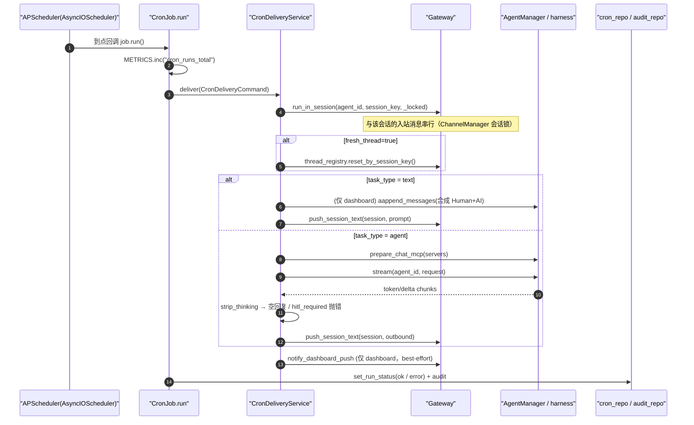
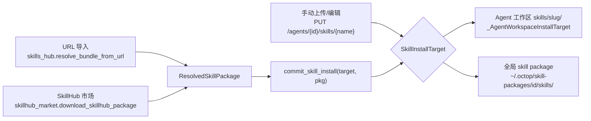
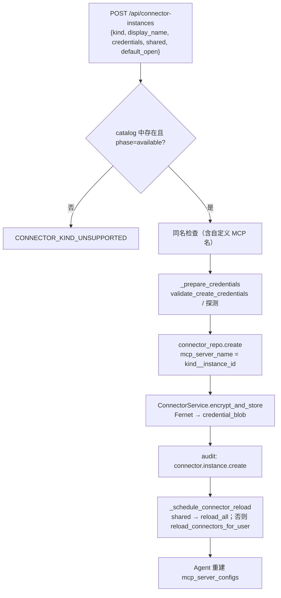
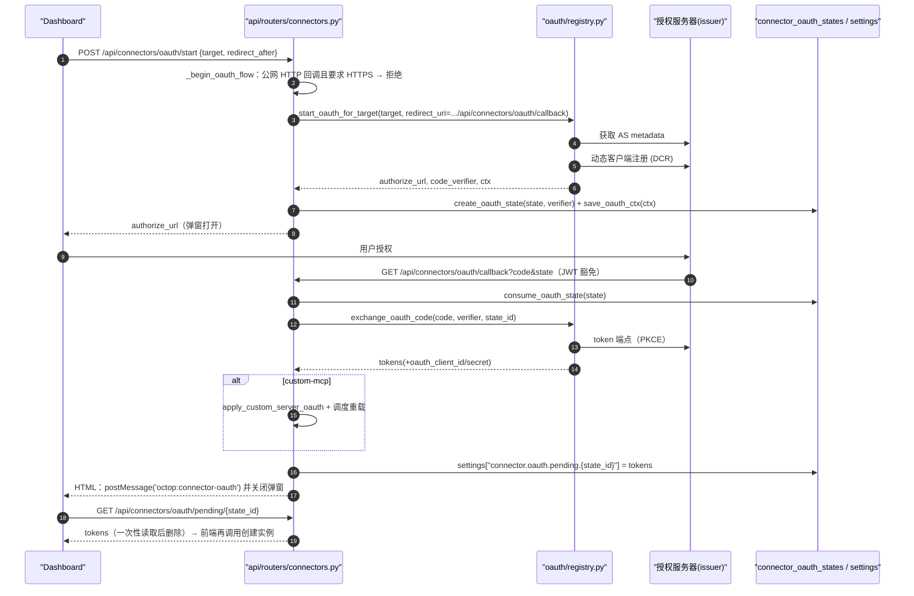
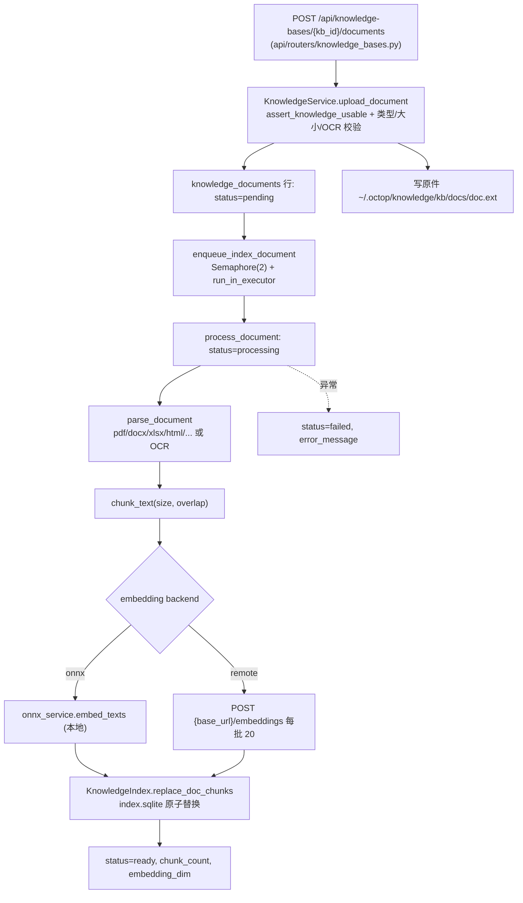
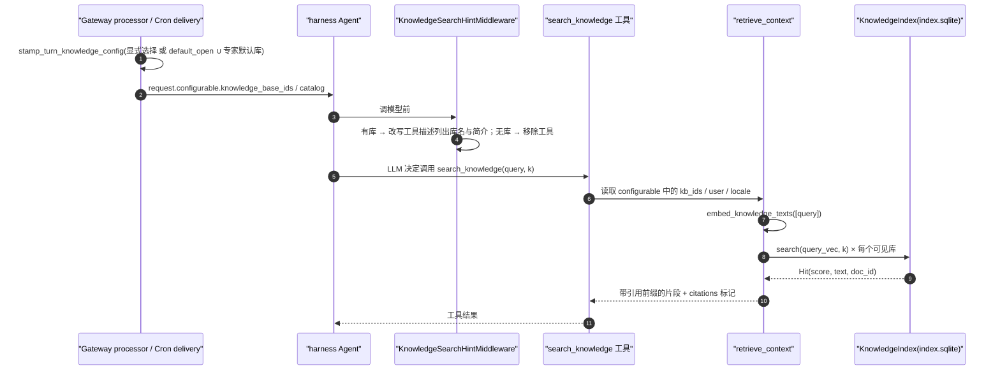
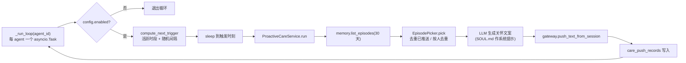

# 08 · 其他业务领域模块

> 一句话概述：`src/octop/infra/` 中除 agents / gateway / db / history 之外的「业务领域」包——定时任务、技能、连接器、知识库、首次运行与运维（TLS / 系统服务 / 自升级）、语音、主动关怀、远程设备、备份等。它们都遵循同一个套路：**domain 逻辑在 `infra/<领域>/`，HTTP 薄层在 `api/routers/<领域>.py`，前端页面在 `dashboard/src/pages/...`**，并通过「内置 LangChain 工具」或「MCP server 配置」接入 Agent runtime。

**本篇你将学到**

- Cron 从数据库行 → APScheduler → `CronDeliveryService` → Gateway 推送的完整链路，以及 `task_type=text|agent` 的差异；Agent 如何用工具给自己建定时任务。
- Skill 包的目录结构、四种来源（手动上传 / URL 导入 / SkillHub 市场 / 全局 skill package）以及启用/禁用如何热同步到运行中的 Agent。
- Connector 的三种 `mcp_mode`（remote / gateway / internal）、OAuth（DCR + PKCE）流程、凭证 Fernet 加密，以及 `/api/internal/mcp` 为什么存在。
- 知识库的导入 → 解析 → 切分 → 向量化 → 检索链路，以及它是怎样以 `search_knowledge` 工具的形式进入对话的。
- 首次运行向导、TLS/Let's Encrypt、系统服务安装、自升级的入口位置。
- voice / proactive / mobile / desktop / browser / backup / utils / metrics / ACP 的定位速览。

边界外内容：启动顺序见 [02-boot-and-runtime.md](02-boot-and-runtime.md)；一次对话的完整流见 [03-chat-flow.md](03-chat-flow.md)；Agent 构建与 harness 配置见 [04-agents.md](04-agents.md)；Gateway / ThreadRegistry / 推送见 [05-gateway.md](05-gateway.md)；表结构与迁移见 [06-data-layer.md](06-data-layer.md)；路由层约定见 [07-api-layer.md](07-api-layer.md)；前端与 CLI 见 [09-frontend-cli.md](09-frontend-cli.md)。

---

## 0. 模块总表

| 模块 | 职责 | 关键文件 | 对应 API router | 对应前端页面目录 |
|------|------|----------|-----------------|------------------|
| `infra/cron/` | 用户定时任务：调度、投递、Agent 自建任务工具；也承载系统级任务（TLS 续期、自动备份） | `manager.py` `job.py` `delivery.py` `trigger.py` `tools.py` `task_type.py` | `api/routers/cron.py` | `dashboard/src/pages/Control/CronJobs/` |
| `infra/skills/` | Skill 包校验、URL 导入、SkillHub 市场、全局 skill package 存储 | `skills_hub.py` `skillhub_market.py` `install.py` `skill_packages.py` `skill_package_store.py` `workspace_catalog.py` | `api/routers/skills.py`、`api/routers/skill_packages.py` | `dashboard/src/pages/Agent/Skills/`、`dashboard/src/pages/SkillPackages/` |
| `infra/connectors/` | 连接器目录、实例凭证（加密）、OAuth、MCP 配置组装、进程内 gateway 适配器、自定义 MCP | `catalog.py` `service.py` `builder.py` `crypto.py` `oauth/` `gateway/` `custom_mcp.py` `probe.py` `qcc.py` | `api/routers/connectors.py`、`api/routers/internal_mcp.py` | `dashboard/src/pages/Agent/Connectors/` |
| `infra/knowledge/` | 知识库 CRUD、文档解析/OCR、切分、embedding、SQLite 向量索引、检索工具 | `service.py` `jobs.py` `parse.py` `chunk.py` `embed.py` `index.py` `retrieve.py` `tools.py` `hint.py` `gate.py` | `api/routers/knowledge_bases.py` | `dashboard/src/pages/KnowledgeBases/`、`dashboard/src/pages/Settings/Embedding/` |
| `infra/setup/` | 首次运行向导（密码文件、向导 token）、systemd/launchd 服务、TLS/ACME、自升级 | `password_file.py` `wizard_tokens.py` `service.py` `self_update.py` `tls/` | `api/routers/setup.py`、`api/routers/tls.py`、`api/routers/update.py` | `dashboard/src/pages/Setup/`、`dashboard/src/pages/Settings/HttpsSettings/` |
| `infra/voice/` | STT/TTS 提供方选择与适配 | `manager.py` `adapters.py` `presets.py` | `api/routers/voice.py` | `dashboard/src/pages/Settings/Voice/` |
| `infra/proactive/` | 主动关怀：基于情景记忆随机时间推送关怀消息 | `scheduler.py` `service.py` `picker.py` | `api/routers/proactive_care.py` | `dashboard/src/pages/Agent/Memory/`（`ProactiveConfig.tsx`） |
| `infra/mobile/` | 远程 Android（adb、容器安装、Agent 工具） | `adb.py` `setup.py` `tools.py` `agent_control.py` | `api/routers/mobile/` | `dashboard/src/pages/Control/RemoteAndroid/` |
| `infra/desktop/` | 远程桌面（X11 截屏、输入注入、会话） | `setup.py` `capture.py` `input.py` `session.py` | `api/routers/desktop/` | `dashboard/src/pages/Control/RemoteDesktop/` |
| `infra/browser/` | 浏览器环境准备（Chrome profile、DISPLAY、卸载） | `setup.py` | `api/routers/browser/` | `dashboard/src/pages/Control/RemoteBrowser/` |
| `infra/backup/` | 系统/工作区/会话备份与恢复、自动备份 | `system_archive.py` `snapshot.py` `auto.py` `store.py` | `api/routers/backup.py` | `dashboard/src/pages/Settings/BackupRestore/` |
| `infra/utils/` | 纯函数工具（路径、ULID、SSRF、frontmatter…） | 见 §6.7 | —— | —— |
| `infra/metrics.py` | 进程内计数器 | `metrics.py` | `api/routers/admin.py` | —— |

---

## 1. `cron/` —— 定时任务

### 1.1 职责

- 持久化用户定义的定时任务（`cron_jobs` 表），在进程内用 APScheduler 的 `AsyncIOScheduler` 调度。
- 到点后把一条 prompt「投递」到某个会话（dashboard / IM / CLI），有两种模式：
  - `text`：原文推送（提醒类）。
  - `agent`：让 Agent 跑一轮，把可见回复推送出去（需要查数据、总结类）。
- 给 Agent 暴露 `cronjob_*` 工具，让 Agent 在对话里替用户创建/修改任务。
- 兼作「系统任务调度器」：TLS 自动续期、自动备份都挂在它上面，但不入库。

### 1.2 关键类与函数

| 符号 | 位置 | 说明 |
|------|------|------|
| `CronTaskType` / `DEFAULT_CRON_TASK_TYPE="agent"` | `src/octop/infra/cron/task_type.py:7-8` | 投递模式字面量；DB 默认值 `agent` |
| `normalize_cron_task_type` / `require_cron_task_type` | `src/octop/infra/cron/task_type.py:15,22` | 前者把未知值兜底为默认值（读库用），后者严格校验（用户/Agent 输入用） |
| `require_cron_prompt`（≤2000 字）/ `require_cron_name`（≤80 字，空则取 prompt 前 40 字） | `src/octop/infra/cron/task_type.py:29,48` | 输入校验 |
| `build_trigger(spec, timezone=)` | `src/octop/infra/cron/trigger.py:62` | 解析 `cron:<5段>` / `interval:<秒>` / `date:<ISO>` → APScheduler trigger |
| `_unix_day_of_week` | `src/octop/infra/cron/trigger.py:19` | 把 Unix 数字星期（0/7=周日）翻译成 `sun..sat`，规避 APScheduler 3 的「0=周一」语义差异 |
| `CronCreateSpec` | `src/octop/infra/cron/manager.py:30` | 创建入参 dataclass |
| `CronManager` | `src/octop/infra/cron/manager.py:50` | 进程级单例：持有 scheduler、锁、系统任务 id 集合 |
| `CronManager.boot` / `reload_from_db` | `src/octop/infra/cron/manager.py:75,82` | 启动时把 enabled 行全部 `_schedule`；备份恢复后只重载用户任务、保留系统任务 |
| `CronManager.create/update/delete/run_now` | `src/octop/infra/cron/manager.py:105,165,213,220` | 写库 + 重新调度 + 审计日志 |
| `CronManager._schedule` | `src/octop/infra/cron/manager.py:240` | `add_job(job.run, trigger, id=cron_id, misfire_grace_time=60)` |
| `CronManager._ensure_session` | `src/octop/infra/cron/manager.py:267` | 创建任务时确保目标 session 存在且归属同一 agent/user |
| `schedule_system_job` / `unschedule_system_job` | `src/octop/infra/cron/manager.py:294,306` | 非持久化系统任务（`misfire_grace_time=300`） |
| `CronJob.run` | `src/octop/infra/cron/job.py:78` | APScheduler 回调：`METRICS.inc`、调用投递服务、写 `last_status` 与审计 |
| `CronDeliveryCommand` | `src/octop/infra/cron/delivery.py:34` | 一次投递的不可变输入 |
| `CronDeliveryService.deliver` | `src/octop/infra/cron/delivery.py:67` | 在 session 锁内执行 `_deliver_text` 或 `_deliver_agent` |
| `_deliver_text` | `src/octop/infra/cron/delivery.py:89` | dashboard 会话额外写入一对合成的 Human/AI 消息，保证历史可见 |
| `_deliver_agent` / `_build_agent_request` | `src/octop/infra/cron/delivery.py:132,175` | 组装 harness 请求（MCP、模型、知识库），流式跑 Agent，拼接 token |
| `build_cronjob_tools` | `src/octop/infra/cron/tools.py:97` | 6 个工具：`cronjob_list/get/create/update/delete/run_now` |


### 1.3 数据表

`cron_jobs`（`src/octop/infra/db/migrations/001_initial.sql:96`），后续迁移追加 `mcp_servers`（`002_cron_mcp_and_skill_packages.sql:4`）和 `name`（`011_cron_job_names.sql`）。关键列：

- `cron_id`（公开字符串 id）、`agent_id`、`user_id`
- `schedule_spec`——**注意**：Python 侧字段叫 `trigger`，列名是 `schedule_spec`，映射在 `src/octop/infra/db/repos/cron.py:93`。
- `prompt`、`session_key`、`fresh_thread`、`model`、`task_type CHECK IN ('text','agent')`、`enabled`
- `last_run_at / last_status / last_error`——由 `CronJob.run` 回写。

### 1.4 装配位置

`OctopServer.start()` 在 Gateway boot 之后创建 `CronDeliveryService` 与 `CronManager`，并立刻挂上两个系统任务（`src/octop/infra/server.py:432-455`）：

```text
CronDeliveryService(gateway, agent_manager=registry, repos)
CronManager(gateway, delivery_service, repos, timezone=config.default_timezone)
await cron_mgr.boot()
install_auto_renewal_job(cron_mgr, ...)   # TLS
install_auto_backup_job(cron_mgr, ...)    # 备份
registry.set_cron_manager(cron_mgr)       # 让 AgentManager 能构造 cronjob_* 工具
```

Agent 构建时（非 team host）把 `build_cronjob_tools(self._cron_manager)` 加入 harness 工具列表：`src/octop/infra/agents/manager.py:3012-3018`。

### 1.5 时序图：一次定时触发



要点：

- **为什么要走 `run_in_session`**：`Gateway.run_in_session`（`src/octop/infra/gateway/gateway.py:406`）把定时投递和同一会话的用户入站消息串行化，避免 cron 回复与用户正在进行的对话交叉写入同一 thread。
- **推送与渠道解耦**：`push_session_text`（`src/octop/infra/gateway/gateway.py:434`）根据 session 的 `channel_type` 解析真实渠道（dashboard 走 WS、CLI、或 IM `channel_id`），因此 cron 结果「在哪儿建的就推回哪儿」。
- `agent` 模式中出现 `hitl_required`（需要人工审批）会直接判失败（`src/octop/infra/cron/delivery.py:148-151`），因为无人值守时没人能批准。
- `agent` 模式的历史写入放在 `finally` 里（`delivery.py:155-158`），保证 `fresh_thread` 刚重置出的空 thread 至少有投影行。
- 用量记账 `source="cron"`（`delivery.py:159-167`）。
- 知识库选择也在这里补上（`_attach_turn_knowledge_config`，`delivery.py:241`），与普通对话走相同的 `stamp_turn_knowledge_config`，见 §4。
- 失败语义：`CronJob.run` 捕获一切异常，写 `last_status="error"` + `last_error` 与审计 `cron.run_failed`，**不重试**，下次触发照常（`src/octop/infra/cron/job.py:99-112`）。只有 `run_now(wait=True)`（CLI 内嵌模式）会把异常抛给调用者（`manager.py:227-228`）。
- 错过触发：`misfire_grace_time=60`，进程停机期间错过的执行超过 60 秒即丢弃，不补跑（`manager.py:260`）。

### 1.5.1 两种模式对比

| 维度 | `text` | `agent` |
|------|--------|---------|
| 是否调用 LLM | 否 | 是（`AgentManager.stream`） |
| 推送内容 | `prompt` 原文 | Agent 可见回复（去掉 thinking） |
| dashboard 历史 | 合成 `HumanMessage(tr("cron.history.executed"))` + `AIMessage(prompt)` 追加到 checkpoint | 真实一轮对话，由 `TurnHistoryTracker` 投影 |
| IM 历史 | 只推送，不写 checkpoint | 同上 |
| MCP / 模型 / 知识库 | 不涉及 | 使用 `mcp_servers`（空则取默认打开项）、`model`、默认知识库 |
| 用量记账 | 无 | `usage_log`，`source="cron"` |
| 典型用途 | 提醒、问候 | 早报、收件箱总结、数据巡检 |

### 1.5.2 入口一览

| 入口 | 位置 | 说明 |
|------|------|------|
| HTTP | `src/octop/api/routers/cron.py:104-236` | `/api/agents/{agent_id}/cron[/{cron_id}[/run-now]]`；`GET /api/cron/settings` 为时区兼容别名 |
| Agent 工具 | `src/octop/infra/cron/tools.py:233-264` | 6 个 `cronjob_*` |
| CLI | `cli/commands/cron.py` | list/create/delete 走离线 DB；`run-now` 走内嵌 `OctopServer`（见 09 篇） |
| 系统任务 | `schedule_system_job` | TLS 续期、自动备份 |

### 1.6 Agent 自建定时任务

`src/octop/infra/cron/tools.py` 的工具从 LangGraph `get_config()["configurable"]` 中读取 `agent_id / user / session_key`（`tools.py:56-68`），所以 **Agent 创建的任务天然绑定到当前对话会话**，结果推回同一渠道。权限：只允许 agent 的 owner 操作（`_require_agent_owner`，`tools.py:76`）。

一个容易踩的差异：**工具里 `task_type` 默认是 `text`**（`tools.py:154`，描述里也引导 LLM 默认用 text），而 DB / HTTP 默认是 `agent`（`task_type.py:8`）。这是有意为之——LLM 最常见的请求是「提醒我喝水」这种固定文案。

### 1.7 时区陷阱

`build_trigger` 的 docstring 解释了为什么必须显式传时区（`src/octop/infra/cron/trigger.py:62-70`）：APScheduler 只有在 `add_job()` 收到**字符串**触发器时才注入 scheduler 时区；预构建的 trigger 会回落到宿主 OS 时区。所以 `_schedule` 和 `schedule_system_job` 都传 `timezone=self._timezone`（`manager.py:244,296`），它来自 `config.default_timezone`。`create/update` 里不带时区的 `build_trigger(...)` 调用只做**语法校验**（`manager.py:108,180`）。

### 1.8 修改提示

- 新增触发语法（如 `@every 5m`）：只改 `build_trigger`（`trigger.py:62`）。注意 `api/routers/cron.py:127` 的 docstring 提到「`@every` aliases」，但当前 `build_trigger` **并不支持**——属于文档与实现不一致，改之前先确认（待确认）。
- 新增投递模式：`task_type.py` 字面量 + `_CRON_TASK_TYPES`、DB `CHECK` 约束（需要 SQLite + PG 迁移对，见 06 篇与 AGENTS.md §7「Database」）、`CronDeliveryService.deliver` 分支、`tools.py` 的 `_TASK_TYPE_HELP` 文案、前端表单。
- 需要一个不入库的进程级周期任务：用 `CronManager.schedule_system_job`，参考 `src/octop/infra/setup/tls/renewal.py:74` 与 `src/octop/infra/backup/auto.py:251`。**不要**自己再起一个 scheduler。
- 用户可见文案（如 dashboard 合成消息 `cron.history.executed`，`delivery.py:103`）要进 `src/octop/i18n/{en,zh}.json`。

---

## 2. `skills/` —— 技能包

### 2.1 职责

Skill = 一个目录 `skills/<slug>/`，以 `SKILL.md`（YAML frontmatter + 正文）为清单，外加任意 `references/`、`scripts/` 等文件。`infra/skills/` 负责：

- 把各种来源规整成同一个「规范包」`ResolvedSkillPackage`（`src/octop/infra/skills/skill_packages.py:23`），并做大小/数量/路径安全校验（`MAX_SKILL_FILES=2000`、`MAX_SKILL_BYTES=64MB`，`skill_packages.py:10-11`）。
- URL 导入（skills.sh / clawhub.ai / skillsmp.com / GitHub，外加 `OCTOP_SKILLS_IMPORT_URL_PREFIXES` 自定义前缀）：`src/octop/infra/skills/skills_hub.py:43-64`。
- 腾讯 SkillHub 市场的搜索、榜单、zip 下载：`src/octop/infra/skills/skillhub_market.py`，默认主机 `https://api.skillhub.cn`（`skillhub_common.py:10`，可用 `SKILLHUB_HOST` 覆盖，`skillhub_market.py:68`）。
- 全局 skill package（管理员维护的一组 skill，多个 Agent 可挂载）：`SkillPackageStore`（`src/octop/infra/skills/skill_package_store.py:59`），内容在 `~/.octop/skill-packages/<package_id>/skills/`（`src/octop/infra/utils/paths.py:73`）。

### 2.2 四种来源，一个安装协议



- `SkillInstallTarget` 协议（`src/octop/infra/skills/install.py:29`）只有三个方法：`skill_exists / write_files / after_install`。**新增一种安装目的地只需实现这个协议**。
- `commit_skill_install`（`install.py:142`）：已存在且未 `overwrite` 抛 `SkillAlreadyExistsError`，否则写文件并调用 `after_install`。
- SkillHub 安装会把展示信息（图标、中英文 label/summary）写入 `SKILL.md` frontmatter 的 `metadata.octop.*`，**不改 slug**（`with_skillhub_presentation_metadata`，`install.py:44`）。
- `skills_hub.py` 1493 行的主体是各站点的 URL 解析与 GitHub 抓取策略（raw → API → archive 多级回退，`skills_hub.py:775-1300`），入口只有 `resolve_bundle_from_url`（`skills_hub.py:1466`）和 `search_hub_skills`（`skills_hub.py:1350`）。分发顺序见 `_fetch_bundle_data`（`skills_hub.py:1423`）：skills.sh → GitHub → skillsmp → clawhub → 直接当 JSON bundle。
- 市场 zip 的安全检查（条目数、解压总量、压缩比 ≤100、路径穿越）在 `skillhub_market._validate_zip`（`skillhub_market.py:186`），常量在 `skillhub_common.py:11-15`，专家（expert）市场也复用这些常量。

注意分层：写 Agent 工作区的 `_AgentWorkspaceInstallTarget` 目前定义在 **HTTP 层** `src/octop/api/routers/skills.py:868`（因为它依赖运行中 Agent 的 `BackendWorkspace`），不是 `infra/`。

### 2.3 启用 / 禁用

- 禁用集合存在 agent `config_json.skills_disabled`（slug 或显示名均可），读取函数 `skills_disabled_set`（`src/octop/infra/agents/manager.py:111`）。
- HTTP：`POST /api/agents/{agent_id}/skills/{name}/enable|disable`（`src/octop/api/routers/skills.py:1094,1110`）。
- 落盘与热同步：`AgentManager.persist_skills_disabled`（`manager.py:1912`）写配置后调用 `sync_skills_disabled` → `harness.set_skills_disabled`（`manager.py:2375-2377`），**不触发 harness 重建**。

### 2.4 Skill 如何进入 Agent runtime

构建 `HarnessAgentConfig` 时（详见 [04-agents.md](04-agents.md)）：

- 工作区技能发现根：`{workspace}/.octop/skills` 与 `{workspace}/skills`（`skills_discovery_roots`，`src/octop/infra/agents/workspace/dir.py:359`）。
- 额外技能目录 `skills_dir` = 配置里的 `skills` + 已挂载 package 的目录（`manager.py:3201-3213`，`_resolve_skill_package_dirs` 在 `manager.py:1944`）。
- `skills_disabled` = 用户禁用 ∪ 插件禁用（`manager.py:3262`）。

真正把 `SKILL.md` 注入 prompt / 提供读取工具的是 `octop-harness`，Octop 只负责提供目录与过滤集合。

### 2.5 数据表

`skill_packages`（最早在 `002_cron_mcp_and_skill_packages.sql:6`，在 `007_resource_identity_and_profile.sql:25` 按资源表规范重建）。单个 Agent 的技能**不入库**，就是工作区文件。

### 2.6 修改提示

- 新增 URL 来源站点：在 `skills_hub.py` 增加 `_extract_xxx_spec` + `_fetch_bundle_from_xxx`，并插入 `_fetch_bundle_data` 分发链；把前缀加进 `SUPPORTED_URL_PREFIXES`（`skills_hub.py:43`）。
- 调整安全上限：`skill_packages.py:10-11` 与 `skillhub_common.py`，两处要一致。
- 工作区 I/O 一律走 `BackendWorkspace`（AGENTS.md §7「Agent workspace I/O」），不要对 `~/.octop/agents/<id>/` 直接 `Path.write_text`。全局 package 是宿主机目录，可以直接用 `Path`。

---

## 3. `connectors/` —— 连接器与 MCP

### 3.1 核心概念

- **Catalog entry**（`ConnectorCatalogEntry`，`src/octop/infra/connectors/catalog.py:45`）：静态预置，描述 `kind`、`auth_kind`（personal_token / oauth2 / api_key / imap_app_password / custom_fields…）、`mcp_mode`、OAuth issuer 等。清单 `_CATALOG` 在 `catalog.py:110` 起，共 ~25 个（腾讯文档、IMA、企查查、Notion、飞书 CLI、WeKnora、Dify……）。
- **Instance**：用户为某个 kind 创建的实例，存在 `connectors` 表（`013_connector_instances.sql:7`）：`instance_id`、`kind`、`shared`、`mcp_server_name`（全局唯一，格式 `{kind}__{instance_id}`，`builder.py:58`）、`credential_blob`（加密）、`status`。
- **三种 `mcp_mode`**（`catalog.py:21` 与 `catalog.py:79-96`）：

| mcp_mode | harness 如何拿到工具 | 典型 kind |
|----------|----------------------|-----------|
| `remote` | 直接连厂商 HTTP MCP URL（`_build_remote_spec`，`builder.py:92`） | tencent-docs、notion、dify、didi |
| `gateway` | Octop 进程内 Python 适配器（`gateway/adapters/*`）；harness 配置里只有一个**无 transport 的占位**，工具在 Agent 启动后注入（`builder.py:517-528`、`inject_missing_gateway_tools`，`builder.py:574`） | qq-mail、tencent-ima、feishu-cli、weknora |
| `internal` | Octop 自己在 `/api/internal/mcp/{kind}/{instance_id}` 暴露一个 HTTP MCP，harness 以 HTTP 方式加载（`_build_gateway_spec`，`builder.py:195`） | 目前仅 qcc（企查查） |

- **自定义 MCP**：用户自填的 MCP server 集合，存成一个 kind=`custom-mcp` 的实例里的加密 JSON（`src/octop/infra/connectors/custom_mcp.py:16`，`service.get_custom_servers`，`service.py:286`）。harness 启动时同样只放占位，**对话时按需加载**（`builder.py:533-543`，`AgentManager.prepare_chat_mcp`，`manager.py:1595`）。

### 3.2 关键类与函数

| 符号 | 位置 | 说明 |
|------|------|------|
| `encrypt_credentials` / `decrypt_credentials` | `src/octop/infra/connectors/crypto.py:20,25` | Fernet 对称加密，密钥存 `secrets` 表 `connector_fernet`，首次使用自动生成 |
| `ConnectorService` | `src/octop/infra/connectors/service.py:78` | 实例凭证读写、刷新、自定义 MCP、QCC 请求、内部 token 校验 |
| `encrypt_and_store` | `service.py:112` | internal 模式会保留/生成 `internal_token` |
| `ensure_fresh_credentials` | `service.py:139` | oauth2 且剩余 < 120s 时用 refresh_token 刷新 |
| `verify_internal_token` | `service.py:627` | `/api/internal/mcp` 的鉴权 |
| `build_mcp_server_configs_for_user` | `src/octop/infra/connectors/builder.py:481` | 把用户可见的 active 实例 → harness `mcp_server_configs` |
| `gateway/registry.py` `_ADAPTERS` | `src/octop/infra/connectors/gateway/registry.py:32` | kind → 适配器模块（`list_tools/call_tool/probe_credentials`） |
| `handle_mcp_request` | `src/octop/infra/connectors/gateway/protocol.py:15` | 极简 MCP JSON-RPC：initialize / tools/list / tools/call / ping |
| `build_gateway_langchain_tools` | `src/octop/infra/connectors/gateway/langchain.py:15` | 把适配器工具包成 LangChain `StructuredTool`，名字 `{mcp_server_name}_{tool}` |
| `probe_connector` | `src/octop/infra/connectors/probe.py:370` | 创建/测试时探测凭证与工具列表 |
| `oauth/registry.py` | `src/octop/infra/connectors/oauth/registry.py` | OAuth 分发：`start_oauth_for_target`（:193）、`exchange_oauth_code`（:306）、`refresh_oauth_credentials`（:371） |
| `oauth/mcp.py` | `src/octop/infra/connectors/oauth/mcp.py` | AS 元数据获取（:71）、动态客户端注册 DCR（:84）、authorize URL（:114）、换 token（:149）、刷新（:193） |
| `oauth/discovery.py` | `src/octop/infra/connectors/oauth/discovery.py:143` | 自定义 MCP：通过 401 的 `WWW-Authenticate` / Protected Resource Metadata 发现 issuer |
| `oauth/pkce.py` | `src/octop/infra/connectors/oauth/pkce.py:10,16` | S256 challenge |

### 3.3 连接器如何进入 Agent

1. Agent 构建时（非 team host）：`build_mcp_server_configs_for_user(...)`（`src/octop/infra/agents/manager.py:3174`）生成 `mcp_server_configs`，交给 harness。
2. Agent 启动后：对 gateway 类实例，如果 HTTP 预加载没产生工具，就用 `inject_missing_gateway_tools` 进程内注入（`manager.py:1800,2538`）。
3. 每轮对话：用户在 composer 里选中的 MCP server 由 `merge_turn_mcp_servers` 合并「默认打开」项，`prepare_chat_mcp` 确保工具已加载（`manager.py:1595`）。Cron 的 `agent` 模式走同一套（`src/octop/infra/cron/delivery.py:182-214`）。

`default_open` 标记（「新对话默认勾选」）存在实例 `config_json` 中，读写见 `src/octop/infra/connectors/default_open.py:9,36`。

### 3.3.1 实例生命周期（非 OAuth 类）



- 路由实现：`src/octop/api/routers/connectors.py:692-758`；后台重载：`connectors.py:447-459`（`asyncio.create_task`，不阻塞响应）。
- `shared=1` 的实例对所有用户可见（`connector_repo.list_visible`），因此创建共享实例要重载**所有** Agent。
- 自定义 MCP 不走这个接口，而是整体 `PUT /api/connectors/custom-mcp`（`connectors.py:561`；在 `create_instance` 中被显式拒绝，`connectors.py:699-703`）。
- 探测：`POST /api/connector-instances/{id}/test` 与 `POST /api/connectors/test-credentials`（`connectors.py:947,991`）最终调用 `probe_connector`（`src/octop/infra/connectors/probe.py:370`），gateway 类会调用适配器的 `probe_credentials`（`gateway/registry.py:72`）。

### 3.4 OAuth 流程（catalog 连接器 & 自定义 MCP 统一）



要点：

- 回调页在 `src/octop/api/routers/connectors.py:1291`，JWT 豁免清单见 `src/octop/api/deps.py:66-72`。
- redirect_uri 以授权开始时存进 ctx 的为准（`oauth/registry.py:352-354` 注释：localhost 与 127.0.0.1 的 Host 漂移会导致换码失败）。
- `oauth_client_id/secret`（DCR 得到的）随 token 一起加密存储，刷新时使用（`registry.py:385-386`）。
- OAuth 期间的临时 ctx 存在 `settings` 表 `connector.oauth.ctx.<state_id>`（`registry.py:23,51`）。

### 3.5 `/api/internal/mcp` 的作用

`src/octop/api/routers/internal_mcp.py` 让 Octop 自己充当一个 Streamable-HTTP MCP server：

- `POST /api/internal/mcp/{kind}/{instance_id}?token=...`（`internal_mcp.py:50`）：校验实例 active + `internal_token`，`kind == "qcc"` 时走 `ConnectorService.handle_qcc_request`（带刷新锁的上游聚合），否则在线程中调用 `handle_mcp_request`。
- `GET`（`internal_mcp.py:99`）返回一个保活 SSE 流，满足 streamable-http 客户端握手；`DELETE`（`:136`）结束会话。
- URL 由 `internal_mcp_url` 生成（`builder.py:62`），固定指向本机 `bind_host:port`（0.0.0.0 时改用 127.0.0.1）。

**为什么需要它**：QCC 这类需要「服务端持有 OAuth 凭证、刷新时加锁、聚合 5 个上游 MCP」的连接器，如果让 harness 直接连厂商，凭证刷新与并发控制无法由 Octop 统一管理；把它包成本机 HTTP MCP，harness 只需持有一个内部 token。细节与限制（刷新锁只在单进程内有效）见 `docs/connectors-qcc.md`「共享授权与生命周期」一节和 `src/octop/infra/connectors/qcc.py`。

### 3.6 修改提示

- **新增一个 gateway 连接器**：① 在 `gateway/adapters/` 新建模块，实现 `list_tools()` / `call_tool(creds, name, args)` / `probe_credentials(creds)`；② 在 `gateway/registry.py:32` 注册；③ 在 `catalog.py` `_CATALOG` 加 entry（`mcp_mode="gateway"`、`credential_fields`）；④ 如有特殊凭证校验，扩展 `validate_create_credentials`（`builder.py:214`）；⑤ 前端图标/文案与 i18n。
- **新增 remote 连接器**：catalog entry + `_build_remote_spec` 分支（`builder.py:92`，未知 kind 会 `raise ValueError`）；若是标准 MCP OAuth，只需填 `oauth_issuer` + `mcp_url`，`is_mcp_oauth_remote`（`catalog.py:89`）就会让它自动进入 DCR+PKCE 流程。
- 凭证永远通过 `ConnectorService.encrypt_and_store` / `decrypt` 读写，不要把明文写进 `config_json`；API 返回自定义 MCP 前用 `redact_servers_for_api`（`custom_mcp.py:337`）。
- 用户可提供的 URL 需经 `validate_mcp_http_url`（`custom_mcp.py:118`）/ `infra/utils/ssrf_guard.py` 校验。

---

## 4. `knowledge/` —— 知识库

### 4.1 职责与数据布局

- 控制面（DB）：`knowledge_bases`、`knowledge_documents`（`src/octop/infra/db/migrations/007_resource_identity_and_profile.sql:75,100`）。文档 `status` 取值 `pending → processing → ready | failed`，带 `chunk_count`、`error_message`、`is_dir`（支持文件夹）。
- 数据面（文件）：`~/.octop/knowledge/<kb_id>/docs/<doc_id><suffix>` 存原件（`src/octop/infra/knowledge/files.py:11-24`），`~/.octop/knowledge/<kb_id>/index.sqlite` 存向量（`src/octop/infra/knowledge/index.py:30`）。**每个知识库一个独立 SQLite 侧车文件**，与主库（SQLite 或 PG）无关。
- 功能总开关与 embedding 配置都存在 `settings` 表：`knowledge_bases_enabled`、`knowledge_embedding_backend`（`onnx|remote`）、`knowledge_embedding_model`、`knowledge_embedding_provider_id`（`src/octop/infra/knowledge/gate.py:18-21`）；切分/检索参数 `knowledge_chunk_size` 等（`params.py:12-15`，默认 800/120/8/6000）。
- 可见性：owner 或 `shared=1`；管理员可见全部（`service.list_visible_bases`，`service.py:129`）。上限：每人 20 个库、每库默认 100 篇（`service.py:29-30`）。

### 4.2 关键类与函数

| 符号 | 位置 | 说明 |
|------|------|------|
| `get_capability` / `assert_knowledge_usable` | `src/octop/infra/knowledge/gate.py:63,138` | 功能是否启用 + embedding 前置条件（ONNX 模型已下载 / 远端 provider 就绪）；几乎所有入口先调它 |
| `KnowledgeService.upload_document` | `src/octop/infra/knowledge/service.py:347` | 校验大小/类型/OCR 开关 → 建行（`pending`）→ 写原件，失败回滚行 |
| `enqueue_index_document` | `src/octop/infra/knowledge/jobs.py:63` | `asyncio.create_task` + 全局信号量（并发 2）+ `run_in_executor` |
| `process_document` | `src/octop/infra/knowledge/jobs.py:34` | 解析 → 切分 → embedding → `replace_doc_chunks` → 更新状态与 `embedding_dim` |
| `resume_pending_index_jobs` | `src/octop/infra/knowledge/jobs.py:82` | 启动时恢复被中断的任务（`src/octop/infra/server.py:493-495`） |
| `reindex_all_documents` | `src/octop/infra/knowledge/jobs.py:75` | 换 embedding 模型后全量重建 |
| `parse_document` | `src/octop/infra/knowledge/parse.py:32` | 按后缀分发：txt/md/json/html/csv/tsv/pdf(pypdf，空文本时回退 OCR)/docx/pptx/xlsx/xls/图片(OCR) |
| `chunk_text` | `src/octop/infra/knowledge/chunk.py:6` | 固定字符窗口 + overlap |
| `embed_knowledge_texts` | `src/octop/infra/knowledge/embed.py:17` | `onnx` → `onnx_service.embed_texts`；`remote` → OpenAI 兼容 `/embeddings`，每批 ≤20 |
| `KnowledgeIndex` | `src/octop/infra/knowledge/index.py:26` | `chunks` 表存 float32 BLOB；`search` 为**全表扫描 + 进程内余弦** |
| `retrieve_context` | `src/octop/infra/knowledge/retrieve.py:22` | 查询向量化 → 多库检索 → 只保留 `ready` 文档 → 按分数排序 → 字符预算截断 → 追加引用标记 |
| `build_knowledge_tools` | `src/octop/infra/knowledge/tools.py:71` | 内置工具 `search_knowledge` |
| `KnowledgeSearchHintMiddleware` | `src/octop/infra/knowledge/hint.py:94` | 每轮改写工具描述（列出本轮挂载的库名与简介）；没挂库则把工具从列表中**移除** |
| `stamp_turn_knowledge_config` | `src/octop/infra/knowledge/default_open.py:38` | 把本轮 `knowledge_base_ids` / `knowledge_base_catalog` / `user_is_admin` / `locale` 写进 `request["configurable"]` |
| OCR | `src/octop/infra/knowledge/ocr.py` | 本地 rapidocr（运行时按需安装依赖，`ocr.py:31-33`）或远端视觉模型 |
| 引用标记 | `src/octop/infra/knowledge/citations.py:10` | `<!--octop-kb-citations:...-->`，供前端渲染来源 |

### 4.3 导入流程



### 4.4 检索与注入对话

知识库**不是**在每轮对话前自动拼进 system prompt，而是以「工具 + 每轮配置」的方式交给模型自主调用：



- 选择逻辑 `merge_knowledge_base_ids`（`src/octop/infra/knowledge/default_open.py:11`）：本轮显式传了列表就用显式列表；否则取**本人拥有**且 `default_open` 的库，再并上 agent/专家配置的默认库（`AgentManager.default_knowledge_base_ids`）。共享库的 `default_open` 只对创建者生效。
- 调用点：普通对话 `src/octop/infra/gateway/process/processor.py:1411`；cron `src/octop/infra/cron/delivery.py:258`。
- 工具与中间件注册：`src/octop/infra/agents/manager.py:3020-3030`（`build_knowledge_tools`）与 `manager.py:3112-3128`（中间件）。
- 检索失败被吞掉返回空串（`retrieve.py:53-55`），不会打断对话。
- 检索是「每库各取 top-k，再全局按分数重排取 k」（`retrieve.py:86-101`），然后按 `char_budget` 截断，每段前加本地化引用头 `knowledge.retrieval.citation`（`retrieve.py:114-120`）。注意 `search_knowledge` 工具目前用的是 `retrieve.py` 的默认 `char_budget=6000`，而 `settings` 中的 `knowledge_retrieval_k / knowledge_context_char_budget`（`params.py:14-15`）是否被该路径读取——待确认（`tools.py:98-106` 调用时只传了 `k`）。

### 4.4.1 HTTP 入口一览

路由前缀 `/api/knowledge-bases`（`src/octop/api/routers/knowledge_bases.py:62`）：

| 分组 | 端点（行号） | 说明 |
|------|--------------|------|
| 能力与配置 | `GET /capability`（:310）、`GET /embedding-options`（:318）、`GET /ocr-options`（:354）、`PUT /feature`（:385） | 功能开关、embedding / OCR 后端选择 |
| 本地 ONNX | `POST /onnx-download`（:467）、`GET /onnx-download-status`（:480）、`POST /onnx-activate`（:487）、`POST /onnx-test`（:505） | 本地 embedding 模型下载与自检 |
| 知识库 | `GET/POST ""`（:518/:531）、`GET /default-open`（:555）、`GET/PATCH/DELETE /{kb_id}`（:572/:592/:621） | CRUD 与默认打开 |
| 文档 | `GET /{kb_id}/documents`（:640）及其后的上传、文本新建、预览、重命名、删除、重建索引（:664-:933） | 上传/新建后立即 `enqueue_index_document` |

### 4.5 修改提示

- **换 embedding 模型**：走 `PUT /api/knowledge-bases/feature` → `gate.set_feature_enabled`（`gate.py:96`）校验前置条件后写 settings；模型变化时路由会调用 `reindex_all_documents`（`src/octop/api/routers/knowledge_bases.py:463`）。向量维度不同的旧 chunk 在检索时会被跳过（`index.py:115-116`），所以**换模型必须重建**。
- 新增文档格式：`parse.py:32` 加分支 + `service.py:35` `_EXT_TO_CONTENT_TYPE` 加映射（否则上传被拒）。
- 性能：`KnowledgeIndex.search` 是 O(N) 全表扫描。库规模变大时的首选改造点是这里（如换 sqlite-vec / 近似索引），接口 `replace_doc_chunks / delete_doc / search` 保持不变即可。
- 新增远端 embedding 协议：只改 `embed.py`；注意保持批次顺序与输入对齐（`embed.py:49-53` 注释）。
- 所有阻塞 I/O（解析、embedding、SQLite）都已在 executor 中执行；新增入口保持这个约定（AGENTS.md §8）。

---

## 5. `setup/` —— 首次运行、服务安装、TLS、自升级

### 5.1 首次运行向导

- **锁定**：没有任何用户时，`api/middleware/setup_lockdown.py` 让除 `/api/setup/`、`/api/health` 外的 API 返回 `503 {"setup_required": true}`，SPA 据此跳转 `/setup`。
- **向导密码文件**：`~/.octop/octop-login.txt`（`src/octop/infra/setup/password_file.py:9`），以 `O_EXCL` + `0o600` 创建。`boot_self_heal`（`password_file.py:68`）在启动时若用户数为 0 就确保文件存在并返回密码供 CLI 打印（调用点 `src/octop/infra/server.py:504`）。文件**永不删除**。
- **向导会话 token**：`WizardTokenStore`（`src/octop/infra/setup/wizard_tokens.py:26`），内存保存、TTL 300s（`server.py:252`），带每 60s 5 次的密码尝试限流（`wizard_tokens.py:12-13`）。
- HTTP 步骤：`/api/setup/status` → `verify-password` / `begin` → `test-database` / `database`（可选 PostgreSQL）→ `initial-admin` → `test-provider` → `finish`（`src/octop/api/routers/setup.py:215-414`）。

### 5.2 系统服务安装

`src/octop/infra/setup/service.py`：渲染 systemd unit（`render_systemd_unit`，`:379`）或 launchd plist（`render_launchd_plist`，`:420`），支持 system / user scope（`resolve_service_scope`，`:118`）、`linger`、`nofile` drop-in（`:544-603`），安装/启停/状态探测（`install_service` `:681`、`restart_service` `:777`、`collect_service_status` `:876`）。CLI 入口 `cli/commands/service.py`（详见 09 篇）。

### 5.3 TLS / Let's Encrypt（`setup/tls/`）

- **资格模式** `tls_issue_mode`（`src/octop/infra/setup/tls/modes.py:21`）：仅 `bind_host=0.0.0.0` 时可签发；未启用 TLS 且端口 80 → `FIRST`；已启用且 443 + http_port 80 → `RENEWAL`；否则 `NONE`。
- **签发**：`TlsManager.start_issue`（`tls/manager.py:163`）先跑 `run_preflight`（端口、DNS 解析、公网 IP 比对，`tls/preflight.py:126`），再后台任务 `_issue_worker` 调 `issue_certificate_http01`（ACME HTTP-01，`tls/acme_issue.py:56`），最后 `install_letsencrypt_cert` 写证书并合并 `config.json`（`tls/store.py:57`）。状态机 `PREFLIGHT → CHALLENGING → ISSUING → INSTALLING → RESTART_REQUIRED/FAILED`；**需要重启**才会加载新证书。
- **Challenge 响应**：内存 `challenge_store`（`tls/challenge.py:28`）。`FIRST` 模式下由主 app 的 `/.well-known/acme-challenge/{token}` 路由应答（`src/octop/api/app.py:135-139`）；启用 TLS 后，`launch.py` 按 `build_listen_plan`（`tls/listeners.py:33`）起双监听：443 跑主 app，80 跑 `build_http_companion_app`（只回 challenge，其余 301 到 HTTPS，`tls/http_companion.py:21`），此时强制 `workers=1`（`src/octop/launch.py:93-97`）。
- **自动续期**：`install_auto_renewal_job` 在 `RENEWAL` 模式下注册系统 cron 任务 `octop_tls_auto_renew`，每天 03:00 检查是否 30 天内到期（`tls/renewal.py:19-20,74-88`）。
- HTTP：`/api/admin/tls/status|preflight|issue`（`src/octop/api/routers/tls.py:55-80`）。

### 5.4 自升级 `self_update.py`

`src/octop/infra/setup/self_update.py`（920 行）由 CLI `octop update` 与 HTTP `/api/update/*`（`src/octop/api/routers/update.py:47`）共用：

- 版本源：PyPI JSON（`fetch_pypi_info`，`:188`），可选预发布，并解析 CHANGELOG 片段（`:222`）。
- 安装器探测：uv / pip / editable（`detect_installer` `:102`、`get_editable_path` `:341`），国内镜像按延迟排序（`_MIRRORS` `:35`、`rank_install_indexes` `:601`）。
- 平台特例：Windows 下先把被锁定的 console script 改名暂存再升级（`stash_console_scripts`，`:454`，逻辑见 `run_upgrade` `:811`）；飞牛 FnOS FPK 部署安装到 `OCTOP_FPK_SITE_PACKAGES`（`_run_fpk_upgrade` `:729`）。

### 5.5 修改提示

- 向导增加步骤：`api/routers/setup.py` + `dashboard/src/pages/Setup/steps/`；若新步骤需在「无用户」状态下访问，前缀必须落在 `/api/setup/`，否则会被 lockdown 与 JWT 同时拦截。
- 改 TLS 端口策略要同时改 `modes.py`、`listeners.py`、`launch.py` 的双监听分支，三者语义耦合。
- 所有 TLS/preflight 文案走 i18n（`tr("tls.*")`，例如 `tls/manager.py:193`）。

---

## 6. 其余模块速览

### 6.1 `voice/` —— 语音

`VoiceManager`（`src/octop/infra/voice/manager.py:23`）从 `settings` 表读 `active_stt_provider` / `active_tts_provider`（默认 `browser`，即前端 Web Speech API），`resolve` 后分派到 `adapters.py` 中的具体实现。内置预设 `browser / edge / tencent / openai / mimo`（`src/octop/infra/voice/presets.py:9`），Edge 只支持 TTS（`manager.py:52-56`）。用户自建的提供方存 `voice_providers` 表（`001_initial.sql:66`，name-keyed 配置表）。HTTP：`/api/voice/stt|tts|active|providers`（`src/octop/api/routers/voice.py:83-134`），管理员配置在 `/api/admin/voice/providers`。

### 6.2 `proactive/` —— 主动关怀

目标：在用户配置的活跃时段内、随机间隔地，基于 Agent 的「情景记忆（episodes）」主动发一条关怀消息。

- `ProactiveCareScheduler`（`src/octop/infra/proactive/scheduler.py:134`）**不使用 APScheduler**，而是每个 agent 一个 `asyncio.Task` 循环（`_run_loop`，`:274`）：读配置 → `compute_next_trigger`（`:44`，`now + random(min,max)`，落在活跃时段外则顺延到次日开始 + 0~120 分钟抖动）→ sleep → 调 `ProactiveCareService.run`。
- `ProactiveCareService.run`（`src/octop/infra/proactive/service.py:117`）：取 `agent.memory.list_episodes`（依赖 `octop_memory`）→ 查已推送记录去重 → `EpisodePicker.pick`（`picker.py:108`，分数 = 强度 × 情绪权重 × 新近度，同一人只留最高分，7 天无可推时放宽到 30 天）→ 读 `SOUL.md` 组 prompt → 用默认模型生成 → `gateway.push_text_from_session` → 写 `care_push_records`。
- 表：`proactive_care_config`（1:1 keyed by `agent_id`）、`care_push_records`（`001_initial.sql:246,256`）。装配见 `src/octop/infra/server.py:461-470`。



与 cron 的区别：cron 是「确定时间、用户显式定义」；主动关怀是「随机时间、由记忆驱动」，且推送前不经过 Agent 的完整 harness 回合，而是一次性 LLM 调用（`ainvoke_text`，`src/octop/infra/proactive/service.py:236`）。配置变更通过 `ProactiveCareScheduler.reschedule / cancel`（`scheduler.py:205,223`）即时生效。

### 6.3 `mobile/` —— 远程 Android

adb 设备发现、截屏/录屏（H.264 Annex-B，`h264.py`）、输入（`adb.py`），Docker 容器方式安装 Android（`docker_install.py`、`setup.install_mobile_stream`，`src/octop/infra/mobile/setup.py:214`）。`agent_control.py` 维护「当前 Agent 可以控制哪台设备」的进程内绑定（仅在远程手机流会话打开期间有效）。Agent 工具由 `build_mobile_tools`（`src/octop/infra/mobile/tools.py:76`）提供，在 `src/octop/infra/agents/manager.py:3036-3038` 注册。`python -m octop.infra.mobile` 是 install.sh 的探测钩子（`mobile/__main__.py`）。

### 6.4 `desktop/` —— 远程桌面

`setup.py`（1069 行）负责 Linux X11/虚拟桌面环境探测与安装；`capture.py` 截屏；`input.py` 键鼠注入与快捷键；`session.py` 是进程内会话注册表，限制并发会话数并提供专用线程池（`capture_executor` / `input_executor`，`src/octop/infra/desktop/session.py:124,128`）。HTTP 在 `api/routers/desktop/`（install / status / stream / settings / uninstall）。

### 6.5 `browser/` —— 浏览器环境（与 `octop_browser` 的关系）

真正的浏览器自动化（Playwright、CDP、profile 管理、录制回放）在独立包 `octop_browser`（`.venv/lib/python3.12/site-packages/octop_browser`，1.0.0）。`infra/browser/setup.py` 只做 Octop 侧「胶水」：Chrome 启动前的 profile 准备（清锁文件、可写性检查、root 用户下迁移 profile 目录，`prepare_harness_profile_for_launch` `src/octop/infra/browser/setup.py:275`）、解析 `DISPLAY`（`:92`）、判断 Playwright Chromium 是否已装（`:393`）、卸载 SSE 流；它以函数内延迟导入的方式使用 `octop_browser.settings / install / profile`（`setup.py:358,411,439`）。HTTP 在 `api/routers/browser/`。

### 6.6 `backup/` —— 备份与恢复

- `system_archive.create_system_backup`（`src/octop/infra/backup/system_archive.py:187`）：打包数据库快照 + 工作区 + 配置，带 `BackupManifest`（`manifest.py`）。PG 用 `pg_dump.py`，SQLite 用只读 URI 快照（`snapshot.py:34`）。
- 恢复时可把数据归属重映射到当前用户（`remap_ownership_to_user`，`snapshot.py:232`），并保留 JWT secret；恢复后 `CronManager.reload_from_db` 刷新调度（`src/octop/infra/cron/manager.py:82`）。
- 自动备份：`apply_auto_backup_schedule` 以系统 cron 任务注册（`src/octop/infra/backup/auto.py:251`），同一时刻只允许一个备份/恢复（`hold_backup_lock`，`auto.py:62`）。
- HTTP：`/api/admin/backup/*`（`src/octop/api/routers/backup.py:213-416`）；CLI `octop backup`。

### 6.7 `utils/` —— 纯函数工具

`infra/utils/` 只能依赖 stdlib/三方库，不能 import 其它 `infra/*` 领域包（AGENTS.md §5）。

| 文件 | 用途 |
|------|------|
| `paths.py` | `PathLayout`：`~/.octop/`（或 `OCTOP_HOME`）下各目录，如 `knowledge_dir`、`skill_packages_dir` |
| `ulid.py` | 进程内单调 ULID；`new_cron_id` 等 |
| `locale.py` | locale 归一化；`resolve_user_locale` / `resolve_request_locale` |
| `frontmatter.py` | Markdown YAML frontmatter 解析（SKILL.md、SOUL.md） |
| `json_file.py` | `OCTOP_HOME` 下小 JSON 配置文件的安全读写 |
| `env_file.py` | `~/.octop/env`（dotenv）持久化环境变量 |
| `llm_text.py` | 一次性 LLM 调用辅助、`strip_thinking` |
| `ssrf_guard.py` | 出站 HTTPS URL 校验（CWE-918） |
| `url.py` | URL 辅助 |
| `ssl_errors.py` | 从异常/stderr 识别 TLS 错误，生成用户提示 |
| `utf8_text.py` | 第三方包字节 → 合法 UTF-8；SKILL.md 修复 |
| `tencent_sign.py` | 腾讯云 TC3-HMAC-SHA256 签名 |
| `search_probe.py` | Web 搜索 provider key 探测 |
| `ollama_manager.py` | Ollama 本地模型管理 |
| `runtime_packages.py` | 运行时按需安装可选 Python 依赖（OCR、ONNX 等） |
| `docker_env.py` | Docker Engine 探测/安装（sandbox 后端） |
| `bwrap.py` | bubblewrap 供给（scoped `root_dir`） |
| `host_dirs.py` | 宿主目录选择器辅助，POSIX 下的禁止前缀 |
| `posix_compat.py` | POSIX-only stdlib 的跨平台类型封装 |
| `subprocess_io.py` / `subprocess_io_win.py` | 跨平台非阻塞读子进程输出 |
| `doc_edit.py` | 二进制文档 ↔ Markdown 转换（工作区编辑） |
| `browser_media.py` | octop-browser 媒体路径（对齐 IM `outbound/`） |
| `thread_artifact.py` | `threads.artifacts` JSON 的叶子类型 |

### 6.8 `metrics.py`

`Metrics` dataclass + 线程锁，仅 5 个计数器：`messages_total`、`stream_errors_total`、`cron_runs_total`、`cron_errors_total`、`agent_active`（`src/octop/infra/metrics.py:10-34`）。写入点：`cron/job.py`、`gateway/process/processor.py:604,897`；读出：`src/octop/api/routers/admin.py:86-90`（返回 `snapshot()`）。按约定在函数内延迟 import 以避免循环依赖。进程重启即清零，不是 Prometheus 指标。

### 6.9 ACP 集成位置

ACP（Agent Client Protocol，见 `docs/acp.md`）没有独立的 `infra/acp/` 包：

- **入站**（外部 IDE 驱动 Octop Agent）：CLI `src/octop/cli/commands/acp.py`，内部调用 `octop_harness.acp.server.run_harness_acp_server`（`acp.py:40-43`），stdio JSON-RPC，无 HTTP 端点。
- **出站**（Octop Agent 通过 `acp_runner` 工具委托编码任务）：runner 配置按用户全局存 `settings` 表 `acp_runners:user:{id}`（`src/octop/infra/agents/settings/acp.py:16`），每个 agent 的开关在 `config_json.acp.tool_enabled`，构建 harness 时传入 `acp_runners` / `acp_delegate_enabled`（`src/octop/infra/agents/manager.py:3260-3261`）。HTTP 在 `src/octop/api/routers/acp.py`，前端 `dashboard/src/pages/Agent/ACP/`。

---

## 7. 修改指南（汇总）

> 通用规则（来自 AGENTS.md）：domain 逻辑放 `infra/`，router 只做校验与映射；DB 变更要成对的 `00N_*.sql` + `00N_*.pg.sql`（未发版前并入当前未发布版本号）；用户可见文案进 `src/octop/i18n/{en,zh}.json`；异步函数里不做阻塞 I/O；交付前 `make all` 通过，改前端再跑 `cd dashboard && npx tsc -b`。

| 场景 | 要改的地方 | 注意 |
|------|------------|------|
| 加一种 cron 任务类型（如 `webhook`） | `cron/task_type.py`（字面量与集合）→ `cron_jobs.task_type` CHECK 约束（SQLite 需表重建，走 `migrate.py` 幂等 helper）→ `CronDeliveryService.deliver` 新分支 → `cron/tools.py` 工具描述 → `api/routers/cron.py` body 模型 → `Control/CronJobs/` 表单 | 新分支同样要在 `run_in_session` 内执行；失败要抛异常让 `CronJob.run` 记 `error` |
| 加一种触发语法 | `cron/trigger.py:build_trigger` | 记得带 `timezone`；负/零 interval 已被拒绝，保持这类防呆 |
| 新增系统级周期任务 | `CronManager.schedule_system_job`，在 `server.py` 启动段挂载 | 不入库、`reload_from_db` 不会清掉它 |
| 新增一个 connector（gateway 型） | `gateway/adapters/<kind>.py` → `gateway/registry.py` → `catalog.py` entry → `builder.validate_create_credentials` → 前端 `Agent/Connectors/` 与 i18n | 工具名最终是 `{kind}__{instance_id}_{tool}`，经 `sanitize_llm_tool_name` 处理 |
| 新增一个 connector（标准 MCP OAuth 远端） | 只加 catalog entry：`auth_kind="oauth2"`、`mcp_mode="remote"`、`oauth_issuer`、`mcp_url`（必要时 `oauth_resource/oauth_scopes`）；`_build_remote_spec` 补 kind 分支 | 公网 HTTP 回调会被拒，文档里提示 HTTPS |
| 需要服务端托管凭证/刷新锁的连接器 | 参照 qcc：`mcp_mode="internal"` + `ConnectorService` 专用 handler + `internal_mcp.py` 分支 | 刷新锁只在单进程内有效（`docs/connectors-qcc.md`） |
| 换 embedding 模型 / 后端 | Dashboard `Settings/Embedding/` → `PUT /api/knowledge-bases/feature` → `gate.set_feature_enabled` → `reindex_all_documents` | 维度变化必须全量重建；远端需 provider 有 `base_url` 与 `api_key` |
| 知识库支持新格式 | `knowledge/parse.py` + `service.py` 的 `_EXT_TO_CONTENT_TYPE` | 需要可选依赖时用 `utils/runtime_packages.py` 按需安装 |
| 调整检索注入策略（例如改为预注入） | `knowledge/default_open.py`（选择）、`knowledge/hint.py`（工具可见性）、`knowledge/retrieve.py`（格式与预算） | 保持 `retrieve_context` 失败返回空串的容错语义 |
| 新增 skill 来源站点 | `skills/skills_hub.py` 分发链 + `SUPPORTED_URL_PREFIXES` | 结果必须经 `resolve_workspace_uploads` 规整与限额 |
| 新增 skill 安装目的地 | 实现 `SkillInstallTarget` 三个方法 | 复用 `commit_skill_install` 的覆盖语义 |
| 新增一个语音提供方 | `voice/presets.py` + `voice/adapters.py` + `VoiceManager.resolve` | 能力（stt/tts/both）要在 `_validate_provider_name` 中体现 |
| 新增 ACME 以外的证书来源 | `setup/tls/store.py`（安装）+ `modes.py`（资格）+ `listeners.py` | 签发完成后仍需重启进程 |

---

## 8. 延伸阅读

- 仓库导航与分层规则：`AGENTS.md`（§5 模块边界、§7 Key patterns、§10 Change workflow）
- 连接器细节：`docs/connectors-qcc.md`（企查查 OAuth / API Key、刷新锁、验收记录）
- ACP：`docs/acp.md`
- Agent 工作区文件 I/O 与 sandbox：`docs/agent-backend-file-io.md`
- 专家与团队（与 skill package、默认知识库相关）：`docs/expert-teams.md`
- 配置项与环境变量：`docs/configuration.md`、`src/octop/config.py`
- HTTP API 参考：`docs/api.md`，运行时 `/api/docs`
- 本系列：[02-boot-and-runtime.md](02-boot-and-runtime.md) · [03-chat-flow.md](03-chat-flow.md) · [04-agents.md](04-agents.md) · [05-gateway.md](05-gateway.md) · [06-data-layer.md](06-data-layer.md) · [07-api-layer.md](07-api-layer.md) · [09-frontend-cli.md](09-frontend-cli.md)
