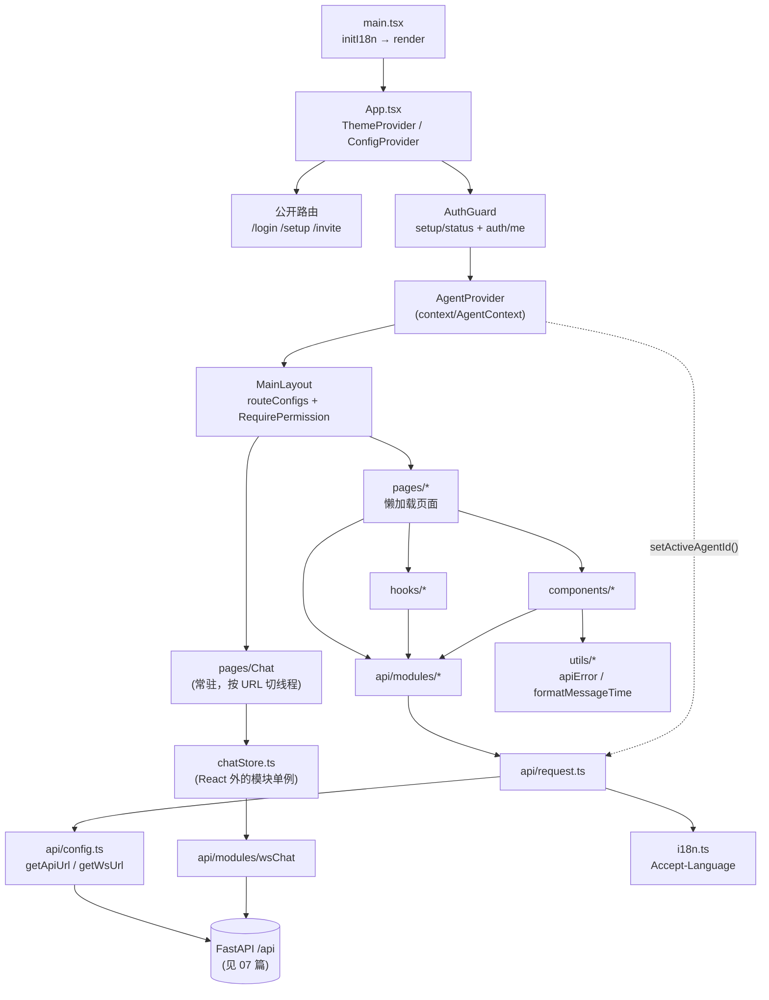
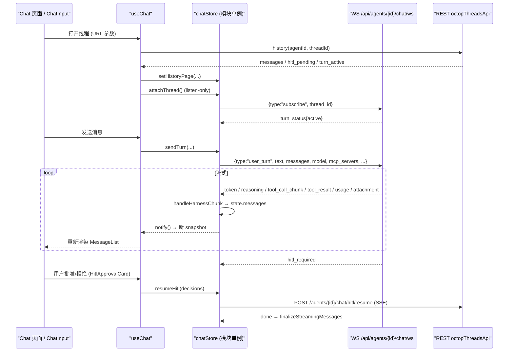
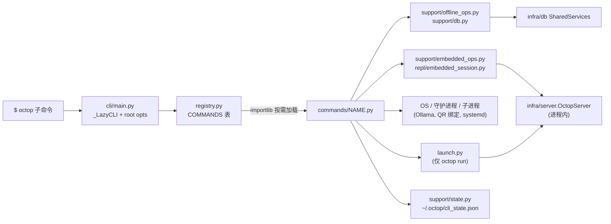

# 09 · 前端控制台与 CLI

> **一句话概述**：Octop 有两个"人机入口"。一个是 `dashboard/` 下的 React 18 + TypeScript + Vite 单页应用（SPA，约 17 万行 TS/TSX），构建后打进 wheel、由 FastAPI 托管；另一个是 `src/octop/cli/` 下的 Click 命令行。两者都**不含业务规则**：前端只通过 `/api` HTTP/WS 和后端通信，CLI 直接调用 `infra/`，或者在进程内临时启动一个 `OctopServer`。

**本篇你将学到**

- dashboard 的工程结构、开发代理和构建产物，以及为什么 `src/octop/dashboard/` 不能手改；
- 路由表：路径 → 页面组件 → 主要调用的 API 模块；
- `api/request.ts` 统一做了哪些事：鉴权头、`Accept-Language`、`X-Octop-Agent-Id`、401/403/503 处理、JWT 滑动续期；
- 聊天页怎样用 React 之外的 `chatStore` 管理 WebSocket、流式 token、工具调用和 HITL（人工审批）状态；
- 全局状态（Theme / Agent / 当前用户）、i18n（含 apiErrors 与后端的同步测试）和服务器时区工具；
- CLI 的懒加载注册表、`support/` 辅助层，以及 Offline / Embedded / External 三种传输层（外加一个"运行中宿主控制通道"的特例）；
- 新增页面、新增 CLI 子命令、新增文案的完整步骤和坑点。

---

## 1. 关键文件表

| 路径 | 作用 |
|------|------|
| `dashboard/package.json` | 依赖与脚本：`dev`=`vite --host`，`build`=`tsc -b && vite build`，`lint`、`test`=vitest |
| `dashboard/vite.config.ts` | 开发代理 `/api`→`127.0.0.1:8088`（含 WS），构建输出到 `../src/octop/dashboard`，PWA 与分包策略 |
| `dashboard/src/main.tsx` | 入口：chunk 过期自愈、`initI18n()` 完成后再渲染 `<App/>`、注册 Service Worker |
| `dashboard/src/App.tsx` | Provider 栈与顶层路由（`/login`、`/setup`、`/invite`，以及 `/*`→`AuthGuard`→`MainLayout`） |
| `dashboard/src/routes/index.tsx` | 业务路由表 `routeConfigs`、侧栏高亮映射 `pathToKey`、全屏页面集合 |
| `dashboard/src/layouts/MainLayout/index.tsx` | 渲染 `routeConfigs`、按权限套 `RequirePermission`、聊天页和 Workbench 常驻挂载 |
| `dashboard/src/api/request.ts` | 所有 HTTP 调用的唯一出口：`request` / `requestBlob` / `requestStream` / `requestUpload` / `probeAuthResource` |
| `dashboard/src/api/config.ts` | `getApiUrl()`、`getWsUrl()`：拼接 `/api` 前缀，以及 http→ws 的协议转换 |
| `dashboard/src/api/modules/*.ts` | 约 50 个按资源划分的 typed 请求封装 |
| `dashboard/src/utils/apiError.ts` | 解析后端错误信封，映射到 `apiErrors.<CODE>` 文案 |
| `dashboard/src/pages/Chat/hooks/chatStore.ts` | 聊天的模块级 store（2883 行）：WS 生命周期、帧处理、断线续流、HITL |
| `dashboard/src/pages/Chat/hooks/useChat.ts` | 用 `useSyncExternalStore` 把 chatStore 桥接进 React，并负责加载历史 |
| `dashboard/src/context/AgentContext.tsx` | 全局 Agent 列表和当前 Agent，并同步到 `request.ts` 的模块变量 |
| `dashboard/src/i18n.ts`, `src/locales/{en,zh}.json` | i18next 初始化；从后端补充 tools/skills 标签 |
| `dashboard/src/hooks/useServerTimezone.ts`, `src/utils/formatMessageTime.ts` | 服务器时区获取与时间格式化 |
| `src/octop/cli/main.py` | Click 根组 `_LazyCLI`，root 级 `--user/--agent/--json` |
| `src/octop/cli/registry.py` | 命令名 → (模块, 属性, 简短帮助) 的懒加载注册表 |
| `src/octop/cli/commands/*.py` | 22 个命令模块，对应注册表中的 22 个顶层命令（另见 §9.2） |
| `src/octop/cli/support/*.py` | db / offline_ops / embedded_ops / acting / ctx / state 等辅助层 |
| `src/octop/cli/repl/*.py` | `chats repl/send` 的嵌入式聊天运行时与终端渲染 |

> 注：AGENTS.md §5 写的是 `cli/main.py` + `cli/*_cmd.py` + `cli/run_cmd.py`，但当前代码实际是 `cli/commands/<name>.py`（如 `src/octop/cli/commands/run.py`），并且由 `registry.py` 懒加载。**以代码为准**。

---

## 2. 前端工程结构

### 2.1 依赖与脚本

`dashboard/package.json` 的核心依赖如下：

- UI：`antd@5` + `antd-style`、`lucide-react` 图标、`react-router-dom@7`；
- 数据与状态：`ahooks`，但**没有** Redux/Zustand 之类的全局 store，全局状态靠 React Context 加模块级单例；
- 渲染：`react-markdown` + `remark-gfm/math` + `rehype-katex`、`mermaid`、`react-syntax-highlighter`、`react-virtuoso`（长消息列表虚拟滚动）、`recharts`（用量图表）；
- 文件预览：`react-pdf`、`docx-preview`、`@aiden0z/pptx-renderer`、`xlsx`、`@monaco-editor/react`；
- 终端与远程桌面：`@xterm/xterm` 5.5.0（版本锁定，理由见 vite 配置注释）；
- i18n：`i18next` + `react-i18next`；
- 测试：`vitest` + `@testing-library/react` + `jsdom`。

脚本：`dev`（`vite --host`）、`build`（`tsc -b && vite build`，先做类型检查）、`lint`（eslint）、`format`（prettier）、`test`（`vitest run`）。

### 2.2 Vite 配置要点（`dashboard/vite.config.ts`）

| 配置 | 位置 | 说明 |
|------|------|------|
| 后端端口 | `dashboard/vite.config.ts:60` | `VITE_API_PORT`，默认 `8088` |
| 开发代理 | `dashboard/vite.config.ts:315-323` | `/api` 转发到 `http://127.0.0.1:${apiPort}`，`ws: true` 同时代理聊天和通知 WS，`xfwd: true` 保留浏览器侧 origin（OAuth 回调要用） |
| 构建输出 | `dashboard/vite.config.ts:92` | `outDir: ../src/octop/dashboard`，`emptyOutDir: true`，每次构建都会**清空**该目录 |
| 分包 | `dashboard/vite.config.ts:104` 起 | `vendor-react` / `vendor-antd`（rc-* 必须和 antd 同一个 chunk，否则出现循环 chunk 报错）/ `vendor-markdown` 等；mermaid、代码高亮走异步 chunk |
| `BASE_URL` 常量 | `dashboard/vite.config.ts:168` | 编译期注入，默认空字符串，即同源部署 |
| PWA | `dashboard/vite.config.ts:178` | `registerType: "prompt"`：新 SW 等用户确认后才激活；HTML 外壳走 NetworkFirst，避免部署后白屏 |
| Vite 断连不刷新 | `suppressViteDisconnectReload()` | 修补 `@vite/client`，防止 Safari / 局域网环境下页面"周期性自动刷新" |

### 2.3 Make 目标

| 命令 | 实际做了什么 |
|------|-------------|
| `make dev` | 同时起 `npm run dev`（:5173）和 `octop run`（:8088），Ctrl-C 一起停（`Makefile:159`） |
| `make dev-frontend` | 只起 Vite（`Makefile:167`），适合后端已经在跑的场景 |
| `make build-frontend` | `npm ci` 后执行 `NODE_ENV=production ... npm run build`（`Makefile:96-100`），产物写进 `src/octop/dashboard/` |
| `make build` | `build-frontend` + `build-wheel`，前端产物随 wheel 一起发布 |

**为什么 `src/octop/dashboard/` 不能手改**：它是 `vite build` 的输出目录（`emptyOutDir`），下次构建会被整体覆盖。源码只在 `dashboard/`。FastAPI 静态托管和 SPA fallback 见 [07-api-layer.md](07-api-layer.md)。

### 2.4 `dashboard/src/` 目录职责

| 目录 | 职责 | 约束（AGENTS.md §5） |
|------|------|------|
| `api/` | `request.ts`、`config.ts`、`modules/*`（按资源划分）、`types/` | 不放 UI 和页面状态 |
| `pages/` | 路由级页面，以及页面内的 hooks、components、utils（例如 `pages/Chat/hooks/`） | 可复用的组件移到 `components/` |
| `components/` | 共享 UI：`AuthGuard`、`RequirePermission`、`Markdown`、`DocumentPreviewCore` 等 | **不直接 `fetch`**，走 `api/` |
| `hooks/` | 可复用 hooks：`useServerTimezone`、`useCurrentUser`、`useIsMobile`、`useDashboardPushToast` 等 | 不放页面一次性逻辑 |
| `context/` | Theme / Agent / LayoutMode / VoiceOutput / Scroll / ServiceRestart / BackupOperation | 访问 API 也要经过 `api/` |
| `layouts/`、`routes/` | 外壳、侧栏、Header、路由表 | 不放业务逻辑 |
| `locales/` | `en.json`、`zh.json` | 两份文件的 key 树保持一致 |
| `utils/` | 纯函数：`apiError`、`formatMessageTime`、`parseHarnessChunk`、`permissions` 等 | 不感知 API 和服务器 |
| `plugins/toolRenderers/` | 工具调用结果的渲染器注册表（内置渲染器 + 插件 UI） | — |

---

## 3. 前端模块依赖图



---

## 4. 启动与路由

### 4.1 启动顺序

1. `main.tsx` 最先 import `./pwa-prompt`，确保 `beforeinstallprompt` 监听器在 React 挂载前注册；随后调用 `installChunkLoadRecovery()`（部署后旧 hash chunk 404 时软刷新）。
2. `void initI18n().then(render)`（`dashboard/src/main.tsx:61`）：**语言包加载完成后才渲染**，因此首屏不会先闪一下 key。
3. `App.tsx` 的 Provider 栈是 `BrowserRouter` → `GlobalErrorBoundary` → `ThemeProvider` → antd `ConfigProvider`（`prefixCls="octop"`，antd locale 和 dayjs locale 跟随 i18n）→ `AntdAppProvider` → `Routes`。
4. 受保护的路由在 `dashboard/src/App.tsx:140-150` 组装：`AuthGuard` → `AgentProvider` → `LayoutModeProvider` → `VoiceOutputProvider` → `MainLayout`。

`AuthGuard` 先调 `/setup/status`，未完成初始化就跳 `/setup`；再用 `/auth/me` 校验 token。**校验通过前不渲染 children**，这样 AgentProvider 不会提前发出 `/api/agents` 请求，避免 401 跳转和渲染互相竞争（见 `dashboard/src/components/AuthGuard.tsx` 文件头注释）。项目里没有独立的 AuthContext，当前用户通过 `CurrentUserProvider`（`hooks/useCurrentUser.tsx`）下发。

### 4.2 路由表（`dashboard/src/routes/index.tsx:144` 起）

下表的"主要 API 模块"通过统计页面目录对 `api/modules/*` 的 import 次数得出，只列出主干模块。

| 路径 | 页面组件 | 主要 API 模块 | 备注 |
|------|---------|--------------|------|
| `/chat`、`/chat/:agentId`、`/chat/:agentId/:threadId` | `pages/Chat`（由 MainLayout 的 `ChatWithKey` 包装） | `octopThreads`、`trajectory`、`knowledgeBases`、`subagents`、`slash`、`wsChat` | `useWrapper: true`；切换线程只改 URL 参数，**页面不重新挂载** |
| `/experts` | `pages/Experts` | `publishedExperts`、`teams`、`subagents`、`expertMarket`、`octopAgents` | |
| `/tasks` | `pages/Control/CronJobs` | `cronjob`、`provider`、`connectors` | 旧路径 `/cron-jobs`、`/orca/cron` 会重定向到这里 |
| `/connectors` | `pages/Agent/Connectors` | `connectors` | |
| `/skill-packages` | `pages/SkillPackages` | `skillPackages`、`expertMarket` | |
| `/knowledge-bases` | `pages/KnowledgeBases` | `knowledgeBases` | |
| `/personalization/*` | `pages/Agent/Personalization` | 聚合 `api`（`src/api/index.ts`）、`plugins` | 子 tab：skills/tools/plugins/subagents/channels/mbti/memory；`/skills`、`/mbti`、`/memory`、`/channels` 都重定向到这里 |
| `/token-usage` | `pages/Control/TokenUsage` | 直接调 `request`：`/usage/summary`、`/admin/usage/summary` | |
| `/acp` | `pages/Agent/ACP` | `acp` | |
| `/workbench`、`/workbench/terminal`、`/workbench/browser` | `pages/Control/Workbench` | `terminalAi`、`browser` 等（通过子组件） | 路由 element 为 `null`，由 MainLayout **常驻挂载**并用 `display` 切换显示 |
| `/remote-desktop/*` | `pages/Control/RemoteDesktop` | `desktop`、`mobile` | |
| `/admin/models` | `pages/Settings/Models` | `provider`、`ollamaModel`、`onnxModel`、`preferences` | |
| `/admin/users` | `pages/Admin/Users` | `userRoles`、`sso`、`invites`、`auth` | |
| `/admin/backend` | `pages/Admin/Storage` | 直接调 `request`：`/admin/storage-backends/…` | |
| `/admin/plugins` | `pages/Admin/Plugins` | `plugins` | |
| `/admin/advanced` | `pages/Settings/AdvancedSettings` | `settings`、`update` | 旧路径 `/updates`、`/environments` 重定向到这里 |
| `/admin/security` | `pages/Settings/Security` | `security` | |
| `/agent-config` | `pages/Agent/Config` | 直接调 `request`：`/agents/…` | |
| `/login`、`/login/oidc/complete`、`/setup`、`/invite` | `pages/Login`、`pages/Setup`、`pages/Invite`（定义在 `App.tsx`，不在 routeConfigs 里） | `auth`、`sso`、`preferences` | 公开路由 |
| `/` → `/chat`；`*` → `NotFoundPage` | | | |

路由相关的几点机制：

- **权限**：`MainLayout` 渲染 routeConfigs 时调用 `routeNeedsPermission(rc.path)`（`dashboard/src/utils/permissions.ts:219`），`/admin*`、`/workbench*`、`/personalization*` 以及 `pathPermissionKeys` 命中的路径会自动套一层 `<RequirePermission>`（`dashboard/src/layouts/MainLayout/index.tsx:157-162`）。前端权限只影响 UI 显示，真正的鉴权在后端（见 [07-api-layer.md](07-api-layer.md)）。
- **侧栏高亮**：新增路由要同时在 `pathToKey`（`dashboard/src/routes/index.tsx:48`）里登记；需要铺满内容区的页面加入 `FULLSCREEN_PATHS`（`:98`）。
- **懒加载**：页面一律 `lazy(() => import(...))`，外层有 `<Suspense fallback={<PageLoading/>}>`（`MainLayout/index.tsx:155`）。`BrowserRouter useTransitions={false}` 是有意设置的：开启 transition 后点击导航时看不到 Suspense fallback，用户会觉得"点了没反应"。
- **历史路径**：大量 `Navigate` 重定向（`/orca/*`、`/octop/*`、`/admin/storage` 等）用来保证旧书签可用。改路径时要保留这些重定向。

---

## 5. HTTP 层：`api/request.ts` 与错误处理

### 5.1 请求头的组装（`buildHeaders`，`dashboard/src/api/request.ts:223-260`）

| 头 | 来源 | 说明 |
|----|------|------|
| `Content-Type: application/json` | 固定 | `requestUpload` / `requestBlob` 改用 `buildAuthHeaders`（`:265`），不设 Content-Type，由浏览器写 multipart boundary |
| `Accept-Language` | `i18n.language` 以 zh 开头则为 `zh`，否则为 `en`（`:226`） | 后端据此本地化错误 message（见 AGENTS.md §7 locale 解析顺序） |
| `Authorization: Bearer <jwt>` | `getAuthToken()`（`:86`）：先读 localStorage，再读 sessionStorage | "记住我"写 localStorage，否则写 sessionStorage，这样新标签页不会共享或擦掉别的标签页的会话（`:74-83`） |
| 调用方 `extra` | `options.headers` | **优先级最高**，setup 向导靠它传入短期 Bearer |
| `X-Octop-Agent-Id` | 模块变量 `activeAgentId`（`:196`），由 `AgentProvider` 调 `setActiveAgentId` 写入 | 只有 `isAgentScopedPath` 命中（`/agents/<id>/...`、`/mbti/...`）时才附带（`:214-221`） |

`getApiUrl(path)` 会给传入的路径加上 `${BASE_URL}/api` 前缀（`dashboard/src/api/config.ts:8-13`），所以模块里写的是 `/agents/...`，**不带 `/api`**。

### 5.2 响应处理管线（`request()`，`dashboard/src/api/request.ts:338-384`）

1. `assertNotSetupLocked`（`:144`）：如果本标签页已经知道处于 setup 锁定状态，就不再发网络请求，直接抛 `SetupRequiredError`，避免请求风暴。
2. `check503ForSetupRequired`（`:159`）：遇到 503 且响应体为 `{setup_required:true}` 时清 token，并一次性 `location.replace("/setup")`。
3. `throwIfUnauthorized`（`:313`）：非 `/auth/*` 路径返回 401 时，清 token 并派发可取消事件 `octop:unauthorized`（`:14`, `:300`）。React 内的 `useUnauthorizedRedirect` 会 `preventDefault()` 并用 SPA 路由跳到 `/login`；如果没有监听者接管，就硬跳转。模块级标志 `_redirectingToLogin` 保证 N 个并发请求只跳一次。
4. **JWT 滑动续期**：`applyRenewedAccessToken`（`:104`）读取响应头 `X-Octop-Access-Token` 并覆盖本地 token，同时保持原有的"记住我"语义。前端**没有 refresh-token 端点**，续期完全靠服务端在响应里下发新 token（后端逻辑见 [07-api-layer.md](07-api-layer.md) 的 JWT 中间件）。
5. 对 agent 作用域路径返回的 403，派发 `octop:forbidden` 事件（`:361-365`）。
6. 非 2xx 时抛 `Error("Request failed: <status> <statusText> - <body>")`，**错误信封以原文拼在 message 里**。
7. 204 返回 `undefined`；非 JSON 响应返回 text。

`requestBlob`（带下载进度）、`requestStream`（chunked TTS）、`probeAuthResource`（只检查存在性）、`requestUpload`（XHR，带上传进度和 abort）复用同一套 setup/401/续期逻辑。

### 5.3 错误展示（`dashboard/src/utils/apiError.ts`）

- `parseApiError(err)`（`:10`）从 `Error.message` 中第一个 `{` 开始解析 JSON，依次兼容 `{error:{code,message,details}}`、FastAPI 的 `{detail}` 和 `{message}` 三种格式。
- `apiErrorMessage(err, fallback, t)`（`:68`）：如果有 `code` 且前端存在 `apiErrors.<CODE>` 文案，优先使用前端翻译（`details` 作为插值参数，`details.reason` 会拼在后面）；服务器 message 比通用文案信息更多时，改用服务器 message。
- WS 错误帧用 `wsStreamErrorMessage`（`:112`）。
- 约定：页面 `catch` 之后调用 `apiErrorMessage(e, t("xxx.fallback"), t)`，**不要**直接展示 `e.message`，否则用户会看到 `Request failed: 400 ...`。

### 5.4 `api/modules/*` 一览

`acp`、`agent`、`agentChat`、`agentTools`、`auth`、`backup`、`browser`、`channel`、`connectors`、`cronjob`、`desktop`、`embedding`、`env`、`expertMarket`、`i18n`、`invites`、`knowledgeBases`、`mbti`、`mediaGeneration`、`memoryDashboard`、`memoryPortable`、`mobile`、`observability`、`octopAgents`、`octopThreads`、`ollamaModel`、`onnxDownloadWatcher`、`onnxModel`、`plugins`、`preferences`、`provider`、`publishedExperts`、`root`、`security`、`settings`、`skillPackages`、`slash`、`sso`、`subagents`、`teams`、`terminalAi`、`tls`、`trajectory`、`update`、`upload`、`userRoles`、`voice`、`workspace`、`wsChat`、`wsNotifications`。

有两种组织方式并存：

- `src/api/index.ts` 把其中一部分模块展开合并成一个 `api` 对象（`dashboard/src/api/index.ts:38`），老页面用 `api.xxx()`；
- 新代码直接 `import { octopThreadsApi } from "../../api/modules/octopThreads"`。**新增模块推荐后一种写法**，不必再往 `api` 聚合对象里加。

---

## 6. 聊天页：WS、帧处理与 UI 状态

聊天协议本身（`user_turn` / `subscribe` / `cancel` 帧、后端怎样把 harness 流转成 chunk、HITL 恢复）见 [03-chat-flow.md](03-chat-flow.md)。本节只讲前端怎么消费这些帧。

### 6.1 为什么把状态放在 React 之外

`dashboard/src/pages/Chat/hooks/chatStore.ts:1-8` 的文件头注释说明了设计意图：WebSocket 和累积的消息都放在**模块级 Map**（`sessionStates`，`:260`；`liveSockets`，`:541`）中，组件卸载后再挂载，仍能拿到正在流式输出的内容。React 侧通过 `useSyncExternalStore(subscribe, getSnapshot)` 订阅（`dashboard/src/pages/Chat/hooks/useChat.ts:825-844`）。这就是切换线程不重新挂载页面、离开聊天页再回来流也不断的原因。

### 6.2 数据流



### 6.3 连接与帧

- **WS URL**：`buildDashboardChatWsUrl(agentId)` 生成 `ws(s)://<host>/api/agents/<id>/chat/ws?token=<jwt>`（`dashboard/src/api/modules/wsChat.ts:3-10`）。浏览器的 WebSocket 无法设置 Authorization 头，因此 JWT 放在 query 里。通知通道 `/api/notifications/ws` 也采用同样的做法（`wsNotifications.ts`，由 `hooks/useDashboardPushToast.tsx` 使用）。
- **发送**：`sendTurn()`（`chatStore.ts:2647`）→ 内部在 `ws.onopen` 中发送 `user_turn` 帧（`:2496-2529`）。帧中带 `thread_id`、`model`、`mcp_servers`、`knowledge_base_ids`（**空数组也要发**，表示显式关闭默认连接器/知识库）、`target_agent_ids`、`reasoning_mode/effort`、`conversation_mode`（ask/plan/craft）、`hitl_policy`。
- **订阅/续流**：`attachThread()`（`:2175`）打开一个 `listenOnly` socket 并发送 `subscribe`（`:2281`）。收到 `turn_status.active=true` 时进入流式状态，线程空闲时封口。每 25 秒发一次 `ping`（`CHAT_WS_PING_MS`，`:502`）。意外断开后按 `MAX_STREAM_RESUME_ATTEMPTS` 自动重连（`wsResumeGate.ts`），只对当前聚焦的线程重连（`setFocusedChatSession`，`:81`）。
- **过滤**：`frameBelongsToThread`（`hooks/frameThread.ts:6`）丢弃 `thread_id` 与当前线程不符的帧。
- **取消**：abort 时发送 `{type:"cancel", thread_id}`（`:828-831`）。

### 6.4 帧 → UI 状态（`handleHarnessChunk`，`chatStore.ts:1154-1297`）

| chunk.type | 对 `state.messages` 的影响 |
|-----------|---------------------------|
| `token` | `appendStreamingToken`：追加到当前说话者的 text block（团队房间按 `speaker` 分气泡，`team_snapshot` 表示整段覆盖） |
| `reasoning` | 追加 `thinking` block（`ThinkingBubble` 渲染） |
| `tool_call_chunk` | `upsertToolCall`：按 index / call_id 建立或更新工具消息 |
| `tool_result` | `closeToolCall`：填入输出和 artifact，并派发 `toolDone` 事件 |
| `usage` / `state_update` / `state_snapshot` | 更新 token 用量和上下文窗口占用（`ContextWindowRing`） |
| `attachment` | 挂到最近的工具消息或文本气泡上 |
| `hitl_required` | `handleHitlRequired` 生成带 `hitlData.status="pending"` 的消息，由 `MessageBubble` 渲染 `HitlApprovalCard` / `AskQuestionCard`（`components/MessageBubble.tsx:624-665`） |
| `slash_action` | 通过 `onSlashAction` 广播，页面据此切 Agent、清屏等 |
| `error` | `appendErrorBubble`（带 `error_code`） |
| `done` | `finalizeStreamingMessages` 封口；记录 `pending_plan_path`（plan 模式生成的计划文件路径） |

每个分支结束后调用 `notify(state)`，重建 snapshot，再触发订阅者重新渲染。

**HITL 恢复**走 HTTP 而不是 WS：`resumeHitl()`（`chatStore.ts:2812`）先在本地把 pending 卡片标为 approved/rejected，再 `fetch POST /agents/{id}/chat/hitl/resume`，并以 SSE 形式消费后续输出（`:2862`）。这是 chatStore 里少数**绕过 `request.ts` 直接 fetch** 的地方（需要流式读取 body），所以它手动拼了 Authorization 头。它位于 `pages/` 的 store 中，不属于"组件直接 fetch"。

**历史**：`useChat` 调 `octopThreadsApi.history()`（`useChat.ts:741`），每页 `CHAT_HISTORY_PAGE_SIZE=25`（`api/modules/octopThreads.ts:148`），用 `next_cursor` 向前翻页。历史中的 `hitl_pending` 会被 `injectPendingHitlMessage` 注回列表；`turn_active=true` 时再 `attachThread` 续上正在进行的流。`MessageList` 使用 `react-virtuoso` 虚拟滚动（`components/MessageList.tsx:13`）。

**工具渲染**：`plugins/toolRenderers/registry.ts` 维护 `byToolName` 注册表（`:8-9`），内置渲染器和插件 UI 都在这里注册，默认使用 `DefaultToolRenderer`。工具的显示名来自 i18n `tools.*`（`pages/Chat/hooks/toolDisplayNames.ts`），权威数据在后端 `src/octop/i18n/*.json`。

---

## 7. 全局状态、i18n 与时区

### 7.1 Context 一览

| Context | 文件 | 内容 |
|---------|------|------|
| Theme | `context/ThemeContext.tsx:73` | 明暗模式、调色板，驱动 antd `ConfigProvider` token |
| Agent | `context/AgentContext.tsx:195` | `agents`、`activeAgentId`、`refresh()`；选择结果持久化到 `localStorage["octop:active-agent"]` 并同步 `request.ts`（`:201-213`）；窗口 focus 时静默刷新（`:283-287`） |
| LayoutMode | `context/LayoutModeContext.tsx:33` | 标准布局 / 极简布局 |
| VoiceOutput | `context/VoiceOutputContext.tsx:8` | TTS 输出 |
| Scroll / ServiceRestart / BackupOperation | `context/*.tsx` | 局部共享状态 |
| 当前用户 | `hooks/useCurrentUser.tsx`（由 `AuthGuard` 提供） | `/auth/me` 的结果，含角色和权限 |

### 7.2 i18n

- 初始化在 `dashboard/src/i18n.ts`：`resolveInitialLocale()`（`:86`）读取本地偏好，`zh`/`en` 语言包**按需动态 import**（`:13-18`），`fallbackLng` 见 `:95`。
- 用户偏好优先：`AuthGuard` 拿到 `/auth/me` 后调用 `applyUserLocale(user.locale)`（`utils/locale.ts:22`），切换语言并同步 `<html lang>`。
- **服务器下发的文案**：`refreshServerLabels()` 调 `GET /api/i18n/tools` 和 `/api/i18n/skills`（`api/modules/i18n.ts:9-10`），再用 `addResourceBundle` 覆盖 `tools.*` / `skills.*`（`i18n.ts:39-79`）。前端 json 中的同名 key 只是离线兜底。
- **与后端同步的测试**：`tests/unit/i18n/test_errors.py:52` 要求 `dashboard/src/locales/en.json` 的 `apiErrors` key 集合与后端 `ErrorCode` 一致；`:65` 要求 dashboard 的 `apiErrors` 使用 i18next 的 `{{name}}` 双花括号（后端用 Python `{name}`）。`tests/unit/i18n/test_tools.py:77` 校验 `tools.*` 同步。

### 7.3 时区

- `useServerTimezone()`（`dashboard/src/hooks/useServerTimezone.ts:28`）调 `GET /api/settings/timezone`（`api/modules/settings.ts:44`），结果缓存在模块级变量中，所有组件共享一次请求；失败时回落到 `"UTC"`。
- 格式化统一使用 `utils/formatMessageTime.ts`：`formatMessageTime(tsMs, tz)`（`:80`，当天只显示 HH:mm）、`formatServerDateTime(epochSec, tz)`（`:111`）、`formatServerIsoDateTime(iso, tz)`（`:123`）。它们内部也调用 `toLocale*`，但**始终传入 `timeZone`**。
- 规则（AGENTS.md §7）：用户可见的时间戳**禁止**直接调用不带 `timeZone` 的 `toLocaleString()`、`toLocaleDateString()`、`toLocaleTimeString()`。数字千分位 `Number#toLocaleString()` 不受此限制。

---

## 8. CLI 总体结构

### 8.1 懒加载入口



- `_LazyCLI.get_command()`（`src/octop/cli/main.py:65-73`）只有在命令真正被调用时才 `importlib.import_module`；`format_commands()`（`:75-80`）直接读取注册表中的帮助文本。这样 `octop --help` 不需要导入 FastAPI 或 harness，启动很快。
- 根组选项（`main.py:93-126`）：`--user`（环境变量 `OCTOP_USER`）、`--agent`（`OCTOP_AGENT`）、`--json`，都写入 `ctx.obj`。`_ensure_utf8_stdio()`（`:14`）用于修复 Windows GBK 控制台输出 emoji 时崩溃的问题。
- 注册表：`src/octop/cli/registry.py:6-37`。**新增命令必须在这里登记**，否则不会出现在 CLI 中。

### 8.2 `support/` 辅助层

| 文件 | 作用 |
|------|------|
| `ctx.py` | `resolve_user()` / `resolve_agent()`：先取显式参数，再取 root `--user/--agent`，最后取 `cli_state.json` 中固定的 agent（`src/octop/cli/support/ctx.py:37-54`）；`require_agent()` 解析不到时 exit 2；`json_output_enabled()` |
| `state.py` | `CLIState(default_user, default_agent)`，读写 `~/.octop/cli_state.json`（`support/state.py:11-36`） |
| `acting.py` | `resolve_cli_acting_user_id()`：按 `--user` → 固定的默认用户 → agent owner 的顺序得到 user_id，委托给 `infra/users/acting.resolve_acting_user_id`（`support/acting.py:10-30`） |
| `db.py` | `open_cli_services()`：加载 env 文件和 config，`open_database` + `run_migrations` + `build_shared_services`，yield `SharedServices` 后关闭（`support/db.py:20-32`）；另有 `list_agents_offline`、`list_threads_offline`、`resolve_cli_locale` |
| `offline_ops.py` | 基于 repo 的本地 CRUD（user / cron / agent delete / provider / models / channel / thread 等，574 行），全部走 `open_cli_services()` |
| `embedded_ops.py` | `cron_run_now`、`agent_action(start/stop/reload)`、`fetch_thread_history`、`probe_provider`、`test_channel`（`support/embedded_ops.py:13-99`） |
| `skills.py` | `list_skills_offline` 其实是嵌入式实现（`support/skills.py:15-22`，**名字有误导性**）；`set_skill_enabled` 是离线实现，修改 `config_json.skills_disabled` |
| `qr.py`、`feishu_creator.py`、`prompts.py`、`errors.py`、`stub.py` | 终端二维码、飞书建 bot 子进程、交互式输入、`fail_octop()` 统一错误输出 |

`repl/`：`embedded_session.embedded_runtime()`（`src/octop/cli/repl/embedded_session.py:16-35`）是一个**引用计数**的进程内 `OctopServer`，同一事件循环中嵌套的 `async with` 共享一个实例，引用计数归零时 `stop()`。`runtime.py` 的 `CliChatSession` 把自己注册到 `gateway.cli_hub`，按 CLI channel 发起 turn，收到 `done/error` 帧即结束（`repl/runtime.py:38-60`, `:108`）；`render.py` 负责终端 Markdown 渲染，`toolbar.py` 负责 REPL 底栏。

---

## 9. 三种传输层

### 9.1 原理对比

| 传输层 | 原理 | 代价 / 注意 | 代表命令 |
|-------|------|------------|---------|
| **Offline** | `open_cli_services()` 直接打开 `~/.octop` 的 SQLite / PG，跑迁移，通过 `SharedServices` 的 repo 读写 | 很快，不启动 harness；**如果 `octop run` 正在运行，写入要等服务重启才生效**（cron、channel 在启动时加载，见 AGENTS.md §5）；并发写时依赖 SQLite WAL | `user *`、`provider list/create/delete`、`cron list/create/delete`、`agent list/delete`、`chats list/create/update/delete`、`channel list/get/create/patch/delete`、`models presets/list/active`、`skills enable/disable`、`admin *`、`captcha reset`、`init`、`backup`、`plugin` |
| **Embedded** | `embedded_runtime()` 在 CLI 进程内 `OctopServer().start()`，完成后 `stop()` | 慢（要启动 agent 和 gateway），但能走完整运行时；与正在运行的 `octop run` 是**两个独立进程**，状态不共享 | `chats send/repl`、`chats get`（历史）、`cron run-now`、`agent create/from-expert/start/stop/reload`、`provider test`、`channel test`、`skills list`、`acp` |
| **External** | 不经过 Octop 运行时，直接调用 OS、守护进程或外部服务 | 与 Octop 进程无关 | `models ollama-*`（`infra/utils/ollama_manager`）、`channel bind qq/wecom/weixin`（扫码轮询）、飞书 bot-creator 子进程、`service *`（systemd/launchd）、`update`（自更新）、`completion`、`clean` |

另有两类特殊情况：

- **`octop run`**：通过 `launch.run_foreground_blocking` 启动完整的 HTTP 服务（`src/octop/cli/commands/run.py:18-20`），这是 CLI 唯一**经由 `launch.py`** 触达 `api/` 的路径（详见 [02-boot-and-runtime.md](02-boot-and-runtime.md)）。
- **`octop memory list/slim`**：既不是 offline 也不是 embedded。它读取 `~/.octop/memory-slim-control.json` 中的端口和 token，用本地 TCP 控制通道连接**已经在运行的**宿主（`src/octop/infra/agents/memory/slim_control.py:23`, `:118-143`），并且"never starts another Octop"。可以把它看作第 4 种"attach 到运行中宿主"的方式。

> ⚠️ `docs/cli.md:57-66` 还描述了一个 "Attach (HTTP/WS)" 层，要求先执行 `octop user login`。但 `user` 命令组中**没有 login 子命令**（`src/octop/cli/commands/user.py`），AGENTS.md 也写明"No `octop user login`"。该文档表格已过时，**以代码为准**。

### 9.2 命令总表

注册表共 22 个顶层命令（`registry.py:6-37`），与 `commands/` 下 22 个模块文件（不含 `__init__.py`）一一对应。子命令的传输层逐一核对过对应的 import。

| 命令 | 文件 | 传输层 | 作用 |
|------|------|--------|------|
| `init` | `commands/init.py` | Offline | 初始化 DB、迁移、JWT secret、首个管理员，复制内置插件 |
| `run` | `commands/run.py` | —（`launch.py`） | 前台启动服务；`--host/--port` 会写回 config.json，可生成自签证书 |
| `service start/stop/restart/status` | `commands/service.py` | External | 安装和管理 systemd / launchd 服务，带健康检查（`infra/setup/service`） |
| `config show/set-user` | `commands/config.py` | 本地文件 | 读写 `cli_state.json` 中固定的默认用户 |
| `user create/list/set-email/passwd/role/disable/delete` | `commands/user.py` | Offline | 用户管理 |
| `agent create/from-expert` | `commands/agent.py:20-101` | Embedded | 经过运行时创建 Agent（包括 workspace 初始化） |
| `agent list/delete/experts` | `commands/agent.py:107,160,212` | Offline | 列出 Agent、删除 Agent、列出专家目录 |
| `agent use` | `commands/agent.py:139` | 本地文件 | 固定默认 agent |
| `agent start/stop/reload` | `commands/agent.py:177-194` | Embedded | `agent_registry.start/stop/reload` |
| `chats list/create/update/delete` | `commands/chats.py` | Offline | 线程增删改查 |
| `chats get` | `commands/chats.py:130` | Embedded | 读取 harness 历史 |
| `chats send/repl` | `commands/chats.py:216,252` | Embedded | 通过 CLI channel 发消息并流式输出；repl 是交互式会话 |
| `channel list/get/create/patch/delete` | `commands/channel.py` | Offline | IM 渠道配置 |
| `channel test` | `commands/channel.py:184` | Embedded | `gateway.probe_channel` |
| `channel bind qq/wecom/weixin`、飞书创建 | `commands/channel.py:212-525` | External（+ Offline 写入 channel） | 终端扫码绑定、飞书 bot-creator 子进程 |
| `cron list/create/delete` | `commands/cron.py` | Offline | 定时任务 |
| `cron run-now` | `commands/cron.py:104` | Embedded | `cron_manager.run_now(wait=True)` |
| `provider list/create/delete` | `commands/provider.py` | Offline | 模型提供商 |
| `provider test` | `commands/provider.py:95` | Embedded（仅 probe，不启动 server） | `probe_provider_row` |
| `models presets/list/active` | `commands/models.py` | Offline | 预设、解析后的模型、默认模型 |
| `models config` | `commands/models.py:74` | Offline + probe | 交互式配置 |
| `models ollama-list/pull/rm` | `commands/models.py:185-234` | External | 本地 Ollama |
| `skills list` | `commands/skills.py:23` | Embedded | `list_skill_summaries` |
| `skills enable/disable/config` | `commands/skills.py:54-90` | Offline | 修改 `skills_disabled` |
| `admin overview/audit/providers/rotate-jwt-secret` | `commands/admin.py` | Offline | 概览、审计日志、轮换 JWT（需重启服务） |
| `captcha reset` | `commands/captcha.py` | Offline | 清除登录验证码锁定 |
| `memory list/slim` | `commands/memory.py` | 运行中宿主控制通道 | 记忆瘦身（要求 `octop run` 正在运行） |
| `backup create/restore/auto status/auto run` | `commands/backup.py` | Offline | 系统备份与恢复（`infra/backup`） |
| `acp` | `commands/acp.py` | Embedded（长驻） | 在 stdio 上以 ACP server 运行某个 Agent（`octop_harness.acp`） |
| `plugin list/install/uninstall/reload` | `commands/plugin.py` | Offline（文件 + config） | `PluginManager` |
| `update` | `commands/update.py` | External | 检查并安装新版本（`infra/setup/self_update`） |
| `clean` | `commands/clean.py` | 本地文件 | 删除 CLI state 或清空整个 `~/.octop` |
| `completion show/install` | `commands/completion.py` | 本地 | shell 补全 |
| `version` | `commands/version.py` | — | 打印版本 |

---

## 10. 仓库根目录的其他入口

| 目录 | 是什么 |
|------|-------|
| `desktop/` | 桌面客户端：Wails v3 外壳（`desktop/src/`）加"绿色版"便携 zip 打包（`desktop/portable/`）。它启动的仍是本地 Octop，与 `infra/desktop`（远程桌面串流）无关 |
| `docker/` | Dockerfile、entrypoint 和多份 compose（默认、postgres、mobile），用于 Docker 部署 |
| `fnos/` | 飞牛 fnOS `.fpk` 安装包（docker 版和 native 版），附带同步上游并自动构建的 CI |
| `plugins/` | 插件 **demo**（`demo-*`、`server-status` 等），演示 Octop/harness 支持的插件 kind 和前后端一体的 UI 卡片。随产品分发的插件位于 `src/octop/infra/agents/plugins/bundled/` |
| `scripts/` | 一键安装脚本（`install.sh/.ps1/.bat`）、wheel 构建、fpk 构建、发布下载链接等工具脚本 |

---

## 11. 修改指南

### 11.1 新增一个页面（路由 + API 模块 + i18n）

1. **后端先行**：接口在 `api/routers/` 中实现，业务逻辑放 `infra/`（见 [07-api-layer.md](07-api-layer.md)）。新 `ErrorCode` 要同时写入后端 `errors.*` 和前端 `apiErrors.*`。
2. **API 模块**：新建 `dashboard/src/api/modules/foo.ts`，导出 `export const fooApi = { list: () => request<FooItem[]>("/foo"), ... }`。路径**不带 `/api`**；类型可以放 `api/types/`。如果是 agent 作用域资源，路径写成 `/agents/${encodeURIComponent(agentId)}/foo`，这样会自动带上 `X-Octop-Agent-Id`。
3. **页面**：新建 `dashboard/src/pages/Foo/index.tsx`，数据通过 `fooApi` 获取，错误用 `apiErrorMessage(e, t("foo.loadFailed"), t)` 展示。可复用的部件放 `components/`，其中**不要直接 `fetch`**。
4. **路由**：在 `dashboard/src/routes/index.tsx` 中：
   - `const FooPage = lazy(() => import("../pages/Foo"));`
   - 在 `routeConfigs` 中添加 `{ path: "/foo", element: <FooPage /> }`；
   - 在 `pathToKey` 中添加 `"/foo": "foo"`，让侧栏高亮；
   - 如需全屏，加入 `FULLSCREEN_PATHS`；
   - 如需权限，在 `utils/permissions.ts` 的 `pathPermissionKeys` 中登记（`/admin/*` 已自动受保护）。
5. **侧栏入口**：在 `layouts/` 的侧栏菜单中添加菜单项（菜单数据在 `layouts/` 下，具体文件待确认，可 grep `pathToKey` 的使用方）。
6. **文案**：`dashboard/src/locales/en.json` 和 `zh.json` 中**添加同一组 key**。
7. **时间显示**：用 `useServerTimezone()` 配合 `formatServerDateTime(...)`。
8. **验证**：
   ```bash
   cd dashboard && npx tsc -b          # 类型检查
   cd dashboard && npm run lint        # ESLint
   cd dashboard && npx vitest run src/pages/Foo   # 如有单测
   make build-frontend                 # 产物写入 src/octop/dashboard/
   uv run pytest tests/unit/i18n -q    # 若动了 apiErrors / tools
   make all                            # 发布门槛（pre-commit 会额外执行 npm run build）
   ```

### 11.2 新增一个 CLI 子命令（怎么选传输层）

先按下面的顺序判断：

1. **只需读写本地 DB 或配置**（CRUD、改设置）→ **Offline**。在 `support/offline_ops.py` 中新增 `xxx_offline()`，内部 `with open_cli_services() as svc:` 调 repo 或 `infra/` 服务。业务校验要复用 `infra/` 里的函数（例如 cron 调用了 `infra/cron/trigger.build_trigger`），**不要在 CLI 中重写一遍**。
2. **需要 harness、gateway 或 agent 运行时**（发消息、probe、启停 agent）→ **Embedded**。在 `support/embedded_ops.py` 中写 `async def xxx_async(): async with embedded_runtime() as server: ...`，再包一个同步的 `asyncio.run(...)`。
3. **只和 OS 或第三方守护进程打交道** → **External**，直接调用 `infra/utils` 或 `infra/setup` 中的对应工具。
4. **必须作用于正在运行的 `octop run`** → 当前只有 `memory` 采用本地控制通道这种模式；新增前先与维护者确认，这一点**待确认**。

然后按以下步骤实现：

1. 在 `src/octop/cli/commands/<name>.py` 中定义 `@click.group()` 或 `@click.command()`。**重量级 import 放在函数体内部**，保持懒加载的收益。
2. 在 `src/octop/cli/registry.py` 的 `COMMANDS` 中登记 `"name": (".commands.name", "attr", "short help")`。给已有命令组加子命令时不需要这一步。
3. 用 `require_agent()` / `resolve_user()` 获取 root 级默认值；列表类命令支持 `json_output_enabled()`；错误统一用 `support/errors.fail_octop(exc)` 输出。
4. 面向终端用户的文案，只要后端已有 i18n key，就用 `tr(key, resolve_cli_locale())`（参考 `commands/memory.py`）。
5. 测试放 `tests/unit/cli/`，并 `monkeypatch.setenv("OCTOP_HOME", str(tmp_path))`；路径用 `Path` 拼接（Windows CI）。
6. 验证：`uv run pytest tests/unit/cli -q`，然后 `make all`。同步更新 `docs/cli.md`。

### 11.3 前端新增文案

1. 界面框架类文案（按钮、表单、导航）：只改 `dashboard/src/locales/{en,zh}.json`，两边的 key 树保持一致，代码中写 `t("foo.bar")`。
2. **服务端拥有的文案**（`tools.*`、`apiErrors.*`）：以后端 `src/octop/i18n/{en,zh}.json` 为准，再把同样的 key 复制到 dashboard 的 locales。`apiErrors` 的插值写成 `{{name}}`，后端写成 `{name}`。
3. 执行 `uv run pytest tests/unit/i18n -q`，验证 key 一致性和占位符风格。

### 11.4 坑点清单

- **不要手改 `src/octop/dashboard/`**：它是构建产物，会被 `emptyOutDir` 清空。
- **组件不得直接 `fetch`**：一律走 `api/modules/*` → `request.ts`，否则会丢失 Bearer、`Accept-Language`、`X-Octop-Agent-Id`、401 跳转、setup 锁定和 JWT 续期。唯一的例外是需要流式读取 body 的地方（例如 `chatStore.resumeHitl`），这时要自己补 Authorization 头并处理 401。
- **不要用裸 `toLocaleString()` / `toLocaleDateString()` / `toLocaleTimeString()` 显示时间戳**：必须传服务器时区，或使用 `formatMessageTime.ts`。
- **不要把聊天状态放进组件 `useState`**：流式状态属于 `chatStore`，否则切换线程或页面时流会丢失。新增帧类型要在 `handleHarnessChunk` 里加 `case`，并同步后端协议（见 03 篇）。
- **`user_turn` 中的 `mcp_servers` / `knowledge_base_ids` 空数组有语义**（显式关闭默认项），不要因为数组为空就省略这个字段。
- **CLI 不得 import `octop.api`**（AGENTS.md §5 硬性禁令）。需要 HTTP 服务时走 `launch.py`，目前只有 `octop run` 这样做。当前 `src/octop/cli` 中没有任何 `octop.api` import，保持这个状态。
- **Offline 写入与运行中的服务**：`octop run` 在跑时，CLI 离线修改 cron/channel 需要重启服务才生效；Embedded 命令会在 CLI 进程内另起一套运行时，不会影响线上进程的内存状态。
- **`support/skills.list_skills_offline` 其实是 Embedded**：以函数体为准，不要看名字。
- **CLI 命令模块顶层避免重量级 import**，否则 `_LazyCLI` 的懒加载就失去了意义。

---

## 12. 延伸阅读

- [01-architecture.md](01-architecture.md)：全局架构与分层
- [02-boot-and-runtime.md](02-boot-and-runtime.md)：`octop run` / `launch.py` / `OctopServer.start()`（CLI Embedded 层复用的就是它）
- [03-chat-flow.md](03-chat-flow.md)：聊天 WS 协议、帧类型、HITL 恢复的后端实现
- [04-agents.md](04-agents.md)：Agent 注册表、start/stop/reload、技能开关
- [05-gateway.md](05-gateway.md)：`cli_hub` / CLI channel、IM 渠道、`probe_channel`
- [06-data-layer.md](06-data-layer.md)：`SharedServices`、repo、迁移（CLI Offline 层的基础）
- [07-api-layer.md](07-api-layer.md)：JWT 中间件与滑动续期、错误信封、静态托管 dashboard
- [08-domains.md](08-domains.md)：cron、connectors、skills、backup 等领域模块
- 仓库文档：`docs/cli.md`（注意其中 Attach 层描述已过时）、`docs/api.md`、`AGENTS.md` §5–§8
