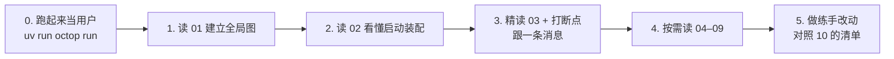

# Octop 学习与修改参考手册

> 基于 `main` 分支 `c8217c1a`（2026-09-27）的源码梳理。每篇都引用了 `file:line`，写作后用脚本校验过：引用的文件都存在，行号都在文件范围内，另外随机抽查了内容是否对得上。代码更新后行号会漂移，**以源码为准**，可以用函数名搜索定位。

## 目录

| 篇 | 主题 | 什么时候看 |
|---|---|---|
| [architecture.html](architecture.html) | **可视化架构大图**（浏览器直接打开，可导出 PNG/PDF）：分层、运行时组件、主链路 ①–⑥、持久化与外部依赖 | 想一眼看清全局时 |
| [01-architecture.md](01-architecture.md) | **整体架构**：系统上下文、分层与禁令、运行时对象图、外部库分工、入口汇合、数据分布、目录地图、名词表 | 第一篇，先建立全局图 |
| [02-boot-and-runtime.md](02-boot-and-runtime.md) | `octop run` → `OctopServer.start()` → `build_app` → uvicorn；配置、`~/.octop` 目录、依赖注入、设置向导、关闭顺序 | 要理解"进程里有什么"时 |
| [03-chat-flow.md](03-chat-flow.md) | **核心链路**：一条消息从 WS 到 harness 再回到前端的全过程；会话与 thread、HITL、IM/CLI/Cron/团队入口、落库 | **最重要**，改任何对话相关功能前必读 |
| [04-agents.md](04-agents.md) | AgentManager 生命周期、`_build_harness_config` 组装、provider、workspace/backend、memory、security、experts/plugins、teams | 改 Agent 能力或配置时 |
| [05-gateway.md](05-gateway.md) | Gateway、IM 渠道、session key、斜杠命令体系、IM 侧 HITL、媒体 | 改 IM 或斜杠命令时 |
| [06-data-layer.md](06-data-layer.md) | 连接池、迁移机制、repo 与 SharedServices、**完整表清单与 ER 图**（schema v18）、history 与 checkpoint、users | 改表或查数据时 |
| [07-api-layer.md](07-api-layer.md) | build_app、中间件顺序、请求生命周期、认证（JWT/OAuth/OIDC/邀请）、**路由总表**、错误码、i18n、时区、测试支撑 | 加接口、错误码、文案时 |
| [08-domains.md](08-domains.md) | cron、skills、connectors、knowledge、setup/TLS，以及 voice/proactive/mobile/desktop/backup/browser/utils 速览 | 改对应业务领域时 |
| [09-frontend-cli.md](09-frontend-cli.md) | dashboard 工程结构、**路由表**、request.ts、聊天页 chatStore；CLI 注册表、传输层、**命令总表** | 改前端或 CLI 时 |
| [10-dev-guide.md](10-dev-guide.md) | **修改速查**："我要改 X → 看哪篇哪节"、通用红线、跨模块陷阱、仓库文档与代码不符清单、疑似问题 | 每次动手改代码前 |

## 推荐学习路径

1. **跑起来**：`uv sync`、`uv run octop run`，打开 `http://127.0.0.1:8088`，配 Provider、建 Agent、聊天，试试 `/help`、定时任务和 Skills，先熟悉 01 §8 名词表里的概念。
2. **读 01 → 02**：能画出运行时对象图，说清楚 router 怎么拿到 `server` 和当前用户。
3. **精读 03，边读边调试**：在 `api/routers/chat/ws.py`、`infra/gateway/process/processor.py:885`、`infra/agents/manager.py` 的 `stream`、`.venv/.../octop_harness/agent.py` 打断点，从控制台发一条消息，一步步跟下去。
4. **按需读 04–09**：用到哪块读哪块。
5. **练手**：10 §6 第 1 条（cron `@every` 的 docstring 与实现不一致）、加一个 `/ping` 斜杠命令（05 §11.1）、加一个小 REST 端点（07 §11.1）。每次都跑 `make all`。

## 查看方式

文档里有 44 张 mermaid 图。在 VS Code 中安装 "Markdown Preview Mermaid Support" 扩展后可直接预览；JetBrains 的 Markdown 插件和 GitHub 也能原生渲染。

## 相关官方文档

`AGENTS.md`（开发规范，必读）、`docs/architecture.md`、`docs/api.md`、`docs/cli.md`、`docs/configuration.md`、`docs/adr/`。注意其中有几处已与代码不符，见 [10 §5](10-dev-guide.md)。
